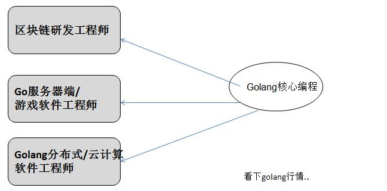

## 1.1 Golang 的学习方向

Go 语言，我们可以简单的写成Golang.



## 1.2 Golang 的应用领域

### 1.2.1 区块链的应用开发

区块链应用

区块链技术，简称 BT（Blockchain technology），也被称之为分布式账本技术，是一种互联网数据库技术，其特点是去中心化、公开透明，让每个人均可参与数据库记录。

配图书籍：《区块链与数字货币》（BLOCKCHAIN TECHNOLOGY）

### 1.2.2 后台的服务应用

后端服务器应用

**美团后台流量支撑程序**

支撑主站后台流量（排序，推荐，搜索等），提供负载均衡，cache，容错，按条件分流，统计运行指标（qps，latency）等功能 -> Golang

**仙侠道**

产品网址：仙侠道官网 - 心动游戏

应用范围：游戏服务端（通讯、逻辑、数据存储）

### 1.2.3 云计算/云服务后台应用

云计算/云服务后台应用

**盛大云 CDN（内容分发网络）**

网址：盛大云计算

应用范围：CDN 的调度系统、分发系统、监控系统、短域名服务，CDN 内部开放平台、运营报表系统以及其他一些小工具等

**京东消息推送云服务/京东分布式文件系统**

网址：京东云

应用范围：后台所有服务全部用 go 实现，golang 的计算能力强。

## 1.3 学习方法的介绍

我对学习 Go 编程方法的理解，希望我们能够达成共识：

1. 高效而愉快的学习
2. 先建立一个整体框架，然后细节
3. 在实际工作中，要培养用到什么，能够快速学习什么能力
4. 先 know how，再 know why【工科】
5. 软件编程是一门“做中学”的学科，不是会了再做，而是做了才会。
6. 适当的囫囵吞枣
7. 学习软件编程是在琢磨别人怎么做，而不是我认为应该怎么做的过程。

```go
for i := 0; i < 10; i++ {
	fmt.Println("hello,world")
}
```

## 1.4 讲课的方式的说明

1. 努力做到通俗易懂
2. 注重Go 语言体系，同时也兼顾技术细节
3. 在实际工作中，如何快速的掌握一个技术的分享，同时也是我们授课的思路(怎么讲解或者学习一个技术)。(很多学员反馈非常受用)


