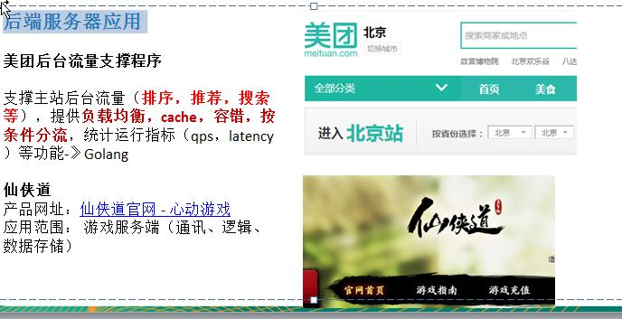
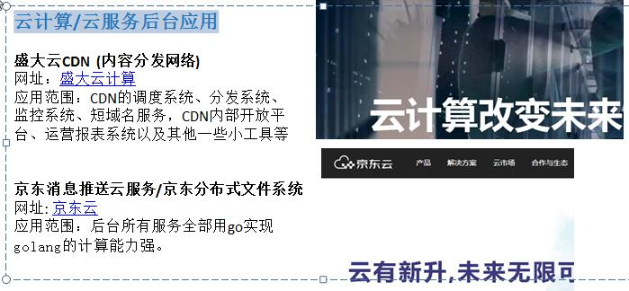
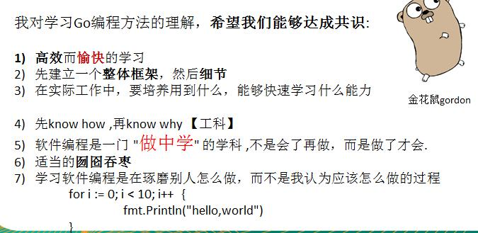
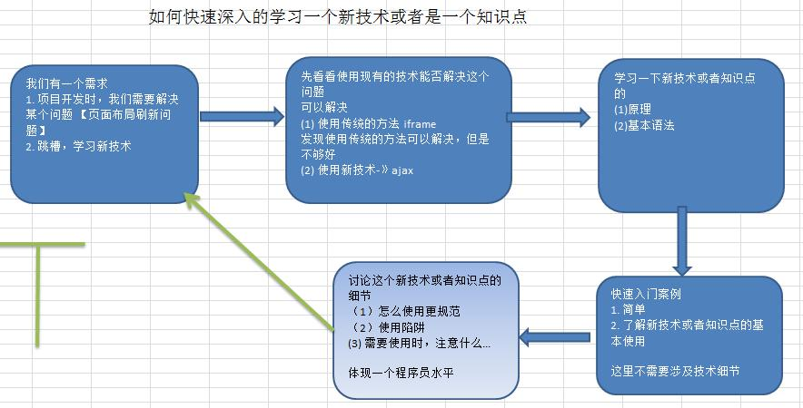

## 1.1 Golang 的学习方向

Go 语言，我们可以简单的写成Golang.

## 1.2 Golang 的应用领域

### 1.2.1 区块链的应用开发

### 1.2.2 后台的服务应用

### 1.2.3 云计算/云服务后台应用

## 1.3 学习方法的介绍

## 1.4 讲课的方式的说明

1. 努力做到通俗易懂
2. 注重Go 语言体系，同时也兼顾技术细节
3. 在实际工作中，如何快速的掌握一个技术的分享，同时也是我们授课的思路(怎么讲解或者学习一个技术)。(很多学员反馈非常受用)

