## 2.1 什么是程序

程序：就是完成某个功能的指令的集合。画一个图理解：

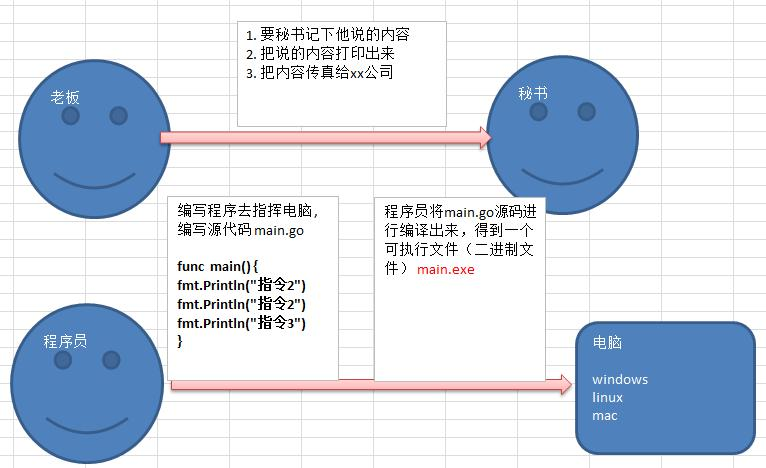


## 2.2 Go 语言的诞生小故事

### 2.2.1 Go 语言的核心开发团队-三个大牛


### 2.2.2 Google 创造Golang 的原因


### 2.2.3 Golang 的发展历程

- 2007 年，谷歌工程师Rob Pike, Ken Thompson 和Robert Griesemer 开始设计一门全新的语言，这是Go 语言的最初原型。
- 2009 年11 月10 日，Google 将Go 语言以开放源代码的方式向全球发布。
- 2015 年8 月19 日，Go 1.5 版发布，本次更新中移除了”最后残余的C 代码”
- 2017 年2 月17 日，Go 语言Go 1.8 版发布。
- 2017 年8 月24 日，Go 语言Go 1.9 版发布。1.9.2 版本
- 2018 年2 月16 日，Go 语言Go 1.10 版发布。

## 2.3 Golang 的语言的特点

- 简介：

Go 语言保证了既能到达静态编译语言的安全和性能，又达到了动态语言开发维护的高效率，使用一个表达式来形容Go 语言：Go = C + Python , 说明Go 语言既有C 静态语言程序的运行速度，又能达到Python 动态语言的快速开发。

1. 从C 语言中继承了很多理念，包括表达式语法，控制结构，基础数据类型，调用参数传值，指针等等，也保留了和C 语言一样的编译执行方式及弱化的指针

举一个案例(体验)：

```go
//go 语言的指针的使用特点(体验)
func testPtr(num *int) {
    *num = 20
}
```

2. 引入包的概念，用于组织程序结构，Go 语言的一个文件都要归属于一个包，而不能单独存在。


3. 垃圾回收机制，内存自动回收，不需开发人员管理
4. 天然并发(重要特点)

(1) 从语言层面支持并发，实现简单

(2) goroutine，轻量级线程，可实现大并发处理，高效利用多核。

(3) 基于CPS 并发模型(Communicating Sequential Processes )实现

5. 吸收了管道通信机制，形成Go 语言特有的管道channel 通过管道channel , 可以实现不同的goroute之间的相互通信。
6. 函数可以返回多个值。举例：

```go
//写一个函数，实现同时返回和，差
//go 函数支持返回多个值
func getSumAndSub(n1 int, n2 int) (int, int ) {
    sum := n1 + n2 //go 语句后面不要带分号.
    sub := n1 - n2
    return sum , sub
}
```

7. 新的创新：比如切片slice、延时执行defer

## 2.4 Golang 的开发工具的介绍

### 2.4.1 工具介绍

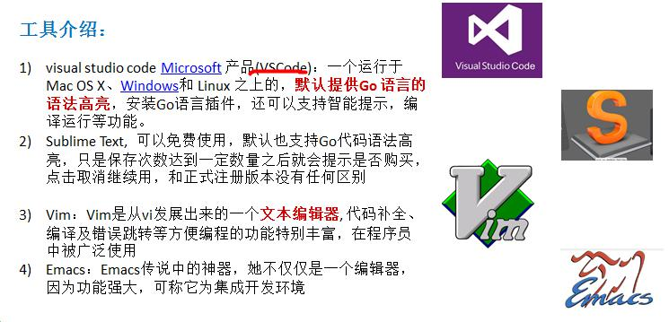


### 2.4.2 工具选择：

- 如何选择开发工具

我们先选择用visual studio code 或者vim 文本编辑器本，到大家对Go 语言有一定了解后，我们再使用Eclipse 等IDE 开发工具。

- 这是为什么呢?

1. 更深刻的理解Go 语言技术,培养代码感。->写代码的感觉。
2. 有利于公司面试。-> 给你纸，写程序

### 2.4.3 VSCode 的安装和使用

1. 先到下载地址去选择适合自己系统的VSCode 安装软件

https://code.visualstudio.com/download

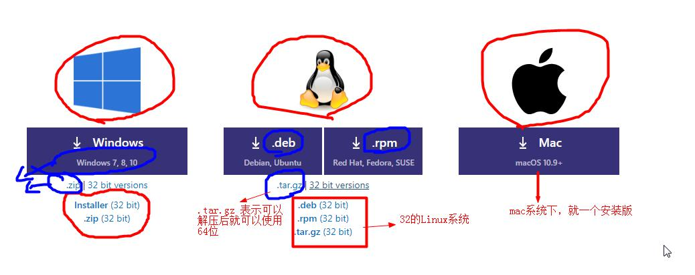

2. 演示如何在windows 下安装vscode 并使用

步骤1: 把vscode 安装文件准备好

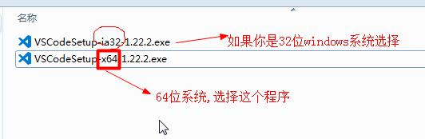

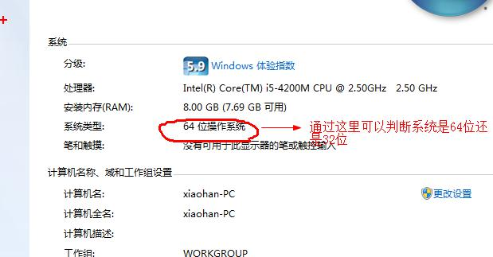

步骤2：双击安装文件，就可以一步一步安装，我个人的习惯是安装到d:/programs 目录.当看到如下界面时，就表示安装成功!

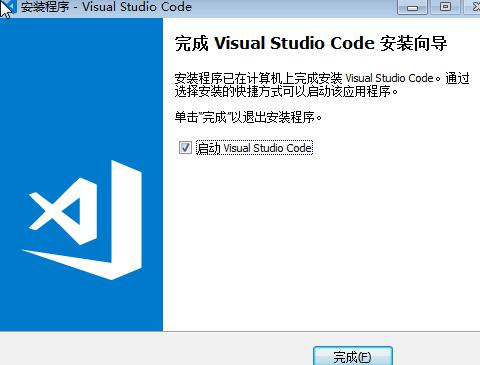

步骤3: 简单的使用一下vscode

在d 盘创建了一个文件夹gocode.

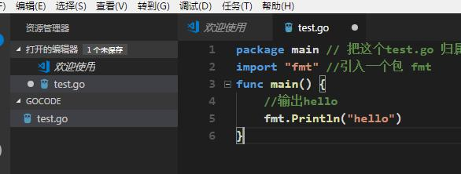

3. 演示如何在Linux(ubuntu /centos)下安装vscode 并使用

这里，我们介绍一下我的linux 的环境:

步骤1: 先下载linux 版本的vscode 安装软件.


步骤2: 因为我这里使用的是虚拟机的ubuntu, 因此我们需要先将vscode 安装软件传输到ubuntu下,使用的xftp5 软件上传。

步骤3: 如果你是在ubuntu 下做go 开发，我们建议将vscode 安装到/opt 目录..

步骤4：将安装软件拷贝到/opt

步骤5: cd /opt 【切换到/opt】

步骤6: 将安装文件解决即可

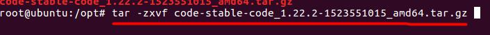

步骤7: 现在进入解压后的目录，即可运行我们的vscode


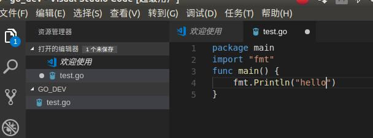

4. 演示如何在Mac 下安装vscode 并使用

如果你使用的就是mac 系统，也可以在该系统下进行go 开发.

步骤1：下载mac 版本的vscode 安装软件


步骤2：把vscode 安装软件，传输到mac 系统

细节: 在，默认情况下mac 没有启动ssh 服务，所以需要我们启动一下，才能远程传输文件. mac 本身安装了ssh 服务，默认情况下不会开机自启

1.启动sshd 服务：

```bash
sudo launchctl load -w /System/Library/LaunchDaemons/ssh.plist
```

2.停止sshd 服务：

```bash
sudo launchctl unload -w /System/Library/LaunchDaemons/ssh.plist
```

3 查看是否启动：

```bash
sudo launchctl list | grep ssh
```

如果看到下面的输出表示成功启动了：

－－－－－－－－－－－－－－

```text
- 0 com.openssh.sshd
```

步骤3：将安装软件解压后即可使用.


进入到这个解压后的文件夹(图形界面)，双击即可

步骤4：编写解简单测试.

在用户所在的目录，创建了gocode,然后将test.go 写到这个文件夹下..

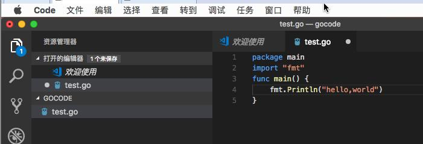

### 2.4.4 小结

我们会讲解在windows，linux , mac 如何安装vscode 开发工具，并且还会讲解如何在三个系统下安装go 的sdk 和如何开发go 程序。

但是为了学习方便，我们前期选择Windows 下开发go。到我们开始讲项目和将区块链时，就会使用linux 系统。

在实际开发中，也可以在windows 开发好程序，然后部署到linux 下。

## 2.5 Windows 下搭建Go 开发环境-安装和配置SDK

### 2.5.1 介绍了SDK

1. SDK 的全称(Software Development Kit 软件开发工具包)
2. SDK 是提供给开发人员使用的，其中包含了对应开发语言的工具包

### 2.5.2 下载SDK 工具包

1. Go 语言的官网为：golang.org , 因为各种原因，可能无法访问。
2. SDK 下载地址：Golang 中国 https://www.golangtc.com/download
3. 如何选择对应的sdk 版本


### 2.5.3 windows 下安装sdk

1. Windows 下SDK 的各个版本说明：

Windows 下：根据自己系统是32 位还是64 位进行下载：

32 位系统：go1.9.2.windows-386.zip

64 位系统：go1.9.2.windows-amd64.zip

2. 请注意：安装路径不要有中文或者特殊符号如空格等
3. SDK 安装目录建议：windows 一般我安装在d:/programs
4. 安装时，基本上是傻瓜式安装，解压就可以使用
5. 安装看老师的演示：
6. 解压后，我们会看到d:/go 目录，这个是sdk

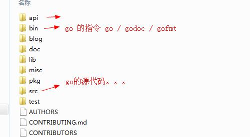

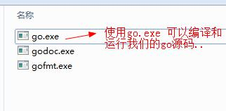

如何测试我们的go 的sdk 安装成功。


### 2.5.4 windows 下配置Golang 环境变量：

- 为什么需要配置环境变量

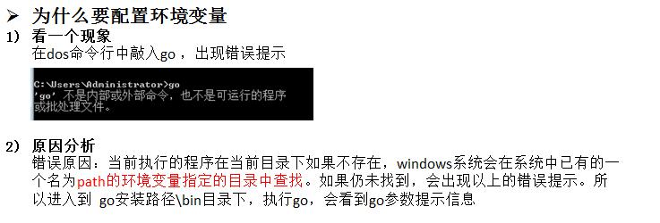

- 配置环境变量介绍

根据windows 系统在查找可执行程序的原理，可以将Go 所在路径定义到环境变量中，让系统帮我们去找运行执行的程序，这样在任何目录下都可以执行go 指令。

- 在Go 开发中，需要配置哪些环境变量


- 看老师如何配置

步骤1：先打开环境变量配置的界面

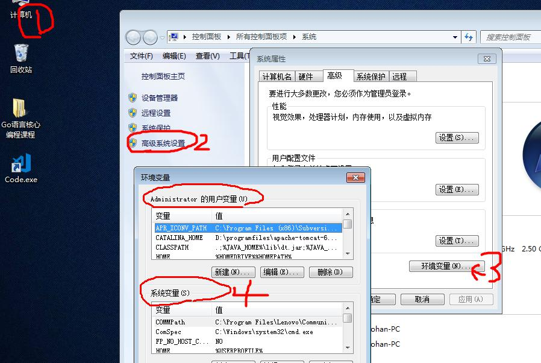

步骤2: 配置我们的环境变量

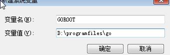

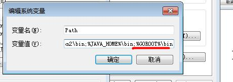

对上图的一个说明：

1. Path 这个环境变量不需要在创建，因为系统本身就有，你后面增加即可
2. 增加Go 的bin : ;%GOROOT%\bin


对上图的一个说明

1. GOPATH ：就是你以后go 项目存放的路径，即工作目录
2. GOPATH：是一个新建的环境变量

- 测试一下我们的环境变量是否配置ok

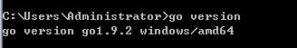

注意：配置环境变量后，需要重新打开一次dos 的终端，这样环境变量才会生效。

## 2.6 Linux 下搭建Go 开发环境-安装和配置SDK

### 2.6.1 Linux 下安装SDK：

1. Linux 下SDK 的各个版本说明：

Linux 下：根据系统是32 位还是64 位进行下载：

32 位系统：go1.9.2.linux-386.tar.gz

64 位系统：go1.9.2.linux-amd64.tar.gz

如何确认你的linux 是多少位：

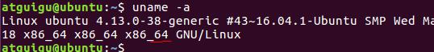

2. 请注意：安装路径不要有中文或者特殊符号如空格等
3. SDK 安装目录建议：linux 放在/opt 目录下
4. 安装时，解压即可，我们使用的是tar.gz
5. 看老师演示

步骤1: 将go1.9.2.linux-amd64.tar.gz 传输到ubuntu

步骤2: 将go1.9.2.linux-amd64.tar.gz 拷贝到/opt 下


步骤3: cd /opt

步骤4：tar -zxvf go1.9.2.linux-amd64.tar.gz [解压后，就可以看到一个go 目录]

步骤5: cd go/bin

步骤6：./go version


### 2.6.2 Linux 下配置Golang 环境变量

步骤1：使用root 的权限来编辑vim /etc/profile 文件

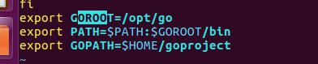

步骤2: 如果需要生效的话，需要注销一下(重新登录)，再使用


## 2.7 Mac 下搭建Go 开发环境-安装和配置SDK

### 2.7.1 mac 下安装Go 的sdk

1. Mac 下SDK 的各个版本说明：

Mac OS 下：只有64 位的软件安装包

Mac OS 系统的安装包：go1.9.2.darwin-amd64.tar.gz

2. 请注意：安装路径不要有中文或者特殊符号如空格等
3. SDK 安装目录建议：Mac 一般放在用户目录下go_dev/go 下
4. 安装时，解压即可
5. 看老师的演示步骤

步骤1：先将我们的安装文件go1.9.2.darwin-amd64.tar.gz 上传到mac

步骤2: 先在用户目录下，创建一个目录go_dev , 将我们上传的文件移动到go_dev 目录

步骤3：解压tar -zxvf go1.9.2.darwin-amd64.tar.gz

步骤4: 解压后，我们会得到一个目录go，进入到go/bin 就是可以使用


这里还是有一个问题，就是如果我们不做bin 目录下，就使用不了go 程序。因此我们仍然需要配置go的环境变量。

### 2.7.2 Mac 下配置Golang 环境变量：

步骤1：s 使用root 用户，修改/etc/profile 增加环境变量的配置

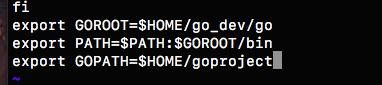

步骤2: 配置完后，需要重新注销用户，配置才会生效.

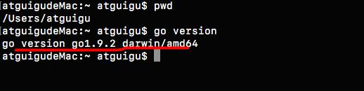

## 2.8 Go 语言快速开发入门

### 2.8.1 需求

要求开发一个hello.go 程序，可以输出 "hello,world”

### 2.8.2 开发的步骤

1. 开发这个程序/项目时，go 的目录结构怎么处理.

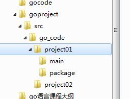

2. 代码如下：

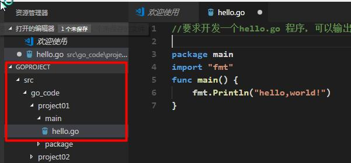

对上图的说明

(1) go 文件的后缀是.go

(2) package main

表示该hello.go 文件所在的包是main, 在go 中，每个文件都必须归属于一个包。

(3) import “fmt”

表示：引入一个包，包名fmt, 引入该包后，就可以使用fmt 包的函数，比如：fmt.Println

(4) func main() {

```text
        }
```

func 是一个关键字，表示一个函数。

main 是函数名，是一个主函数，即我们程序的入口。

(5) fmt.Println(“hello”)

表示调用fmt 包的函数Println 输出“hello,world”

3. 通过go build 命令对该go 文件进行编译，生成.exe 文件.

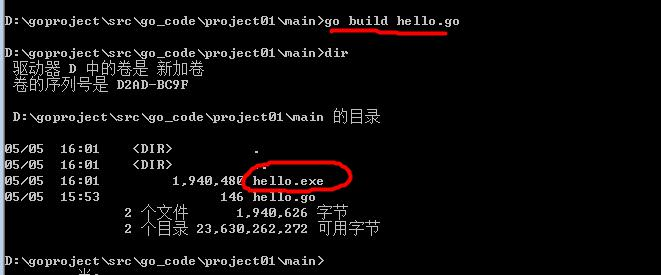

4. 运行hello.exe 文件即可

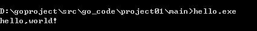

5. 注意：通过go run 命令可以直接运行hello.go 程序[类似执行一个脚本文件的形式]

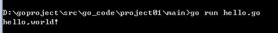

### 2.8.3 linux 下如何开发Go 程序

说明：linux 下开发go 和windows 开发基本是一样的。只是在运行可执行的程序时，是以./文件名方式

演示: 在linux 下开发Go 程序。


编译和运行hello.go

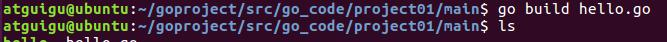


也可以直接使用go run hello.go 方式运行


### 2.8.4 Mac 下如何开发Go 程序

- 说明：在mac 下开发go 程序和windows 基本一样。
- 演示一下：如何在mac 下开发一个hello.go 程序
- 源代码的编写：hello.go


- 编译再运行，直接go run 来运行

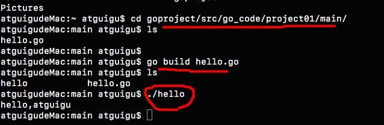

- 直接go run 来运行


### 2.8.5 go 语言的快速入门的课堂练习

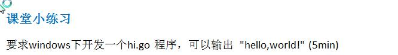

### 2.8.6 Golang 执行流程分析

- 如果是对源码编译后，再执行，Go 的执行流程如下图


- 如果我们是对源码直接执行go run 源码，Go 的执行流程如下图

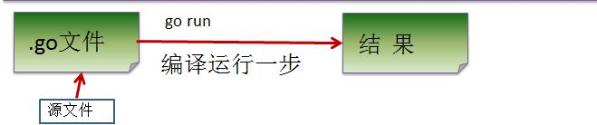

- 两种执行流程的方式区别

1. 如果我们先编译生成了可执行文件，那么我们可以将该可执行文件拷贝到没有go 开发环境的机器上，仍然可以运行
2. 如果我们是直接go run go 源代码，那么如果要在另外一个机器上这么运行，也需要go 开发环境，否则无法执行。
3. 在编译时，编译器会将程序运行依赖的库文件包含在可执行文件中，所以，可执行文件变大了很多。

### 2.8.7 编译和运行说明

1. 有了go 源文件，通过编译器将其编译成机器可以识别的二进制码文件。
2. 在该源文件目录下，通过go build 对hello.go 文件进行编译。可以指定生成的可执行文件名，在windows 下必须是.exe 后缀。

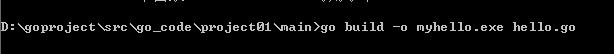

3. 如果程序没有错误，没有任何提示，会在当前目录下会出现一个可执行文件(windows 下是.exe

Linux 下是一个可执行文件)，该文件是二进制码文件，也是可以执行的程序。

4. 如果程序有错误，编译时，会在错误的那行报错。有助于程序员调试错误.

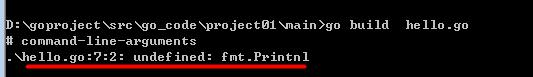

5. 运行有两种形式

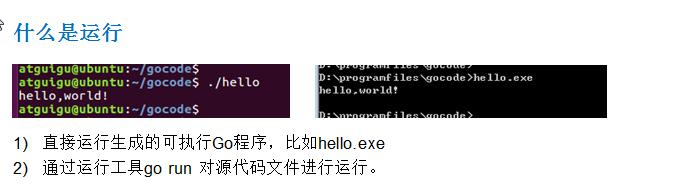

### 2.8.8 Go 程序开发的注意事项

1. Go 源文件以"go" 为扩展名。
2. Go 应用程序的执行入口是main()函数。这个是和其它编程语言（比如java/c）
3. Go 语言严格区分大小写。
4. Go 方法由一条条语句构成，每个语句后不需要分号(Go 语言会在每行后自动加分号)，这也体

现出Golang 的简洁性。

5. Go 编译器是一行行进行编译的，因此我们一行就写一条语句，不能把多条语句写在同一个，否则报错

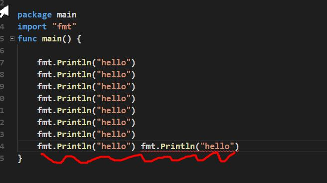

6. go 语言定义的变量或者import 的包如果没有使用到，代码不能编译通过。

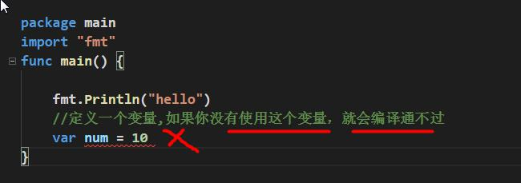

7. 大括号都是成对出现的，缺一不可。

## 2.9 Go 语言的转义字符(escape char)

说明:常用的转义字符有如下:

1. \t : 表示一个制表符，通常使用它可以排版。


2. \n ：换行符
3. \\ ：一个\
4. \" ：一个"
5. \r ：一个回车 fmt.Println("天龙八部雪山飞狐\r 张飞");
6. 案例截图

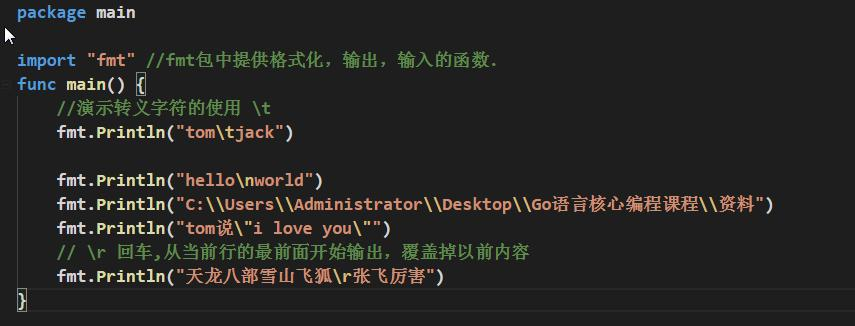

- 课堂练习


```text
5min
```

作业评讲：

```go
package main
import "fmt" //fmt 包中提供格式化，输出，输入的函数.
func main() {
    //要求：要求：请使用一句输出语句，达到输入如下图形的效果
    fmt.Println("姓名\t 年龄\t 籍贯\t 地址\njohn\t20\t 河北\t 北京")
}
```

## 2.10 Golang 开发常见问题和解决方法

### 2.10.1 文件名或者路径错误

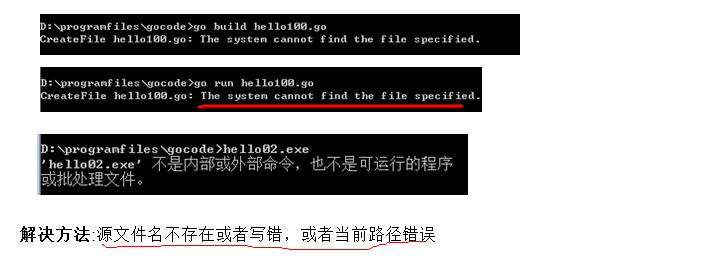

### 2.10.2 小结和提示

学习编程最容易犯的错是语法错误。Go 要求你必须按照语法规则编写代码。如果你的程序违反了语法规则，例如：忘记了大括号、引号，或者拼错了单词，Go 编译器都会报语法错误，要求：尝试

着去看懂编译器会报告的错误信息。

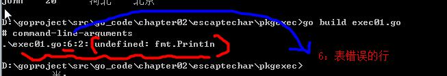

## 2.11 注释(comment)

### 2.11.1 介绍注释

用于注解说明解释程序的文字就是注释，注释提高了代码的阅读性；

注释是一个程序员必须要具有的良好编程习惯。将自己的思想通过注释先整理出来，再用代码去体现。

### 2.11.2 在Golang 中注释有两种形式

1. 行注释

- 基本语法

```text
// 注释内容
```

- 举例

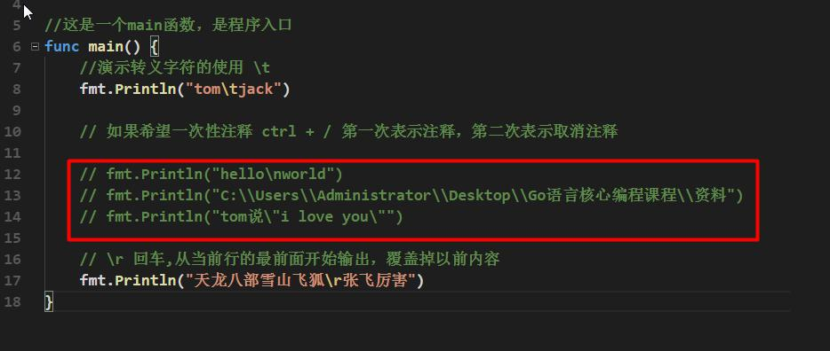

2. 块注释(多行注释)

- 基本语法

```text
/*
注释内容
*/
```

- 举例说明

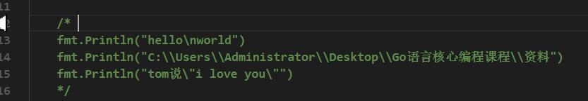

- 使用细节

1. 对于行注释和块注释，被注释的文字，不会被Go 编译器执行。
2. 块注释里面不允许有块注释嵌套[注意一下]

## 2.12 规范的代码风格

### 2.12.1 正确的注释和注释风格：

1. Go 官方推荐使用行注释来注释整个方法和语句。
2. 带看Go 源码

### 2.12.2 正确的缩进和空白

1. 使用一次tab 操作，实现缩进,默认整体向右边移动，时候用shift+tab 整体向左移看老师的演示：
2. 或者使用gofmt 来进行格式化[演示]

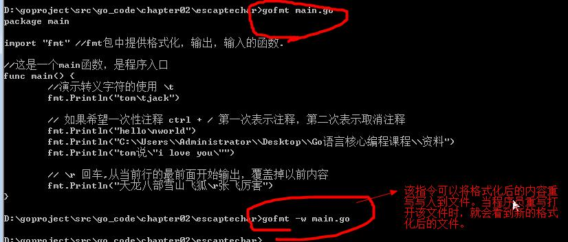

3. 运算符两边习惯性各加一个空格。比如：2 + 4 * 5。

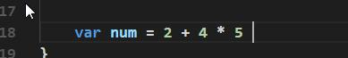

4. Go 语言的代码风格.

```go
package main
import "fmt"
func main() {
    fmt.Println("hello,world!")
}
```

上面的写法是正确的.

```go
package main
import "fmt"
func main()
{
    fmt.Println("hello,world!")
}
```

上面的写法不是正确，Go 语言不允许这样编写。【Go 语言不允许这样写，是错误的！】Go 设计者思想: 一个问题尽量只有一个解决方法

5. 一行最长不超过80 个字符，超过的请使用换行展示，尽量保持格式优雅

- 举例说明

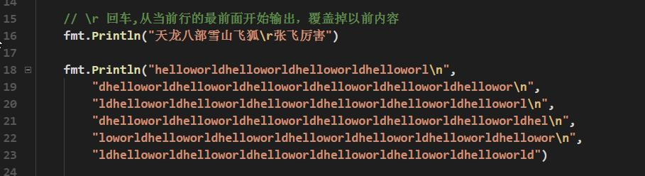

## 2.13 Golang 官方编程指南

- 说明：Golang 官方网站https://golang.org

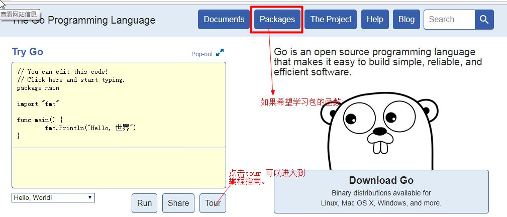

- 点击上图的tour -> 选择简体中文就可以进入中文版的Go 编程指南。

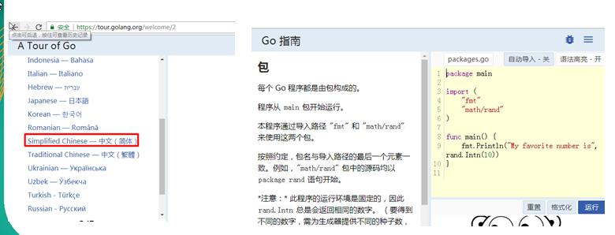

- Golang 官方标准库API 文档，https://golang.org/pkg可以查看Golang 所有包下的函数和使用


- 解释术语：API

api ：application program interface :应用程序编程接口。

就是我们Go 的各个包的各个函数。

## 2.14 Golang 标准库API 文档

1. API （Application Programming Interface,应用程序编程接口）是Golang 提供的基本编程接口。
2. Go 语言提供了大量的标准库，因此google 公司也为这些标准库提供了相应的API 文档，用于告诉开发者如何使用这些标准库，以及标准库包含的方法。
3. Golang 中文网在线标准库文档：https://studygolang.com/pkgdoc
4. Golang 的包和源文件和函数的关系简图

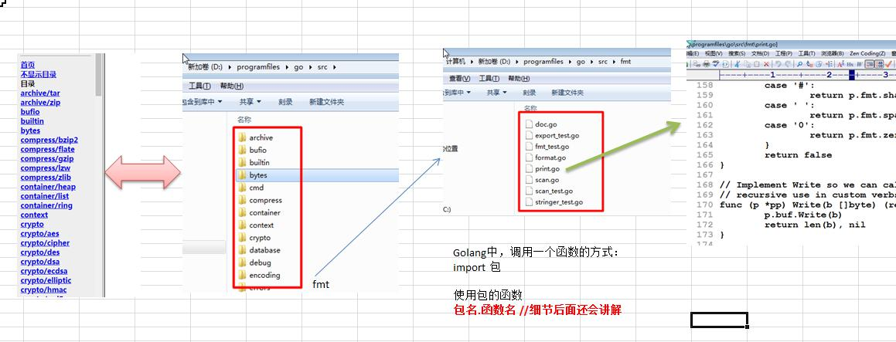

5. 有一个离线版的Golang_Manual_By_AstaXie_20120522.chm

## 2.15 Dos 的常用指令(了解)

### 2.15.1 dos 的基本介绍

Dos：Disk Operating System 磁盘操作系统, 简单说一下windows 的目录结构

### 2.15.2 dos 的基本操作原理

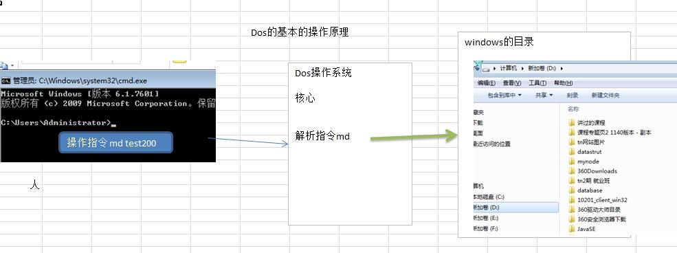

### 2.15.3 目录操作指令

- 查看当前目录是什么

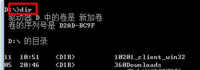

- 切换到其他盘下：盘符号F 盘

案例演示：

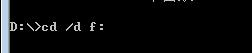

- 切换到当前盘的其他目录下(使用相对路径和绝对路径演示)

案例演示：

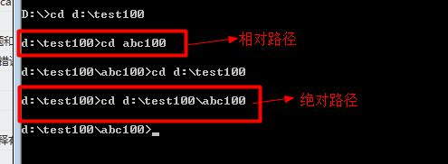

- 切换到上一级：

案例演示：


- 切换到根目录：

案例演示：


- 新建目录md （make directory）

新建一个目录：


新建多个目录：


- 删除目录

删除空目录


删除目录以及下面的子目录和文件，不带询问


删除目录以及下面的子目录和文件，带询问


### 2.15.4 文件的操作

- 新建或追加内容到文件

案例演示：


- 复制或移动文件

复制


移动


- 删除文件

删除指定文件


删除所有文件


### 2.15.5 其它指令

- 清屏

cls [苍老师]

- 退出dos

```text
exit
```

### 2.15.6 综合案例


## 2.16 课后练习题的评讲

1. 独立编写Hello,Golang!程序[评讲]


2. 将个人的基本信息（姓名、性别、籍贯、住址）打印到终端上输出。各条信息分别占一行


3. 在终端打印出如下图所示的效果


## 2.17 本章的知识回顾

- Go 语言的SDK 是什么?

SDK 就是软件开发工具包。我们做Go 开发，首先需要先安装并配置好sdk.

- Golang 环境变量配置及其作用。

GOROOT: 指定go sdk 安装目录。

Path: 指令sdk\bin 目录：go.exe godoc.exe gofmt.exe

GOPATH: 就是golang 工作目录：我们的所有项目的源码都这个目录下。

- Golang 程序的编写、编译、运行步骤是什么? 能否一步执行?

编写：就是写源码

编译：go build 源码=》生成一个二进制的可执行文件

运行：1. 对可执行文件运行xx.exe ./可执行文件 2. go run 源码

- Golang 程序编写的规则。

1. go 文件的后缀.go
2. go 程序区分大小写
3. go 的语句后，不需要带分号
4. go 定义的变量，或者import 包，必须使用，如果没有使用就会报错
5. go 中，不要把多条语句放在同一行。否则报错
6. go 中的大括号成对出现，而且风格

```go
func main() {
    //语句
}
```

- 简述：在配置环境、编译、运行各个步骤中常见的错误

对初学者而言，最容易错的地方拼写错误。比如文件名，路径错误。拼写错误
