## 3.1 为什么需要变量

### 3.1.1 一个程序就是一个世界


### 3.1.2 变量是程序的基本组成单位

不论是使用哪种高级程序语言编写程序,变量都是其程序的基本组成单位，比如一个示意图：

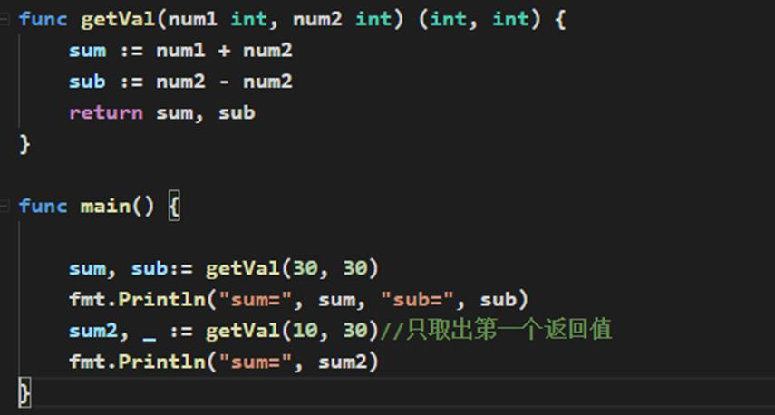

比如上图的sum,sub 都是变量。

## 3.2 变量的介绍

### 3.2.1 变量的概念

变量相当于内存中一个数据存储空间的表示，你可以把变量看做是一个房间的门牌号，通过门牌号我们可以找到房间，同样的道理，通过变量名可以访问到变量(值)。

### 3.2.2 变量的使用步骤

1. 声明变量(也叫:定义变量)
2. 非变量赋值
3. 使用变量

## 3.3 变量快速入门案例

看一个案例：

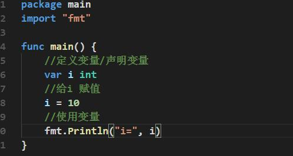

输出：


## 3.4 变量使用注意事项

1. 变量表示内存中的一个存储区域
2. 该区域有自己的名称（变量名）和类型（数据类型）

示意图：

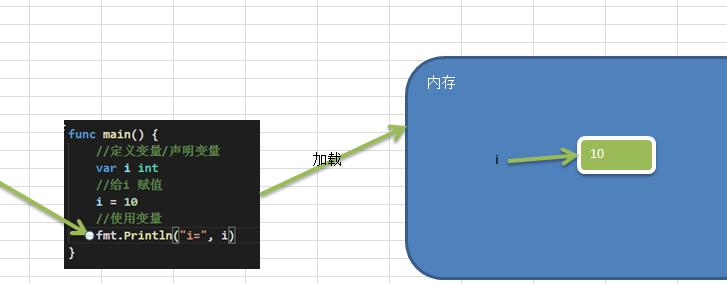

3. Golang 变量使用的三种方式

(1) 第一种：指定变量类型，声明后若不赋值，使用默认值


(2) 第二种：根据值自行判定变量类型(类型推导)

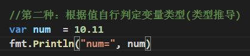

(3) 第三种：省略var, 注意:=左侧的变量不应该是已经声明过的，否则会导致编译错误

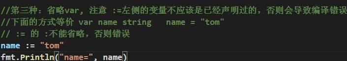

4. 多变量声明

在编程中，有时我们需要一次性声明多个变量，Golang 也提供这样的语法

举例说明:

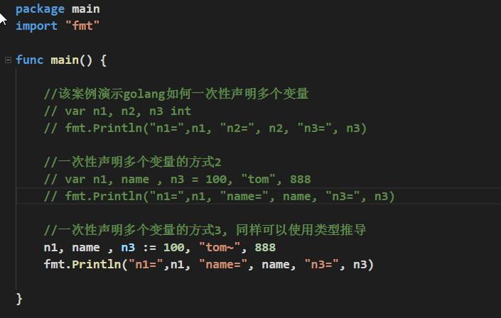

如何一次性声明多个全局变量【在go 中函数外部定义变量就是全局变量】：

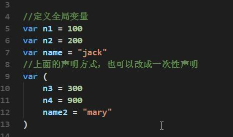

5. 该区域的数据值可以在同一类型范围内不断变化(重点)

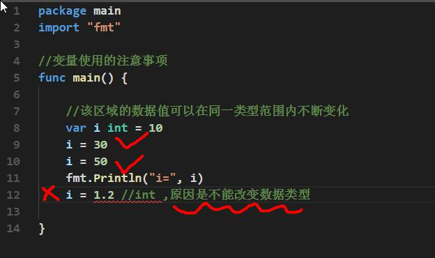

6. 变量在同一个作用域(在一个函数或者在代码块)内不能重名

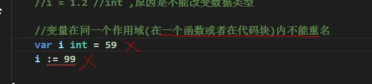

7. 变量=变量名+值+数据类型，这一点请大家注意，变量的三要素
8. Golang 的变量如果没有赋初值，编译器会使用默认值, 比如int 默认值0 string 默认值为空串，

小数默认为0

## 3.5 变量的声明，初始化和赋值

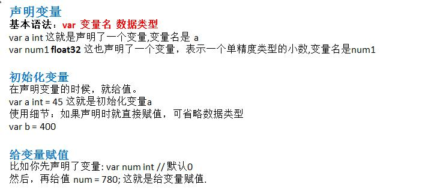

## 3.6 程序中+号的使用

1. 当左右两边都是数值型时，则做加法运算
2. 当左右两边都是字符串，则做字符串拼接

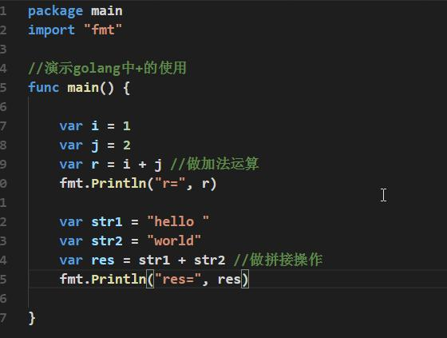

## 3.7 数据类型的基本介绍

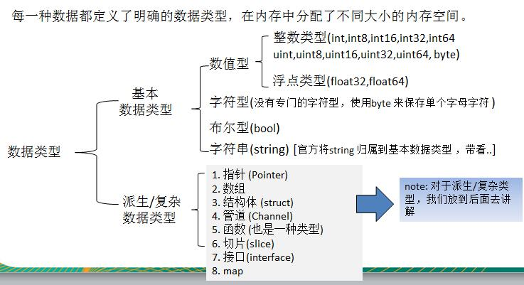

## 3.8 整数类型

### 3.8.1 基本介绍

简单的说，就是用于存放整数值的，比如0, -1, 2345 等等。

### 3.8.2 案例演示

### 3.8.3 整数的各个类型

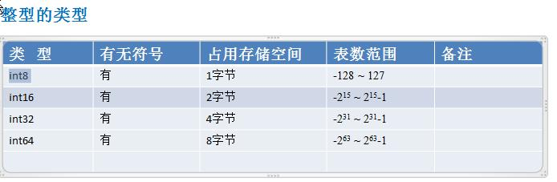


int 的无符号的类型：

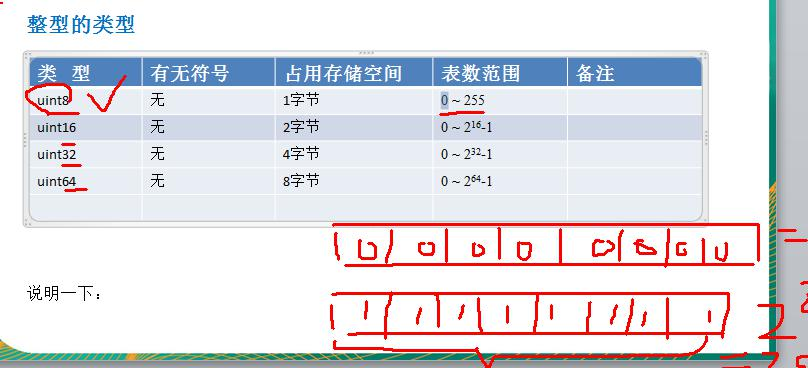

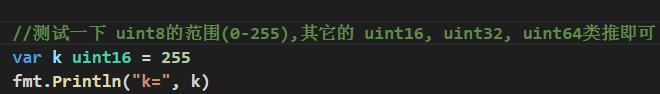

int 的其它类型的说明:

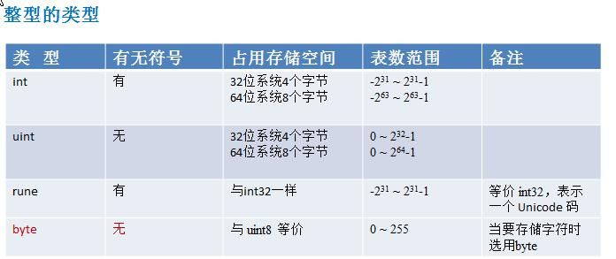

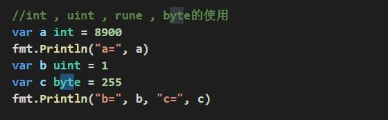

### 3.8.4 整型的使用细节

1. Golang 各整数类型分：有符号和无符号，int uint 的大小和系统有关。
2. Golang 的整型默认声明为int 型

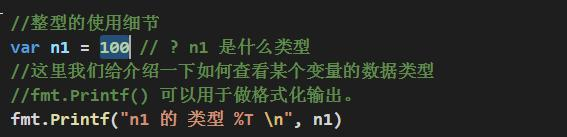

3. 如何在程序查看某个变量的字节大小和数据类型（使用较多）

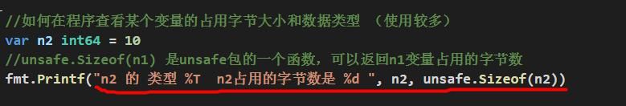

4. Golang 程序中整型变量在使用时，遵守保小不保大的原则，即：在保证程序正确运行下，尽量使用占用空间小的数据类型。【如：年龄】

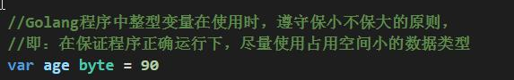

5. bit: 计算机中的最小存储单位。byte:计算机中基本存储单元。[二进制再详细说] 1byte = 8 bit

## 3.9 小数类型/浮点型

### 3.9.1 基本介绍

小数类型就是用于存放小数的，比如1.2 0.23 -1.911

### 3.9.2 案例演示

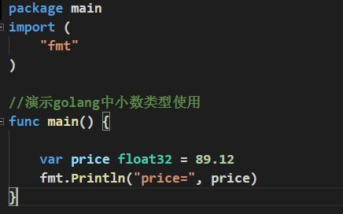

### 3.9.3 小数类型分类

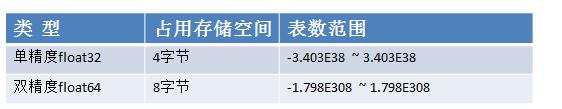

对上图的说明:

1. 关于浮点数在机器中存放形式的简单说明,浮点数=符号位+指数位+尾数位

说明：浮点数都是有符号的.

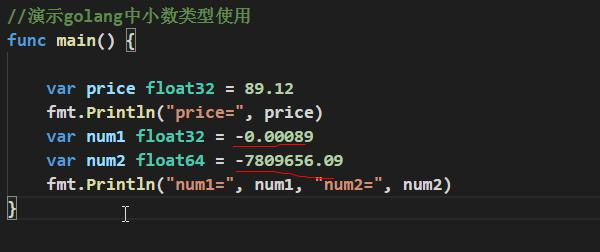

2. 尾数部分可能丢失，造成精度损失。-123.0000901

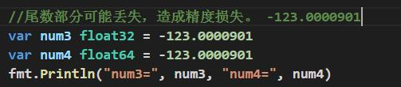

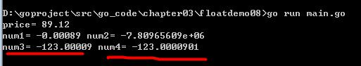

说明：float64 的精度比float32 的要准确.

说明：如果我们要保存一个精度高的数，则应该选用float64

3. 浮点型的存储分为三部分：符号位+指数位+尾数位在存储过程中，精度会有丢失

### 3.9.4 浮点型使用细节

1. Golang 浮点类型有固定的范围和字段长度，不受具体OS(操作系统)的影响。
2. Golang 的浮点型默认声明为float64 类型。

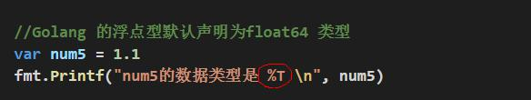

3. 浮点型常量有两种表示形式

十进制数形式：如：5.12

.512 (必须有小数点）

科学计数法形式:如：5.1234e2 = 5.12 * 10 的2 次方 5.12E-2 = 5.12/10 的2 次方

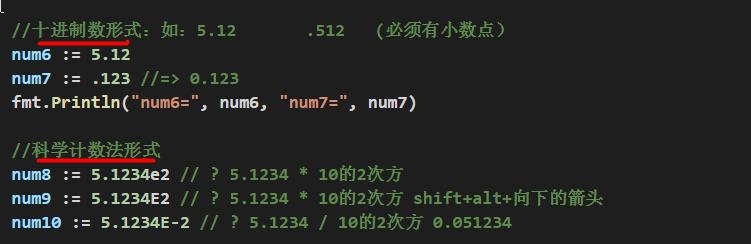

4. 通常情况下，应该使用float64 ，因为它比float32 更精确。[开发中，推荐使用float64]

## 3.10 字符类型

### 3.10.1 基本介绍

Golang 中没有专门的字符类型，如果要存储单个字符(字母)，一般使用byte 来保存。

字符串就是一串固定长度的字符连接起来的字符序列。Go 的字符串是由单个字节连接起来的。也就是说对于传统的字符串是由字符组成的，而Go 的字符串不同，它是由字节组成的。

### 3.10.2 案例演示

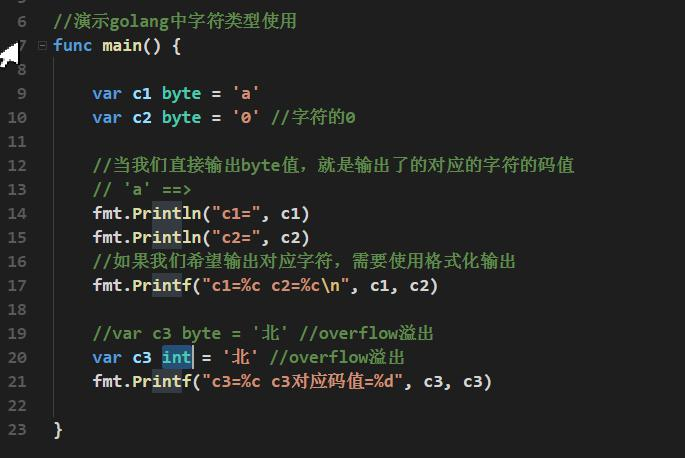

对上面代码说明

1. 如果我们保存的字符在ASCII 表的,比如[0-1, a-z,A-Z..]直接可以保存到byte
2. 如果我们保存的字符对应码值大于255,这时我们可以考虑使用int 类型保存
3. 如果我们需要安装字符的方式输出，这时我们需要格式化输出，即fmt.Printf(“%c”, c1)..

### 3.10.3 字符类型使用细节

1. 字符常量是用单引号('')括起来的单个字符。例如：var c1 byte = 'a' var c2 int = '中' var c3

```text
byte = '9'
```

2. Go 中允许使用转义字符'\’来将其后的字符转变为特殊字符型常量。例如：var c3 char = ‘\n’

```text
// '\n'表示换行符
```

3. Go 语言的字符使用UTF-8 编码 ，如果想查询字符对应的utf8 码值 http://www.mytju.com/classcode/tools/encode_utf8.asp

英文字母-1 个字节 汉字-3 个字节

4. 在Go 中，字符的本质是一个整数，直接输出时，是该字符对应的UTF-8 编码的码值。
5. 可以直接给某个变量赋一个数字，然后按格式化输出时%c，会输出该数字对应的unicode 字符

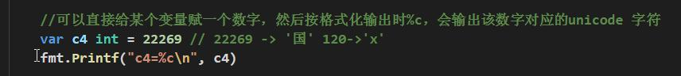

6. 字符类型是可以进行运算的，相当于一个整数，因为它都对应有Unicode 码.

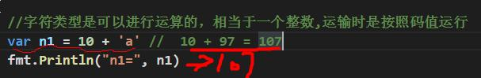

### 3.10.4 字符类型本质探讨

1. 字符型存储到计算机中，需要将字符对应的码值（整数）找出来

存储：字符--->对应码值---->二进制-->存储

读取：二进制----> 码值----> 字符--> 读取

2. 字符和码值的对应关系是通过字符编码表决定的(是规定好)
3. Go 语言的编码都统一成了utf-8。非常的方便，很统一，再也没有编码乱码的困扰了

## 3.11 布尔类型

### 3.11.1 基本介绍

1. 布尔类型也叫bool 类型，bool 类型数据只允许取值true 和false
2. bool 类型占1 个字节。
3. bool 类型适于逻辑运算，一般用于程序流程控制[注：这个后面会详细介绍]：

- if 条件控制语句；
- for 循环控制语句

### 3.11.2 案例演示

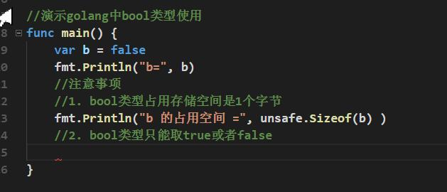

## 3.12 string 类型

### 3.12.1 基本介绍

字符串就是一串固定长度的字符连接起来的字符序列。Go 的字符串是由单个字节连接起来的。Go语言的字符串的字节使用UTF-8 编码标识Unicode 文本

### 3.12.2 案例演示

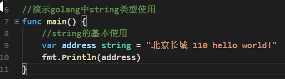

### 3.12.3 string 使用注意事项和细节

1. Go 语言的字符串的字节使用UTF-8 编码标识Unicode 文本，这样Golang 统一使用UTF-8 编码,中文乱码问题不会再困扰程序员。
2. 字符串一旦赋值了，字符串就不能修改了：在Go 中字符串是不可变的。

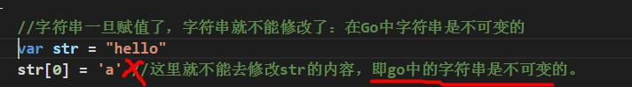

3. 字符串的两种表示形式

(1) 双引号, 会识别转义字符

(2) 反引号，以字符串的原生形式输出，包括换行和特殊字符，可以实现防止攻击、输出源代码等效果【案例演示】

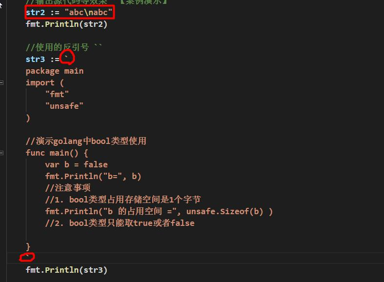

4. 字符串拼接方式

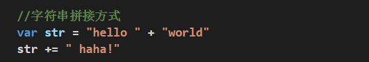

5. 当一行字符串太长时，需要使用到多行字符串，可以如下处理

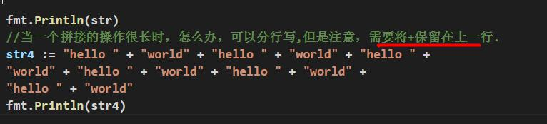

## 3.13 基本数据类型的默认值

### 3.13.1 基本介绍

在go 中，数据类型都有一个默认值，当程序员没有赋值时，就会保留默认值，在go 中，默认值又叫零值。

### 3.13.2 基本数据类型的默认值如下

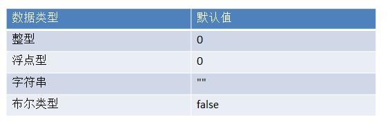

案例:

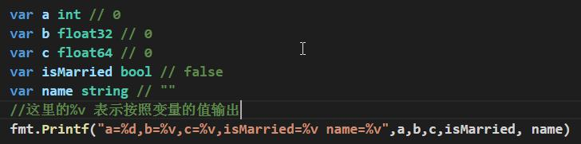

## 3.14 基本数据类型的相互转换

### 3.14.1 基本介绍

Golang 和java / c 不同，Go 在不同类型的变量之间赋值时需要显式转换。也就是说Golang 中数据类型不能自动转换。

### 3.14.2 基本语法

表达式T(v) 将值v 转换为类型T

T: 就是数据类型，比如int32，int64，float32 等等

v: 就是需要转换的变量

### 3.14.3 案例演示

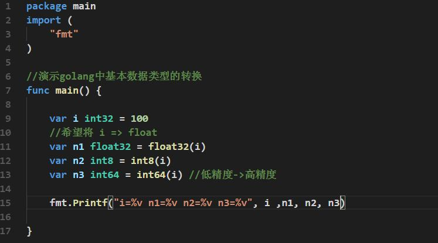

### 3.14.4 基本数据类型相互转换的注意事项

1. Go 中，数据类型的转换可以是从表示范围小-->表示范围大，也可以范围大--->范围小
2. 被转换的是变量存储的数据(即值)，变量本身的数据类型并没有变化！

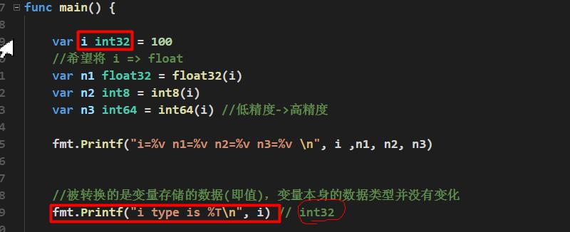

3. 在转换中，比如将int64 转成int8 【-128---127】，编译时不会报错，只是转换的结果是按溢出处理，和我们希望的结果不一样。因此在转换时，需要考虑范围.

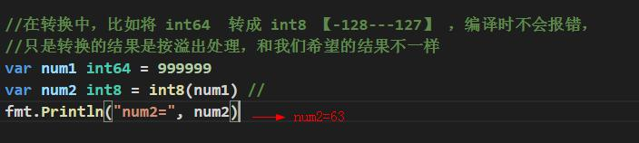

### 3.14.5 课堂练习

- 练习1

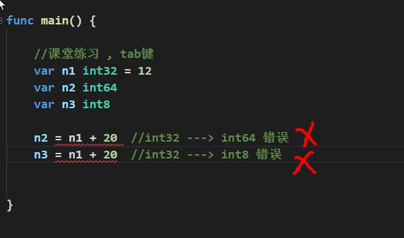

如何修改上面的代码，就可以正确.

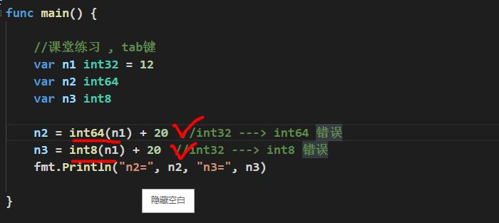

- 练习2

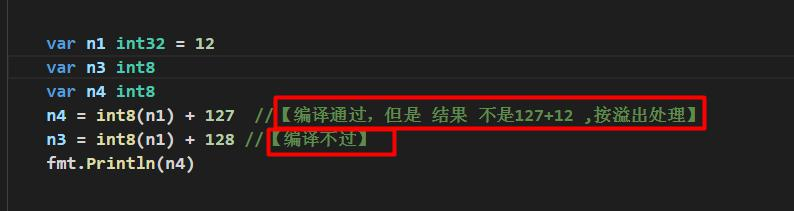

## 3.15 基本数据类型和string 的转换

### 3.15.1 基本介绍

在程序开发中，我们经常将基本数据类型转成string,或者将string 转成基本数据类型。

### 3.15.2 基本类型转string 类型

- 方式1：fmt.Sprintf("%参数",表达式)【个人习惯这个，灵活】

函数的介绍：

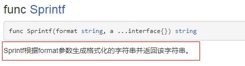

参数需要和表达式的数据类型相匹配

```go
fmt.Sprintf().. 会返回转换后的字符串
```

- 案例演示

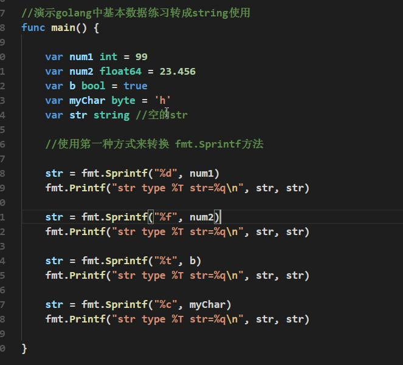

- 方式2：使用strconv 包的函数

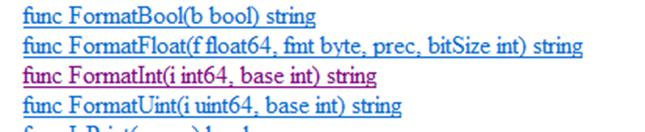

- 案例说明

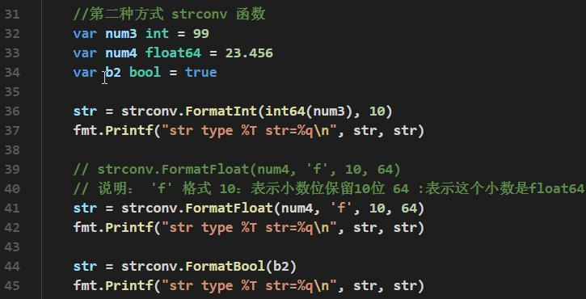

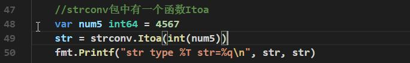

### 3.15.3 string 类型转基本数据类型

- 使用时strconv 包的函数

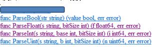

- 案例演示


- 说明一下


### 3.15.4 string 转基本数据类型的注意事项

在将String 类型转成基本数据类型时，要确保String 类型能够转成有效的数据，比如我们可以把"123" , 转成一个整数，但是不能把"hello" 转成一个整数，如果这样做，Golang 直接将其转成0 ，其它类型也是一样的道理. float => 0 bool => false

案例说明：


## 3.16 指针

### 3.16.1 基本介绍

1. 基本数据类型，变量存的就是值，也叫值类型
2. 获取变量的地址，用&，比如：var num int, 获取num 的地址：&num

分析一下基本数据类型在内存的布局.


3. 指针类型，指针变量存的是一个地址，这个地址指向的空间存的才是值

比如：var ptr *int = &num

举例说明：指针在内存的布局.


4. 获取指针类型所指向的值，使用：*，比如：var ptr *int, 使用*ptr 获取ptr 指向的值


5. 一个案例再说明


### 3.16.2 案例演示

1. 写一个程序，获取一个int 变量num 的地址，并显示到终端
2. 将num 的地址赋给指针ptr , 并通过ptr 去修改num 的值.


### 3.16.3 指针的课堂练习


### 3.16.4 指针的使用细节

1. 值类型，都有对应的指针类型，形式为 *数据类型，比如int 的对应的指针就是*int, float32对应的指针类型就是 *float32, 依次类推。
2. 值类型包括：基本数据类型int 系列, float 系列, bool, string 、数组和结构体struct

## 3.17 值类型和引用类型

### 3.17.1 值类型和引用类型的说明

1. 值类型：基本数据类型int 系列, float 系列, bool, string 、数组和结构体struct
2. 引用类型：指针、slice 切片、map、管道chan、interface 等都是引用类型

### 3.17.2 值类型和引用类型的使用特点

1. 值类型：变量直接存储值，内存通常在栈中分配

示意图：


2. 引用类型：变量存储的是一个地址，这个地址对应的空间才真正存储数据(值)，内存通常在堆上分配，当没有任何变量引用这个地址时，该地址对应的数据空间就成为一个垃圾，由GC 来回收

示意图：


3. 内存的栈区和堆区示意图


## 3.18 标识符的命名规范

### 3.18.1 标识符概念

1. Golang 对各种变量、方法、函数等命名时使用的字符序列称为标识符
2. 凡是自己可以起名字的地方都叫标识符

### 3.18.2 标识符的命名规则

1. 由26 个英文字母大小写，0-9 ，_ 组成
2. 数字不可以开头。var num int //ok var 3num int //error
3. Golang 中严格区分大小写。

```text
    var num int
    var Num int
```

说明：在golang 中，num 和Num 是两个不同的变量

4. 标识符不能包含空格。


5. 下划线"_"本身在Go 中是一个特殊的标识符，称为空标识符。可以代表任何其它的标识符，但是它对应的值会被忽略(比如：忽略某个返回值)。所以仅能被作为占位符使用，不能作为标识符使用


6. 不能以系统保留关键字作为标识符（一共有25 个），比如break，if 等等...

### 3.18.3 标识符的案例

```text
    hello // ok
    hello12 //ok
    1hello // error ,不能以数字开头
    h-b // error ,不能使用-
    x h // error, 不能含有空格
    h_4 // ok
    _ab // ok
```

int // ok , 我们要求大家不要这样使用

float32 // ok , 我们要求大家不要这样使用

```text
    _ // error
    Abc // ok
```

### 3.18.4 标识符命名注意事项

1. 包名：保持package 的名字和目录保持一致，尽量采取有意义的包名，简短，有意义，不要和标准库不要冲突fmt


2. 变量名、函数名、常量名：采用驼峰法

举例：

```text
    var stuName string = “tom” 形式: xxxYyyyyZzzz ...
    var goodPrice float32 = 1234.5
```

3. 如果变量名、函数名、常量名首字母大写，则可以被其他的包访问；如果首字母小写，则只能在本包中使用( 注：可以简单的理解成，首字母大写是公开的，首字母小写是私有的) ,在golang 没有public , private 等关键字。

案例演示：


## 3.19 系统保留关键字


## 3.20 系统的预定义标识符


