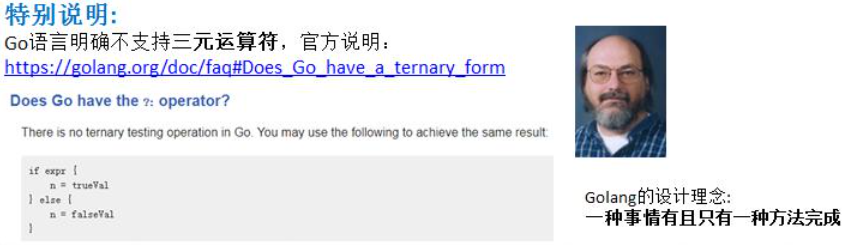
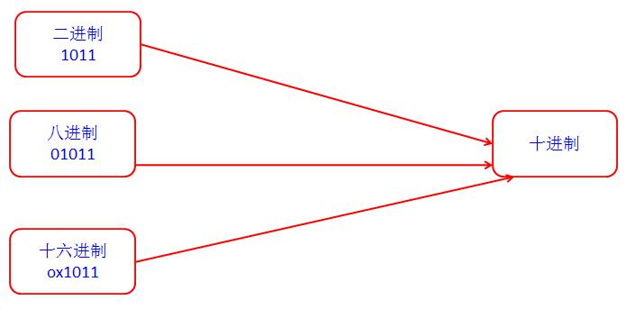
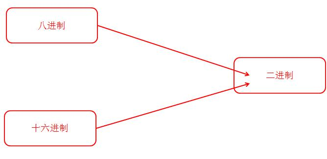

## 4.1 运算符的基本介绍

运算符是一种特殊的符号，用以表示数据的运算、赋值和比较等

运算符是一种特殊的符号，用以表示数据的运算、赋值和比较等

1. 算术运算符
2. 赋值运算符
3. 比较运算符/关系运算符
4. 逻辑运算符
5. 位运算符
6. 其它运算符

## 4.2 算术运算符

算术运算符是对数值类型的变量进行运算的，比如：加减乘除。在Go 程序中使用的非常多

### 4.2.1 算术运算符的一览表

| 运算符 | 运算 | 范例 | 结果 |
| :---: | :---: | :---: | :---: |
| `+` | 正号 | `+3` | 3 |
| `-` | 负号 | `-4` | -4 |
| `+` | 加 | `5 + 5` | 10 |
| `-` | 减 | `6 - 4` | 2 |
| `*` | 乘 | `3 * 4` | 12 |
| `/` | 除 | `5 / 5` | 1 |
| `%` | 取模（取余） | `7 % 5` | 2 |
| `++` | 自增 | `a = 2; a++` | `a = 3` |
| `--` | 自减 | `a = 2; a--` | `a = 1` |
| `+` | 字符串相加 | `"He" + "llo"` | `"Hello"` |

### 4.2.2 案例演示

- 案例演示算术运算符的使用。

+, - , * , / , %, ++, -- , 重点讲解/、%

自增：++

自减：--

- 演示/ 的使用的特点

```go
//重点讲解 /、%
//说明，如果运算的数都是整数，那么除后，去掉小数部分，保留整数部分
fmt.Println(10 / 4)

var n1 float32 = 10 / 4
fmt.Println(n1)

//如果我们希望保留小数部分，则需要有浮点数参与运算
var n2 float32 = 10.0 / 4
fmt.Println(n2)
```

- 演示% 的使用特点

```go
// 演示 % 的使用
// 看一个公式a % b = a - a / b * b
fmt.Println("10%3=", 10 % 3) // =1
fmt.Println("-10%3=", -10 % 3) // = -10 - (-10) / 3 * 3 = -10 - (-9) = -1
fmt.Println("10%-3=", 10 % -3) // =1
fmt.Println("-10%-3=", -10 % -3) // =-1
```

- ++ 和--的使用

```go
// ++ 和 -- 的使用
var i int = 10
i++ // 等价 i = i + 1
fmt.Println("i=", i) // 11
i-- // 等价 i = i - 1
fmt.Println("i=", i) // 10
```

### 4.2.3 算术运算符使用的注意事项

1. 对于除号"/"，它的整数除和小数除是有区别的：整数之间做除法时，只保留整数部分而舍弃小数部分。例如：x := 19/5 ,结果是 3
2. 当对一个数取模时，可以等价a%b=a-a/b*b ，这样我们可以看到取模的一个本质运算。
3. Golang 的自增自减只能当做一个独立语言使用时，不能这样使用

```go
package main
import (
	"fmt"
)
func main() {
	//在golang中，++ 和 -- 只能独立使用。
	var i int = 8
	var a int
	a = i++ //错误，i++只能独立使用
	a = i-- //错误，i--只能独立使用
	if i++ > 0 {
		fmt.Println("ok")
	}
}
```

4. Golang 的++ 和-- 只能写在变量的后面，不能写在变量的前面，即：只有a++ a-- 没有++a

```text
--a
```

```go
var i int = 1
i++        // ✅
++i        // 错误，在golang没有前++
i--        // ✅
--i        // 错误，在golang没有前--
fmt.Println("i=", i)
```

5. Golang 的设计者去掉c / java 中的自增自减的容易混淆的写法，让Golang 更加简洁，统一。(强制性的)

### 4.2.4 课堂练习1

```go
var i int = 1
i = i++
fmt.Println(i);
//问：结果是多少？为什么？
//上面的代码时错误，编译不通过, i = i++

var i int = 10
if i++ > 10 {
fmt.Println("ok")
}
//问：结果是多少？为什么？
//上面的代码时错误, 编译不通过, i++ >10
```

### 4.2.5 课堂练习2

1. 假如还有97 天放假，问：xx 个星期零xx 天
2. 定义一个变量保存华氏温度，华氏温度转换摄氏温度的公式为：5/9*(华氏温度-100),请求出华氏温度对应的摄氏温度。

```go
package main
import (
	"fmt"
)
func main() {
	//假如还有97天放假，问：xx个星期零xx天
	var days int = 97
	var week int = days / 7
	var day int = days % 7
	fmt.Printf("%d个星期零%d天\n", week, day)

	//定义一个变量保存华氏温度，华氏温度转换摄氏温度的公式为：
	//5/9*(华氏温度-100),请求出华氏温度对应的摄氏温度
	var huashi float32 = 134.2
	var sheshi float32 = 5.0 / 9 * (huashi - 100)
	fmt.Printf("%v 对应的摄氏温度=%v \n", huashi, sheshi)
}
```

## 4.3 关系运算符(比较运算符)

### 4.3.1 基本介绍

1. 关系运算符的结果都是bool 型，也就是要么是true，要么是false
2. 关系表达式经常用在if 结构的条件中或循环结构的条件中

### 4.3.2 关系运算符一览图

| 运算符 | 运算 | 范例 | 结果 |
| :---: | :---: | :---: | :---: |
| `==` | 相等 | `4 == 3` | false |
| `!=` | 不相等 | `4 != 3` | true |
| `<` | 小于 | `4 < 3` | false |
| `>` | 大于 | `4 > 3` | true |
| `<=` | 小于或等于 | `4 <= 3` | false |
| `>=` | 大于或等于 | `4 >= 3` | true |

### 4.3.3 案例演示

```go
package main
import (
	"fmt"
)
func main() {
	//演示关系运算符的使用
	var n1 int = 9
	var n2 int = 8
	fmt.Println(n1 == n2)  //false
	fmt.Println(n1 != n2)  //true
	fmt.Println(n1 > n2)   //true
	fmt.Println(n1 >= n2)  //true
	fmt.Println(n1 < n2)   //false
	fmt.Println(n1 <= n2)  //false
	flag := n1 > n2
	fmt.Println("flag=", flag)
}
```

### 4.3.4 关系运算符的细节说明

细节说明

1. 关系运算符的结果都是bool 型，也就是要么是true，要么是false。
2. 关系运算符组成的表达式，我们称为关系表达式：a > b
3. 比较运算符"=="不能误写成"=" !!

## 4.4 逻辑运算符

### 4.4.1 基本介绍

用于连接多个条件（一般来讲就是关系表达式），最终的结果也是一个bool 值

### 4.4.2 逻辑运算的说明

假定 A 值为 `True`，B 值为 `False`：

| 运算符 | 描述 | 实例 |
| :---: | :--- | :--- |
| `&&` | 逻辑与运算符。如果两边的操作数都是 True，则为 True，否则为 False。 | `(A && B)` 为 False |
| `\|\|` | 逻辑或运算符。如果两边的操作数有一个 True，则为 True，否则为 False。 | `(A \|\| B)` 为 True |
| `!` | 逻辑非运算符。如果条件为 True，则逻辑为 False，否则为 True。 | `!(A && B)` 为 True |

### 4.4.3 案例演示

```go
//演示逻辑运算符的使用 &&
var age int = 40
if age > 30 && age < 50 {
	fmt.Println("ok1")
}

if age > 30 && age < 40 {
	fmt.Println("ok2")
}
```

```go
//演示逻辑运算符的使用 ||
if age > 30 || age < 50 {
	fmt.Println("ok3")
}

if age > 30 || age < 40 {
	fmt.Println("ok4")
}
```

```go
//演示逻辑运算符的使用 !
if age > 30 {
	fmt.Println("ok5")
}

if !(age > 30) {
	fmt.Println("ok6")
}
```

### 4.4.4 注意事项和细节说明

1. &&也叫短路与：如果第一个条件为false，则第二个条件不会判断，最终结果为false
2. ||也叫短路或：如果第一个条件为true，则第二个条件不会判断，最终结果为true
3. 案例演示

```go
//声明一个函数(测试)
func test() bool {
	fmt.Println("test....")
	return true
}

func main() {
	var i int = 10
	//短路与
	//说明 因为 i < 9 为 false ,因此后面的 test() 就不执行
	if i < 9 && test() {
		fmt.Println("ok...")
	}

	//说明 因为 i > 9 为 true ,因此后面的 test() 就不执行
	if i > 9 || test() {
		fmt.Println("hello...")
	}
}
```

## 4.5 赋值运算符

### 4.5.1 基本的介绍

赋值运算符就是将某个运算后的值，赋给指定的变量。

### 4.5.2 赋值运算符的分类

| 运算符 | 描述 | 实例 |
| :--- | :--- | :--- |
| = | 简单的赋值运算符，将一个表达式的值赋给一个左值 | C = A + B 将 A + B 表达式结果赋值给 C |
| += | 相加后再赋值 | C += A 等于 C = C + A |
| -= | 相减后再赋值 | C -= A 等于 C = C - A |
| *= | 相乘后再赋值 | C *= A 等于 C = C * A |
| /= | 相除后再赋值 | C /= A 等于 C = C / A |
| %= | 求余后再赋值 | C %= A 等于 C = C % A |

| 运算符 | 描述 | 实例 |
| :--- | :--- | :--- |
| <<= | 左移后赋值 | C <<= 2 等于 C = C << 2 |
| >>= | 右移后赋值 | C >>= 2 等于 C = C >> 2 |
| &= | 按位与后赋值 | C &= 2 等于 C = C & 2 |
| ^= | 按位异或后赋值 | C ^= 2 等于 C = C ^ 2 |
| \|= | 按位或后赋值 | C \|= 2 等于 C = C \| 2 |

说明：这部分的赋值运算涉及到二进制相关知识，我们放在讲二进制的时候再回头讲解。

### 4.5.3 赋值运算的案例演示

案例演示赋值运算符的基本使用。

1. 赋值基本案例
2. 有两个变量，a 和b，要求将其进行交换，最终打印结果
3. += 的使用案例
4. 案例

```go
func main() {
	//赋值运算符的使用演示
	// var i int
	// i = 10 //基本赋值

	//有两个变量，a和b，要求将其进行交换，最终打印结果
	// a = 9 , b = 2 ==> a = 2 b = 9
	a := 9
	b := 2
	fmt.Printf("交换前的情况是 a = %v , b=%v \n", a, b)
	//定义一个临时变量
	t := a
	a = b //
	b = t //
	fmt.Printf("交换后的情况是 a = %v , b=%v \n", a, b)

	//复合赋值的操作
	a += 17 // 等价 a = a + 17
	fmt.Println("a=", a)
}
```

### 4.5.4 赋值运算符的特点

1. 运算顺序从右往左

```go
var c int
c = a + 3 // 赋值运算的执行顺序是从右向左
```

2. 赋值运算符的左边只能是变量,右边可以是变量、表达式、常量值

```go
//2)赋值运算符的左边 只能是变量,右边 可以是变量、表达式、常量值
// 表达式：任何有值都可以看做表达式
var d int
d = a //
d = 8 + 2 * 8 // =的右边是表达式
d = test() + 90 // =的右边是表达式
d = 890 // 890常量
fmt.Println(d)
```

3. 复合赋值运算符等价于下面的效果

比如：a += 3 等价于a = a + 3

### 4.5.5 面试题

有两个变量，a 和b，要求将其进行交换，但是不允许使用中间变量，最终打印结果

```go
package main
import (
	"fmt"
)
func main() {
	//有两个变量，a和b，要求将其进行交换，但是不允许使用中间变量，最终打印结果
	var a int = 10
	var b int = 20

	a = a + b //
	b = a - b // b = a + b - b ==> b = a
	a = a - b // a = a + b - a ==> a = b

	fmt.Printf("a=%v b=%v", a, b)
}
```

## 4.6 位运算符

| 运算符 | 描述 |
| :--- | :--- |
| & | 按位与运算符"&"是双目运算符。其功能是参与运算的两数各对应的二进位相与。运算规则是: 同时为1, 结果为1, 否则为0 |
| \| | 按位或运算符"\|"是双目运算符。其功能是参与运算的两数各对应的二进位相或。运算规则是: 有一个为1, 结果为1, 否则为0 |
| ^ | 按位异或运算符"^"是双目运算符。其功能是参与运算的两数各对应的二进位相异或。运算规则是: 当二进位不同时, 结果为1, 否则为0 |
| << | 左移运算符"<<"是双目运算符。其功能是把"<<"左边的运算数的各二进位全部左移若干位，高位丢弃，低位补0。左移n位就是乘以2的n次方 |
| >> | 右移运算符">>"是双目运算符。其功能是把">>"左边的运算数的各二进位全部右移若干位，右移n位就是除以2的n次方 |

说明：因为位运算涉及到二进制相关知识，我们仍然放到讲二进制时，再详细讲解。

## 4.7 其它运算符说明

| 运算符 | 描述 | 实例 |
| :--- | :--- | :--- |
| & | 返回变量存储地址 | &a; 将给出变量的实际地址。 |
| * | 指针变量 | *a; 是一个指针变量 |

举例说明：

```go
import (
	"fmt"
)
func main() {
	//演示一把 & 和 * 的使用
	a := 100
	fmt.Println("a 的地址=", &a)

	var ptr *int = &a
	fmt.Println("ptr 指向的值是=", *ptr)
}
```

### 4.7.1 课堂案例

案例1：求两个数的最大值

```go
func main() {
	//求两个数的最大值
	var n1 int = 10
	var n2 int = 40
	var max int
	if n1 > n2 {
		max = n1
	} else {
		max = n2
	}
	fmt.Println("max=", max)
}
```

案例2：求三个数的最大值

```go
func main() {
	//求两个数的最大值
	var n1 int = 10
	var n2 int = 40
	var max int
	if n1 > n2 {
		max = n1
	} else {
		max = n2
	}
	fmt.Println("max=", max)

	//求出三个数的最大值思路：先求出两个数的最大值，
	//然后让这个最大值和第三数比较，在取出最大值
	var n3 = 45
	if n3 > max {
		max = n3
	}
	fmt.Println("三个数中最大值是=", max)
}
```

## 4.8 特别说明



举例说明，如果在golang 中实现三元运算的效果。

```go
var n int
var i int = 10
var j int = 12
//传统的三元运算
//n = i > j ? i : j
if i > j {
	n = i
} else {
	n = j
}
fmt.Println("n=", n) // 12
```

## 4.9 运算符的优先级

### 4.9.1 运算符的优先级的一览表

| 分类 | 描述 | 关联性 |
| :--- | :--- | :--- |
| 后缀 | () [] -> . ++ -- | 左到右 |
| 单目 | + - ! ~ (type) * & sizeof | 右到左 |
| 乘法 | * / % | 左到右 |
| 加法 | + - | 左到右 |
| 移位 | << >> | 左到右 |
| 关系 | < <= > >= | 左到右 |
| 相等（关系） | == != | 左到右 |
| 按位AND | & | 左到右 |
| 按位XOR | ^ | 左到右 |
| 按位OR | \| | 左到右 |
| 逻辑AND | && | 左到右 |
| 逻辑OR | \|\| | 左到右 |
| 赋值运算符 | = += -= *= /= %= >>= <<= &= ^= \|= | 右到左 |
| 逗号 | , | 左到右 |

（优先级从高到低）

### 4.9.2 对上图的说明

1. 运算符有不同的优先级，所谓优先级就是表达式运算中的运算顺序。如右表，上一行运算符总

优先于下一行。

2. 只有单目运算符、赋值运算符是从右向左运算的。
3. 梳理了一个大概的优先级

1：括号，++, --

2: 单目运算

3：算术运算符

4：移位运算

5：关系运算符

6：位运算符

7：逻辑运算符

8：赋值运算符

9：逗号

## 4.10 键盘输入语句

### 4.10.1 介绍

在编程中，需要接收用户输入的数据，就可以使用键盘输入语句来获取。InputDemo.go

### 4.10.2 步骤：

1. 导入fmt 包
2. 调用fmt 包的fmt.Scanln() 或者fmt.Scanf()

**func Scanln**

```go
func Scanln(a ...interface{}) (n int, err error)
```

Scanln类似Scan，但会在换行时才停止扫描。最后一个条目后必须有换行或者到达结束位置。

**func Scanf**

```go
func Scanf(format string, a ...interface{}) (n int, err error)
```

Scanf从标准输入扫描文本，根据format 参数指定的格式将成功读取的空白分隔的值保存进成功传递给本函数的参数。返回成功扫描的条目个数和遇到的任何错误。

### 4.10.3 案例演示：

要求：可以从控制台接收用户信息，【姓名，年龄，薪水, 是否通过考试】。

1. 使用fmt.Scanln() 获取

```go
func main() {
	//要求：可以从控制台接收用户信息，【姓名，年龄，薪水，是否通过考试】。
	//方式1 fmt.Scanln
	//1先声明需要的变量
	var name string
	var age byte
	var sal float32
	var isPass bool
	fmt.Println("请输入姓名 ")
	//当程序执行到 fmt.Scanln(&name),程序会停止在这里，等待用户输入，并回车
	fmt.Scanln(&name)
	fmt.Println("请输入年龄 ")
	fmt.Scanln(&age)
	fmt.Println("请输入薪水 ")
	fmt.Scanln(&sal)

	fmt.Println("请输入是否通过考试 ")
	fmt.Scanln(&isPass)

	fmt.Printf("名字是 %v \n 年龄是 %v \n 薪水是 %v \n 是否通过考试 %v \n", name, age, sal, isPass)
}
```

2. 使用fmt.Scanf() 获取

```go
//方式2:fmt.Scanf,可以按指定的格式输入
fmt.Println("请输入你的姓名，年龄，薪水，是否通过考试， 使用空格隔开")
fmt.Scanf("%s %d %f %t", &name, &age, &sal, &isPass)
fmt.Printf("名字是 %v \n年龄是 %v \n 薪水是 %v \n 是否通过考试 %v \n", name, age, sal, isPass)
```

## 4.11 进制

对于整数，有四种表示方式：

1. 二进制：0,1 ，满2 进1。

在golang 中，不能直接使用二进制来表示一个整数，它沿用了c 的特点。

2. 十进制：0-9 ，满10 进1。
3. 八进制：0-7 ，满8 进1. 以数字0 开头表示。
4. 十六进制：0-9 及A-F，满16 进1. 以0x 或0X 开头表示。

此处的A-F 不区分大小写。

```go
func main() {
	var i int = 5
	//二进制输出
	fmt.Printf("%b \n", i)

	//八进制：0-7，满8进1. 以数字0开头表示
	var j int = 011 // 011=> 9
	fmt.Println("j=", j)

	//0-9及A-F，满16进1. 以0x或0X开头表示
	var k int = 0x11 // 0x11=> 16 + 1 = 17
	fmt.Println("k=", k)
}
```

### 4.11.1 进制的图示

进制的图示：

| 十进制 | 十六进制 | 八进制 | 二进制 |
| :--- | :--- | :--- | :--- |
| 0 | 0 | 0 | 0 |
| 1 | 1 | 1 | 1 |
| 2 | 2 | 2 | 10 |
| 3 | 3 | 3 | 11 |
| 4 | 4 | 4 | 100 |
| 5 | 5 | 5 | 101 |
| 6 | 6 | 6 | 110 |
| 7 | 7 | 7 | 111 |
| 8 | 8 | 10 | 1000 |
| 9 | 9 | 11 | 1001 |
| 10 | A | 12 | 1010 |
| 11 | B | 13 | 1011 |
| 12 | C | 14 | 1100 |
| 13 | D | 15 | 1101 |
| 14 | E | 16 | 1110 |
| 15 | F | 17 | 1111 |
| 16 | 10 | 20 | 10000 |
| 17 | 11 | 21 | 10001 |

### 4.11.2 进制转换的介绍
第一组（其它进制转十进制）：
1. 二进制转十进制
2. 八进制转十进制
3. 十六进制转十进制
4. 示意图

第二组：(十进制转其它进制)
1. 十进制转二进制
2. 十进制转八进制
3. 十进制转十六进制
4. 示意图

第三组 (二进制转其它进制)
1. 二进制转八进制
2. 二进制转十六进制
3. 示意图

第四组 (其它进制转二进制)
1. 八进制转二进制
2. 十六进制转二进制
3. 示意图

### 4.11.3 其它进制转十进制



### 4.11.4 二进制如何转十进制

**134 = 4 * 1 + 3 * 10 + 1 * 10 * 10 = 4 + 30 + 100 = 134**

<span style="color:red">规则：</span>从最低位开始（右边的），将每个位上的数提取出来，乘以2的(位数-1)次方，然后求和。

<span style="color:red">案例：</span>请将二进制：1011 转成十进制的数

<span style="color:red"><u>1011 = 1 * 1 + 1 * 2 + 0 * 2 * 2 + 1 * 2 * 2 * 2 = 1 + 2 + 0 + 8 = 11</u></span>


### 4.11.5 八进制转换成十进制示例

<span style="color:red">规则：</span>从最低位开始（右边的），将每个位上的数提取出来，乘以8的(位数-1)次方，然后求和。

<span style="color:red">案例：</span>请将 0123 转成十进制的数

<span style="color:red"><u>0123 = 3 * 1 + 2 * 8 + 1 * 8 * 8 = 3 + 16 + 64 = 83</u></span>

### 4.11.6 16 进制转成10 进制

<span style="color:red">规则：</span>从最低位开始，将每个位上的数提取出来，乘以16的(位数-1)次方，然后求和。

<span style="color:red">案例：</span>请将 0x34A 转成十进制的数

<span style="color:red"><u>0x34A = 10 * 1 + 4 * 16 + 3 * 16 * 16 = 10 + 64 + 768 = 842</u></span>

### 4.11.7 其它进制转10 进制的课堂练习

- 课堂练习：请将

二进制： 110001100 转成十进制

八进制： 02456 转成十进制

十六进制： 0xA45 转成十进制

### 4.11.8 十进制如何转成其它进制


### 4.11.9 十进制如何转二进制

<span style="color:red">规则：</span>将该数不断除以2，直到商为0为止，然后将每步得到的余数倒过来，就是对应的二进制。

<span style="color:red">案例：</span>请将 56 转成二进制

```text
2 | 56   ... 0
2 | 28   ... 0
2 | 14   ... 0
2 | 7    ... 1
2 | 3    ... 1
2 | 1    ... 1
    0
```

<span style="color:red"><u>将余数倒过来：111000 = 56</u></span>

### 4.11.10 十进制转成八进制

<span style="color:red">规则：</span>将该数不断除以8，直到商为0为止，然后将每步得到的余数倒过来，就是对应的八进制。

<span style="color:red">案例：</span>请将 156 转成八进制

```text
8 | 156   ... 4
8 | 19    ... 3
8 | 2     ... 2
    0
```

<span style="color:red"><u>将余数倒过来：156 = 0234</u></span>

### 4.11.11 十进制转十六进制

<span style="color:red">规则：</span>将该数不断除以16，直到商为0为止，然后将每步得到的余数倒过来，就是对应的十六进制。

<span style="color:red">案例：</span>请将 356 转成十六进制

```text
16 | 356   ... 4
16 | 22    ... 6
    1
```

<span style="color:red"><u>将余数倒过来：356 = 0X164</u></span>

### 4.11.12 课堂练习

课堂练习：请将

123 转成二进制

678 转成八进制

8912 转成十六进制

### 4.11.13 二进制转换成八进制、十六进制


### 4.11.14 二进制转换成八进制

<span style="color:red">规则：</span>将二进制数每三位一组(从低位开始组合)，转成对应的八进制数即可。

<span style="color:red">案例：</span>请将 二进制：11010101 转成八进制

<span style="color:red"><u>11010101 = 0325</u></span>

### 4.11.15 二进制转成十六进制

<span style="color:red">规则：</span>将二进制数每四位一组(从低位开始组合)，转成对应的十六进制数即可。

<span style="color:red">案例：</span>请将 二进制：11010101 转成十六进制

<span style="color:red"><u>11010101 = 0xD5</u></span>

- 课堂练习

课堂练习：请将

二进制：11100101 转成八进制

二进制：1110010110 转成十六进制

### 4.11.16 八进制、十六进制转成二进制



### 4.11.17 八进制转换成二进制

<span style="color:red">规则：</span>将八进制数每1位，转成对应的一个3位的二进制数即可。

<span style="color:red">案例：</span>请将 0237 转成二进制

<span style="color:red">0237</span> = <span style="color:blue">10011111</span>

### 4.11.18 十六进制转成二进制

<span style="color:red">规则：</span>将十六进制数每1位，转成对应的一个4位的二进制数即可。

<span style="color:red">案例：</span>请将 0x237 转成二进制

<span style="color:red">0x237</span> = <span style="color:blue">100010110111</span>

## 4.12 位运算

### 4.12.1 位运算的思考题

1. 请看下面的代码段，回答a,b,c,d 结果是多少?

```go
func main() {
    var a int = 1 >> 2
    var b int = -1 >> 2
    var c int = 1 << 2
    var d int = -1 << 2
    //a,b,c,d 结果是多少
    fmt.Println("a=", a)
    fmt.Println("b=", b)
    fmt.Println("c=", c)
    fmt.Println("d=", d)
}
```

2. 请回答在Golang 中，下面的表达式运算的结果是:

```go
func main() {
    fmt.Println(2&3)
    fmt.Println(2|3)
    fmt.Println(13&7)
    fmt.Println(5|4) //?
    fmt.Println(-3^3) //?
}
```

### 4.12.2 二进制在运算中的说明

二进制是逢2 进位的进位制，0、1 是基本算符。

现代的电子计算机技术全部采用的是二进制，因为它只使用0、1 两个数字符号，非常简单方便，

易于用电子方式实现。计算机内部处理的信息，都是采用二进制数来表示的。二进制（Binary）数用0和1 两个数字及其组合来表示任何数。进位规则是“逢2 进1”，数字1 在不同的位上代表不同的值，按从右至左的次序，这个值以二倍递增。

在计算机的内部，运行各种运算时，都是以二进制的方式来运行。

### 4.12.3 原码、反码、补码

网上对原码,反码,补码的解释过于复杂，我这里精简6句话：

对于有符号的而言：

1) 二进制的最高位是符号位: 0表示正数,1表示负数

  - 1 ===> [0000 0001]　-1 ===> [1000 0001]

2) 正数的原码，反码，补码都一样

3) 负数的反码=它的原码符号位不变，其它位取反(0->1,1->0)

  - 1 ===> 原码[0000 0001] 反码[0000 0001] <span style="color:red">补码[0000 0001]</span>

  - -1 ===> 原码[1000 0001] 反码[1111 1110] <span style="color:red">补码[1111 1111]</span>

4) 负数的补码=它的反码+1

5) 0的反码，<span style="color:red">补码</span>都是0

6) 在计算机运算的时候，都是以<span style="color:red">补码</span>的方式来运算的。

  - 1-1　1-1 = 1+(-1)

### 4.12.4 位运算符和移位运算符

- Golang 中有3 个位运算

分别是”按位与&、按位或|、按位异或^,它们的运算规则是：

按位与& ： 两位全为１，结果为1，否则为0

按位或|

: 两位有一个为1，结果为1，否则为0

按位异或^ : 两位一个为0,一个为1，结果为1，否则为0

- 案例练习

比如：2&3=? 2|3=? 2^3=?

```go
package main

import (
	"fmt"
)

func main() {
	//位运算的演示
	fmt.Println(2 & 3)  // 2
	fmt.Println(2 | 3)  // 3
	fmt.Println(2 ^ 3)  // 3
	fmt.Println(-2 ^ 2) // -4
}
```

**2&3**

```text
2 的补码  0000 0010
3 的补码  0000 0011
2&3      0000 0010 => 2
```

**2|3=?**

```text
2 的补码  0000 0010
3 的补码  0000 0011
2|3      0000 0011 => 3
```

**2^3**

```text
2 的补码  0000 0010
3 的补码  0000 0011
2^3      0000 0001 => 1
```

**-2^2**

```text
-2 的原码 1000 0010 => 反码 1111 1101 => 补码 1111 1110
2 的补码 0000 0010
-2^2　1111 1100（补码）=> 原码
1111 1100 => 反码 1111 1011 => 原码 1000 0100 => -4
```

- Golang 中有2 个移位运算符：

>>、<< 右移和左移,运算规则:

右移运算符 >>：低位溢出,符号位不变,并用符号位补溢出的高位

左移运算符 <<: 符号位不变,低位补0

- 案例演示

```go
a := 1 >> 2 // 0000 0001 =>0000 0000 = 0
c := 1 << 2 // 0000 0001 ==> 0000 0100 => 4
```
