## 4.1 运算符的基本介绍

运算符是一种特殊的符号，用以表示数据的运算、赋值和比较等

运算符是一种特殊的符号，用以表示数据的运算、赋值和比较等

1. 算术运算符
2. 赋值运算符
3. 比较运算符/关系运算符
4. 逻辑运算符
5. 位运算符
6. 其它运算符

## 4.2 算术运算符

算术运算符是对数值类型的变量进行运算的，比如：加减乘除。在Go 程序中使用的非常多

### 4.2.1 算术运算符的一览表

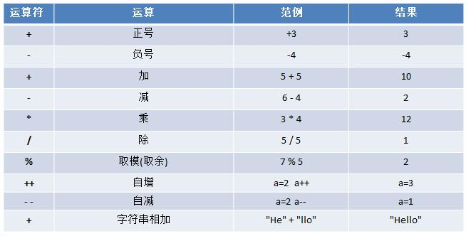

### 4.2.2 案例演示

- 案例演示算术运算符的使用。

+, - , * , / , %, ++, -- , 重点讲解/、%

自增：++

自减：--

- 演示/ 的使用的特点


- 演示% 的使用特点

```go
// 演示 % 的使用
// 看一个公式a % b = a - a / b * b
fmt.Println("10%3=", 10 % 3) // =1
fmt.Println("-10%3=", -10 % 3) // = -10 - (-10) / 3 * 3 = -10 - (-9) = -1
fmt.Println("10%-3=", 10 % -3) // =1
fmt.Println("-10%-3=", -10 % -3) // =-1
```

- ++ 和--的使用


### 4.2.3 算术运算符使用的注意事项

1. 对于除号"/"，它的整数除和小数除是有区别的：整数之间做除法时，只保留整数部分而舍弃小数部分。例如：x := 19/5 ,结果是 3
2. 当对一个数取模时，可以等价a%b=a-a/b*b ，这样我们可以看到取模的一个本质运算。
3. Golang 的自增自减只能当做一个独立语言使用时，不能这样使用

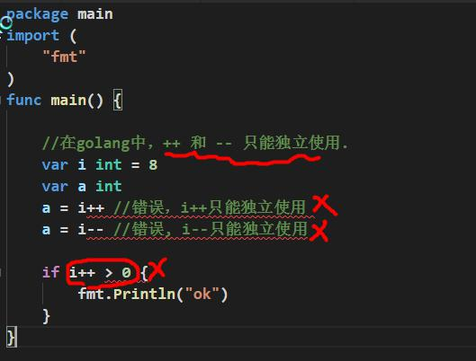

4. Golang 的++ 和-- 只能写在变量的后面，不能写在变量的前面，即：只有a++ a-- 没有++a

```text
--a
```


5. Golang 的设计者去掉c / java 中的自增自减的容易混淆的写法，让Golang 更加简洁，统一。(强制性的)

### 4.2.4 课堂练习1

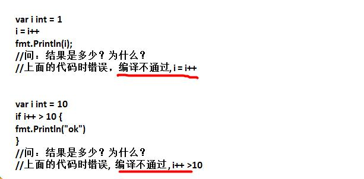

### 4.2.5 课堂练习2

1. 假如还有97 天放假，问：xx 个星期零xx 天
2. 定义一个变量保存华氏温度，华氏温度转换摄氏温度的公式为：5/9*(华氏温度-100),请求出华氏温度对应的摄氏温度。

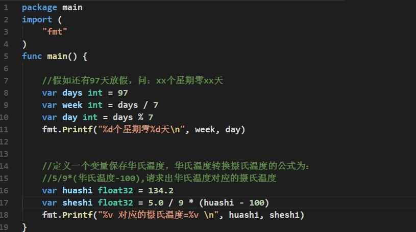

## 4.3 关系运算符(比较运算符)

### 4.3.1 基本介绍

1. 关系运算符的结果都是bool 型，也就是要么是true，要么是false
2. 关系表达式经常用在if 结构的条件中或循环结构的条件中

### 4.3.2 关系运算符一览图

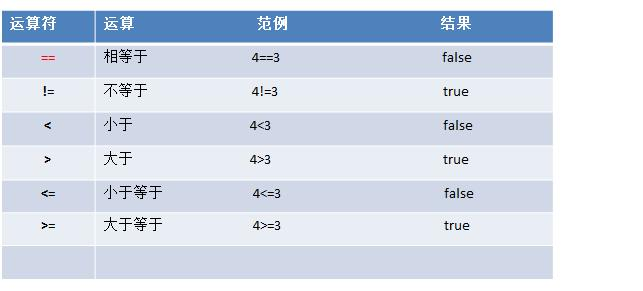

### 4.3.3 案例演示

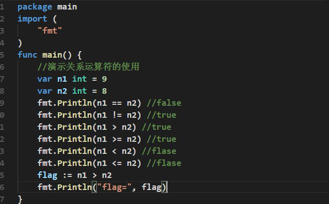

### 4.3.4 关系运算符的细节说明

细节说明

1. 关系运算符的结果都是bool 型，也就是要么是true，要么是false。
2. 关系运算符组成的表达式，我们称为关系表达式：a > b
3. 比较运算符"=="不能误写成"=" !!

## 4.4 逻辑运算符

### 4.4.1 基本介绍

用于连接多个条件（一般来讲就是关系表达式），最终的结果也是一个bool 值

### 4.4.2 逻辑运算的说明

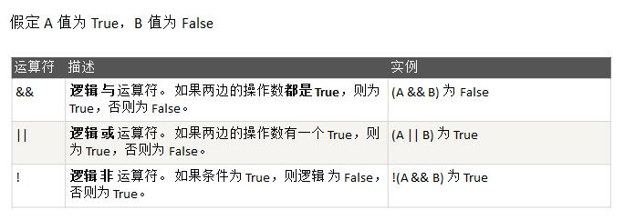

### 4.4.3 案例演示

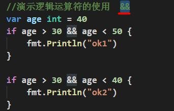

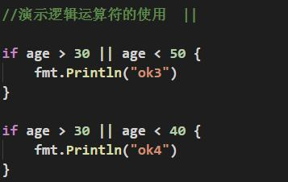

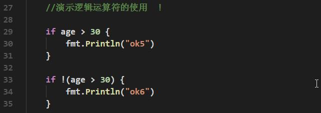

### 4.4.4 注意事项和细节说明

1. &&也叫短路与：如果第一个条件为false，则第二个条件不会判断，最终结果为false
2. ||也叫短路或：如果第一个条件为true，则第二个条件不会判断，最终结果为true
3. 案例演示

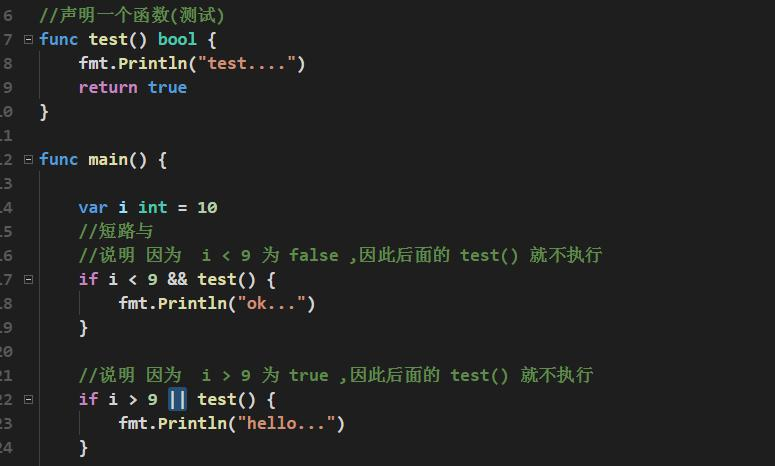

## 4.5 赋值运算符

### 4.5.1 基本的介绍

赋值运算符就是将某个运算后的值，赋给指定的变量。

### 4.5.2 赋值运算符的分类

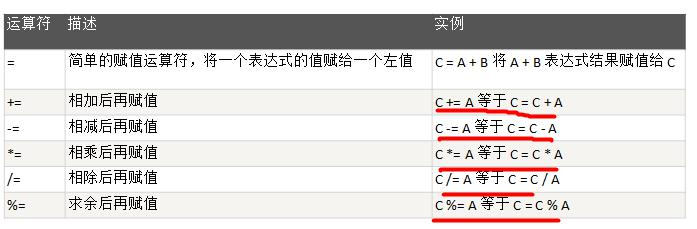

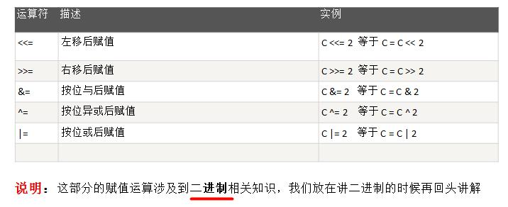

### 4.5.3 赋值运算的案例演示

案例演示赋值运算符的基本使用。

1. 赋值基本案例
2. 有两个变量，a 和b，要求将其进行交换，最终打印结果
3. += 的使用案例
4. 案例

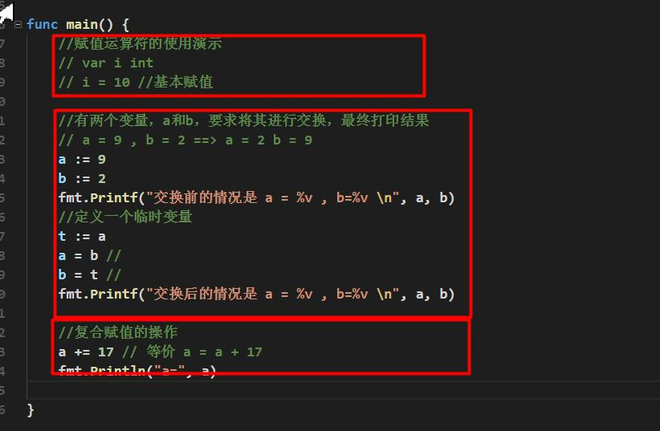

### 4.5.4 赋值运算符的特点

1. 运算顺序从右往左

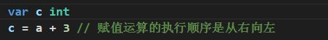

2. 赋值运算符的左边只能是变量,右边可以是变量、表达式、常量值

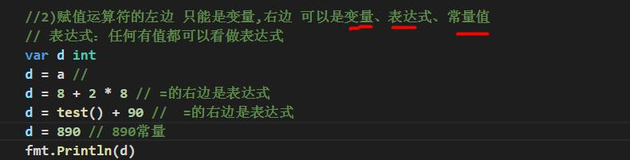

3. 复合赋值运算符等价于下面的效果

比如：a += 3 等价于a = a + 3

### 4.5.5 面试题

有两个变量，a 和b，要求将其进行交换，但是不允许使用中间变量，最终打印结果

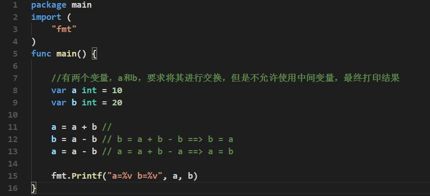

## 4.6 位运算符

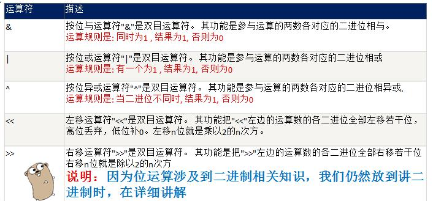

## 4.7 其它运算符说明

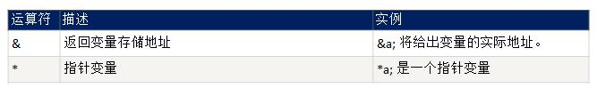

举例说明：

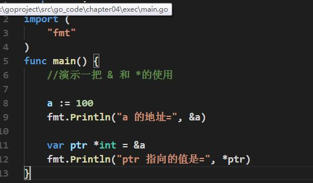

### 4.7.1 课堂案例

案例1：求两个数的最大值

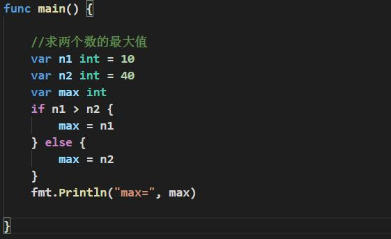

案例2：求三个数的最大值

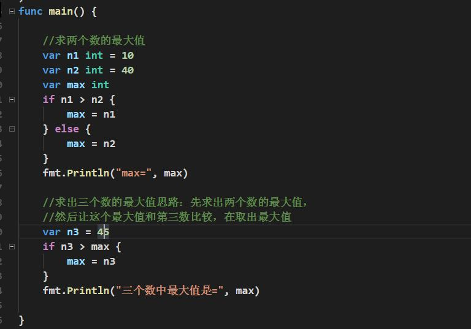

## 4.8 特别说明

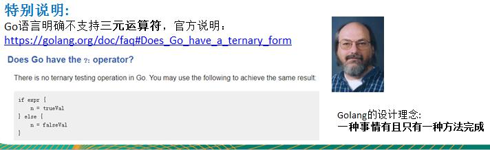

举例说明，如果在golang 中实现三元运算的效果。

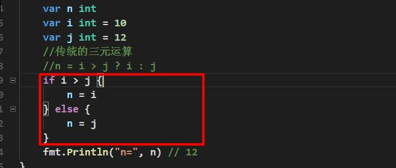

## 4.9 运算符的优先级

### 4.9.1 运算符的优先级的一览表

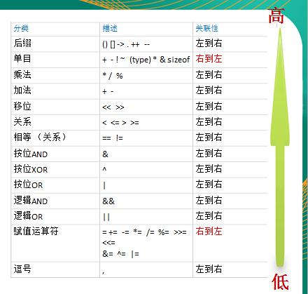

### 4.9.2 对上图的说明

1. 运算符有不同的优先级，所谓优先级就是表达式运算中的运算顺序。如右表，上一行运算符总

优先于下一行。

2. 只有单目运算符、赋值运算符是从右向左运算的。
3. 梳理了一个大概的优先级

1：括号，++, --

2: 单目运算

3：算术运算符

4：移位运算

5：关系运算符

6：位运算符

7：逻辑运算符

8：赋值运算符

9：逗号

## 4.10 键盘输入语句

### 4.10.1 介绍

在编程中，需要接收用户输入的数据，就可以使用键盘输入语句来获取。InputDemo.go

### 4.10.2 步骤：

1. 导入fmt 包
2. 调用fmt 包的fmt.Scanln() 或者fmt.Scanf()

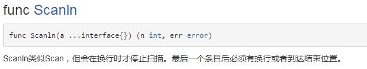

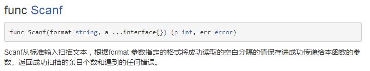

### 4.10.3 案例演示：

要求：可以从控制台接收用户信息，【姓名，年龄，薪水, 是否通过考试】。

1. 使用fmt.Scanln() 获取

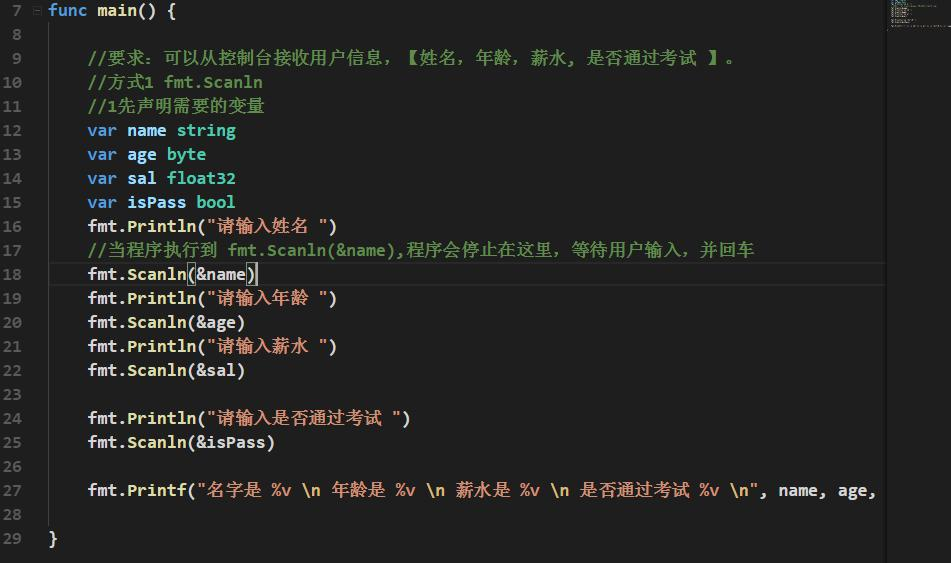

2. 使用fmt.Scanf() 获取

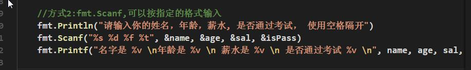

## 4.11 进制

对于整数，有四种表示方式：

1. 二进制：0,1 ，满2 进1。

在golang 中，不能直接使用二进制来表示一个整数，它沿用了c 的特点。

2. 十进制：0-9 ，满10 进1。
3. 八进制：0-7 ，满8 进1. 以数字0 开头表示。
4. 十六进制：0-9 及A-F，满16 进1. 以0x 或0X 开头表示。

此处的A-F 不区分大小写。

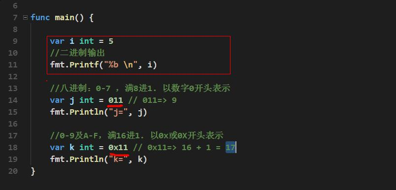

### 4.11.1 进制的图示

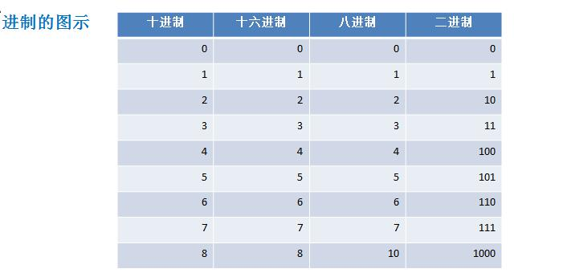

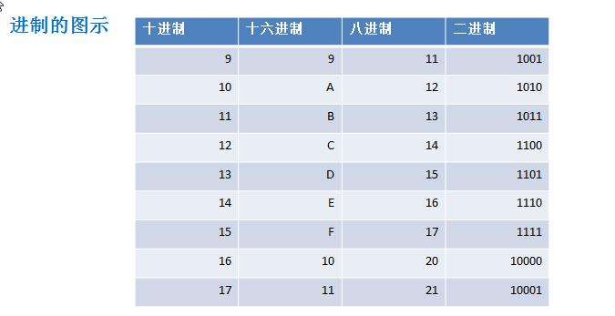

### 4.11.2 进制转换的介绍

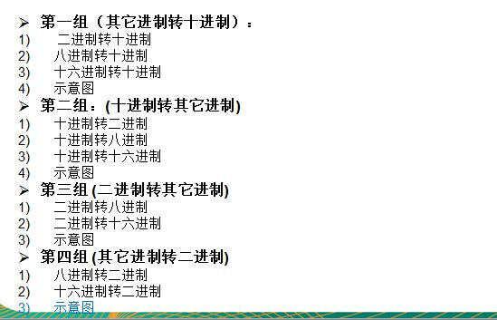

### 4.11.3 其它进制转十进制


### 4.11.4 二进制如何转十进制

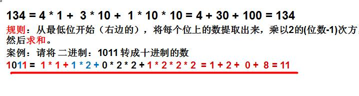

### 4.11.5 八进制转换成十进制示例

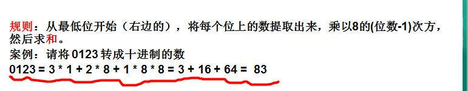

### 4.11.6 16 进制转成10 进制

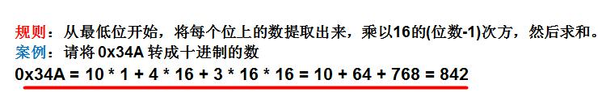

### 4.11.7 其它进制转10 进制的课堂练习

- 课堂练习：请将

二进制： 110001100 转成十进制

八进制： 02456 转成十进制

十六进制： 0xA45 转成十进制

### 4.11.8 十进制如何转成其它进制

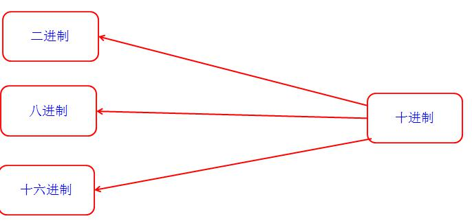

### 4.11.9 十进制如何转二进制

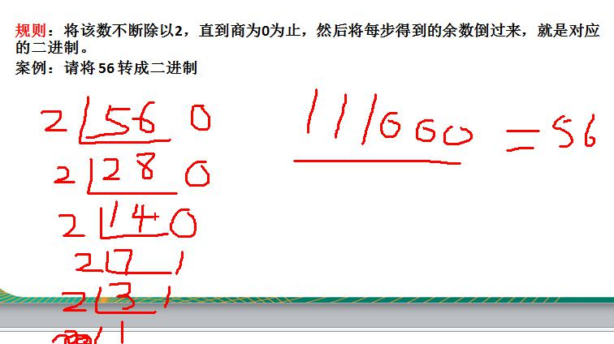

### 4.11.10 十进制转成八进制

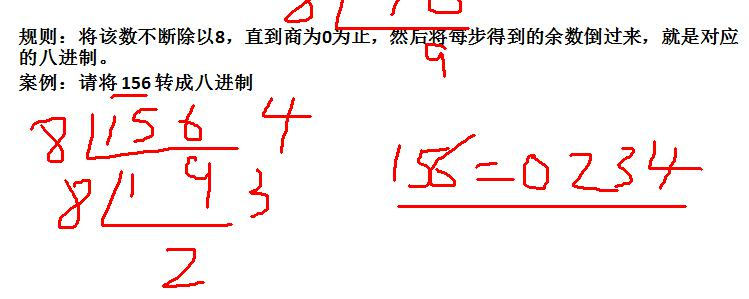

### 4.11.11 十进制转十六进制

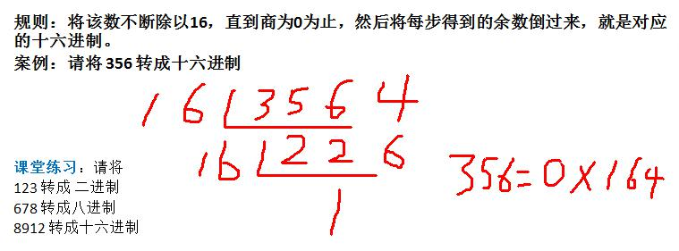

### 4.11.12 课堂练习

课堂练习：请将

123 转成二进制

678 转成八进制

8912 转成十六进制

### 4.11.13 二进制转换成八进制、十六进制


### 4.11.14 二进制转换成八进制

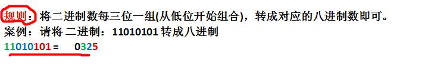

### 4.11.15 二进制转成十六进制

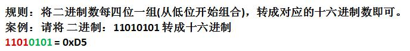

- 课堂练习

课堂练习：请将

二进制：11100101 转成八进制

二进制：1110010110 转成十六进制

### 4.11.16 八进制、十六进制转成二进制


### 4.11.17 八进制转换成二进制

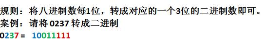

### 4.11.18 十六进制转成二进制

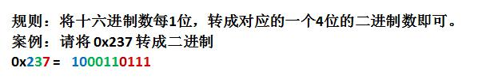

## 4.12 位运算

### 4.12.1 位运算的思考题

1. 请看下面的代码段，回答a,b,c,d 结果是多少?

```go
func main() {
    var a int = 1 >> 2
    var b int = -1 >> 2
    var c int = 1 << 2
    var d int = -1 << 2
    //a,b,c,d 结果是多少
    fmt.Println("a=", a)
    fmt.Println("b=", b)
    fmt.Println("c=", c)
    fmt.Println("d=", d)
}
```

2. 请回答在Golang 中，下面的表达式运算的结果是:

```go
func main() {
    fmt.Println(2&3)
    fmt.Println(2|3)
    fmt.Println(13&7)
    fmt.Println(5|4) //?
    fmt.Println(-3^3) //?
}
```

### 4.12.2 二进制在运算中的说明

二进制是逢2 进位的进位制，0、1 是基本算符。

现代的电子计算机技术全部采用的是二进制，因为它只使用0、1 两个数字符号，非常简单方便，

易于用电子方式实现。计算机内部处理的信息，都是采用二进制数来表示的。二进制（Binary）数用0和1 两个数字及其组合来表示任何数。进位规则是“逢2 进1”，数字1 在不同的位上代表不同的值，按从右至左的次序，这个值以二倍递增。

在计算机的内部，运行各种运算时，都是以二进制的方式来运行。

### 4.12.3 原码、反码、补码

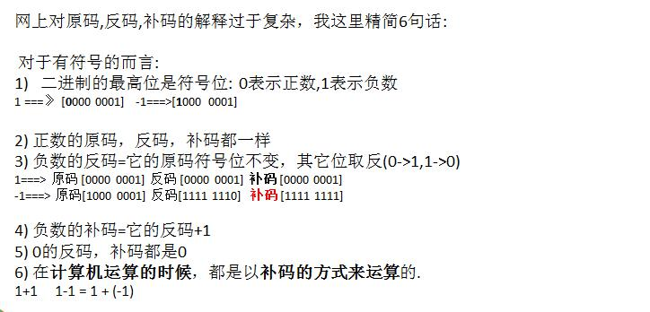

### 4.12.4 位运算符和移位运算符

- Golang 中有3 个位运算

分别是”按位与&、按位或|、按位异或^,它们的运算规则是：

按位与& ： 两位全为１，结果为1，否则为0

按位或|

: 两位有一个为1，结果为1，否则为0

按位异或^ : 两位一个为0,一个为1，结果为1，否则为0

- 案例练习

比如：2&3=? 2|3=? 2^3=?

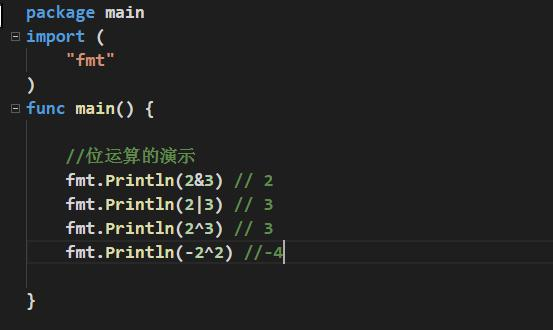

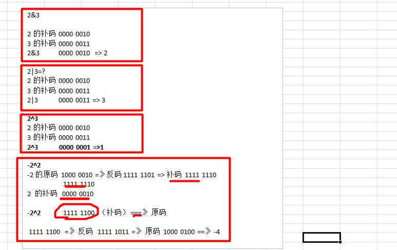

- Golang 中有2 个移位运算符：

>>、<< 右移和左移,运算规则:

右移运算符 >>：低位溢出,符号位不变,并用符号位补溢出的高位

左移运算符 <<: 符号位不变,低位补0

- 案例演示

```go
a := 1 >> 2 // 0000 0001 =>0000 0000 = 0
c := 1 << 2 // 0000 0001 ==> 0000 0100 => 4
```
