## 5.1 程序流程控制介绍

在程序中，程序运行的流程控制决定程序是如何执行的，是我们必须掌握的，主要有三大流程控制语句。

1. 顺序控制
2. 分支控制
3. 循环控制

## 5.2 顺序控制

程序从上到下逐行地执行，中间没有任何判断和跳转。

一个案例说明，必须下面的代码中，没有判断，也没有跳转.因此程序按照默认的流程执行，即顺序控制。

```go
package main

import "fmt"

func main() {
	//假如还有97天放假，问：xx个星期零xx天
	var days int = 97
	var week int = days / 7
	var day int = days % 7
	fmt.Printf("%d个星期零%d天\n", week, day)

	//定义一个变量保存华氏温度，华氏温度转换摄氏温度的公式为：
	//5/9*(华氏温度-100),请求出华氏温度对应的摄氏温度
	var huashi float32 = 134.2
	var sheshi float32 = 5.0 / 9 * (huashi - 100)
	fmt.Printf("%v 对应的摄氏温度=%v \n", huashi, sheshi)
}
```

### 5.2.1 顺序控制的一个流程图

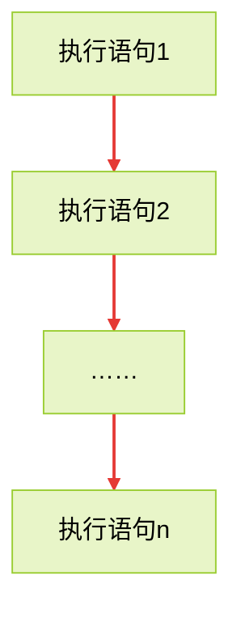

### 5.2.2 顺序控制举例和注意事项

Golang 中定义变量时采用合法的前向引用。如：

```go
func main() {
    var num1 int = 10 //声明了num1
    var num2 int = num1 + 20 //使用num1
    fmt.Println(num2)
}
```

错误形式：

```go
func main() {
    var num2 int = num1 + 20 //使用num1
    var num1 int = 10 //声明num1 (×)
    fmt.Println(num2)
}
```

## 5.3 分支控制

### 5.3.1 分支控制的基本介绍

分支控制就是让程序有选择执行。有下面三种形式

1. 单分支
2. 双分支
3. 多分支

### 5.3.2 单分支控制

- 基本语法


- 应用案例

请大家看个案例[ifDemo.go]:

编写一个程序,可以输入人的年龄,如果该同志的年龄大于18 岁,则输出"你年龄大于18,要对自己的行为负责!" 需求---[分析]---->代码

代码:

```go
package main

import "fmt"

func main() {
	//请大家看个案例[ifDemo.go]:
	//编写一个程序,可以输入人的年龄,如果该同志的年龄大于18岁,则输出 "你年龄大于18,要对自己的行为负责!"

	//分析
	//1.年龄 ===> var age int
	//2.从控制台接收一个输入 fmt.Scanln(&age)
	//3.if判断

	var age int
	fmt.Println("请输入年龄:")
	fmt.Scanln(&age)

	if age > 18 {
		fmt.Println("你年龄大于18,要对自己的行为负责!")
	}
}
```

输出的结果：

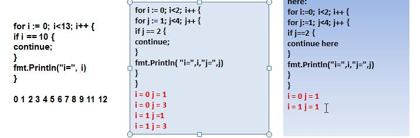

- 单分支的流程图

流程图可以用图形方式来更加清晰的描述程序执行的流程。

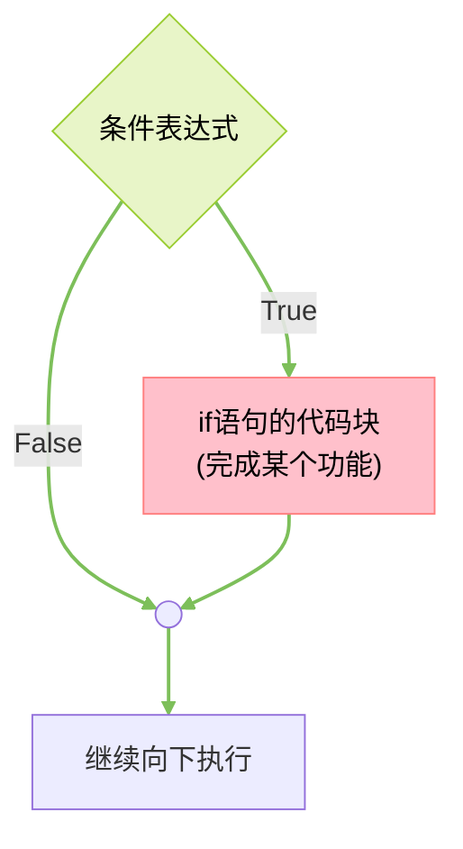

- 单分支的细节说明

```go
//golang支持在if中，直接定义一个变量，比如如下
if age := 20; age > 18 {
	fmt.Println("你年龄大于18,要对自己的行为负责!")
}
```

### 5.3.3 双分支控制

- 基本语法

```go
if 条件表达式 {
    执行代码块1
} else {
    执行代码块2
}
```
说明：当条件表达式成立，即执行代码块 1，否则执行代码块 2。{} 也是必须有的。
- 应用案例

请大家看个案例[IfDemo2.go]:

编写一个程序,可以输入人的年龄,如果该同志的年龄大于18 岁,则输出“你年龄大于18,要对自己的行为负责!”。否则,输出”你的年龄不大这次放过你了.”

```go
func main() {
	//请大家看个案例[IfDemo2.go]:
	//编写一个程序,可以输入人的年龄,如果该同志的年龄大于18岁,则输出 "你年龄大于18,要对
	//自己的行为负责!"。否则 ,输出"你的年龄不大这次放过你了."

	//思路分析
	//1. 年龄 ===》 var age int
	//2. fmt.Scanln接收
	//3. if --- else

	//代码
	var age int
	fmt.Println("请输入年龄:")
	fmt.Scanln(&age)

	if age > 18 {
		fmt.Println("你年龄大于18....")
	} else {
		fmt.Println("你的年龄不大这次放过你了")
	}
}
```

- 双分支的流程图的分析

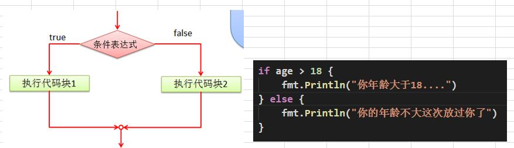

对双分支的总结

1. 从上图看条件表达式就是 age >18

2. 执行代码块1 ===> fmt.Println("你的年龄大于18") ..

3. 执行代码块2 ===> fmt.Println("你的年龄不大....") .

4. 强调一下双分支只会执行其中的一个分支。

### 5.3.4 单分支和双分支的案例

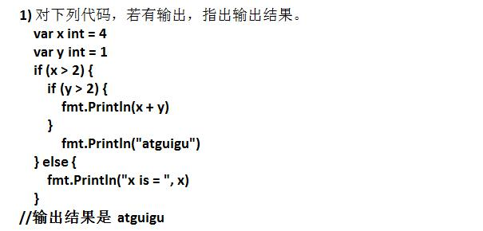

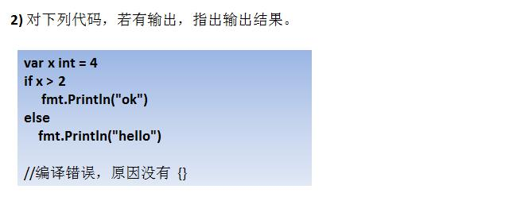

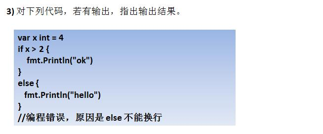

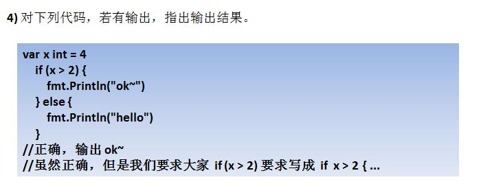

5. 编写程序，声明2 个int32 型变量并赋值。判断两数之和，如果大于等于50，打印“hello world!

```go
func main() {
	//编写程序，声明2个int32型变量并赋值。判断两数之和，如果大于等于50，打印“hello world!”

	//分析
	//1. 变量
	//2. 单分支

	var n1 int32 = 10
	var n2 int32 = 50
	if n1 + n2 >= 50 {
		fmt.Println("hello,world")
	}
}
```

6. 编写程序，声明2 个float64 型变量并赋值。判断第一个数大于10.0，且第2 个数小于20.0，打印两数之和。

```go
//编写程序，声明2个float64型变量并赋值。判断第一个数大于10.0，
//且第2个数小于20.0，打印两数之和
var n3 float64 = 11.0
var n4 float64 = 17.0
if n3 > 10.0 && n4 < 20.0 {
	fmt.Println("和=", (n3 + n4))
}
```

7. 【选作】定义两个变量int32，判断二者的和，是否能被3 又能被5 整除，打印提示信息

```go
var num1 int32 = 10
var num2 int32 = 5
if (num1 + num2) % 3 == 0 && (num1 + num2) % 5 == 0 {
	fmt.Println("能被3又能被5整除")
}
```

8. 判断一个年份是否是闰年，闰年的条件是符合下面二者之一：(1)年份能被4 整除，但不能被100整除；(2)能被400 整除

```go
//8)判断一个年份是否是闰年，闰年的条件是符合下面二者之一：
//(1)年份能被4整除，但不能被100整除；(2)能被400整除
var year int = 2019
if (year % 4 == 0 && year % 100 != 0) || year % 400 == 0 {
	fmt.Println(year, "是闰年~")
}
```

### 5.3.5 多分支控制

- 基本语法

```text
if 条件表达式1 {
	执行代码块1
} else if 条件表达式2 {
	执行代码块2
}
……
else {
	执行代码块n
}
```

对上面基本语法的说明

1. 多分支的判断流程如下:

(1) 先判断条件表达式1 是否成立，如果为真，就执行代码块1

(2) 如果条件表达式1 如果为假，就去判断条件表达式2 是否成立，如果条件表达式2 为真，就执行代码块2

(3) 依次类推.

(4) 如果所有的条件表达式不成立，则执行else 的语句块。

2. else 不是必须的。
3. 多分支只能有一个执行入口。

- 看一个多分支的流程图(更加清晰)

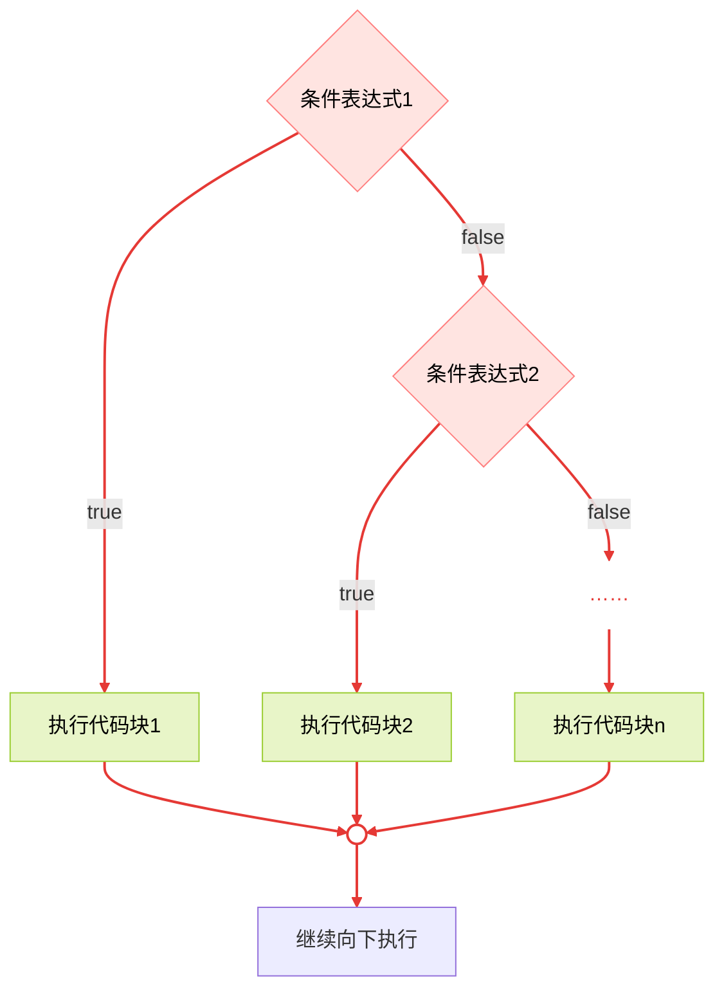

- 多分支的快速入门案例

岳小鹏参加Golang 考试，他和父亲岳不群达成承诺：

如果：

成绩为100 分时，奖励一辆BMW；

成绩为(80，99]时，奖励一台iphone7plus；

当成绩为[60,80]时，奖励一个iPad；

其它时，什么奖励也没有。

请从键盘输入岳小鹏的期末成绩，并加以判断

代码如下：

```go
// 其它时，什么奖励也没有。
// 请从键盘输入岳小鹏的期末成绩，并加以判断

//分析思路
//1. score 分数变量 int
//2. 选择多分支流程控制
//3. 成绩从键盘输入 fmt.Scanln

var score int
fmt.Println("请输入成绩:")
fmt.Scanln(&score)

//多分支判断
if score == 100 {
	fmt.Println("奖励一辆BMW")
} else if score > 80 && score <= 99 {
	fmt.Println("奖励一台iphone7plus")
} else if score >= 60 && score <= 80 {
	fmt.Println("奖励一个 iPad")
} else {
	fmt.Println("什么都不奖励")
}
```

对初学者而言，有一个使用陷阱.

```go
//使用陷阱……只会输出ok1……
var n int = 10
if n > 9 {
	fmt.Println("ok1") //输出 ok1
} else if n > 6 {
	fmt.Println("ok2")
} else if n > 3 {
	fmt.Println("ok3")
} else {
	fmt.Println("ok4")
}
```

- 多分支的课堂练习

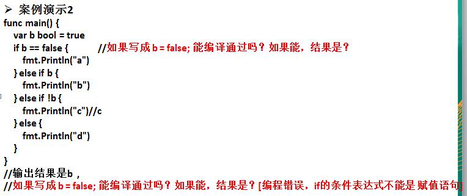

案例3:

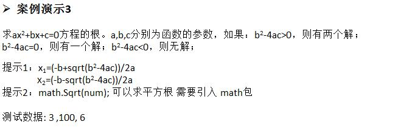

代码:

```go
//分析思路
//1. a,b,c 是三个float64
//2. 使用到给出的数学公式
//3. 使用到多分支
//4. 使用math.Sqrt方法 => 手册

//走代码
var a float64 = 2.0
var b float64 = 4.0
var c float64 = 2.0

m := b*b - 4*a*c
//多分支判断
if m > 0 {
	x1 := (-b + math.Sqrt(m)) / 2 * a
	x2 := (-b - math.Sqrt(m)) / 2 * a
	fmt.Printf("x1=%v x2=%v", x1, x2)
} else if m == 0 {
	x1 := (-b + math.Sqrt(m)) / 2 * a
	fmt.Printf("x1=%v", x1)
} else {
	fmt.Println("无解...")
}
```

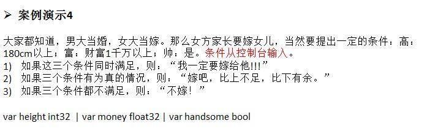

代码：

```go
//分析思路
//1. 应该设计三个变量 var height int32 | var money float32 | var handsome bool
//2. 而且需要从终端输入 fmt.Scanln
//3. 使用多分支if--else if -- else

var height int32
var money float32
var handsome bool

fmt.Println("请输入身高(厘米)")
fmt.Scanln(&height)
fmt.Println("请输入财富(千万)")
fmt.Scanln(&money)
fmt.Println("请输入是否帅(true/false)")
fmt.Scanln(&handsome)

if height > 180 && money > 1.0 && handsome {
	fmt.Println("我一定要嫁给他!!!")
} else if height > 180 || money > 1.0 || handsome {
	fmt.Println("嫁吧，比上不足，比下有余")
} else {
	fmt.Println("不嫁....")
}
```

### 5.3.6 嵌套分支

- 基本介绍

在一个分支结构中又完整的嵌套了另一个完整的分支结构，里面的分支的结构称为内层分支外面的分支结构称为外层分支。

- 基本语法

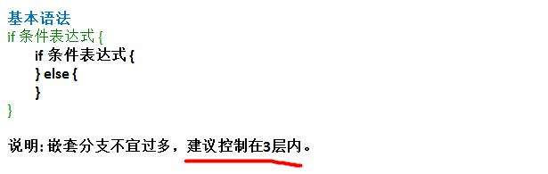

- 应用案例1

参加百米运动会，如果用时8 秒以内进入决赛，否则提示淘汰。并且根据性别提示进入男子组或女

子组。【可以让学员先练习下】, 输入成绩和性别。

代码:

```go
//分析思路
//1. 定义一个变量，来接收跑步使用秒数．float64
//2. 定义一个变量，来接收性别string
//3. 因为判断是嵌套的判断，因此我们会使用嵌套分支

var second float64

fmt.Println("请输入秒数")
fmt.Scanln(&second)

if second <= 8 {
	//进入决赛
	var gender string
	fmt.Println("请输入性别")
	fmt.Scanln(&gender)
	if gender == "男" {
		fmt.Println("进入决赛的男子组")
	} else {
		fmt.Println("进入决赛的女子组")
	}
} else {
	fmt.Println("out...")
}
```

- 应用案例2

出票系统：根据淡旺季的月份和年龄，打印票价[考虑学生先做]

4_10 旺季：

成人（18-60）：60

儿童（<18）:半价

老人（>60）:1/3

淡季：

成人：40

其他：20

代码：

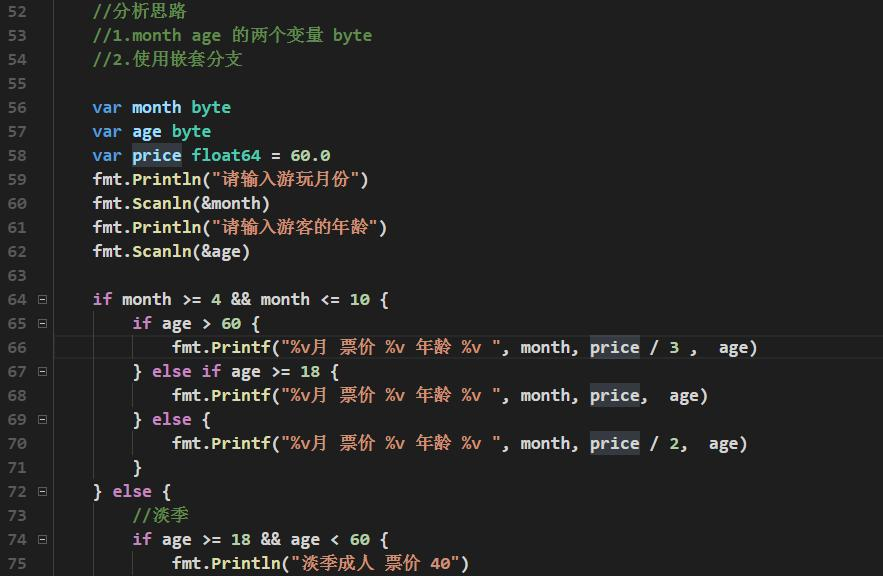

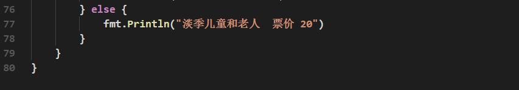

## 5.4 switch 分支控制

### 5.4.1 基本的介绍

1. switch 语句用于基于不同条件执行不同动作，每一个case 分支都是唯一的，从上到下逐一测试，直到匹配为止。
2. 匹配项后面也不需要再加break

### 5.4.2 基本语法

```go
switch 表达式 {
case 表达式1, 表达式2, ...:
	语句块1
case 表达式3, 表达式4, ...:
	语句块2
//这里可以有多个case语句
default:
	语句块
}
```

### 5.4.3 switch 的流程图

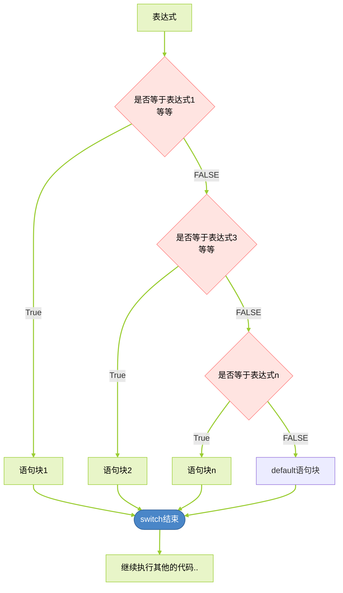

- 对上图的说明和总结

1. switch 的执行的流程是，先执行表达式，得到值，然后和case 的表达式进行比较，如果相等，就匹配到，然后执行对应的case 的语句块，然后退出switch 控制。
2. 如果switch 的表达式的值没有和任何的case 的表达式匹配成功，则执行default 的语句块。执行

后退出switch 的控制.

3. golang 的case 后的表达式可以有多个，使用逗号间隔.
4. golang 中的case 语句块不需要写break , 因为默认会有,即在默认情况下，当程序执行完case 语句块后，就直接退出该switch 控制结构。

### 5.4.4 switch 快速入门案例

- 案例：

请编写一个程序，该程序可以接收一个字符，比如: a,b,c,d,e,f,g a表示星期一，b表示星期二… 根据用户的输入显示相依的信息.要求使用switch 语句完成

- 代码

```go
//分析思路
//1. 定义一个变量接收字符
//2. 使用switch完成
var key byte
fmt.Println("请输入一个字符 a,b,c,d,e,f,g")
fmt.Scanf("%c", &key)

switch key {
case 'a':
	fmt.Println("周一，猴子穿新衣")
case 'b':
	fmt.Println("周二，猴子当小二")
case 'c':
	fmt.Println("周三，猴子爬雪山")
//...
default:
	fmt.Println("输入有误...")
}
```

### 5.4.5 switch 的使用的注意事项和细节

1. case/switch 后是一个表达式( 即：常量值、变量、一个有返回值的函数等都可以)

```go
//写一个非常简单的函数
func test(char byte) byte {
	return char + 1
}

func main() {
	// 案例:
	// 请编写一个程序，该程序可以接收一个字符，比如: a,b,c,d,e,f,g
	// a表示星期一，b表示星期二 ... 根据用户的输入显示相依的信息．
	// 要求使用 switch 语句完成

	//分析思路
	//1. 定义一个变量接收字符
	//2. 使用switch完成
	var key byte
	fmt.Println("请输入一个字符 a,b,c,d,e,f,g")
	fmt.Scanf("%c", &key)
}
```

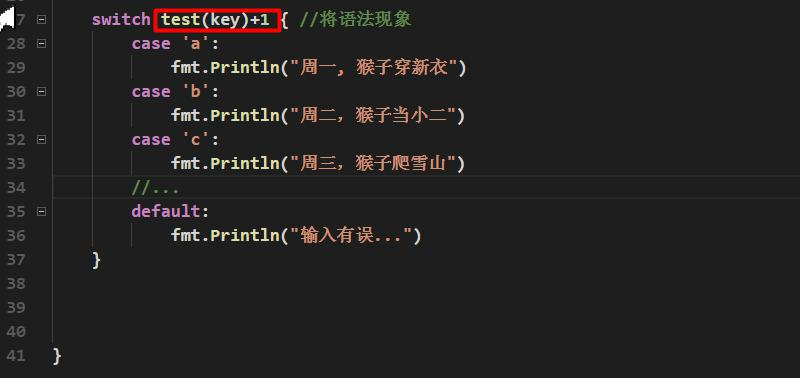

2. case 后的各个表达式的值的数据类型，必须和switch 的表达式数据类型一致

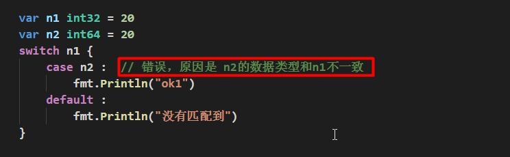

3. case 后面可以带多个表达式，使用逗号间隔。比如case 表达式1, 表达式2 ...

```go
var n1 int32 = 5
var n2 int32 = 20
switch n1 {
case n2, 10, 5 :  // case 后面可以有多个表达式
	fmt.Println("ok1")
default :
	fmt.Println("没有匹配到")
}
```

4. case 后面的表达式如果是常量值(字面量)，则要求不能重复

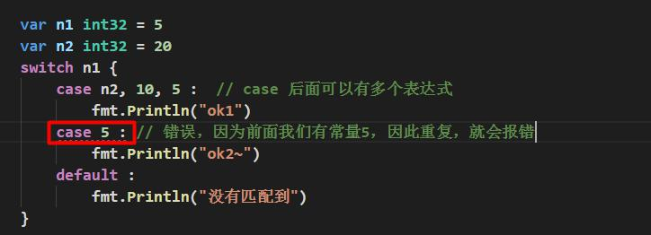

5. case 后面不需要带break , 程序匹配到一个case 后就会执行对应的代码块，然后退出switch，如果一个都匹配不到，则执行default
6. default 语句不是必须的.
7. switch 后也可以不带表达式，类似if --else 分支来使用。【案例演示】

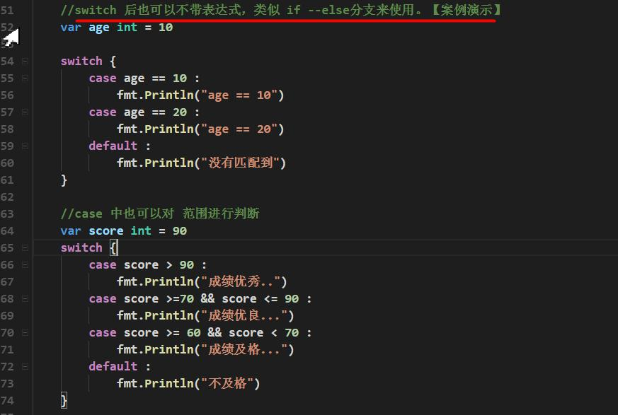

8. switch 后也可以直接声明/定义一个变量，分号结束，不推荐。【案例演示】

```go
//switch 后也可以直接声明/定义一个变量，分号结束，不推荐
switch grade := 90; { // 在golang中，可以这样写
case grade > 90 :
	fmt.Println("成绩优秀~..")
case grade >=70 && grade <= 90 :
	fmt.Println("成绩优良~...")
case grade >= 60 && grade < 70 :
	fmt.Println("成绩及格~...")
default :
	fmt.Println("不及格~")
}
```

9. switch 穿透-fallthrough ，如果在case 语句块后增加fallthrough ,则会继续执行下一个case，也叫switch 穿透

```go
//switch 的穿透 fallthrough
var num int = 10
switch num {
case 10:
	fmt.Println("ok1")
	fallthrough //默认只能穿透一层
case 20:
	fmt.Println("ok2")
	fallthrough
case 30:
	fmt.Println("ok3")
default:
	fmt.Println("没有匹配到..")
}
```

10. Type Switch：switch 语句还可以被用于type-switch 来判断某个interface 变量中实际指向的变量类型【还没有学interface, 先体验一把】

```go
var x interface{}
var y = 10.0
x = y
switch i := x.(type) {
case nil:
	fmt.Printf(" x 的类型~ :%T",i)
case int:
	fmt.Printf("x 是 int 型")
case float64:
	fmt.Printf("x 是 float64 型")
case func(int) float64:
	fmt.Printf("x 是 func(int) 型")
case bool, string:
	fmt.Printf("x 是 bool 或 string 型" )
default:
	fmt.Printf("未知型")
}
```

### 5.4.6 switch 的课堂练习

1. 使用switch 把小写类型的char 型转为大写(键盘输入)。只转换a, b, c, d, e. 其它的输出“other”。

```go
func main(){
	//1)使用 switch 把小写类型的 char型转为大写(键盘输入)。
	//只转换 a, b, c, d, e. 其它的输出 "other"。

	var char byte
	fmt.Println("请输入一个字符..")
	fmt.Scanf("%c", &char)

	switch char {
	case 'a':
		fmt.Println("A")
	case 'b':
		fmt.Println("B")
	case 'c':
		fmt.Println("C")
	case 'd':
		fmt.Println("D")
	case 'e':
		fmt.Println("E")
	default :
		fmt.Println("other")
	}
}
```

2. 对学生成绩大于60 分的，输出“合格”。低于60 分的，输出“不合格”。(注：输入的成绩不能大于100)

```go
//2)对学生成绩大于60分的，输出“合格”。低于60分的，输出“不合格”。
//(注：输入的成绩不能大于100)
var score float64
fmt.Println("请输入成绩")
fmt.Scanln(&score)

switch int(score / 60) {
case 1:
	fmt.Println("及格")
case 0:
	fmt.Println("不及格")
default:
	fmt.Println("输入有误..")
}
```

3. 根据用户指定月份，打印该月份所属的季节。3,4,5 春季6,7,8 夏季 9,10,11 秋季12, 1, 2 冬季

```go
//3)根据用户指定月份，
//打印该月份所属的季节。3,4,5 春季 6,7,8 夏季  9,10,11 秋季 12, 1, 2 冬季
var month byte
fmt.Println("请输入月份")
fmt.Scanln(&month)
switch month {
case 3, 4, 5 :
	fmt.Println("spring")
case 6, 7, 8 :
	fmt.Println("summer")
case 9, 10, 11 :
	fmt.Println("autumn")
case 12, 1, 2 :
	fmt.Println("winter")
default:
	fmt.Println("输入有误..")
}
```

### 5.4.7 switch 和if 的比较

总结了什么情况下使用switch ,什么情况下使用if

1. 如果判断的具体数值不多，而且符合整数、浮点数、字符、字符串这几种类型。建议使用swtich语句，简洁高效。
2. 其他情况：对区间判断和结果为bool 类型的判断，使用if，if 的使用范围更广。

## 5.5 for 循环控制

### 5.5.1 基本介绍

听其名而知其意。就是让我们的一段代码循环的执行。

### 5.5.2 一个实际的需求

- 请大家看个案例[forTest.go]:

编写一个程序, 可以打印10 句

"你好，尚硅谷!"。请大家想想怎么做?

- 使用传统的方式实现

```go
func main() {
	//输出10句 "你好，尚硅谷"

	// fmt.Println("你好，尚硅谷")
	// fmt.Println("你好，尚硅谷")
	// fmt.Println("你好，尚硅谷")
	// fmt.Println("你好，尚硅谷")
	// fmt.Println("你好，尚硅谷")
	// fmt.Println("你好，尚硅谷")
	// fmt.Println("你好，尚硅谷")
	// fmt.Println("你好，尚硅谷")
	// fmt.Println("你好，尚硅谷")
	// fmt.Println("你好，尚硅谷")
}
```

- for 循环的快速入门

```go
//golang中，有循环控制语句来处理循环的执行某段代码的方法->for循环
//for循环快速入门
for i := 1; i <= 10; i++ {
	fmt.Println("你好，尚硅谷", i)
}
```

### 5.5.3 for 循环的基本语法

- 语法格式

```text
for 循环变量初始化; 循环条件; 循环变量迭代{
    循环操作(语句)
}
```

- 对上面的语法格式说明

1. 对for 循环来说，有四个要素：
2. 循环变量初始化
3. 循环条件
4. 循环操作(语句) ,有人也叫循环体。
5. 循环变量迭代

- for 循环执行的顺序说明：

1. 执行循环变量初始化，比如i := 1
2. 执行循环条件，比如i <= 10
3. 如果循环条件为真，就执行循环操作:比如fmt.Println(“....”)
4. 执行循环变量迭代, 比如i++
5. 反复执行2, 3, 4 步骤，直到循环条件为False ，就退出for 循环。

### 5.5.4 for 循环执行流程分析

- for 循环的流程图

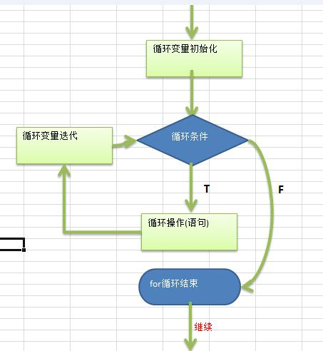

- 对照代码分析for 循环的执行过程

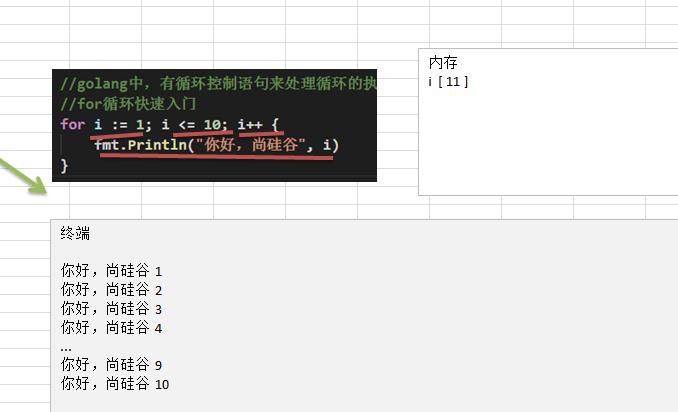

### 5.5.5 for 循环的使用注意事项和细节讨论

1. 循环条件是返回一个布尔值的表达式
2. for 循环的第二种使用方式

```text
    for 循环判断条件 {
        //循环执行语句
    }
```

将变量初始化和变量迭代写到其它位置

- 案例演示：

```go
//for循环的第二种写法
j := 1 //循环变量初始化
for j <= 10 { //循环条件
	fmt.Println("你好，尚硅谷~", j)
	j++ //循环变量迭代
}
```

3. for 循环的第三种使用方式

```text
    for {
        //循环执行语句
    }
```

上面的写法等价for ; ; {} 是一个无限循环，通常需要配合break 语句使用

```go
//for循环的第三种写法，这种写法通常会配合break使用
k := 1
for { // 这里也等价 for ; ; {
	if k <= 10 {
		fmt.Println("ok~~", k)
	} else {
		break //break就是跳出这个for循环
	}
	k++
}
```

4. Golang 提供for-range 的方式，可以方便遍历字符串和数组(注: 数组的遍历，我们放到讲数组的时候再讲解) ，案例说明如何遍历字符串。

- 字符串遍历方式1-传统方式

```go
//字符串遍历方式1-传统方式
var str string = "hello,world!"
for i := 0; i < len(str); i++ {
	fmt.Printf("%c \n", str[i]) //使用到下标....
}
```

- 字符串遍历方式2-for - range

```go
fmt.Println()
//字符串遍历方式2-for-range
str = "abc~ok"
for index, val := range str {
	fmt.Printf("index=%d, val=%c \n", index, val)
}
```

- 上面代码的细节讨论

如果我们的字符串含有中文，那么传统的遍历字符串方式，就是错误，会出现乱码。原因是传统的对字符串的遍历是按照字节来遍历，而一个汉字在utf8 编码是对应3 个字节。

如何解决需要要将 str 转成[]rune 切片.=> 体验一把

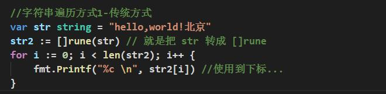

对应for-range 遍历方式而言，是按照字符方式遍历。因此如果有字符串有中文，也是ok

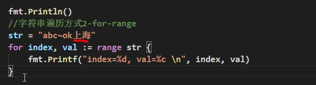

### 5.5.6 for 循环的课堂练习

1. 打印1~100 之间所有是9 的倍数的整数的个数及总和

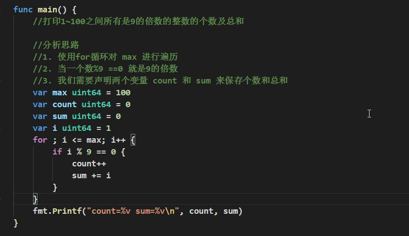

2. 完成下面的表达式输出，6 是可变的。

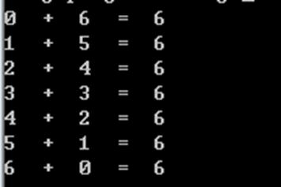

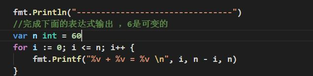

## 5.6 while 和do..while 的实现

Go 语言没有while 和do...while 语法，这一点需要同学们注意一下，如果我们需要使用类似其它语言(比如java / c 的while 和do...while )，可以通过for 循环来实现其使用效果。

### 5.6.1 while 循环的实现

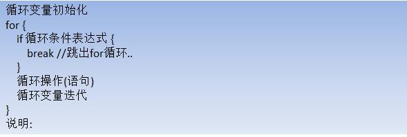

- 说明上图

1. for 循环是一个无限循环
2. break 语句就是跳出for 循环

- 使用上面的while 实现完成输出10 句”hello,wrold”

```go
func main(){
	//使用while方式输出10句 "hello,world"
	//循环变量初始化
	var i int = 1
	for {
		if i > 10 { //循环条件
			break // 跳出for循环,结束for循环
		}
		fmt.Println("hello,world", i)
		i++ //循环变量的迭代
	}

	fmt.Println("i=", i)
}
```

### 5.6.2 do..while 的实现

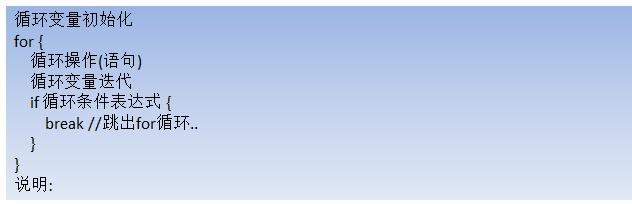

- 对上图的说明

1. 上面的循环是先执行，在判断，因此至少执行一次。
2. 当循环条件成立后，就会执行break, break 就是跳出for 循环，结束循环.

- 案例演示

使用上面的do...while 实现完成输出10 句”hello,ok”

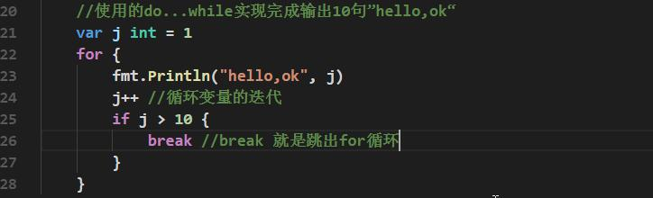

## 5.7 多重循环控制(重点，难点)

### 5.7.1 基本介绍

1. 将一个循环放在另一个循环体内，就形成了嵌套循环。在外边的for 称为外层循环在里面的for循环称为内层循环。【建议一般使用两层，最多不要超过3 层】
2. 实质上，嵌套循环就是把内层循环当成外层循环的循环体。当只有内层循环的循环条件为false时，才会完全跳出内层循环，才可结束外层的当次循环，开始下一次的循环。
3. 外层循环次数为m 次，内层为n 次，则内层循环体实际上需要执行m*n 次

### 5.7.2 应用案例

1. 统计3 个班成绩情况，每个班有5 名同学，求出各个班的平均分和所有班级的平均分[学生的成绩从键盘输入]

编程时两大绝招

(1) 先易后难，即将一个复杂的问题分解成简单的问题。

(2) 先死后活

代码:

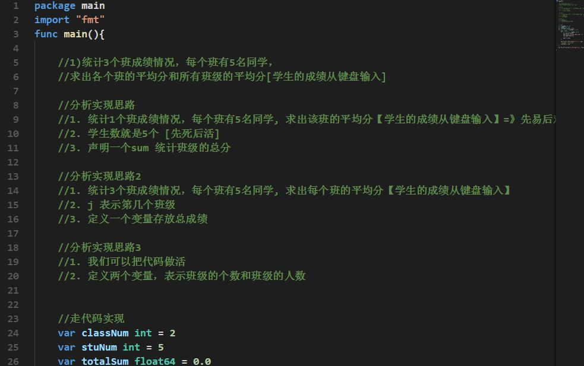

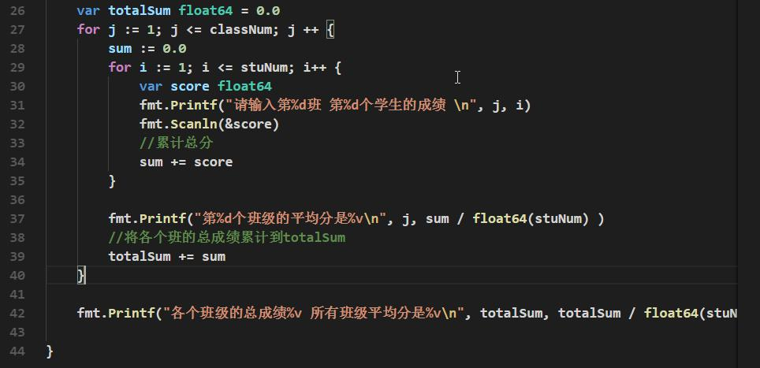

2. 统计三个班及格人数，每个班有5 名同学

对上面的代码进行了一点修改.

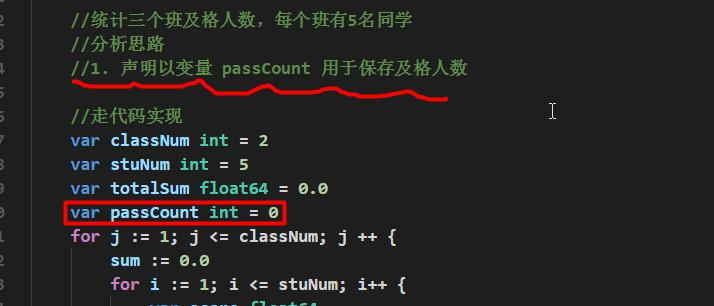

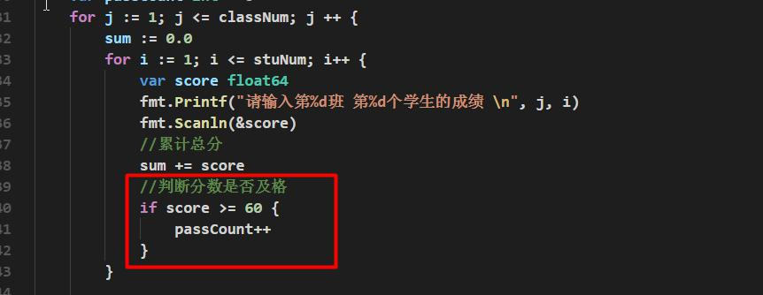

3. 打印金字塔经典案例

使用for 循环完成下面的案例请编写一个程序，可以接收一个整数,表示层数，打印出金字

- 分析编程思路
- 走代码

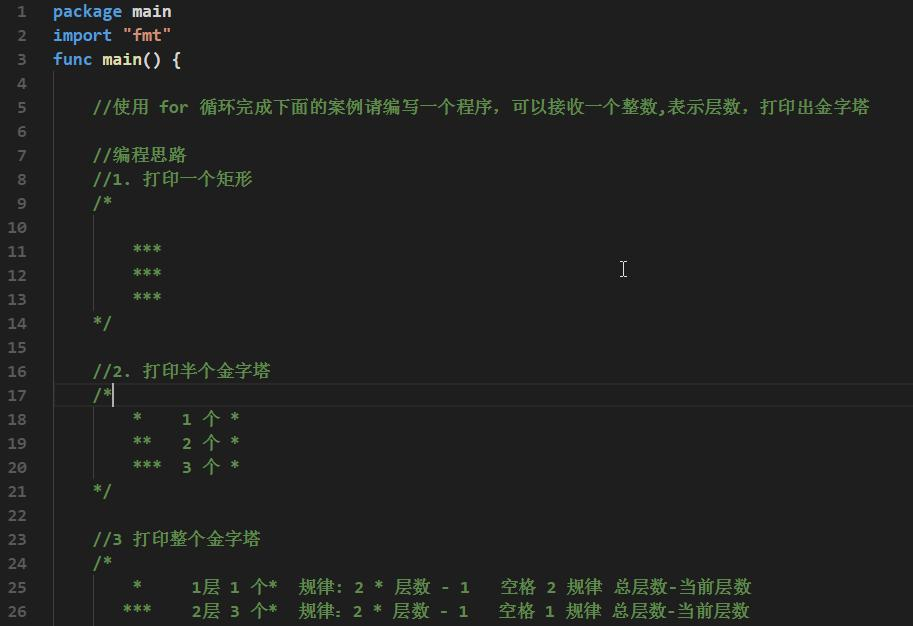

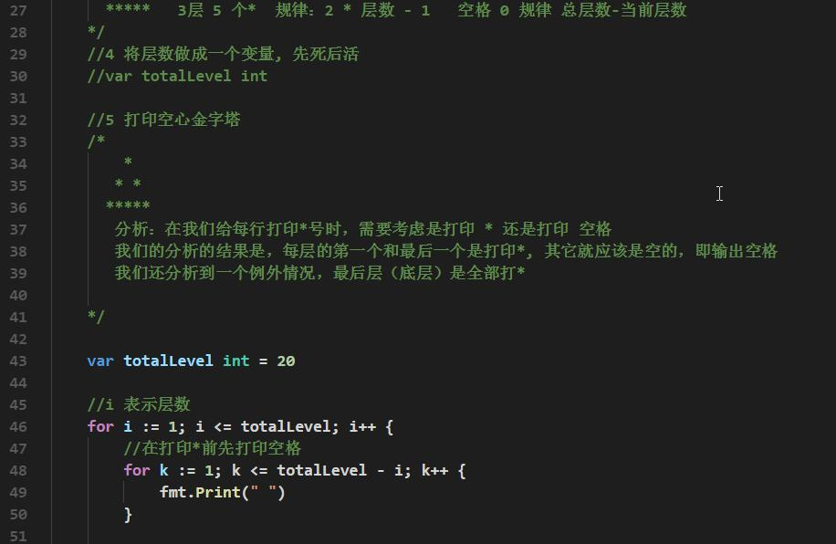

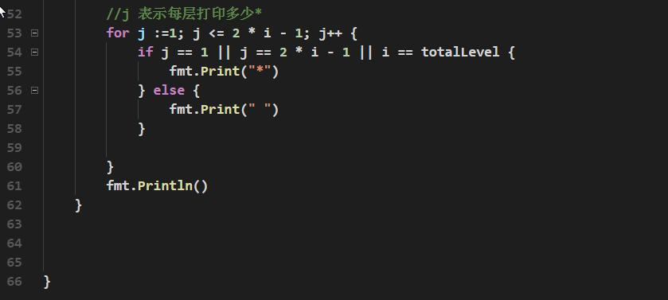

4. 打印出九九乘法表

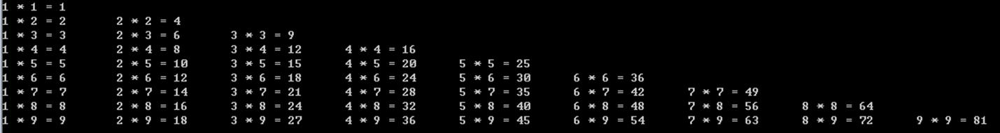

代码：

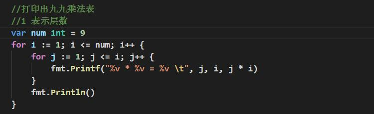

## 5.8 跳转控制语句-break

### 5.8.1 看一个具体需求，引出break

随机生成1-100 的一个数，直到生成了99 这个数，看看你一共用了几次?

分析：编写一个无限循环的控制，然后不停的随机生成数，当生成了99 时，就退出这个无限循环==》break 提示使用

这里我们给大家说一下，如下随机生成1-100 整数.

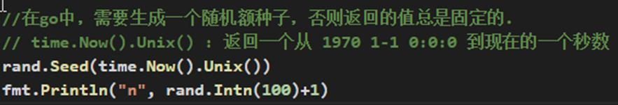

### 5.8.2 break 的快速入门案例

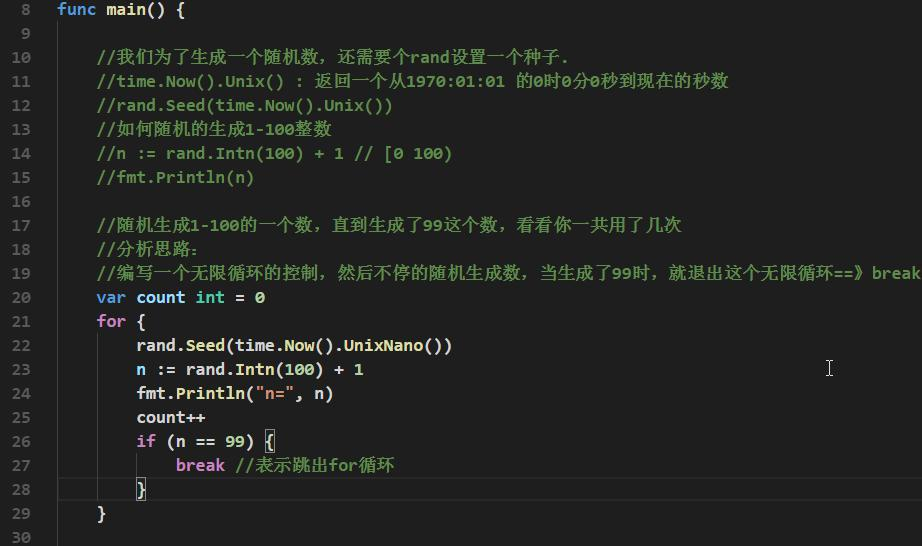

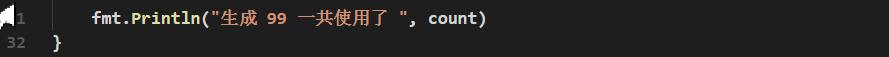

### 5.8.3 基本介绍：

break 语句用于终止某个语句块的执行，用于中断当前for 循环或跳出switch 语句。

### 5.8.4 基本语法：

{ ……

```text
        break
        ……
}
```

### 5.8.5 以for 循环使用break 为例,画出示意图

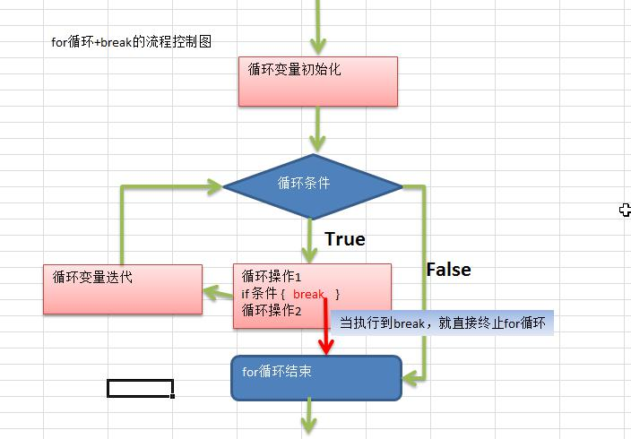

### 5.8.6 break 的注意事项和使用细节

1. break 语句出现在多层嵌套的语句块中时，可以通过标签指明要终止的是哪一层语句块
2. 看一个案例

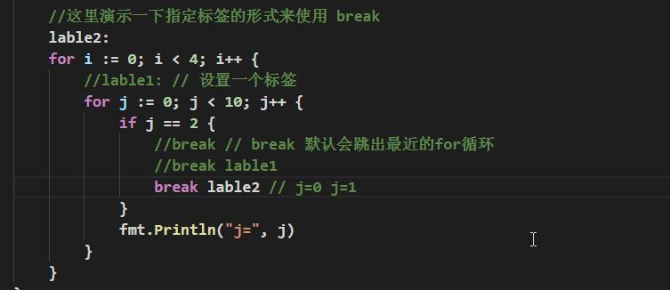

3. 对上面案例的说明

(1) break 默认会跳出最近的for 循环

(2) break 后面可以指定标签，跳出标签对应的for 循环

### 5.8.7 课堂练习

1. 100 以内的数求和，求出当和第一次大于20 的当前数

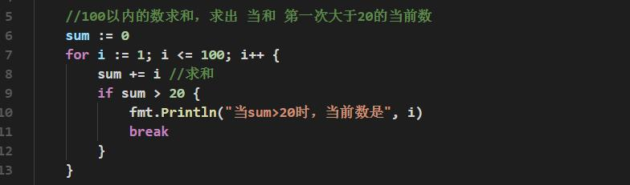

2. 实现登录验证，有三次机会，如果用户名为”张无忌” ,密码”888”提示登录成功，否则提示还有几次机会.

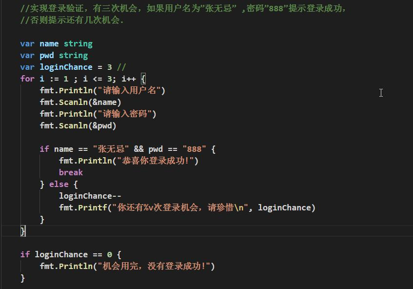

## 5.9 跳转控制语句-continue

### 5.9.1 基本介绍：

continue 语句用于结束本次循环，继续执行下一次循环。

continue 语句出现在多层嵌套的循环语句体中时，可以通过标签指明要跳过的是哪一层循环, 这个和前面的break 标签的使用的规则一样.

### 5.9.2 基本语法：

{ ……

```text
        continue
        ……
}
```

### 5.9.3 continue 流程图

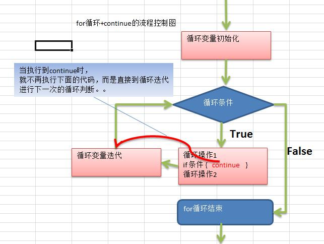

### 5.9.4 案例分析continue 的使用

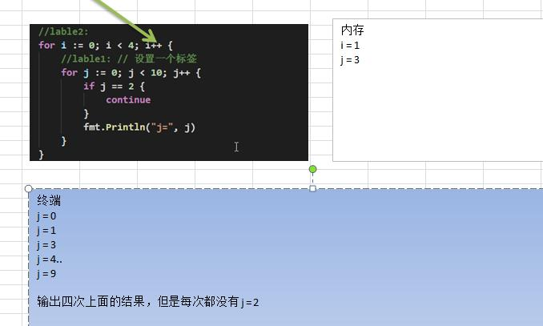

### 5.9.5 continu 的课堂练习

- 练习1


- continue 实现打印1——100 之内的奇数[要求使用for 循环+continue]

代码：

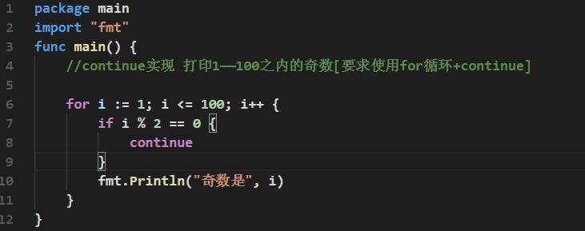

- 从键盘读入个数不确定的整数，并判断读入的正数和负数的个数，输入为0 时结束程序

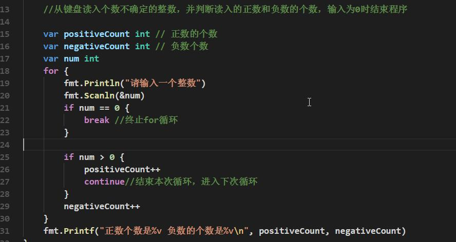

- 课后练习题(同学们课后自己完成)：

某人有100,000 元,每经过一次路口，需要交费,规则如下:

当现金>50000 时,每次交5%

当现金<=50000 时,每次交1000

编程计算该人可以经过多少次路口,使用for break 方式完成

## 5.10 跳转控制语句-goto

### 5.10.1 goto 基本介绍

1. Go 语言的goto 语句可以无条件地转移到程序中指定的行。
2. goto 语句通常与条件语句配合使用。可用来实现条件转移，跳出循环体等功能。
3. 在Go 程序设计中一般不主张使用goto 语句，以免造成程序流程的混乱，使理解和调试程序都产生困难

### 5.10.2 goto 基本语法

```text
goto label
.. .
label: statement
```

### 5.10.3 goto 的流程图


### 5.10.4 快速入门案例


## 5.11 跳转控制语句-return

### 5.11.1 介绍：

return 使用在方法或者函数中，表示跳出所在的方法或函数，在讲解函数的时候，会详细的介绍。


说明

1. 如果return 是在普通的函数，则表示跳出该函数，即不再执行函数中return 后面代码，也可以理解成终止函数。
2. 如果return 是在main 函数，表示终止main 函数，也就是说终止程序。
