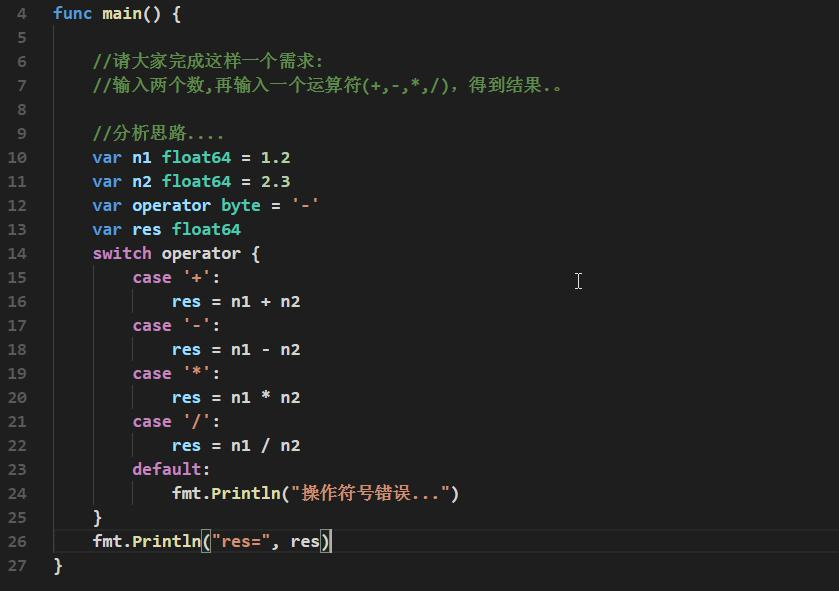
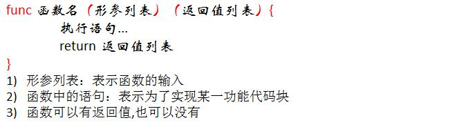
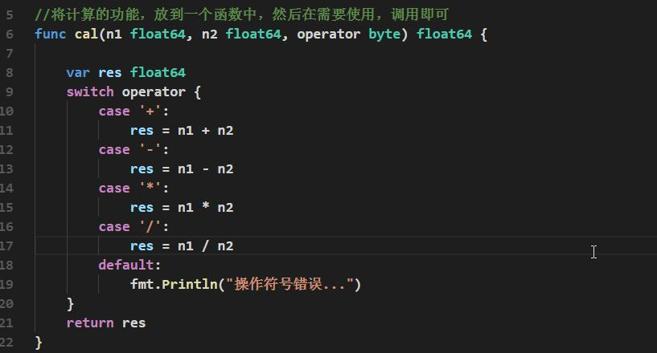
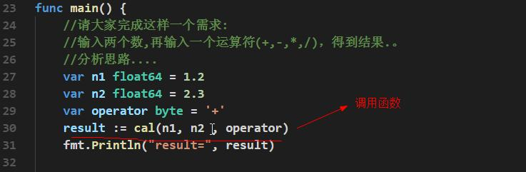
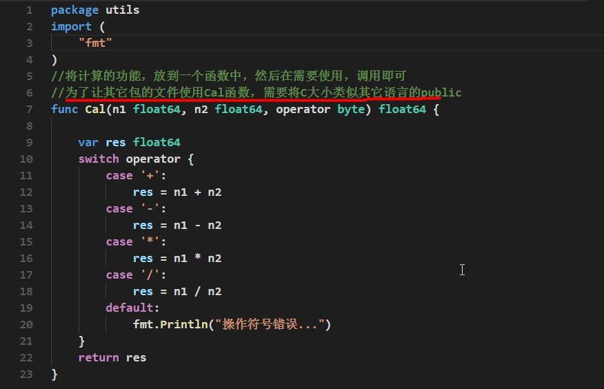
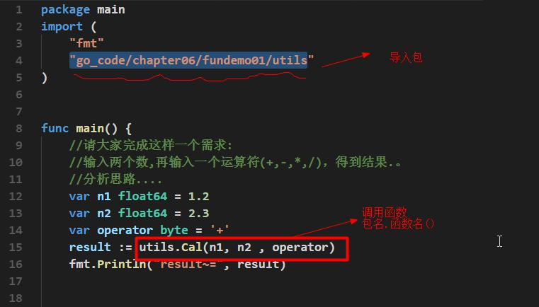
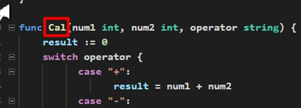
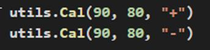
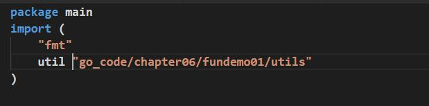
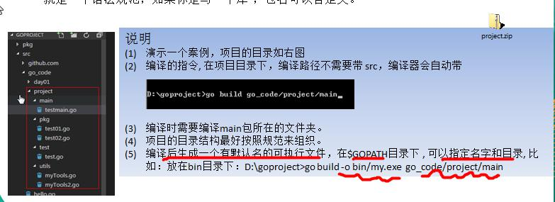

## 6.1 为什么需要函数

### 6.1.1 请大家完成这样一个需求:

输入两个数,再输入一个运算符(+,-,*,/)，得到结果.。

### 6.1.2 使用传统的方法解决

- 走代码



- 分析一下上面代码问题

1. 上面的写法是可以完成功能, 但是代码冗余
2. 同时不利于代码维护
3. 函数可以解决这个问题

## 6.2 函数的基本概念

为完成某一功能的程序指令(语句)的集合,称为函数。

在Go 中,函数分为: 自定义函数、系统函数(查看Go 编程手册)

## 6.3 函数的基本语法



## 6.4 快速入门案例

使用函数解决前面的计算问题。

走代码:





## 6.5 包的引出

1. 在实际的开发中，我们往往需要在不同的文件中，去调用其它文件的定义的函数，比如main.go中，去使用utils.go 文件中的函数，如何实现？-》包
2. 现在有两个程序员共同开发一个Go 项目,程序员xiaoming 希望定义函数Cal ,程序员xiaoqiang也想定义函数也叫Cal。两个程序员为此还吵了起来,怎么办? -》包

## 6.6 包的原理图

包的本质实际上就是创建不同的文件夹，来存放程序文件。

画图说明一下包的原理


## 6.7 包的基本概念

说明：go 的每一个文件都是属于一个包的，也就是说go 是以包的形式来管理文件和项目目录结构的

## 6.8 包的三大作用

区分相同名字的函数、变量等标识符

当程序文件很多时,可以很好的管理项目

控制函数、变量等访问范围，即作用域

## 6.9 包的相关说明

- 打包基本语法

```go
package 包名
```

- 引入包的基本语法

```go
import "包的路径"
```

## 6.10 包使用的快速入门

包快速入门-Go 相互调用函数，我们将func Cal 定义到文件utils.go , 将utils.go 放到一个包中，当其它文件需要使用到utils.go 的方法时，可以import 该包，就可以使用了. 【为演示：新建项目目录结构】

代码演示：


utils.go 文件



main.go 文件



## 6.11 包使用的注意事项和细节讨论

1. 在给一个文件打包时，该包对应一个文件夹，比如这里的utils 文件夹对应的包名就是utils,文件的包名通常和文件所在的文件夹名一致，一般为小写字母。
2. 当一个文件要使用其它包函数或变量时，需要先引入对应的包

- 引入方式1：import"包名"
- 引入方式2：

```go
import (
    "包名"
    "包名"
)
```

- package 指令在文件第一行，然后是import 指令。
- 在import 包时，路径从$GOPATH 的src 下开始，不用带src , 编译器会自动从src 下开始引入

3. 为了让其它包的文件，可以访问到本包的函数，则该函数名的首字母需要大写，类似其它语言的public ,这样才能跨包访问。比如utils.go 的



4. 在访问其它包函数，变量时，其语法是包名.函数名，比如这里的main.go 文件中



5. 如果包名较长，Go 支持给包取别名，注意细节：取别名后，原来的包名就不能使用了



说明: 如果给包取了别名，则需要使用别名来访问该包的函数和变量。

6. 在同一包下，不能有相同的函数名（也不能有相同的全局变量名），否则报重复定义
7. 如果你要编译成一个可执行程序文件，就需要将这个包声明为main , 即package main .这个就是一个语法规范，如果你是写一个库，包名可以自定义


