# 第 1 章 Git 操作

Git 的版本控制概念、安装配置、底层对象、本地操作、分支、撤销与重置、数据恢复和标签。

<!-- more -->

<!-- PDF 第 1 页 -->

> —————————————————————————————
V2.0  
# 第1章  Git 操作
## 版本控制
什么是版本控制？我们为什么要关心它呢？版本控制是一种记录一个或若干文  
件内容变化，以便将来查阅特定版本修订情况的系统  
为什么要使用版本控制?软件开发中采用版本控制系统是个明智的选择。  
有了它你就可以将某个文件回溯到之前的状态，甚至将整个项目都回退到过去某  
个时间点的状态。就算你乱来一气把整个项目中的文件改的改删的删，你也照样可以  
轻松恢复到原先的样子。但额外增加的工作量却微乎其微。  
你可以比较文件的变化细节，查出最后是谁修改了哪个地方，从而找出导致怪异  
问题出现的原因，又是谁在何时报告了某个功能缺陷等等。  
### 集中化的版本控制系统
集中化的版本控制系统诸如 CVS，svn 以及 Perforce 等，都有一个单一的集  
中管理的服务器，保存所有文件的修订版本，而协同工作的人们都通过客户端连到  
这台服务器，取出最新的文件或者提交更新。多年以来，这已成为版本控制系统的  
标准做法  
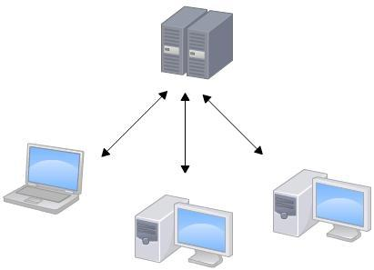

这种做法带来了许多好处，现在，每个人都可以在一定程度上看到项目中的其  
他人正在做些什么。而管理员也可以轻松掌控每个开发者的权限，并且管理一个集  
中化的版本控制系统; 要远比在各个客户端上维护本地数据库来得轻松容易  
事分两面，有好有坏。这么做最显而易见的缺点是中央服务器的单点故障。  
如果服务器宕机一小时，那么在这一小时内，谁都无法提交更新，也就无法协同  

<!-- PDF 第 2 页 -->

> —————————————————————————————
工作。  
(并不是说服务器故障了就没有办法写代码了,只是在服务器故障的情况下,编写的  
代码是没有办法得到保障的.试想svn 中央服务器挂机一天.你还拼命写了一天代  
码,其中12 点之前的代码都是高质量可靠的,而且有很多闪光点.而12 点之后的代  
码由于你想尝试一个比较大胆的想法,将代码改的面目全非了.这样下来你12 点之  
前做的工作也都白费了  有记录的版本只能是svn 服务器挂掉时保存的版本!)  
要是中央服务器的磁盘发生故障，碰巧没做备份，或者备份不够及时，就会  
有丢失数据的风险。最坏的情况是彻底丢失整个项目的所有历史更改记录，而被  
客户端偶然提取出来的保存在本地的某些快照数据就成了恢复数据的希望。但这  
样的话依然是个问题，你不能保证所有的数据都已经有人事先完整提取出来过。  
只要整个项目的历史记录被保存在单一位置，就有丢失所有历史更新记录的风险。  
### 分布式的版本控制系统
于是分布式版本控制系统面世了。在这类系统中，像 Git，BitKeeper 等，客  
户端并不只提取最新版本的文件快照，而是把代码仓库完整地镜像下来。这么一  
来，任何一处协同工作用的服务器发生故障，事后都可以用任何一个镜像出来的本  
地仓库恢复。因为每一次的提取操作，实际上都是一次对代码仓库的完整备份  
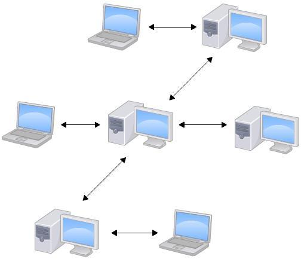

更进一步，许多这类系统都可以指定和若干不同的远端代码仓库进行交  
互。籍此，你就可以在同一个项目中分别和不同工作小组的人相互协作。  
分布式的版本控制系统在管理项目时 存放的不是项目版本与版本之间  
的差异.它存的是索引(所需磁盘空间很少  所以每个客户端都可以放下整个  
项目的历史记录)  
分布式的版本控制系统出现之后,解决了集中式版本控制系统的缺陷:  
1. 断网的情况下也可以进行开发(因为版本控制是在本地进行的)  
2. 使用github 进行团队协作,哪怕github 挂了 每个客户端保存  
的也都是整个完整的项目(包含历史记录的!!!)  

<!-- PDF 第 3 页 -->

> —————————————————————————————
## Git 简史
Git 是目前世界上最先进的分布式版本控制系统。同生活中的许多伟大事件一样，Git  
诞生于一个极富纷争大举创新的年代。Linux 内核开源项目有着为数众广的参与者。绝  
大多数的 Linux 内核维护工作都花在了提交补丁和保存归档的繁琐事务上（1991－2002  
年间）。到 2002 年，整个项目组开始启用分布式版本控制系统 BitKeeper 来管理和维  
护代码。  
到了 2005 年，开发 BitKeeper 的商业公司同 Linux 内核开源社区的合作关系结  
束，他们收回了免费使用 BitKeeper 的权力。这就迫使 Linux 开源社区（特别是 Linux  
的缔造者 Linus Torvalds ）不得不吸取教训，只有开发一套属于自己的版本控制系统才  
不至于重蹈覆辙。他们对新的系统制订了若干目标：  
分支切换速度快  
容量小(压缩)  
简单的设计 完全分布式  
对非线性开发模式的强力支持（允许上千个并行开发的分支）  
有能力高效管理类似 Linux 内核一样的超大规模项目（速度和数据量）  
自诞生于 2005 年以来，Git 日臻成熟完善，在高度易用的同时，仍然保留着初期设  
定的目标。它的速度飞快，极其适合管理大项目，它还有着令人难以置信的非线性分支管理  
系统可以应付各种复杂的项目开发需求。  
## Git 安装
### 在 Windows 上安装
git 地址 : https://git-scm.com/download/win  
下载完安装包之后，双击exe 安装包，可以看到如下图窗口界面，一直点击  
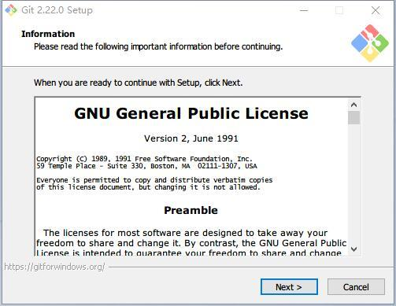

完成安装之后，就可以使用命令行的 `git` 工具（已经自带了 ssh 客户端）;  
图示如下:  

<!-- PDF 第 4 页 -->

> —————————————————————————————
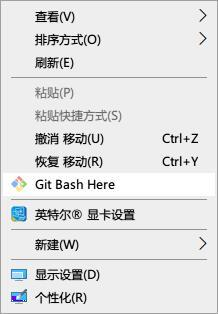

当你点击`git bash Here` 菜单之后，可以看到一个终端窗口，在终端里面输入  
命令`git --version`，如果可以看到 git 的版本信息，则说明安装成功，如下图所  
示：  
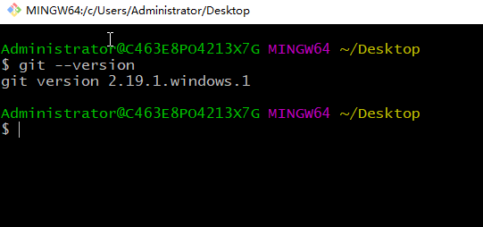

### 在 Mac 上安装
git 地址 :https://git-scm.com/download/mac  
下载下来之后可以看到一个dmg 文件，双击打开 压缩文件，可以看到里面有  
一个文件， 再次双击pkg 文件，就可以进行安装，然后按照引导一直点击继续  
按钮就可以完成安装了.  
## Git 初始化配置
一般在新的系统上，我们都需要先配置下自己的 Git 工作环境。配置工作只需一  
次，以后升级时还会沿用现在的配置。当然，如果需要，你随时可以用相同的命令修  
改已有的配置。  
Git 提供了一个叫做 git config 的命令来配置或读取相应的工作环境变量而正是由  
这些环境变量，决定了 Git 在各个环节的具体工作方式和行为。这些变量可以存放  
在以下三个不同的地方：  
`/etc/gitconfig` 文件：系统中对所有用户都普遍适用的配置。若使用 `git`  

<!-- PDF 第 5 页 -->

> —————————————————————————————
`config` 时用 `--system` 选项，读写的就是这个文件。  
`~/.gitconfig` 文件：用户目录下的配置文件只适用于该用户。若使用 `git`  
`config` 时用 `--global` 选项，读写的就是这个文件。  
`.git/config` 文件：当前项目的 Git 目录中的配置文件（也就是工作目录  
中的 `.git/config` 文件）这里的配置仅仅针对当前项目有效。  
每一个级别的配置都会覆盖上层的相同配置  
### 配置内容
#### 用户信息
第一个要配置的是你个人的用户名称和电子邮件地址。这两条配置很重要，每  
次 Git 提交时都会引用这两条信息，说明是谁提交了更新，所以会随更新内容一  
起被永久纳入历史记录：  
```bash
$ git config --global user.name "damu"
$ git config --global user.email damu@example.com
```

要检查已有的配置信息，可以使用 `git config --list` 命令  
删除配置信息`git config --global --unset user.email`  
## Git 底层概念（底层命令）
#### 基础的linux 命令
```bash
clear ：清除屏幕
echo 'test content'：往控制台输出信息 echo 'test content' > test.txt
ll ：将当前目录下的 子文件&子目录平铺在控制台
find 目录名： 将对应目录下的子孙文件&子孙目录平铺在控制台
find 目录名 -type f ：将对应目录下的文件平铺在控制台
rm  文件名 ： 删除文件
mv 源文件 重命名文件: 重命名
```

cat 文件的url : 查看对应文件的内容  
vim 文件的url(在英文模式下)  
按 i 进插入模式  进行文件的编辑  
按 esc 键&amp;按:键 进行命令的执行  
q!   强制退出（不保存）  
wq  保存退出  
set nu 设置行号  
#### 初始化新仓库
命令：git init  
解析：要对现有的某个项目开始用 Git 管理，只需到此项目所在的目录，执  
行：git init  
作用：初始化后，在当前目录下会出现一个名为 .git 的目录，所有 Git 需要  
的数据和资源都存放在这个目录中。不过目前，仅仅是按照既有的结构框架初始化  
好了里边所有的文件和目录，但我们还没有开始跟踪管理项目中的任何一个文件。  

<!-- PDF 第 6 页 -->

> —————————————————————————————
#### .git 目录
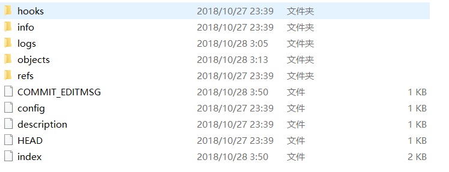

`hooks`              目录包含客户端或服务端的钩子脚本；  
`info`               包含一个全局性排除文件  
`logs`              保存日志信息  
`objects`            目录存储所有数据内容；  
```text
refs
```

目录存储指向数据的提交对象的指针（分支）  
`config`             文件包含项目特有的配置选项  
```text
description
```

用来显示对仓库的描述信息  
`HEAD`                文件指示目前被检出的分支  
`index`               文件保存暂存区信息  
#### git 对象
Git 的核心部分是一个简单的键值对数据库。你可以向该数据库插入任意类型  
的内容，它会返回一个键值，通过该键值可以在任意时刻再次检索该内容  
 向数据库写入内容 并返回对应键值  
命令：  
```bash
echo 'test content' | git hash-object -w --stdin
```

-w 选项指示 hash-object 命令存储数据对象；若不指定此选项，则  
该命令仅返回对应的键值  
--stdin（standard input）选项则指示该命令从标准输入读取内容；  
若不指定此选项，则须在命令尾部给出待存储文件的路径  
```bash
git hash-object -w 文件路径
```

存文件  
```bash
git hash-object 文件路径
```

返回对应文件的键值  
d670460b4b4aece5915caf5c68d12f560a9fe3e4  
返回：  
该命令输出一个长度为 40 个字符的校验和。 这是一个 SHA-1 哈希值  
 查看 Git 是如何存储数据的  
命令：  
```bash
find .git/objects -type f
```

返回：  
.git/objects/d6/70460b4b4aece5915caf5c68d12f560a9fe3e4  
这就是开始时 Git 存储内容的方式：一个文件对应一条内容。校验和的前两个字符  

<!-- PDF 第 7 页 -->

> —————————————————————————————
用于命名子目录，余下的 38 个字符则用作文件名。  
 根据键值拉取数据  
命令：  
```bash
git cat-file -p d670460b4b4aece5915caf5c68d12f560a9fe3e4
```

-p 选项可指示该命令自动判断内容的类型，并为我们显示格式友好的内容  
返回：  
对应文件的内容  
#### 对一个文件进行简单的版本控制
 创建一个新文件并将其内容存入数据库  
命令：  
```bash
echo 'version 1' > test.txt
git hash-object -w test.txt
```

返回：  
83baae61804e65cc73a7201a7252750c76066a30  
 向文件里写入新内容，并再次将其存入数据库  
命令：  
```bash
echo 'version 2' > test.txt
git hash-object -w test.txt
```

返回：  
1f7a7a472abf3dd9643fd615f6da379c4acb3e3a  
 查看数据库内容  
命令：  
```bash
find .git/objects -type f
git cat-file -p 83baae61804e65cc73a7201a7252750c76066a30
git cat-file -p 1f7a7a472abf3dd9643fd615f6da379c4acb3e3a
git cat-file -t 1f7a7a472abf3dd9643fd615f6da379c4acb3e3a
```

利用 cat-file -t 命令，可以让 Git 告诉我们其内部存储  
的任何对象类型  
返回：blob  
问题：  
1.  记住文件的每一个版本所对应的 SHA-1 值并不现实  
2. 在Git 中，文件名并没有被保存——我们仅保存了文件的内容  
解决方案：树对象  
 注意  
当前的操作都是在对本地数据库进行操作 不涉及暂存区  
#### 构建树对象
树对象（tree object），它能解决文件名保存的问题，也允许我们将多个文件  
组织到一起。Git 以一种类似于 UNIX 文件系统的方式存储内容。所有内容均以  
树对象和数据对象(git 对象)的形式存储，其中树对象对应了 UNIX 中的目录项，  
数据对象(git 对象)则大致上对应文件内容。一个树对象包含了一条或多条记录（每  

<!-- PDF 第 8 页 -->

> —————————————————————————————
条记录含有一个指向git 对象或者子树对象的 SHA-1 指针，以及相应的模式、类  
型、文件名信息）。一个树对象也可以包含另一个树对象。  
我们可以通过update-index；write-tree；read-tree 等命令来构建  
树对像并塞入到暂存区。  
假设我们做了一系列操作之后得到一个树对像  
 操作  
1. 利用update-index 命令 为 test.txt 文件的首个版本——创建一个  
暂存区。并通过write-tree 命令生成树对像。  
命令：  
```bash
git update-index --add --cacheinfo 100644 \
```

83baae61804e65cc73a7201a7252750c76066a30 test.txt  
```bash
git write-tree
```

文件模式为   100644，表明这是一个普通文件  
100755，表示一个可执行文件；  
120000，表示一个符号链接。  
--add 选项：  
因为此前该文件并不在暂存区中 首次需要—add  
--cacheinfo 选项：  
因为将要添加的文件位于 Git 数据库中，而不是位于当前  
目录下 所有需要—cacheinfo  
2. 新增new.txt  将new.txt 和 test.txt 文件的第二个个版本  
塞入暂存区。并通过write-tree 命令生成树对像。  
命令：  
```bash
echo 'new file' > new.txt
git update-index --cacheinfo 100644 \
```

1f7a7a472abf3dd9643fd615f6da379c4acb3e3a test.txt  
```bash
git update-index --add new.txt
git write-tree
```

3. 将第一个树对象加入第二个树对象，使其成为新的树对象  
命令：  
```bash
git read-tree
```

--prefix=bak d8329fc1cc938780ffdd9f94e0d364e0ea74f579  
```bash
git write-tree
```

read-tree 命令，可以把树对象读入暂存区  
 图示（最后的树对象）  

<!-- PDF 第 9 页 -->

> —————————————————————————————
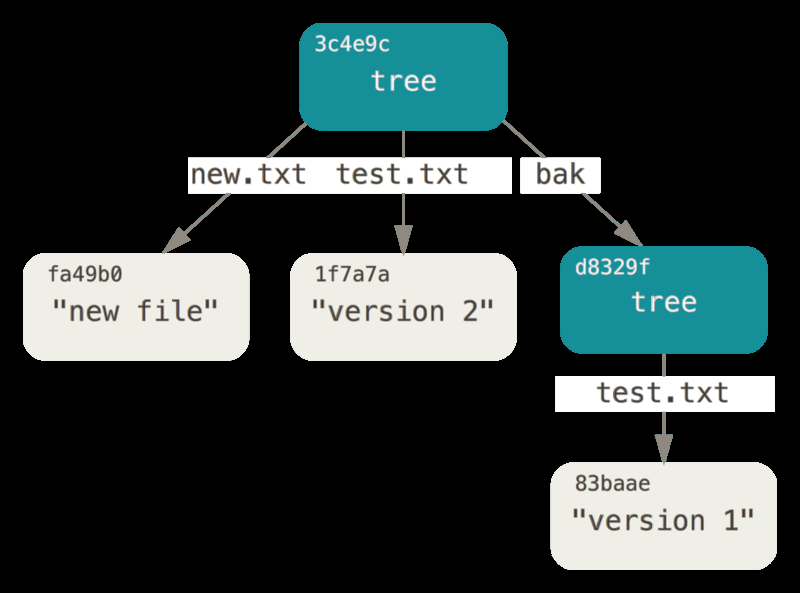

 问题  
现在有三个树对象（执行了三次write-tree），分别代表了我们想要跟踪  
的不同项目快照。然而问题依旧：若想重用这些快照，你必须记住所有三个  
SHA-1 哈希值。 并且，你也完全不知道是谁保存了这些快照，在什么时刻保  
存的，以及为什么保存这些快照。 而以上这些，正是提交对象（commit object）  
能为你保存的基本信息  
#### 树对象
 查看暂存区当前的样子  
```bash
git ls-files -s
```

 查看树对象  
命令：  
```bash
git cat-file -p master^{tree}（或者是树对象的hash）
```

master^{tree} 语法表示 master 分支上最新的提交所指向的  
树对象。  
返回:  
100644 blob a906cb2a4a904a152e80877d4088654daad0c859      README  
100644 blob 8f94139338f9404f26296befa88755fc2598c289      Rakefile  
040000 tree 99f1a6d12cb4b6f19c8655fca46c3ecf317074e0      lib  
图示：  

<!-- PDF 第 10 页 -->

> —————————————————————————————
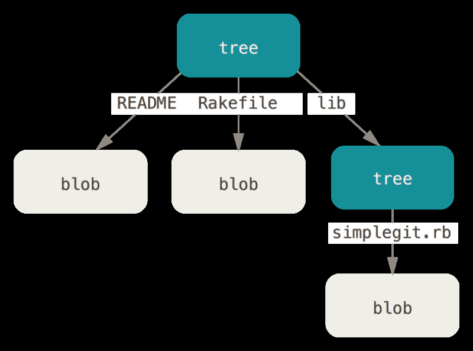

注意，`lib` 子目录（所对应的那条树对象记录）并不是一个数据对象，而  
是一个指针，其指向的是另一个树对象：  
```bash
git cat-file -p 99f1a6d12cb4b6f19c8655fca46c3ecf317074e0
```

100644 blob 47c6340d6459e05787f644c2447d2595f5d3a54b  
simplegit.rb  
 解析树对象  
Git 根据某一时刻暂存区（即 index 区域）所表示的状态创建并记录  
一个对应的树对象，如此重复便可依次记录（某个时间段内）一系列的树对象。  
其实树对象是对暂存区内操作的抽象，这颗树对象相对于就是快照。当我  
们的工作区有任何更改同步到暂存区时。便会调用write-tree 命令  
通过 write-tree 命令向暂存区内容写入一个树对象。它会根据当前  
暂存区状态自动创建一个新的树对象。即每一次同步都产生一颗树对象。且该  
命令会返回一个hash 指向树对象。  
在Git 中每一个文件（数据）都对应一个hash（类型 blob）  
每一个树对象都对应一个hash（类型 tree）  
 总结  
我们可以认为树对象就是我们项目的快照  
#### 提交对象
我们可以通过调用 commit-tree 命令创建一个提交对象，为此需要指定一个树  
对象的 SHA-1 值，以及该提交的父提交对象（如果有的话 第一次将暂存区做快  
照就没有父对象）  
 创建提交对象  
```bash
echo 'first commit' | git commit-tree d8329f
```

返回：  
fdf4fc3344e67ab068f836878b6c4951e3b15f3d  
 查看提交对象  
```bash
git cat-file -p fdf4fc3
```

返回：  
tree d8329fc1cc938780ffdd9f94e0d364e0ea74f579  

<!-- PDF 第 11 页 -->

> —————————————————————————————
author Scott Chacon &lt;schacon@gmail.com&gt; 1243  
committer Scott Chacon &lt;schacon@gmail.com&gt; 1243  
first commit  
 提交对象的格式  
提交对象的格式很简单：  
它先指定一个顶层树对象，代表当前项目快照；然后是作者/提交者信息（依  
据你的 `user.name` 和 `user.email` 配置来设定，外加一个时间戳）；留空  
一行，最后是提交注释  
接着，我们将创建另两个提交对象，它们分别引用各自的上一个提交（作为其  
父提交对象）：  
```bash
echo 'second commit' | git commit-tree 0155eb -p fdf4fc3
```

cac0cab538b970a37ea1e769cbbde608743bc96d  
```bash
echo 'third commit'  | git commit-tree 3c4e9c -p cac0cab
```

1a410efbd13591db07496601ebc7a059dd55cfe9  
 图示  
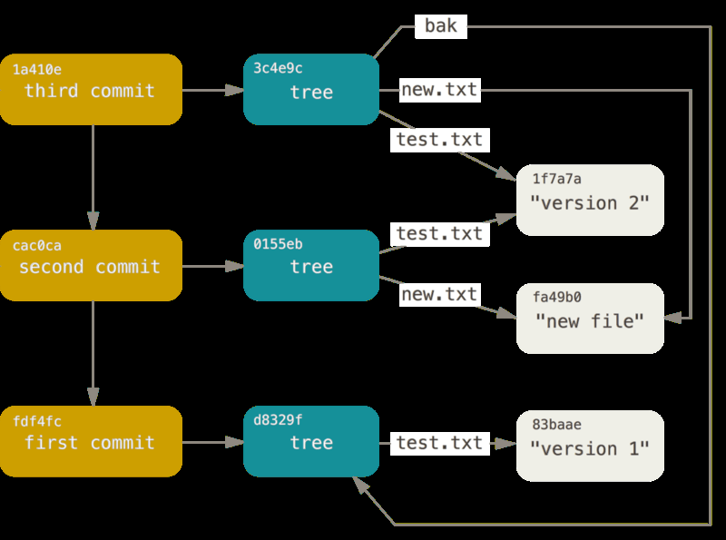

 注意  
```bash
git commit-tree 不但生成提交对象 而且会将对应的快照（树对象）提交到本地库中
```

## Git 本地操作（高层命令）
### 初始化新仓库

<!-- PDF 第 12 页 -->

> —————————————————————————————
命令：git init  
解析：要对现有的某个项目开始用 Git 管理，只需到此项目所在的目录，执  
行：git init  
作用：初始化后，在当前目录下会出现一个名为 .git 的目录，所有 Git 需要  
的数据和资源都存放在这个目录中。不过目前，仅仅是按照既有的结构框架初始化  
好了里边所有的文件和目录，但我们还没有开始跟踪管理项目中的任何一个文件。  
### 记录每次更新到仓库
工作目录下面的所有文件都不外乎这两种状态：已跟踪  或  未跟踪  
已跟踪的文件是指本来就被纳入版本控制管理的文件，在上次快照中有它  
们的记录，工作一段时间后，它们的状态可能是已提交，已修改或者已暂存  
所有其他文件都属于未跟踪文件。它们既没有上次更新时的快照，也不在  
当前的暂存区域。  
初次克隆某个仓库时，工作目录中的所有文件都属于已跟踪文件，且状态  
为已提交；在编辑过某些文件之后，Git 将这些文件标为已修改。我们逐步把  
这些修改过的文件放到暂存区域，直到最后一次性提交所有这些暂存起来的文  
件。使用 Git 时的文件状态变化周期如下图所示  
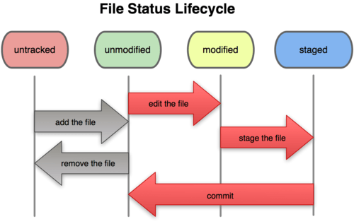

### 检查当前文件状态
命令：git status  
作用：确定文件当前处于什么状态  
#### 克隆仓库后的文件
如果在克隆仓库之后立即执行此命令，会看到类似这样的输出：  
On branch master  
nothing to commit, working directory clean  
这说明你现在的工作目录相当干净。换句话说，所有已跟踪文件在上次提  
交后都未被更改过。此外，上面的信息还表明，当前目录下没有出现任何处于  
未跟踪的新文件，否则 Git 会在这里列出来。最后，该命令还显示了当前所  
在的分支是 master，这是默认的分支名称，实际是可以修改的，现在先不用  
考虑。  
#### 未跟踪文件
如果创建一个新文件README,保存退出后运行 git status 会看到该文件出现  
在未跟踪文件列表中：  

<!-- PDF 第 13 页 -->

> —————————————————————————————
On branch master  
Untracked files:  
(use "git add &lt;file&gt;..." to include in what will be committed)  
README  
nothing added to commit but untracked files present (use "git add" to  
track)  
在状态报告中可以看到新建的README 文件出现在“Untracked files”下  
面。未跟踪的文件意味着Git 在之前的快照（提交）中没有这些文件；Git 不  
会自动将之纳入跟踪范围，除非你明明白白地告诉它“我需要跟踪该文件”，因  
而不用担心把临时文件什么的也归入版本管理。  
### 基本操作
#### 跟踪新文件（暂存）
命令：git add 文件名  
作用：跟踪一个新文件  
再次运行 git status 命令，会看到 README 文件已被跟踪，并处于暂存  
状态：  
Changes to be committed:  
(use "git reset HEAD &lt;file&gt;..." to unstage)  
new file:   README  
只要在 “Changes to be committed” 这行下面的，就说明是已暂存状态。  
如果此时提交，那么该文件此时此刻的版本将被留存在历史记录中。在 git  
add 后面可以指明要跟踪的文件或目录路径。如果是目录的话，就说明要递归  
跟踪该目录下的所有文件。（译注：其实 git add 的潜台词就是把目标文件快  
照放入暂存区域，也就是 add file into staged area，同时未曾跟踪过的文件标  
记为已跟踪。）  
#### 暂存已修改文件
现在README 文件都已暂存，下次提交时就会一并记录到仓库。假设此时，  
你想要在 README 里再加条注释，重新编辑存盘后，准备好提交。不过且慢，再  
运行 git status 看看：  
On branch master  
Changes to be committed:  
(use "git reset HEAD &lt;file&gt;..." to unstage)  
new file:   README  
Changes not staged for commit:  
(use "git add &lt;file&gt;..." to update what will be committed)  
(use "git checkout -- &lt;file&gt;..." to discard changes in working directory)  
modified:   README  
README 文件出现了两次！一次算已修改，一次算已暂存，这怎么可能呢？  
好吧，实际上 Git 只不过暂存了你运行 git add 命令时的版本，如果现在提交，那  
么提交的是添加注释前的版本，而非当前工作目录中的版本。所以，运行了 git  
add 之后又作了修订的文件，需要重新运行 git add 把最新版本重新暂存起来：  
```bash
$ git add README
$ git status
```

On branch master  

<!-- PDF 第 14 页 -->

> —————————————————————————————
Changes to be committed:  
(use "git reset HEAD &lt;file&gt;..." to unstage)  
new file:   README  
#### 查看已暂存和未暂存的更新
实际上 git status 的显示比较简单，仅仅是列出了修改过的文件，如果要  
查看具体修改了什么地方，可以用 git diff 命令.这个命令它已经能解决我们  
两个问题了：当前做的哪些更新还没有暂存？有哪些更新已经暂存起来准备  
好了下次提交？  
1. 当前做的哪些更新还没有暂存？，  
命令：git diff（不加参数直接输入 git diff）  
2. 有哪些更新已经暂存起来准备好了下次提交？  
命令： git diff –cached  或者  git diff –staged(1.6.1 以上)  
#### 提交更新
当暂存区域已经准备妥当可以提交时，在此之前，请一定要确认还有什么修改  
过的或新建的文件还没有 git add 过，否则提交的时候不会记录这些还没暂存起来  
的变化。所以，每次准备提交前，先用 git status 看下，是不是都已暂存起来了，  
然后再运行提交命令 git commit  
命令：git commit  
注意：这种方式会启动文本编辑器以便输入本次提交的说明  
默认的提交消息包含最后一次运行 git status 的输出，放在注释行里，  
另外开头还有一空行，供你输入提交说明。你完全可以去掉这些注释行，  
不过留着也没关系，多少能帮你回想起这次更新的内容有哪些。  
另外也可以用 -m 参数后跟提交说明的方式，在一行命令中提交更新：  
命令：git commit –m “message xxx”  
提交时记录的是放在暂存区域的快照，任何还未暂存的仍然保持已修改状态，  
可以在下次提交时纳入版本管理。每一次运行提交操作，都是对你项目作一次快照，  
以后可以回到这个状态，或者进行比较  
#### 跳过使用暂存区域
尽管使用暂存区域的方式可以精心准备要提交的细节，但有时候这么做略显繁  
琐。Git 提供了一个跳过使用暂存区域的方式，只要在提交的时候，给 git  
commit 加上 -a 选项，Git 就会自动把所有已经跟踪过的文件暂存起来一并提交，  
从而跳过 git add 步骤  
```bash
git commit -a
```

#### 移除文件
要从 Git 中移除某个文件，就必须要从已跟踪文件清单中注册删除（确切地说，  
是在暂存区域注册删除），然后提交。可以用 git rm 命令完成此项工作，并连带  
从工作目录中删除指定的文件，这样以后就不会出现在未跟踪文件清单中了。  
1. 从工作目录中手工删除文件  
```bash
git status
```

On branch master  
Changes not staged for commit:  
(use "git add/rm &lt;file&gt;..." to update what will be committed)  
(use "git checkout -- &lt;file&gt;..." to discard changes in working directory)  

<!-- PDF 第 15 页 -->

> —————————————————————————————
deleted:    grit.gemspec  
no changes added to commit (use "git add" and/or "git commit -a")  
2. 再运行 git rm 记录此次移除文件的操作  
```bash
git status
```

On branch master  
Changes to be committed:  
(use "git reset HEAD &lt;file&gt;..." to unstage)  
deleted:    grit.gemspec  
3. 最后提交的时候，该文件就不再纳入版本管理了  
#### 文件改名
```bash
git mv file.from file.to
git status
```

On branch master  
Changes to be committed:  
(use "git reset HEAD &lt;file&gt;..." to unstage)  
renamed:    README.txt -&gt; README  
其实，运行 `git mv` 就相当于运行了下面三条命令：  
```bash
$ mv README.txt README
$ git rm README.txt
$ git add README
```

#### 查看历史记录
 git log  
在提交了若干更新，又或者克隆了某个项目之后，你也许想回顾下提交历史。  
完成这个任务最简单而又有效的工具是 `git log` 命令  
```bash
$ git log
commit 085bb3bcb608e1e8451d4b2432f8ecbe6306e7e7
Author: Scott Chacon <schacon@gee-mail.com>
Date:   Sat Mar 15 16:40:33 2008 -0700
removed unnecessary test
commit a11bef06a3f659402fe7563abf99ad00de2209e6
Author: Scott Chacon <schacon@gee-mail.com>
Date:   Sat Mar 15 10:31:28 2008 -0700
first commit
```

默认不用任何参数的话，`git log` 会按提交时间列出所有的更新，最近的  
更新排在最上面。 正如你所看到的，这个命令会列出每个提交的 SHA-1 校验和、  
作者的名字和电子邮件地址、提交时间以及提交说明。  
 git log 参数  
```bash
git log --pretty=oneline
git log --oneline
```

## Git 分支操作（杀手功能）
几乎所有的版本控制系统都以某种形式支持分支。 使用分支意味着你可以把你的工  
作从开发主线上分离开来，以免影响开发主线。 在很多版本控制系统中，这是一个  

<!-- PDF 第 16 页 -->

> —————————————————————————————
略微低效的过程——常常需要完全创建一个源代码目录的副本。对于大项目来说，这  
样的过程会耗费很多时间。  
而Git 的分支模型极其的高效轻量的。是Git 的必杀技特性，也正因为这一特性，使  
得 Git 从众多版本控制系统中脱颖而出  
### 创建分支
命令：git branch  
作用：  
为你创建了一个可以移动的新的指针。 比如，创建一个 testing 分  
支：git branch testing。这会在当前所在的提交对象上创建一个指针  
注意：  
git branch  分支名 创建 一个新分支，并不会自动切换到新分支中去  
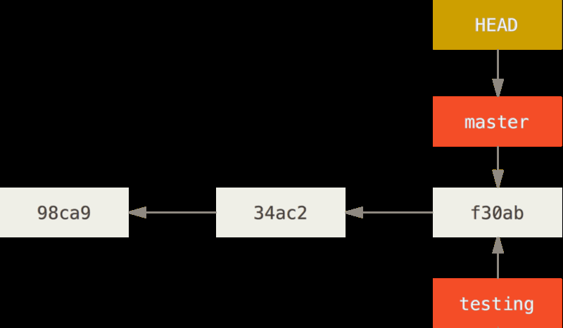

git branch 不只是可以创建与删除分支。 如果不加任何参数运行它，  
会得到当前所有分支的一个列表  
```bash
git branch -d name
```

删除分支  
```bash
git branch  -v
```

可以查看每一个分支的最后一次提交  
```bash
git branch name commitHash
```

新建一个分支并且使分支指向对应的提交对象  
```bash
git branch –merged
```

查看哪些分支已经合并到当前分支  
在这个列表中分支名字前没有 * 号的分支通常可以使用  
git branch -d 删除掉；  
```bash
git branch --no-merged
```

查看所有包含未合并工作的分支  
尝试使用 git branch -d 命令删除在这个列表中的分支时会失败。  
如果真的想要删除分支并丢掉那些工作，可以使用 `-D` 选项强制删  
除它。  
### 查看当前分支所指对象
命令：git log --oneline –decorate  
（提供这一功能的参数是 --decorate）  
### 切换分支
#### 命令&图示
```bash
git checkout testing
```

<!-- PDF 第 17 页 -->

> —————————————————————————————
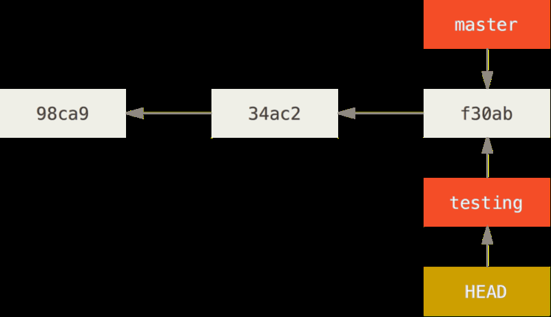

#### 做出修改，再提交
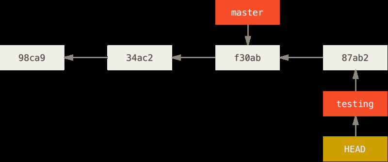

#### 切回master
命令：  
```bash
git checkout master
```

<!-- PDF 第 18 页 -->

> —————————————————————————————
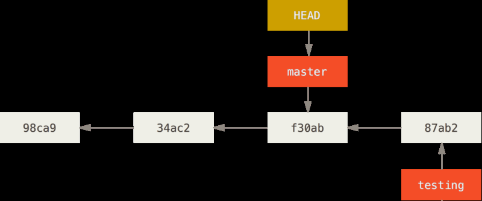

 注意  
分支切换会改变你工作目录中的文件  
在切换分支时，一定要注意你工作目录里的文件会被改变。 如果是切换  
到一个较旧的分支，你的工作目录会恢复到该分支最后一次提交时的样子。 如  
果 Git 不能干净利落地完成这个任务，它将禁止切换分支  
每次在切换分支前 提交一下当前分支  
### 查看项目分叉历史
```bash
git log --oneline --decorate --graph --all
```

### 分支合并
命令：git merge 分支名  
#### 实际案例
 工作流：  
1.开发某个网站。  
2.为实现某个新的需求，创建一个分支。  
3.在这个分支上开展工作。  
正在此时，你突然接到一个电话说有个很严重的问题需要紧急修补。 你  
将按照如下方式来处理：  
1.切换到你的线上分支（production branch）。  
2.为这个紧急任务新建一个分支，并在其中修复它。  
3.在测试通过之后，切换回线上分支，然后合并这个修补分支，最后将改  
动推送到线上分支。  
4.切换回你最初工作的分支上，继续工作。  
 Git 流  
首先，我们假设你正在你的项目上工作，并且已经有一些提交。  
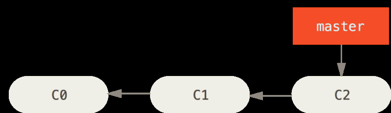

现在，你已经决定要解决你的公司使用的问题追踪系统中的 #53 问题。 想要  
新建一个分支并同时切换到那个分支上，你可以运行一个带有 -b 参数的 git  

<!-- PDF 第 19 页 -->

> —————————————————————————————
checkout 命令  
```bash
git checkout -b iss53
```

相当于  
```bash
git branch iss53
git checkout iss53
```

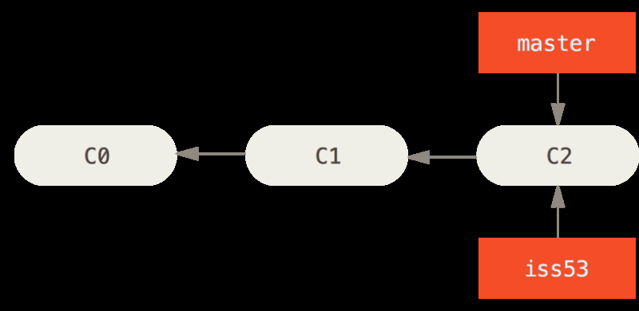

你继续在 #53 问题上工作，并且做了一些提交。 在此过程中，iss53 分  
支在不断的向前推进，因为你已经检出到该分支  
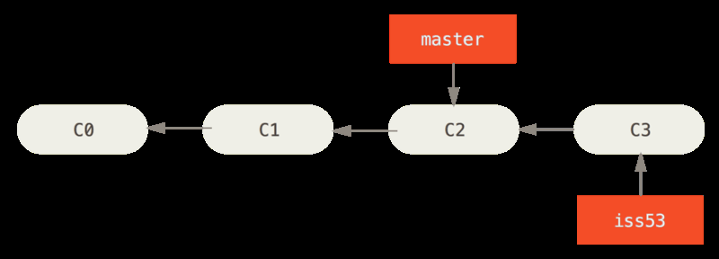

！！！现在你接到那个电话，有个紧急问题等待你来解决  
有了 Git 的帮助，你不必把这个紧急问题和 `iss53` 的修改混在一  
起，你也不需要花大力气来还原关于 53# 问题的修改，然后再添加关于这个  
紧急问题的修改，最后将这个修改提交到线上分支。 你所要做的仅仅是切换  
回 `master` 分支  
但是，在你这么做之前，要留意你的工作目录和暂存区里那些还没有  
被提交的修改，它可能会和你即将检出的分支产生冲突从而阻止 Git 切换到  
该分支。 最好的方法是，在你切换分支之前，保持好一个干净的状态。（提  
交你的所有修改）  
```bash
git checkout master
```

这个时候，你的工作目录和你在开始 #53 问题之前一模一样，现在你可  
以专心修复紧急问题了。 请牢记：当你切换分支的时候，Git 会重置你的工  
作目录，使其看起来像回到了你在那个分支上最后一次提交的样子。 Git 会  
自动添加、删除、修改文件以确保此时你的工作目录和这个分支最后一次提交  
时的样子一模一样。  
！！！接下来，你要修复这个紧急问题。 让我们建立一个针对该紧急问  
题的分支（hotfix branch），在该分支上工作直到问题解决：  
```bash
git checkout -b hotfix
```

做出修改  
```bash
git commit -a -m 'fixed the broken email address'
```

<!-- PDF 第 20 页 -->

> —————————————————————————————
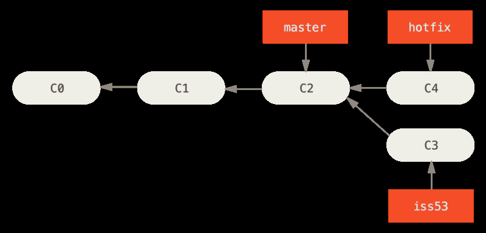

！！！你可以运行你的测试，确保你的修改是正确的，然后将其合并回你  
的 `master` 分支来部署到线上。 你可以使用 `git merge` 命令来达到上  
述目的  
```bash
git checkout master
git merge hotfix
```

在合并的时候，有时候会出现"快进（fast-forward）"这个词。 由于当  
前 `master` 分支所指向的提交是你当前提交的直接上游，所以 Git 只是简  
单的将指针向前移动。 换句话说，当你试图合并两个分支时，如果顺着一个  
分支走下去能够到达另一个分支，那么 Git 在合并两者的时候，只会简单的  
将指针向前推进（指针右移），因为这种情况下的合并操作没有需要解决的分  
歧——这就叫做 “快进（fast-forward）  
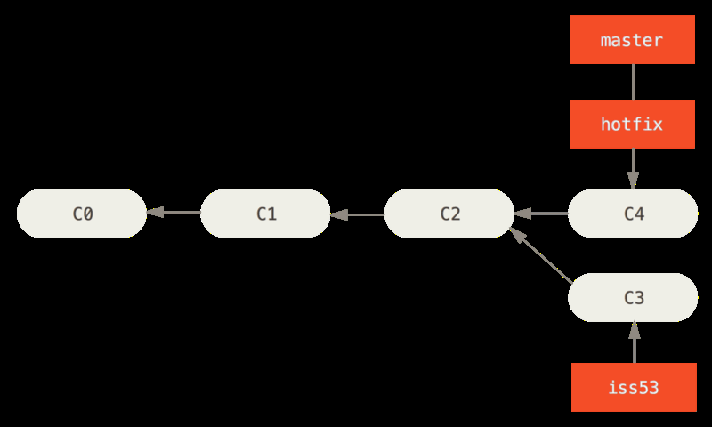

！！！关于这个紧急问题的解决方案发布之后，你准备回到被打断之前时  
的工作中。 然而，你应该先删除 `hotfix` 分支，因为你已经不再需要它了  
—— `master` 分支已经指向了同一个位置。 你可以使用带 `-d` 选项的 `git`  
`branch` 命令来删除分支。现在你可以切换回你正在工作的分支继续你的工  
作，也就是针对 #53 问题的那个分支  
```bash
git branch -d hotfix
git checkout iss53
```

<!-- PDF 第 21 页 -->

> —————————————————————————————
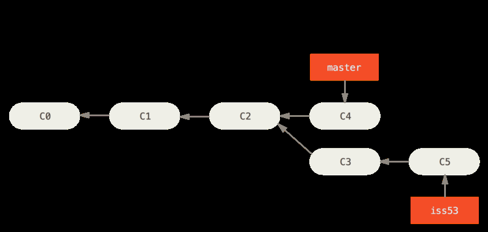

你在 `hotfix` 分支上所做的工作并没有包含到 `iss53` 分支中。 如果你需  
要拉取 `hotfix` 所做的修改，你可以使用 `git merge master` 命令  
将 `master` 分支合并入 `iss53` 分支，或者你也可以等到 `iss53` 分支完成其  
使命，再将其合并回 `master` 分支。  
```bash
git checkout master
git merge iss53
```

 典型合并  
当前的合并和你之前合并 `hotfix` 分支的时候看起来有一点不一样。 在  
这种情况下，你的开发历史从一个更早的地方开始分叉开来（diverged）。 因  
为，`master` 分支所在提交并不是 `iss53` 分支所在提交的直接祖先，Git 不  
得不做一些额外的工作。 出现这种情况的时候，Git 会使用两个分支的末端  
所指的快照（`C4` 和 `C5`）以及这两个分支的工作祖先（`C2`），做一个简单  
的三方合并。  
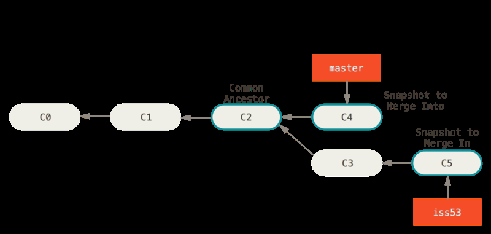

和之前将分支指针向前推进所不同的是，Git 将此次三方合并的结果做了一个新的  
快照并且自动创建一个新的提交指向它。 这个被称作一次合并提交，它的特别之处在  
于他有不止一个父提交。  

<!-- PDF 第 22 页 -->

> —————————————————————————————
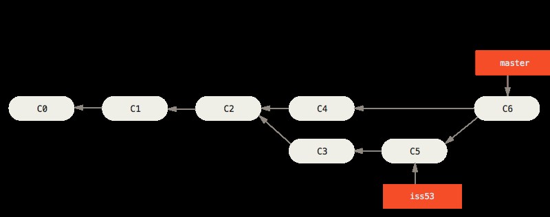

需要指出的是，Git 会自行决定选取哪一个提交作为最优的  
共同祖先，并以此作为合并的基础；这和更加古老的 CVS 系  
统或者 Subversion （1.5 版本之前）不同，在这些古老的版本  
管理系统中，用户需要自己选择最佳的合并基础。 Git 的这个  
优势使其在合并操作上比其他系统要简单很多  
最终删除iss53 号分支  
```bash
git branch -d iss53
```

 冲突  
有时候合并操作不会如此顺利。 如果你在两个不同的分支中，对同一个  
文件的同一个部分进行了不同的修改，Git 就没法干净的合并它们。 如果你  
对 #53 问题的修改和有关 `hotfix` 的修改都涉及到同一个文件的同一  
处，在合并它们的时候就会产生合并冲突  
此时 Git 做了合并，但是没有自动地创建一个新的合并提交。 Git 会暂  
停下来，等待你去解决合并产生的冲突。 你可以在合并冲突后的任意时刻  
使用 git status 命令来查看那些因包含合并冲突而处于未合并（unmerged）  
状态的文件  
任何因包含合并冲突而有待解决的文件，都会以未合并状态标识出来。  
&lt;&lt;&lt;&lt;&lt;&lt;&lt; HEAD:index.html  
&lt;div id="footer"&gt;contact : email.support@github.com&lt;/div&gt;  
=======  
&lt;div id="footer"&gt;  
please contact us at support@github.com  
&lt;/div&gt;  
&gt;&gt;&gt;&gt;&gt;&gt;&gt; iss53:index.html  
在你解决了所有文件里的冲突之后，对每个文件使用 git add 命令来将其  
标记为冲突已解决。 一旦暂存这些原本有冲突的文件，Git 就会将它们标记  
为冲突已解决  
### 分支模式
#### 长期分支

<!-- PDF 第 23 页 -->

> —————————————————————————————
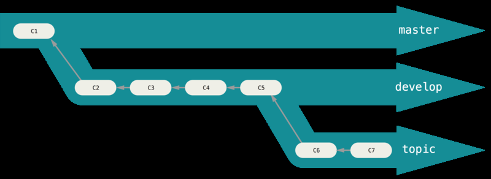

许多使用 Git 的开发者都喜欢使用这种方式来工作，比如只在 `master` 分支上保留完  
全稳定的代码——有可能仅仅是已经发布或即将发布的代码。 他们还有一些名  
为 `develop` 或者 `next` 的平行分支，被用来做后续开发或者测试稳定性——这些分支  
不必保持绝对稳定，但是一旦达到稳定状态，它们就可以被合并入 `master` 分支了。，  
等待下一次的发布。  
随着你的提交而不断右移的指针。 稳定分支的指针总是在提交历史中落后一大截，  
而前沿分支的指针往往比较靠前。  
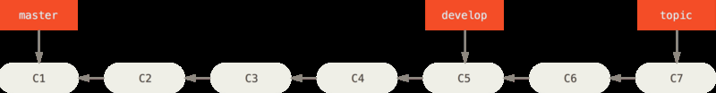

 特性分支（topic）  
特性分支对任何规模的项目都适用。 特性分支是一种短期分支，它被用来  
实现单一特性或其相关工作。 也许你从来没有在其他的版本控制系统（`VCS`）  
上这么做过，因为在那些版本控制系统中创建和合并分支通常很费劲。 然而，  
在 Git 中一天之内多次创建、使用、合并、删除分支都很常见。  
实例：  
考虑这样一个例子，你在 `master` 分支上工作到 `C1`，这时为了解  
决一个问题而新建 `iss91` 分支，在 `iss91` 分支上工作到 `C2`，这时思路  
断了，你暂时放弃修复`iss91`，切回主分支又工作到了`c3`（画了几个页面）。  
这时你突然对`iss91` 问题有了新的想法，你切回`iss91` 继续工作到了`c6`。  
在完成了对iss91 的bug 修复之后。你发现你`C4` 之后的修改都没有使用ES6  
语法。于是你再新建一个 `iss91v2` 分支重新使用ES6 语法开发到C8，写  
了一会写累了。接着你回到 `master` 分支又画了一会页面到C10，画完页面  
后你一咬牙切回 `iss91v2` 完成es6 版本的修改到C11. 你又冒出了一个不  
太确定的想法，切回master 后新建一个 `dumbidea` 分支，并在上面做些实  
验。 你的提交历史看起来像下面这个样子：  

<!-- PDF 第 24 页 -->

> —————————————————————————————
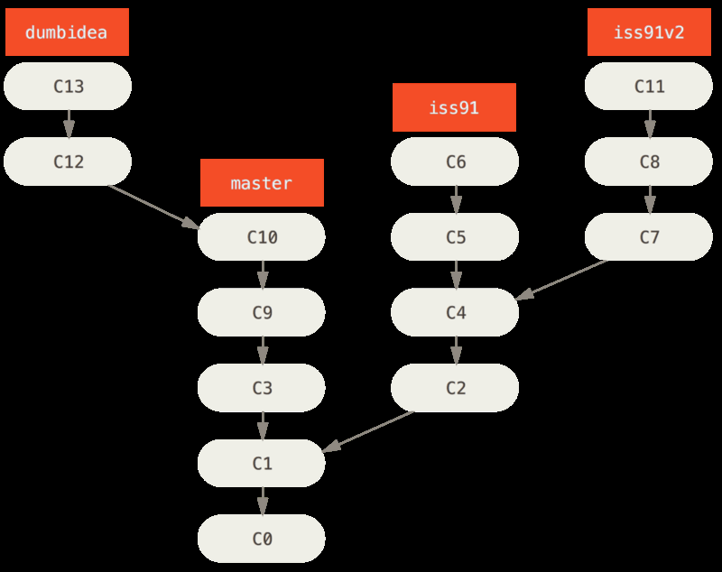

现在，我们假设两件事情：你决定使用第二个方案来解决那个问题，即使  
用在 `iss91v2` 分支中方案；另外，你将 `dumbidea` 分支拿给你的同事看  
过之后，结果发现这是个惊人之举。 这时你可以抛弃 `iss91` 分支（即丢  
弃 `C5` 和 `C6` 提交），然后把另外两个分支合并入主干分支。 最终你的提交  
历史看起来像下面这个样子：  
在master 分支是先合并 `dumbidea` 分支  
切回`iss91v2` 分支合并掉`iss91`  
删除`iss91`  
切回master 分支再合并`iss91v2` 分支  

<!-- PDF 第 25 页 -->

> —————————————————————————————
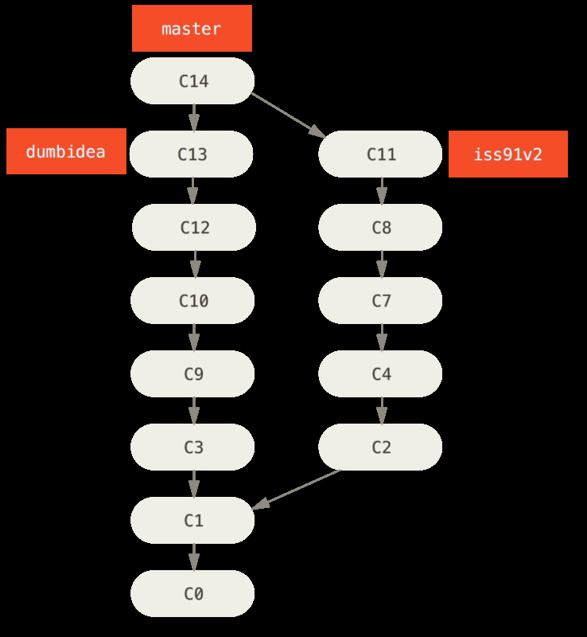

### 分支本质
Git 的分支，其实本质上仅仅是指向提交对象的可变指针。 Git 的默认分支  
名字是 `master`。 在多次提交操作之后，你其实已经有一个指向最后那个提交对  
象的 `master` 分支。 它会在每次的提交操作中自动向前移动。  
 注意  
Git 的 “master” 分支并不是一个特殊分支。 它就跟其它分支完全没有区别。 之所  
以几乎每一个仓库都有 master 分支，是因为 `git init` 命令默认创建它，并且大多数  
人都懒得去改动它。  
 图示  

<!-- PDF 第 26 页 -->

> —————————————————————————————
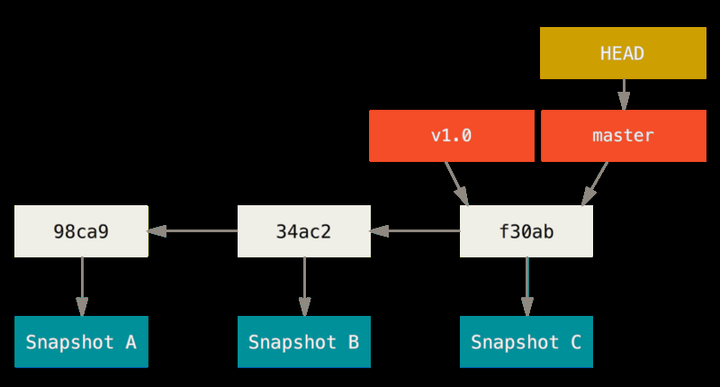

### 分支原理
 .git/refs 目录  
这个目录中保存了分支及其对应的提交对象  
 HEAD 引用  
当运行类似于 `git branch (branchname)` 这样的命令时，Git  
会取得当前所在分支最新提交对应的 SHA-1 值，并将其加入你想要创建的  
任何新分支中。  
当你执行 `git branch (branchname)` 时，Git 如何知道最新提  
交的 SHA-1 值呢？ 答案是 HEAD 文件。  
HEAD 文件是一个符号引用（symbolic reference），指向目前所在的分  
支。 所谓符号引用，意味着它并不像普通引用那样包含一个 SHA-1 值。  
它是一个指向其他引用的指针  
## Git 存储
有时，当你在项目的一部分上已经工作一段时间后，所有东西都进入了混乱的状  
态，而这时你想要切换到另一个分支做一点别的事情。 问题是，你不想仅仅因为  
过会儿回到这一点而为做了一半的工作创建一次提交。 针对这个问题的答案是  
git stash 命令  
git stash 命令会将未完成的修改保存到一个栈上，而你  
可以在任何时候重新应用这些改动(git stash apply)  
```bash
git stash list:查看存储
git stash apply stash@{2}
```

如果不指定一个储藏，Git 认为指定的是最近的储藏  
git stash pop  来应用储藏然后立即从栈上扔掉它  
git stash drop 加上将要移除的储藏的名字来移除它  
## 配别名
Git 并不会在你输入部分命令时自动推断出你想要的命令。 如果不想每次都输入  
完整的 Git 命令，可以通过 git config 文件来轻松地为每一个命令设置一个别名。  
```bash
$ git config --global alias.co checkout
```

<!-- PDF 第 27 页 -->

> —————————————————————————————
```bash
$ git config --global alias.br branch
$ git config --global alias.ci commit
$ git config --global alias.st status
```

当要输入 git commit 时，只需要输入 git ci  
## 撤销&重置
### 撤销
#### git commit –amend
命令: git commit --amend  
作用:  
这个命令会将暂存区中的文件提交。  
如果自上次提交以来你还未做任何修改（例如，在上次提交后马上执  
行了此命令），那么快照会保持不变，而你所修改的只是提交信息  
如果你提交后发现忘记了暂存某些需要的修改，可以像下面这样操作  
```bash
git commit -m 'initial commit'
git add forgotten_file
git commit –amend
```

最终你只会有一个提交 - 第二次提交将代替第一次提交的结果  
#### git reset
命令：git reset HEAD 文件名  
作用：将文件从暂存区中撤回到工作目录  
#### git checkout
命令：git checkout  -- 文件名  
作用：将在工作目录中对文件的修改撤销  
注意：  
```bash
git checkout -- [file] 是一个危险的命令，这很重要。 你对那个文件做的任
```

何修改都会消失 - 你只是拷贝了另一个文件来覆盖它。 除非你确实清楚不想要那个文件了，  
否则不要使用这个命令  
### HEAD
HEAD 是当前分支引用的指针，它总是指向该分支上的最后一次提交。  
这表示 HEAD 将是下一次提交的父结点。通常，理解 HEAD 的最简方式，  
就是将它看做 当前提交 的快照。  
```bash
git cat-file -p HEAD
```

查看当前提交对象  
```bash
git ls-tree -r HEAD
```

查看当前提交对象对应的树对像的内容  
### 暂存区（索引区）
```bash
git ls-files -s
```

查看暂存区当前的样子  
### 工作目录
你可以把工作目录当做 沙盒。在你将修改提交到暂存区并记录到历史之  
前，可以随意更改。  
### 细化基本流程
当我们运行 `git init`，这会创建一个 Git 仓库，其中的 HEAD 引用指向  

<!-- PDF 第 28 页 -->

> —————————————————————————————
未创建的分支。此时，只有工作目录有内容  
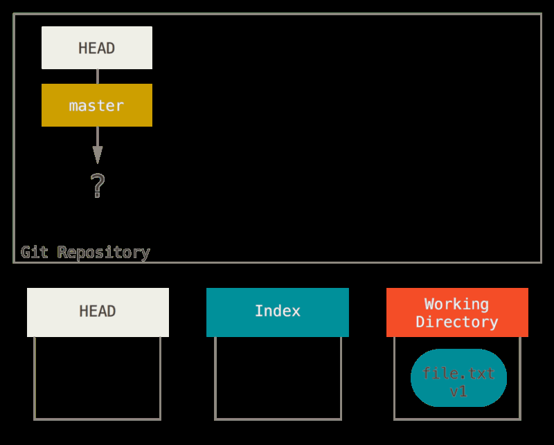

现在我们想要提交这个文件，所以用 `git add` 来获取工作目录中的内容，  
并将其复制到索引中  
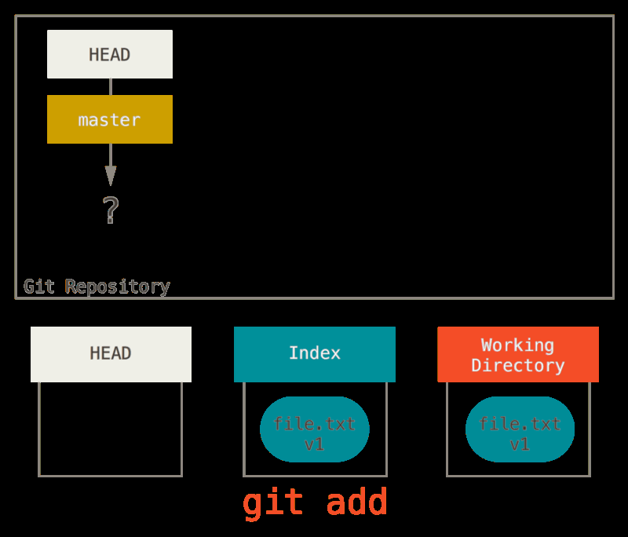

接着运行 `git commit`，它会取得索引中的内容并将它保存为一个永久的快  
照，然后创建一个指向该快照的提交对象，最后更新 `master` 来指向本次提交  

<!-- PDF 第 29 页 -->

> —————————————————————————————
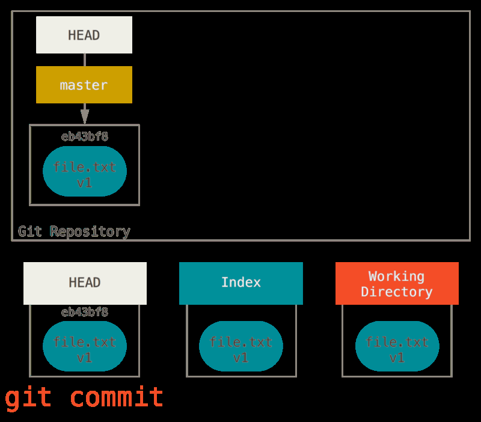

此时如果我们运行 `git status`，会发现没有任何改动，因为现在三棵树完  
全相同  
现在我们想要对文件进行修改然后提交它。 我们将会经历同样的过程；首先在  
工作目录中修改文件。 我们称其为该文件的 v2 版本，并将它标记为红色  
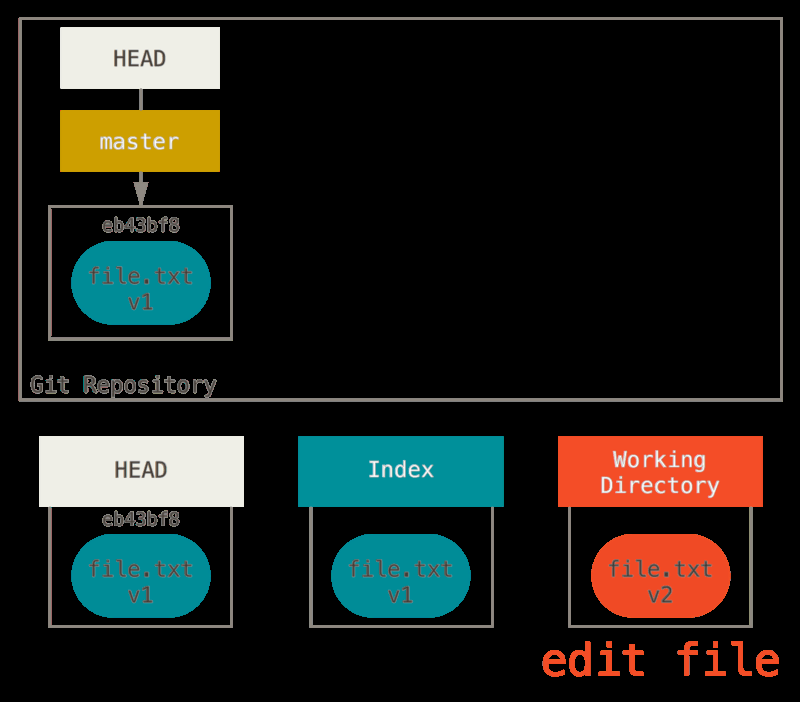

如果现在运行 `git status`，我们会看到文件显示在 “Changes not staged  
for commit,” 下面并被标记为红色，因为该条目在索引与工作目录之间存在不同。  
接着我们运行 `git add` 来将它暂存到索引中  

<!-- PDF 第 30 页 -->

> —————————————————————————————
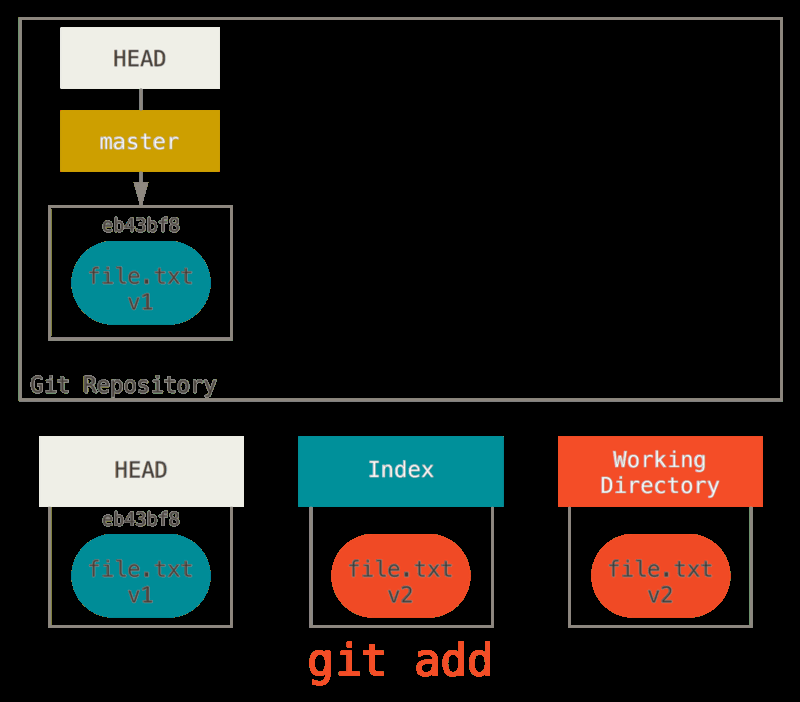

此时，由于索引和 HEAD 不同，若运行 `git status` 的话就会看到  
“Changes to be committed” 下的该文件变为绿色 ——也就是说，现在预期的下  
一次提交与上一次提交不同。 最后，我们运行 `git commit` 来完成提交。  
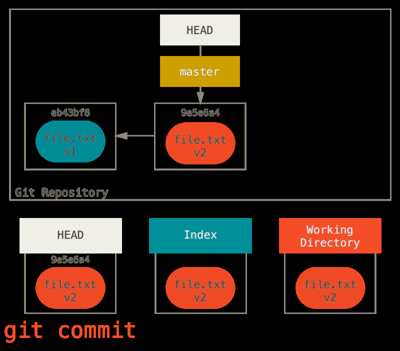

现在运行 `git status` 会没有输出，因为三棵树又变得相同了  
切换分支或克隆的过程也类似。 当检出一个分支时，它会修改 HEAD 指  

<!-- PDF 第 31 页 -->

> —————————————————————————————
向新的分支引用，将 索引 填充为该次提交的快照，然后将 索引 的内容复制  
到 工作目录 中。  
### 重置reset
#### reset 三部曲（commithash）
 移动 HEAD  
reset 做的第一件事是移动 HEAD 的指向。  
假设我们再次修改了 `file.txt` 文件并第三次提交它。 现在的历史看  
起来是这样  
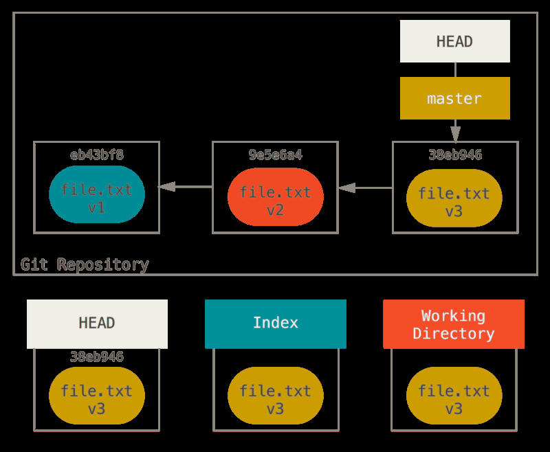

```bash
git reset –soft HEAD~
```

这与改变 HEAD 自身不同（checkout 所做的）；reset 移动 HEAD 指向的分支。  

<!-- PDF 第 32 页 -->

> —————————————————————————————
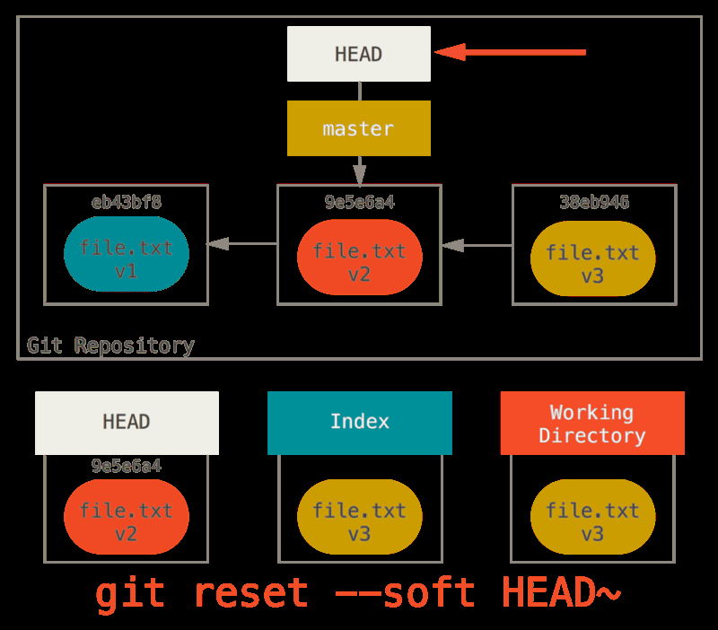

看一眼上图，理解一下发生的事情：它本质上是撤销了上一次 `git`  
`commit` 命令。 当你在运行 `git commit` 时，Git 会创建一个新的提交，并  
移动 HEAD 所指向的分支来使其指向该提交。  
当你将它 `reset` 回 `HEAD~`（HEAD 的父结点）时，其实就是把该分支移  
动回原来的位置，而不会改变索引和工作目录。 现在你可以更新索引并再次运  
行 `git commit` 来完成 `git commit --amend` 所要做的事情了。  
 更新暂存区（索引）  

<!-- PDF 第 33 页 -->

> —————————————————————————————
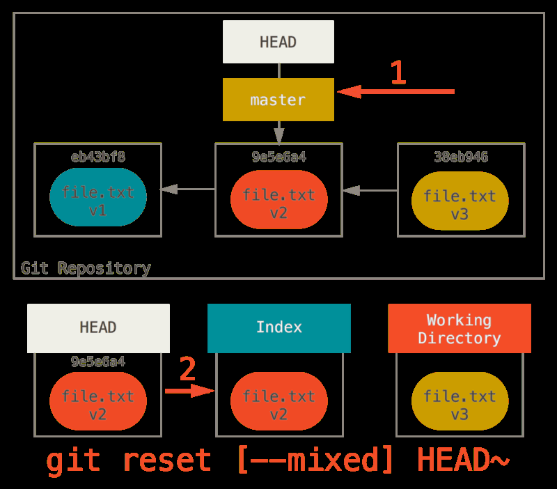

注意 git reset HEAD~ 等同于git reset –mixed HEAD~  
理解一下发生的事情：它依然会撤销一上次 提交，但还会 取消暂存 所有  
的东西。 于是，我们回滚到了所有 git add 和 git commit 的命令执行之前。  
 更新工作目录  
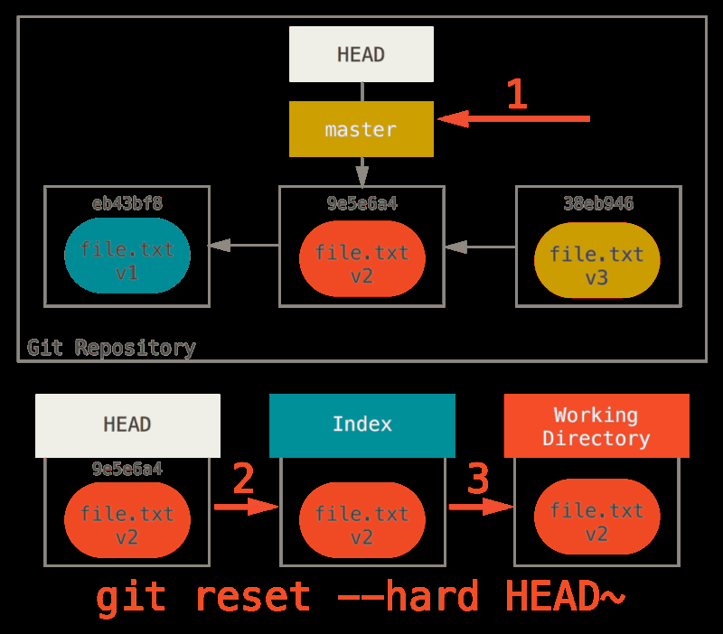

你撤销了最后的提交、`git add` 和 `git commit` 命令以及工作目录  
中的所有工作。  

<!-- PDF 第 34 页 -->

> —————————————————————————————
#### 注意点
必须注意，`--hard` 标记是 `reset` 命令唯一的危险用法，它也是 Git 会  
真正地销毁数据的仅有的几个操作之一。 其他任何形式的 `reset` 调用都可  
以轻松撤消，但是 `--hard` 选项不能，因为它强制覆盖了工作目录中的文件。  
在这种特殊情况下，我们的 Git 数据库中的一个提交内还留有该文件的 v3 版  
本，我们可以通过 `reflog` 来找回它。但是若该文件还未提交，Git 仍会覆  
盖它从而导致无法恢复。  
#### 路径reset
前面讲述了 reset 基本形式的行为，不过你还可以给它提供一个作用路径。 若  
指定了一个路径，reset 将会跳过第 1 步，并且将它的作用范围限定为指定的文  
件或文件集合。 这样做自然有它的道理，因为 HEAD 只是一个指针，你无法让  
它同时指向两个提交中各自的一部分。 不过索引和工作目录 可以部分更新，所以  
重置会继续进行第 2、3 步。  
现在，假如我们运行 git reset file.txt （这其实是 git reset --mixed HEAD  
file.txt 的简写形式，），它会：  
移动 HEAD 分支的指向 （因为是文件这一步忽略）  
让索引看起来像 HEAD  
所以它本质上只是将 file.txt 从 HEAD 复制到索引中  
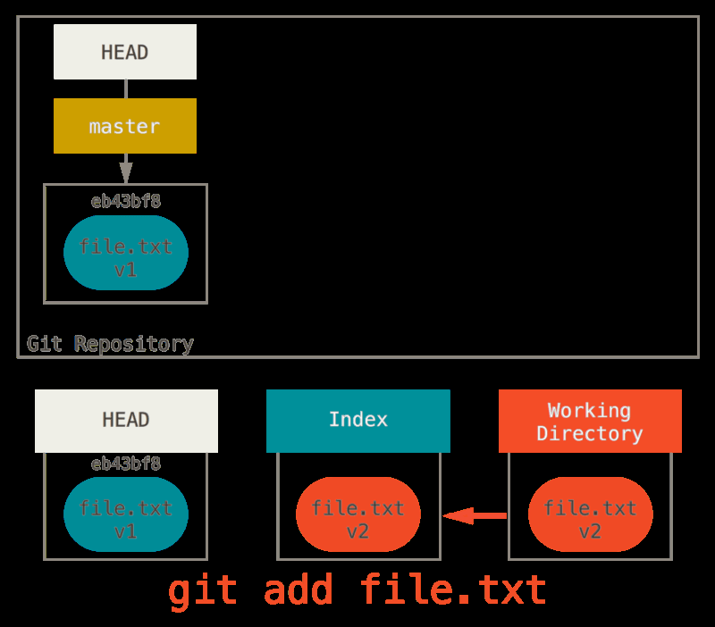

<!-- PDF 第 35 页 -->

> —————————————————————————————
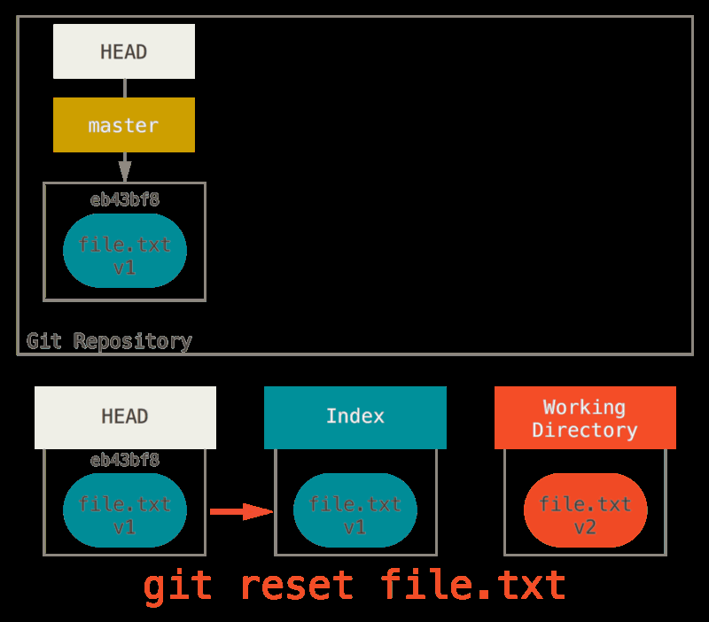

#### checkout
 不带路径  
```bash
git checkout [branch]
```

运行 `git checkout [branch]` 与运行 `git reset --hard`  
```text
[branch] 非常相似，它会更新三者使其看起来像 [branch]，不过有两
```

点重要的区别  
首先不同于 `reset --hard`，`checkout` 对工作目录是安全的，它会  
通过检查来确保不会将已更改的文件弄丢。而 `reset --hard` 则会不做检  
查就全面地替换所有东西。  
第二个重要的区别是如何更新 HEAD。 `reset` 会移动 HEAD 分支的  
指向，而 `checkout` 只会移动 HEAD 自身来指向另一个分支。  
例如，假设我们有 `master` 和 `develop` 分支，它们分别指向不同的提  
交；我们现在在 `develop` 上。 如果我们运行 `git reset master`，那  
么 `develop` 自身现在会和 `master` 指向同一个提交。 而如果我们运行 `git`  
`checkout master` 的话，`develop` 不会移动，HEAD 自身会移动。 现在  
HEAD 将会指向 `master`。  
所以，虽然在这两种情况下我们都移动 HEAD 使其指向了提交 A，但_  
做法_是非常不同的。 `reset` 会移动 HEAD 分支的指向，而 `checkout` 则  
移动 HEAD 自身。  

<!-- PDF 第 36 页 -->

> —————————————————————————————
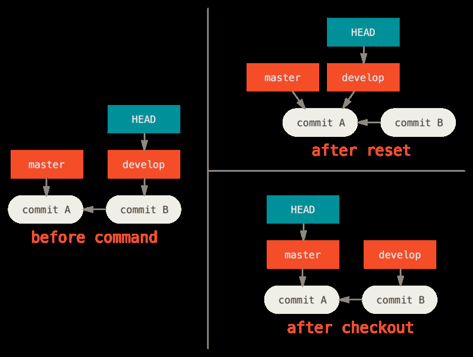

 带路径  
```bash
git checkout  commithash  <file>
```

运行 `checkout` 的另一种方式就是指定一个文件路径，这会像 `reset` 一样  
不会移动 HEAD。 它就像是 `git reset --hard [branch] file`。 这样对  
工作目录并不安全，它也不会移动 HEAD  将会跳过第 1 步 更新暂存区 和 工  
作目录  
```bash
git checkout --  <file>
```

相比于git reset – hard  commitHash  跟文件名的形式第一  第二步都没做  
## 数据恢复
在你使用 Git 的时候，你可能会意外丢失一次提交。 通常这是因为你强制删除了  
正在工作的分支，但是最后却发现你还需要这个分支；亦或者硬重置了一个分支，放弃  
了你想要的提交。 如果这些事情已经发生，该如何找回你的提交呢？  
### 实例
假设你已经提交了五次  
```bash
$ git log --pretty=oneline
```

ab1afef80fac8e34258ff41fc1b867c702daa24b  
modified repo a bit  
484a59275031909e19aadb7c92262719cfcdf19a  
added repo.rb  
1a410efbd13591db07496601ebc7a059dd55cfe9  
third commit  

<!-- PDF 第 37 页 -->

> —————————————————————————————
cac0cab538b970a37ea1e769cbbde608743bc96d  
second commit  
fdf4fc3344e67ab068f836878b6c4951e3b15f3d  
first commit  
现在，我们将 `master` 分支硬重置到第三次提交  
```bash
$ git reset --hard 1a410efbd13591db07496601ebc7a059dd55cfe9
```

HEAD is now at 1a410ef third commit  
```bash
$ git log --pretty=oneline
```

1a410efbd13591db07496601ebc7a059dd55cfe9 third commit  
cac0cab538b970a37ea1e769cbbde608743bc96d second commit  
fdf4fc3344e67ab068f836878b6c4951e3b15f3d first commit  
现在顶部的两个提交已经丢失了 - 没有分支指向这些提交。 你需要找出最后  
一次提交的 SHA-1 然后增加一个指向它的分支。 窍门就是找到最后一次的  
提交的 SHA-1 - 但是估计你记不起来了，对吗？  
最方便，也是最常用的方法，是使用一个名叫 `git reflog` 的工具。  
当你正在工作时，Git 会默默地记录每一次你改变 HEAD 时它的值。 每一  
次你提交或改变分支，引用日志都会被更新  
```bash
$ git reflog
```

1a410ef HEAD@{0}: reset: moving to 1a410ef  
ab1afef HEAD@{1}: commit: modified repo.rb a bit  
484a592 HEAD@{2}: commit: added repo.rb  
。。。  
`git reflog` 并不能显示足够多的信息。 为了使显示的信息更加有用，  
我们可以执行 `git log -g`，这个命令会以标准日志的格式输出引用日志  
### 恢复
看起来下面的那个就是你丢失的提交，你可以通过创建一个新的分支  
指向这个提交来恢复它。 例如，你可以创建一个名  
为 `recover-branch` 的分支指向这个提交（ab1afef）  
```bash
git branch recover-branch ab1afef
```

现在有一个名为 `recover-branch` 的分支是你的 `master` 分  
支曾经指向的地方，再一次使得前两次提交可到达了。  
## 打tag
Git 可以给历史中的某一个提交打上标签，以示重要。 比较有代表性的是人们会  
使用这个功能来标记发布结点（v1.0 等等）。  
#### 列出标签
```bash
git tag
git tag -l 'v1.8.5*'
```

v1.8.5 v1.8.5-rc0 v1.8.5-rc1 v1.8.5-rc2 v1.8.5-rc3 v1.8.5.1 v1.8.5.2 v1.8.5.3  
#### 创建标签
Git 使用两种主要类型的标签：轻量标签 与 附注标签  
轻量标签很像一个不会改变的分支 - 它只是一个特定提交的引用  
```bash
git tag v1.4
git tag v1.4 commitHash
```

附注标签是存储在 Git 数据库中的一个完整对象。 它们是可以被校验  
的；其中包含打标签者的名字、电子 邮件地址、日期时间；还有一个标签信  

<!-- PDF 第 38 页 -->

> —————————————————————————————
息；通常建议 创建附注标签，这样你可以拥有以上所有信息；但是如果你只  
是想用一个临时的标签，或者因为某些原因不想要保存那些信息，轻量标签也  
是可用的  
```bash
git tag -a v1.4
git tag -a v1.4 commitHash
git tag -a v1.4 commitHash -m 'my version 1.4'
```

#### 查看特定标签
git show 可以显示任意类型的对象（git 对象 树对象 提交对象 tag 对象）  
```bash
git show tagname
```

#### 远程标签
默认情况下，git push 命令并不会传送标签到远程仓库服务器上。 在创建完  
标签后你必须显式地推送标签到 共享服务器上。你可以运行  
```bash
git push origin [tagname]
```

如果想要一次性推送很多标签，也可以使用带有 --tags 选项的 git push 命令。  
这将会把所有不在远程仓库 服务器上的标签全部传送到那里。  
```bash
git push origin --tags
```

#### 删除标签
删除标签 要删除掉你本地仓库上的标签，可以使用命令 git tag -d &lt;tagname&gt;。  
例如，可以使用下面的命令删除掉 一个轻量级标签：  
```bash
git tag -d v1.4
```

应该注意的是上述命令并不会从任何远程仓库中移除这个标签，你必须使用  
git push &lt;remote&gt; :refs/tags/&lt;tagname&gt; 来更新你的远程仓库：  
```bash
git push origin :refs/tags/v1.4
```

#### 检出标签
如果你想查看某个标签所指向的文件版本，可以使用 git checkout 命令  
```bash
git checkout tagname
```

虽然说这会使你的仓库处于“分离 头指针（detacthed HEAD）”状态。在“分  
离头指针”状态下，如果你做了某些更改然后提交它们，标签不会发生变化，但你  
的新提交将不属于任何 分支，并且将无法访问，除非访问确切的提交哈希。因此，  
如果你需要进行更改——比如说你正在修复旧版本的错 误——这通常需要创建一  
个新分支：  
```bash
git checkout -b version2
```

## Git 特点
在开始学习 Git 的时候，请不要尝试把各种概念和其他版本控制系统（诸如  
Subversion 和 Perforce 等）相比拟，否则容易混淆每个操作的实际意义。Git 在保存  
和处理各种信息的时候，虽然操作起来的命令形式非常相近，但它与其他版本控制系统  
的做法颇为不同。理解这些差异将有助于你准确地使用 Git 提供的各种工具。  
### 直接记录快照，而非差异比较
Git 和其他版本控制系统的主要差别在于，Git 只关心文件数据的整体是  
否发生变化，而大多数其他系统则只关心文件内容的具体差异。这类系统  
（CVS，Subversion，Perforce，Bazaar 等等）每次记录有哪些文件作了更新，  
以及都更新了哪些行的什么内容. (下图)其他系统在每个版本中记录着各个文  

<!-- PDF 第 39 页 -->

> —————————————————————————————
件的具体差异  
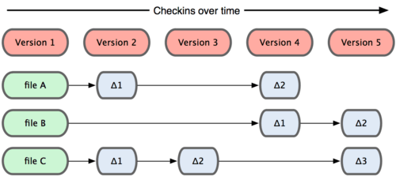

Git 并不保存这些前后变化的差异数据。实际上，Git 更像是把变化的文  
件作快照后，记录在一个微型的文件系统中。每次提交更新时，它会纵览一遍  
所有文件的指纹信息并对文件作一快照，然后保存一个指向这次快照的索引。  
为提高性能，若文件没有变化，Git 不会再次保存，而只对上次保存的快照作  
一链接。Git 的工作方式就像下图所示（保存每次更新时的文件快照）  
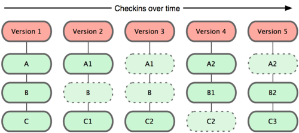

这是 Git 同其他系统的重要区别。它完全颠覆了传统版本控制的套路，并  
对各个环节的实现方式作了新的设计。Git 更像是个小型的文件系统，但它同  
时还提供了许多以此为基础的超强工具，而不只是一个简单的 VCS。稍后在  
讨论 Git 分支管理的时候，我们会再看看这样的设计究竟会带来哪些好处。  
### 近乎所有操作都是本地执行
在 Git 中的绝大多数操作都只需要访问本地文件和资源，不用连网。但如  
果用 CVCS 的话，差不多所有操作都需要连接网络。因为 Git 在本地磁盘上  
就保存着所有当前项目的历史更新，所以处理起来速度飞快。  
### 时刻保持数据完整性
在保存到 Git 之前，所有数据都要进行内容的校验和计算，并将此结果  
作为数据的唯一标识和索引。换句话说，不可能在你修改了文件或目录之后，  
Git 一无所知。这项特性作为 Git 的设计哲学，建在整体架构的最底层。所  
以如果文件在传输时变得不完整，或者磁盘损坏导致文件数据缺失，Git 都能  

<!-- PDF 第 40 页 -->

> —————————————————————————————
立即察觉。Git 使用 SHA-1 算法计算数据的校验，通过对文件的内容或目录  
的结构计算出一个 SHA-1 哈希值，作为指纹字符串。该字串由 40 个十六进  
制字符（0-9 及 a-f）组成，看起来就像是：  
24b9da6552252987aa493b52f8696cd6d3b00373  
Git 的工作完全依赖于这类指纹字串，所以你会经常看到这样的哈希值。  
实际上，所有保存在 Git 数据库中的东西都是用此哈希值来作索引的，而不  
是靠文件名。  
### 多数操作仅添加数据
常用的 Git 操作大多仅仅是把数据添加到数据库。因为任何一种不可逆  
的操作，比如删除数据，都会使回退或重现历史版本变得困难重重。在别的  
VCS 中，若还未提交更新，就有可能丢失或者混淆一些修改的内容，但在 Git  
里，一旦提交快照之后就完全不用担心丢失数据，特别是养成定期推送到其他  
仓库的习惯的话。  
这种高可靠性令我们的开发工作安心不少，尽管去做各种试验性的尝试好  
了，再怎样也不会弄丢数据。  
### 文件的三种状态
对于任何一个文件，在 Git 内都只有三种状态（Git 外的状态就是一个普  
通文件）：  
已提交（committed），  
已提交表示该文件已经被安全地保存在本地数据库中了；  
已修改（modified）  
已修改表示修改了某个文件，但还没有提交保存；  
已暂存（staged）  
已暂存表示把已修改的文件放在下次提交时要保存的清单中  
由此我们看到 Git 管理项目时，文件流转的三个工作区域：  
**Git 的工作目录，暂存区域,本地仓库！！！！**
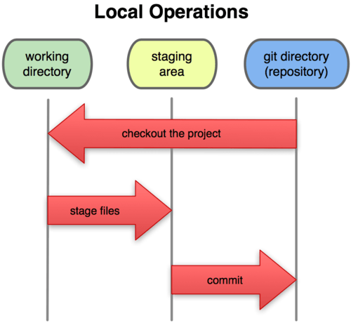

