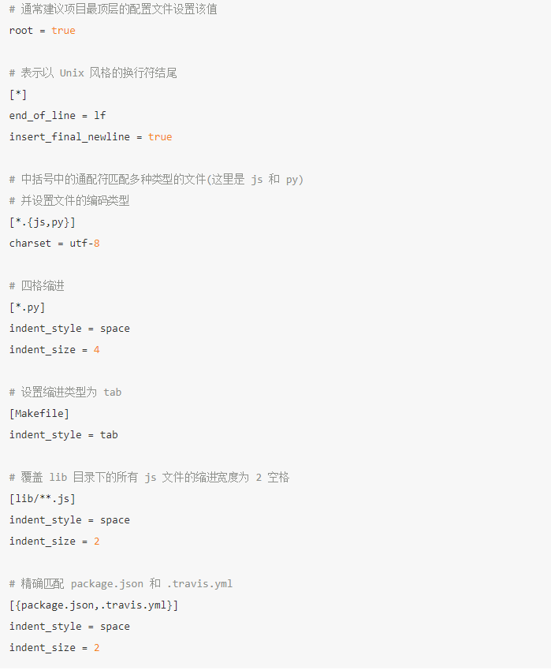

# 第 2 章 代码风格

ESLint 的含义、安装、规则配置、常用规则，以及与 Git 结合和忽略文件配置。

<!-- more -->

<!-- PDF 第 41 页 -->

> —————————————————————————————
## Git 工作流程
每个项目都有一个 Git 目录（.git ）它是 Git 用来保存元数据和对象数据库  
的地方。该目录非常重要，每次克隆镜像仓库的时候，实际拷贝的就是这个目录里  
面的数据。  
1. 在工作目录中修改某些文件。  
a)  
从项目中取出某个版本的所有文件和目录，用以开始后续工作的叫做工作  
目录。这些文件实际上都是从 Git 目录中的压缩对象数据库中提取出来  
的，接下来就可以在工作目录中对这些文件进行编辑。  
2. 保存到暂存区域，对暂存区做快照  
a)  
暂存区域只不过是个简单的文件，一般都放在 Git 目录中。有时候人们  
会把这个文件叫做索引文件，不过标准说法还是叫暂存区域。  
3. 提交更新，将保存在暂存区域的文件快照永久转储到本地数据库（Git 目录）  
中  
我们可以从文件所处的位置来判断状态：如果是 Git 目录中保存着的特定版  
本文件，就属于已提交状态；如果作了修改并已放入暂存区域，就属于已暂存  
状态；如果自上次取出后，作了修改但还没有放到暂存区域，就是已修改状态。  
# 第2 章 代码风格
## 3.1 Eslint
ESLint 是一个开源的 JavaScript 代码检查工具，由 Nicholas C. Zakas 于2013 年6 月  
创建。代码检查是一种静态的分析，常用于寻找有问题的模式或者代码，并且不依赖于具体  
的编码风格。对大多数编程语言来说都会有代码检查，一般来说编译程序会内置检查工具。  
JavaScript 是一个动态的弱类型语言，在开发中比较容易出错。因为没有编译程序，为  
了寻找 JavaScript 代码错误通常需要在执行过程中不断调试。像 ESLint 这样的可以让程序  
员在编码的过程中发现问题而不是在执行的过程中。  
ESLint 的初衷是为了让程序员可以创建自己的检测规则。ESLint 的所有规则都被设计  
成可插入的。ESLint 的默认规则与其他的插件并没有什么区别，规则本身和测试可以依赖  
于同样的模式。为了便于人们使用，ESLint 内置了一些规则，当然，你可以在使用过程中  
自定义规则。  
ESLint 使用 Node.js 编写，这样既可以有一个快速的运行环境的同时也便于安装。  
## 编码规范
每个程序员都有自己的编码习惯  
有的人写代码一行代码结尾必须加分号 ;，有的人觉得不加分号 ; 更好看；  
有的人写代码一行代码不会超过 80 个字符，认为这样看起来简洁明了，有的人喜  
欢把所有逻辑都写在一行代码上，觉得别人看不懂的代码很牛逼；  
有的人使用变量必然会先定义 var a = 10;，而粗心的人写变量可能没有定义过就直  
接使用 b = 10;  

<!-- PDF 第 42 页 -->

> —————————————————————————————
## Lint 的含义
如果你写自己的项目怎么折腾都没关系，但是在公司中老板希望每个人写出的代码  
都要符合一个统一的规则，这样别人看源码就能够看得懂，因为源码是符合统一的编码  
规范制定的。  
那么问题来了，总不能每个人写的代码老板都要一行行代码去检查吧，这是一件很  
蠢的事情。凡是重复性的工作，都应该被制作成工具来节约成本。这个工具应该做两件  
事情：  
提供编码规范；  
提供自动检验代码的程序，并打印检验结果：告诉你哪一个文件哪一行代码不  
符合哪一条编码规范，方便你去修改代码。  
Lint 是检验代码格式工具的一个统称，具体的工具有 Jslint 、 Eslint 等等  
## 使用Eslint
确保你的电脑安装了 node 和 npm 环境  
### 创建项目
npm init  
### 本地安装
npm i eslint --save-dev  
### 设置package.json 文件
"scripts": {  
```json
"lint": "eslint src",
"lint:create": "eslint --init"
}
```

#### Eslint --init
生成 `.eslintrc.js` 文件。提供编码规则  
#### eslint src
校验代码的程序，自动检验 `src` 目录下所有的 `.js` 文件  
## 检测文件
### 文件内容
src/index.js  
```javascript
const lint = 'eslint'
```

### 错误信息
1:7   error  'lint' is assigned a value but never used      no-unused-vars  
定义的变量没有被使用到  
1:22  error  Newline required at end of file but not found  eol-last  
新行是必须的 但是没有找到  
### 规则表
如果对编码规范具体某一条规则不了解的话，可以在 eslint 规则表 查  
看用法：https://cn.eslint.org/docs/rules/  
（不建议去背规则表，而是用到什么查什么，把它当成字典来用，不  
那么累）  
### fix
"lint": "eslint src --fix", 加上 --fix 参数，是 Eslint 提供的自动修复基础错  

<!-- PDF 第 43 页 -->

> —————————————————————————————
误的功能。  
`--fix` 只能修复基础的不影响代码逻辑的错误，像 `no-unused-vars` 这种  
错误只能手动修改  
## 跳过 lint 校验
```javascript
const apple = "apple";  // eslint-disable-line
const balana = "balana";  // eslint-disable-line
/* eslint-disable */
```

alert('foo');  
```text
/* eslint-enable */
```

## .eslintrc.js 解析
```javascript
module.exports = {
```

"env": {  
"browser": true,  
"commonjs": true,  
"es6": true  
```json
},
"extends": "eslint:recommended",
```

"parserOptions": {  
"ecmaVersion": 2016,  
```json
"sourceType": "module"
},
```

"rules": {  
"indent": [  
"error",  
"tab"  
],  
"linebreak-style": [  
"error",  
"windows"  
],  
"quotes": [  
"error",  
"double"  
],  
"semi": [  
"error",  
"always"  
]  
```text
}
};
```

该文件导出一个对象，对象可以包含属性 env、extends、parserOptions、plugins、  

<!-- PDF 第 44 页 -->

> —————————————————————————————
rules、globals  
`env`、`parserOptions`、`plugin`、`parse`  
标识我们程序将要使用到的语法（交互式的指令 对我们来说不重要）  
`Parse` 代表使用的解析器  
`extends`、`rules`  
```json
"extends": "eslint:recommended",
```

值为 "eslint:recommended" 的 extends 属性启用一系列核心规则，这些规  
则是经过前人验证的最佳实践（所谓最佳实践，就是大家伙都觉得应该遵  
循的编码规范），想知道最佳实践具体有哪些编码规范，可以在 eslint 规  
则表 中查看被标记为 √ 的规则项  
eslint-config-recommended 本质上是一个包  
rules  
用于覆盖继承来的规则，我们可以通过设置 rules 来定义我们自己的编码  
规范。  
ESLint 附带有大量的规则，修改规则应遵循如下要求  
"off" 或 0 - 关闭规则  
"warn" 或 1 - 开启规则，使用警告级别的错误：warn (不会导致程  
序退出)  
"error" 或 2 - 开启规则，使用错误级别的错误：error (当被触发的  
时候，程序会退出)  
## 常用规则
### object-shorthand
设置该规则，表示对象属性要简写。  
```javascript
var foo = {x: x};    // 会报错
var bar = {a: function () {}};  // 会报错
var foo = {x};    // 不会报错
var bar = {a () {}};    // 不会报错
```

### prefer-arrow-callback
要求回调函数使用箭头函数  
回调函数，函数的参数是个函数，这个参数函数就是回调函数  
funciton bar () {}不是回调函数，不会报错  
setTimeout 的第一个参数就是回调函数，不用箭头函数会报错  
setTimeout(() =&gt; {}, 1000)  
### no-trailing-spaces
禁止行尾空格  
### no-shadow
禁止变量声明与外层作用域的变量同名  
```javascript
function sum (num) {
var num = 2;
// 报错，因为 num 变量作为参数已经申明过了
}
```

<!-- PDF 第 45 页 -->

> —————————————————————————————
## 与Git 结合
到目前为止,我们只是单独的在Eslint 的体系中使用编码约束。没有什么强有力的手  
段来进行强制约束。我们可以在Git 中结合Eslint。让代码在没有通过Eslint 的情况下  
禁止提交。  
### pre-commit
### 哈士奇
## eslintignore
. eslintignore  
## 3.2 EditorConfig
在团队开发中，统一的代码格式是必要的。但是不同开发人员使用的编辑工具可能  
不同，这样就造成代码的不统一。  
目前为止，还是有很多人陷入在 tabs vs spaces 之类的争论中。不是每个人都在严  
格要求自己的代码规范和风格，对于多人协作的项目这容易出现问题。毕竟每个人所用  
的 IDE 和编辑器都可能不同。  
EditorConfig 帮助开发人员定义和维护不同编辑器之间一致的编码风格。  
EditorConfig 项目由定义编码样式的文件格式和一组文本编辑器插件组成，这些插件使  
编辑器能够读取文件格式并坚持已定义的样式。编辑器配置文件易于阅读，并且可以很  
好地与版本控制系统一起工作  
你只需配置一个 .editorconfig 文件，在其中设置好要遵守的代码规范，放在项目  
的根目录下，就能够在几乎所有的主流 IDE 和编辑器中复用了，可以将 .editorconfig  
文件也提交到版本控制系统中，就不需要针对不同 IDE 和编辑器再单独进行设置了。  
## 配置文件
EditorConfig 插件会自动在项目中寻找名为 .editorconfig 的配置文  
件，每个文件的样式偏好会自动根据该文件所在文件夹的 .editorconfig 文  
件向上寻找所有同名文件，直到某个配置的文件种包含了 root=true。最接  
近该文件的配置文件中的设置优先最高  
## 配置文件格式
### 通配符基本

<!-- PDF 第 46 页 -->

> —————————————————————————————


### 实例


