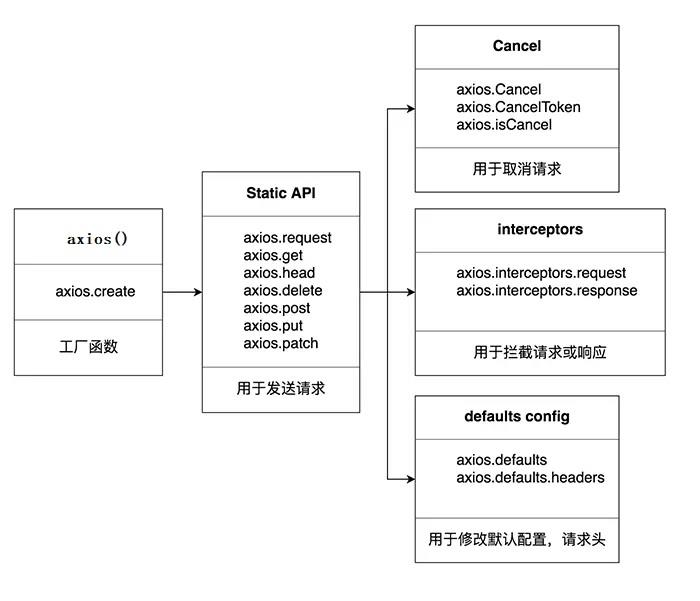
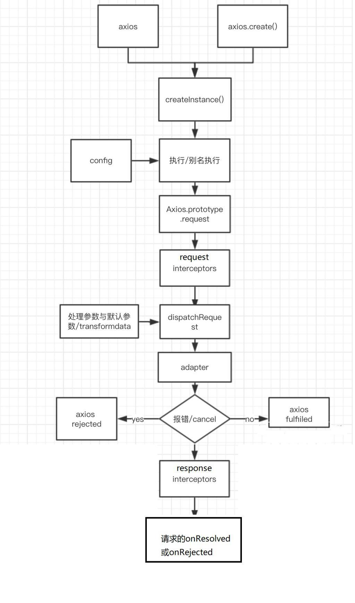
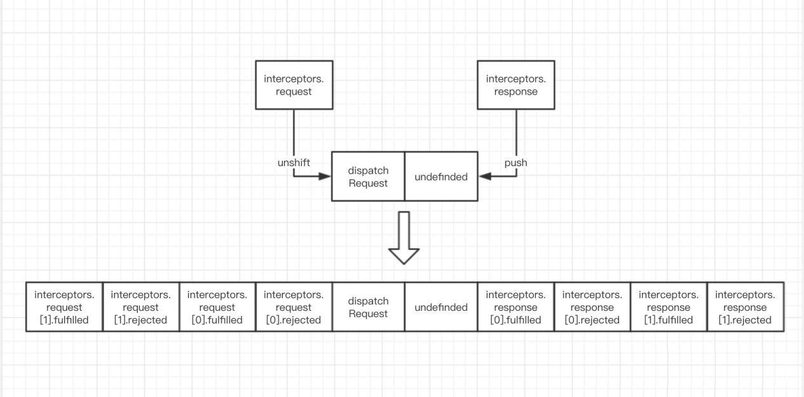

# axios 从入门到源码分析


## 1. 第1 章：axios 的理解和使用

### 1.1. axios 是什么?

1. 前端最流行的ajax 请求库  
2. react/vue 官方都推荐使用axios 发ajax 请求  
3. 文档: https://github.com/axios/axios  

### 1.2. axios 特点

1. 基于xhr + promise 的异步ajax 请求库  
2. 浏览器端/node 端都可以使用  
3. 支持请求／响应拦截器  
4. 支持请求取消  
5. 请求/响应数据转换  
6. 批量发送多个请求  

### 1.3. axios 常用语法

axios(config): 通用/最本质的发任意类型请求的方式  
axios(url[, config]): 可以只指定url 发get 请求  
axios.request(config): 等同于axios(config)  
axios.get(url[, config]): 发get 请求  
axios.delete(url[, config]): 发delete 请求  
axios.post(url[, data, config]): 发post 请求  
axios.put(url[, data, config]): 发put 请求  
axios.defaults.xxx: 请求的默认全局配置  
axios.interceptors.request.use(): 添加请求拦截器  
axios.interceptors.response.use(): 添加响应拦截器  
axios.create([config]): 创建一个新的axios(它没有下面的功能)  
axios.Cancel(): 用于创建取消请求的错误对象  
axios.CancelToken(): 用于创建取消请求的token 对象  
axios.isCancel(): 是否是一个取消请求的错误  
axios.all(promises): 用于批量执行多个异步请求  
axios.spread(): 用来指定接收所有成功数据的回调函数的方法  



### 1.4. 难点语法的理解和使用

#### 1.4.1. axios.create(config)

1. 根据指定配置创建一个新的axios, 也就就每个新axios 都有自己的配置  
2. 新axios 只是没有取消请求和批量发请求的方法, 其它所有语法都是一致的  
3. 为什么要设计这个语法?  
  (1) 需求: 项目中有部分接口需要的配置与另一部分接口需要的配置不太一  
  样, 如何处理  
  (2) 解决: 创建2 个新axios, 每个都有自己特有的配置, 分别应用到不同要  
  求的接口请求中  

#### 拦截器函数/ajax 请求/请求的回调函数的调用顺序

1. 说明: 调用axios()并不是立即发送ajax 请求, 而是需要经历一个较长的流程  
2. 流程: 请求拦截器2 => 请求拦截器1 => 发ajax 请求 => 响应拦截器1 => 响  
  应拦截器2 => 请求的回调  
3. 注意: 此流程是通过promise 串连起来的, 请求拦截器传递的是config, 响应  
  拦截器传递的是response  

#### 1.4.2. 取消请求

1. 基本流程  
  配置cancelToken 对象  
  缓存用于取消请求的cancel 函数  
  在后面特定时机调用cancel 函数取消请求  
  在错误回调中判断如果error 是cancel, 做相应处理  
2. 实现功能  
  点击按钮, 取消某个正在请求中的请求  
  在请求一个接口前, 取消前面一个未完成的请求  

## 2. 第2 章：axios 源码分析

### 2.1. 源码目录结构

```text
├── /dist/                     # 项目输出目录
├── /lib/                      # 项目源码目录
│ ├── /adapters/               # 定义请求的适配器 xhr、http
│ │ ├── http.js                # 实现http 适配器(包装http 包)
│ │ └── xhr.js                 # 实现xhr 适配器(包装xhr 对象)
│ ├── /cancel/                 # 定义取消功能
│ ├── /core/                   # 一些核心功能
│ │ ├── Axios.js               # axios 的核心主类
│ │ ├── dispatchRequest.js     # 用来调用http 请求适配器方法发送请求的函数
│ │ ├── InterceptorManager.js  # 拦截器的管理器
│ │ └── settle.js              # 根据http 响应状态，改变Promise 的状态
│ ├── /helpers/                # 一些辅助方法
│ ├── axios.js                 # 对外暴露接口
│ ├── defaults.js              # axios 的默认配置
│ └── utils.js                 # 公用工具
├── package.json               # 项目信息
├── index.d.ts                 # 配置TypeScript 的声明文件
└── index.js                   # 入口文件
```

### 2.2. 源码分析

#### 2.2.1. axios 与Axios 的关系 ?

1. 从语法上来说: axios 不是Axios 的实例  
2. 从功能上来说: axios 是Axios 的实例  
3. axios 是Axios.prototype.request 函数bind()返回的函数  
4. axios 作为对象有Axios 原型对象上的所有方法, 有Axios 对象上所有属性  

#### 2.2.2. instance 与axios 的区别?

1. 相同:  
  (1) 都是一个能发任意请求的函数: request(config)  
  (2) 都有发特定请求的各种方法: get()/post()/put()/delete()  
  (3) 都有默认配置和拦截器的属性: defaults/interceptors  
2. 不同:  
  (1) 默认配置很可能不一样  
  (2) instance 没有axios 后面添加的一些方法: create()/CancelToken()/all()  

#### 2.2.3. axios 运行的整体流程?



1. 整体流程:  

```text
request(config)  ==>  dispatchRequest(config)  ==>  xhrAdapter(config)
```

2. request(config):  
  将请求拦截器 / dispatchRequest() / 响应拦截器 通过promise 链串连起来,  
  返回promise  
3. dispatchRequest(config):  
  转换请求数据 ===> 调用xhrAdapter()发请求 ===> 请求返回后转换响应数  
  据. 返回promise  
4. xhrAdapter(config):  
  创建XHR 对象, 根据config 进行相应设置, 发送特定请求, 并接收响应数据,  
  返回promise  

#### 2.2.4. axios 的请求/响应拦截器是什么?



1. 请求拦截器:  
  在真正发送请求前执行的回调函数  
  可以对请求进行检查或配置进行特定处理  
  成功的回调函数, 传递的默认是config(也必须是)  
  失败的回调函数, 传递的默认是error  
2. 响应拦截器  
  在请求得到响应后执行的回调函数  
  可以对响应数据进行特定处理  
  成功的回调函数, 传递的默认是response  
  失败的回调函数, 传递的默认是error  

#### 2.2.5. axios 的请求/响应数据转换器是什么?

1. 请求转换器: 对请求头和请求体数据进行特定处理的函数  

```javascript
if (utils.isObject(data)) {
   setContentTypeIfUnset(headers, 'application/json;charset=utf-8');
   return JSON.stringify(data);
}
```

2. 响应转换器: 将响应体json 字符串解析为js 对象或数组的函数  

```javascript
response.data = JSON.parse(response.data)
```

#### 2.2.6. response 的整体结构

```javascript
{
        data,
        status,
        statusText,
        headers,
        config,
        request
  }
```

#### 2.2.7. error 的整体结构

```javascript
{
       message,
       response,
       request,
 }
```

#### 2.2.8. 如何取消未完成的请求?

1. 当配置了cancelToken 对象时, 保存cancel 函数  
  (1) 创建一个用于将来中断请求的cancelPromise  
  (2) 并定义了一个用于取消请求的cancel 函数  
  (3) 将cancel 函数传递出来  
2. 调用cancel()取消请求  
  (1) 执行cacel 函数, 传入错误信息message  
  (2) 内部会让cancelPromise 变为成功, 且成功的值为一个Cancel 对象  
  (3) 在cancelPromise 的成功回调中中断请求, 并让发请求的proimse 失败,  
  失败的reason 为Cancel 对象
