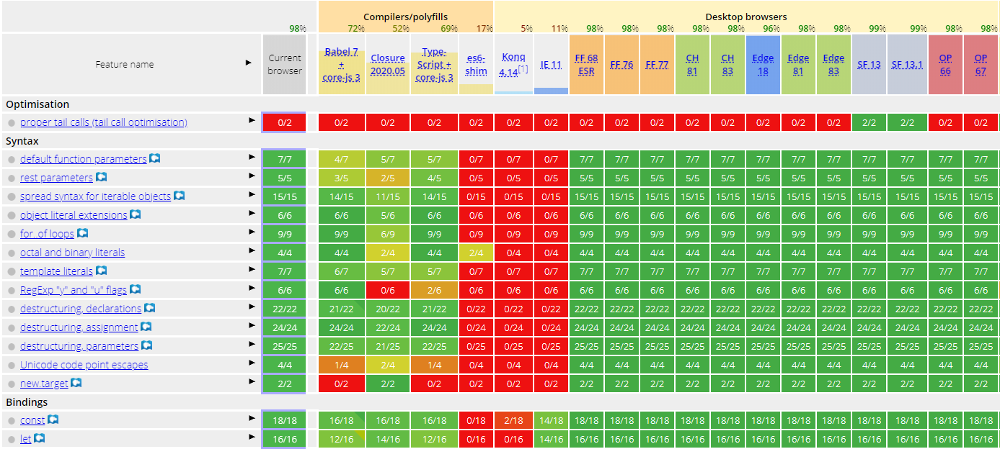

# ECMAScript 6-11


## 第1 章 ECMASript 相关介绍

### 1.1. 什么是ECMA


ECMA（European Computer Manufacturers Association）中文名称为欧洲计算机制  
造商协会，这个组织的目标是评估、开发和认可电信和计算机标准。1994 年后该  
组织改名为Ecma 国际。  

### 1.2. 什么是ECMAScript

ECMAScript 是由Ecma 国际通过ECMA-262 标准化的脚本程序设计语言。  

### 1.3. 什么是ECMA-262

Ecma 国际制定了许多标准，而ECMA-262 只是其中的一个，所有标准列表查看  
http://www.ecma-international.org/publications/standards/Standard.htm  

### 1.4. ECMA-262 历史

ECMA-262（ECMAScript）历史版本查看网址  
http://www.ecma-international.org/publications/standards/Ecma-262-arch.htm  

| 第1 版 | 1997 年 | 制定了语言的基本语法 |
| --- | --- | --- |
| 第2 版 | 1998 年 | 较小改动 |
| 第3 版 | 1999 年 | 引入正则、异常处理、格 式化输出等。IE 开始支持 |
| 第4 版 | 2007 年 | 过于激进，未发布 |
| 第5 版 | 2009 年 | 引入严格模式、JSON，扩 展对象、数组、原型、字 符串、日期方法 |
| 第6 版 | 2015 年 | 模块化、面向对象语法、 Promise、箭头函数、let、 const、数组解构赋值等等 |
| 第7 版 | 2016 年 | 幂运算符、数组扩展、 Async/await 关键字 |
| 第8 版 | 2017 年 | Async/await、字符串扩展 |
| 第9 版 | 2018 年 | 对象解构赋值、正则扩展 |
| 第10 版 | 2019 年 | 扩展对象、数组方法 |

  ES.next  
  动态指向下一个版本  
注：从ES6 开始，每年发布一个版本，版本号比年份最后一位大1  

### 1.5. 谁在维护ECMA-262

TC39（Technical Committee 39）是推进 ECMAScript 发展的委员会。其会员都是  
公司（其中主要是浏览器厂商，有苹果、谷歌、微软、因特尔等）。TC39 定期  
召开会议，会议由会员公司的代表与特邀专家出席  

### 1.6. 为什么要学习ES6

⚫ ES6 的版本变动内容最多，具有里程碑意义  
⚫ ES6 加入许多新的语法特性，编程实现更简单、高效  
⚫ ES6 是前端发展趋势，就业必备技能  

### 1.7. ES6 兼容性

http://kangax.github.io/compat-table/es6/ 可查看兼容性  



## 第2 章 ECMASript 6 新特性

### 2.1. let 关键字

let 关键字用来声明变量，使用let 声明的变量有几个特点：  
1) 不允许重复声明  
2) 块儿级作用域  
3) 不存在变量提升  
4) 不影响作用域链  
应用场景：以后声明变量使用let 就对了  

### 2.2. const 关键字

const 关键字用来声明常量，const 声明有以下特点  
1) 声明必须赋初始值  
2) 标识符一般为大写  
3) 不允许重复声明  
4) 值不允许修改  
5) 块儿级作用域  
注意: 对象属性修改和数组元素变化不会出发const 错误  
应用场景：声明对象类型使用const，非对象类型声明选择let  

### 2.3. 变量的解构赋值

  ES6 允许按照一定模式，从数组和对象中提取值，对变量进行赋值，这被称  
为解构赋值。  

```javascript
//数组的解构赋值
const arr = ['张学友', '刘德华', '黎明', '郭富城'];
let [zhang, liu, li, guo] = arr;

//对象的解构赋值
const lin = {
    name: '林志颖',
    tags: ['车手', '歌手', '小旋风', '演员']
};
let {name, tags} = lin;

//复杂解构
let wangfei = {
    name: '王菲',
    age: 18,
    songs: ['红豆', '流年', '暧昧', '传奇'],
    history: [
        {name: '窦唯'},
        {name: '李亚鹏'},
        {name: '谢霆锋'}
    ]
};
let {songs: [one, two, three], history: [first, second, third]} =
wangfei;
```

注意：频繁使用对象方法、数组元素，就可以使用解构赋值形式  

### 2.4. 模板字符串

模板字符串（template string）是增强版的字符串，用反引号（`）标识，特点：  
1) 字符串中可以出现换行符  
2) 可以使用 ${xxx} 形式输出变量  

```javascript
// 定义字符串
let str = `<ul>
        <li>沈腾</li>
        <li>玛丽</li>
        <li>魏翔</li>
        <li>艾伦</li>
    </ul>`;

// 变量拼接
let star = '王宁';
let result = `${star}在前几年离开了开心麻花`;
```

注意：当遇到字符串与变量拼接的情况使用模板字符串  

### 2.5. 简化对象写法

  ES6 允许在大括号里面，直接写入变量和函数，作为对象的属性和方法。这  
样的书写更加简洁。  

```javascript
let name = '尚硅谷';
let slogon = '永远追求行业更高标准';
let improve = function () {
    console.log('可以提高你的技能');
}
//属性和方法简写
let atguigu = {
    name,
    slogon,
    improve,
    change() {
        console.log('可以改变你')
    }
};
```

注意：对象简写形式简化了代码，所以以后用简写就对了  

### 2.6. 箭头函数

ES6 允许使用「箭头」（=>）定义函数。  

```javascript
/**
 * 1. 通用写法
 */
let fn = (arg1, arg2, arg3) => {
    return arg1 + arg2 + arg3;
}
```

箭头函数的注意点:  
1) 如果形参只有一个，则小括号可以省略  
2) 函数体如果只有一条语句，则花括号可以省略，函数的返回值为该条语句的  
  执行结果  
3) 箭头函数this 指向声明时所在作用域下 this 的值  
4) 箭头函数不能作为构造函数实例化  
5) 不能使用arguments  

```javascript
/**
 * 2. 省略小括号的情况
 */
let fn2 = num => {
    return num * 10;
};

/**
 * 3. 省略花括号的情况
 */
let fn3 = score => score * 20;

/**
 * 4. this 指向声明时所在作用域中 this 的值
 */
let fn4 = () => {
    console.log(this);
}

let school = {
    name: '尚硅谷',
    getName(){
        let fn5 = () => {
            console.log(this);
        }
        fn5();
    }
};
```

注意：箭头函数不会更改this 指向，用来指定回调函数会非常合适  

### 2.7. rest 参数

ES6 引入rest 参数，用于获取函数的实参，用来代替arguments  

```javascript
/**
 * 作用与 arguments 类似
 */
function add(...args){
    console.log(args);
}
add(1,2,3,4,5);

/**
 * rest 参数必须是最后一个形参
 */
function minus(a,b,...args){
    console.log(a,b,args);
}
minus(100,1,2,3,4,5,19);
```

注意：rest 参数非常适合不定个数参数函数的场景  

### 2.8. spread 扩展运算符

  扩展运算符（spread）也是三个点（...）。它好比 rest 参数的逆运算，将一  
个数组转为用逗号分隔的参数序列，对数组进行解包。  

```javascript
/**
 * 展开数组
 */
let tfboys = ['德玛西亚之力','德玛西亚之翼','德玛西亚皇子'];
function fn(){
    console.log(arguments);
}
fn(...tfboys)


/**
 * 展开对象
 */
let skillOne = {
    q: '致命打击',
};
let skillTwo = {
    w: '勇气'
};
let skillThree = {
    e: '审判'
};
let skillFour = {
    r: '德玛西亚正义'
};

let gailun = {...skillOne, ...skillTwo,...skillThree,...skillFour};
```

### 2.9. Symbol

#### 2.9.1. Symbol 基本使用

  ES6 引入了一种新的原始数据类型Symbol，表示独一无二的值。它是  
JavaScript 语言的第七种数据类型，是一种类似于字符串的数据类型。  
Symbol 特点  
1) Symbol 的值是唯一的，用来解决命名冲突的问题  
2) Symbol 值不能与其他数据进行运算  
3) Symbol 定义的对象属性不能使用for…in 循环遍历，但是可以使用  
  Reflect.ownKeys 来获取对象的所有键名  

```javascript
//创建 Symbol
let s1 = Symbol();
console.log(s1, typeof s1);

//添加标识的 Symbol
let s2 = Symbol('尚硅谷');
let s2_2 = Symbol('尚硅谷');
console.log(s2 === s2_2);

//使用 Symbol for 定义
let s3 = Symbol.for('尚硅谷');
let s3_2 = Symbol.for('尚硅谷');
console.log(s3 === s3_2);
```

注: 遇到唯一性的场景时要想到Symbol  

#### 2.9.2. Symbol 内置值

  除了定义自己使用的 Symbol 值以外，ES6 还提供了11 个内置的Symbol 值，  
指向语言内部使用的方法。可以称这些方法为魔术方法，因为它们会在特定的场  
景下自动执行。  

| Symbol.hasInstance | 当其他对象使用instanceof 运算符，判断是否为该对 象的实例时，会调用这个方法 |
| --- | --- |
| Symbol.isConcatSpreadable | 对象的Symbol.isConcatSpreadable 属性等于的是一个 布尔值，表示该对象用于Array.prototype.concat()时， 是否可以展开。 |
| Symbol.species | 创建衍生对象时，会使用该属性 |
| Symbol.match | 当执行str.match(myObject) 时，如果该属性存在，会 调用它，返回该方法的返回值。 |
| Symbol.replace | 当该对象被str.replace(myObject)方法调用时，会返回 该方法的返回值。 |
| Symbol.search | 当该对象被str. search (myObject)方法调用时，会返回 该方法的返回值。 |
| Symbol.split | 当该对象被str. split (myObject)方法调用时，会返回该 方法的返回值。 |
| Symbol.iterator | 对象进行for...of 循环时，会调用Symbol.iterator 方法， 返回该对象的默认遍历器 |
| Symbol.toPrimitive | 该对象被转为原始类型的值时，会调用这个方法，返 回该对象对应的原始类型值。 |
| Symbol. toStringTag | 在该对象上面调用toString 方法时，返回该方法的返 回值 |
| Symbol. unscopables | 该对象指定了使用with 关键字时，哪些属性会被with 环境排除。 |

### 2.10. 迭代器

  遍历器（Iterator）就是一种机制。它是一种接口，为各种不同的数据结构提  
供统一的访问机制。任何数据结构只要部署 Iterator 接口，就可以完成遍历操作。  
1) ES6 创造了一种新的遍历命令for...of 循环，Iterator 接口主要供for...of 消费  
2) 原生具备iterator 接口的数据(可用for of 遍历)  
  a) Array  
  b) Arguments  
  c) Set  
  d) Map  
  e) String  
  f)  
  TypedArray  
  g) NodeList  
3) 工作原理  
  a) 创建一个指针对象，指向当前数据结构的起始位置  
  b) 第一次调用对象的next 方法，指针自动指向数据结构的第一个成员  
  c) 接下来不断调用next 方法，指针一直往后移动，直到指向最后一个成员  
  d) 每调用next 方法返回一个包含value 和done 属性的对象  
注: 需要自定义遍历数据的时候，要想到迭代器。  

### 2.11. 生成器

生成器函数是ES6 提供的一种异步编程解决方案，语法行为与传统函数完全不同  

```javascript
function * gen(){
    yield '一只没有耳朵';
    yield '一只没有尾巴';
    return '真奇怪';
}
let iterator = gen();
console.log(iterator.next());
console.log(iterator.next());
console.log(iterator.next());
```

代码说明：  
1) * 的位置没有限制  
2) 生成器函数返回的结果是迭代器对象，调用迭代器对象的next 方法可以得到  
  yield 语句后的值  
3) yield 相当于函数的暂停标记，也可以认为是函数的分隔符，每调用一次next  
  方法，执行一段代码  
4) next 方法可以传递实参，作为yield 语句的返回值  

### 2.12. Promise

Promise 是ES6 引入的异步编程的新解决方案。语法上Promise 是一个构造函数，  
用来封装异步操作并可以获取其成功或失败的结果。  
1) Promise 构造函数: Promise (excutor) {}  
2) Promise.prototype.then 方法  
3) Promise.prototype.catch 方法  

### 2.13. Set

  ES6 提供了新的数据结构 Set（集合）。它类似于数组，但成员的值都是唯  
一的，集合实现了iterator 接口，所以可以使用『扩展运算符』和『for…of…』进  
行遍历，集合的属性和方法：  
  返回集合的元素个数  
1) size  
2) add  
  增加一个新元素，返回当前集合  
3) delete 删除元素，返回boolean 值  
4) has  
  检测集合中是否包含某个元素，返回boolean 值  
5) clear  
  清空集合，返回undefined  

```javascript
//创建一个空集合
let s = new Set();
//创建一个非空集合
let s1 = new Set([1,2,3,1,2,3]);

//集合属性与方法
//返回集合的元素个数
console.log(s1.size);
//添加新元素
console.log(s1.add(4));
//删除元素
console.log(s1.delete(1));
//检测是否存在某个值
console.log(s1.has(2));
//清空集合
console.log(s1.clear());
```

### 2.14. Map

  ES6 提供了 Map 数据结构。它类似于对象，也是键值对的集合。但是“键”  
的范围不限于字符串，各种类型的值（包括对象）都可以当作键。Map 也实现了  
iterator 接口，所以可以使用『扩展运算符』和『for…of…』进行遍历。Map 的属  
性和方法：  
1) size  
  返回Map 的元素个数  
2) set  
  增加一个新元素，返回当前Map  
3) get  
  返回键名对象的键值  
  检测Map 中是否包含某个元素，返回boolean 值  
4) has  
  清空集合，返回undefined  
5) clear  

```javascript
//创建一个空 map
let m = new Map();
//创建一个非空 map
let m2 = new Map([
    ['name','尚硅谷'],
    ['slogon','不断提高行业标准']
]);

//属性和方法
//获取映射元素的个数
console.log(m2.size);
//添加映射值
console.log(m2.set('age', 6));
//获取映射值
console.log(m2.get('age'));
//检测是否有该映射
console.log(m2.has('age'));
//清除
console.log(m2.clear());
```

### 2.15. class 类

  ES6 提供了更接近传统语言的写法，引入了 Class（类）这个概念，作为对  
象的模板。通过class 关键字，可以定义类。基本上，ES6 的class 可以看作只是  
一个语法糖，它的绝大部分功能，ES5 都可以做到，新的class 写法只是让对象  
原型的写法更加清晰、更像面向对象编程的语法而已。  
知识点：  
1) class 声明类  
2) constructor 定义构造函数初始化  
3) extends 继承父类  
4) super 调用父级构造方法  
5) static 定义静态方法和属性  
6) 父类方法可以重写  

```javascript
//父类
class Phone {
    //构造方法
    constructor(brand, color, price) {
        this.brand = brand;
        this.color = color;
        this.price = price;
    }

    //对象方法
    call() {
        console.log('我可以打电话!!!')
    }
}

//子类
class SmartPhone extends Phone {

    constructor(brand, color, price, screen, pixel) {
        super(brand, color, price);
        this.screen = screen;
        this.pixel = pixel;
    }

    //子类方法
    photo(){
        console.log('我可以拍照!!');
    }

    playGame(){
        console.log('我可以玩游戏!!');
    }

    //方法重写
    call(){
        console.log('我可以进行视频通话!!');
    }

    //静态方法
    static run(){
        console.log('我可以运行程序')
    }

    static connect(){
        console.log('我可以建立连接')
    }
}

//实例化对象
const Nokia = new Phone('诺基亚', '灰色', 230);
const iPhone6s = new SmartPhone('苹果', '白色', 6088,
'4.7inch','500w');

//调用子类方法
iPhone6s.playGame();
//调用重写方法
iPhone6s.call();
//调用静态方法
SmartPhone.run();
```

### 2.16. 数值扩展

#### 2.16.1.

#### 二进制和八进制

ES6 提供了二进制和八进制数值的新的写法，分别用前缀0b 和0o 表示。  

#### Number.isFinite() 与Number.isNaN()

#### 2.16.2.

Number.isFinite() 用来检查一个数值是否为有限的  
Number.isNaN() 用来检查一个值是否为NaN  

#### 2.16.3.

#### Number.parseInt() 与Number.parseFloat()

ES6 将全局方法parseInt 和parseFloat，移植到Number 对象上面，使用不变。  

#### 2.16.4.

#### Math.trunc

用于去除一个数的小数部分，返回整数部分。  

#### 2.16.5.

#### Number.isInteger

Number.isInteger() 用来判断一个数值是否为整数  

### 2.17. 对象扩展

ES6 新增了一些Object 对象的方法  
1) Object.is 比较两个值是否严格相等，与『===』行为基本一致（+0 与 NaN）  
2) Object.assign 对象的合并，将源对象的所有可枚举属性，复制到目标对象  
3) __proto__、setPrototypeOf、 setPrototypeOf 可以直接设置对象的原型  

### 2.18. 模块化

模块化是指将一个大的程序文件，拆分成许多小的文件，然后将小文件组合起来。  

#### 2.18.1.

#### 模块化的好处

模块化的优势有以下几点：  
1) 防止命名冲突  
2) 代码复用  
3) 高维护性  

#### 2.18.2.

#### 模块化规范产品

ES6 之前的模块化规范有：  
1) CommonJS  =>  NodeJS、Browserify  
2) AMD  
  =>  requireJS  
3) CMD  
  =>  seaJS  

#### 2.18.3.

#### ES6 模块化语法

模块功能主要由两个命令构成：export 和import。  
⚫ export 命令用于规定模块的对外接口  
⚫ import 命令用于输入其他模块提供的功能  

## 第3 章 ECMASript 7 新特性

#### 3.1. Array.prototype.includes

Includes 方法用来检测数组中是否包含某个元素，返回布尔类型值  

### 3.2. 指数操作符

在ES7 中引入指数运算符「**」，用来实现幂运算，功能与Math.pow 结果相同  

## 第4 章 ECMASript 8 新特性

### 4.1. async 和await

async 和await 两种语法结合可以让异步代码像同步代码一样  

#### 4.1.1. async 函数

1. async 函数的返回值为promise 对象，  
2. promise 对象的结果由async 函数执行的返回值决定  

#### 4.1.2. await 表达式

1. await 必须写在async 函数中  
2. await 右侧的表达式一般为promise 对象  
3. await 返回的是promise 成功的值  
4. await 的promise 失败了, 就会抛出异常, 需要通过try...catch 捕获处理  

#### 4.2. Object.values 和Object.entries

1. Object.values()方法返回一个给定对象的所有可枚举属性值的数组  
2. Object.entries()方法返回一个给定对象自身可遍历属性 [key,value] 的数组  

#### 4.3. Object.getOwnPropertyDescriptors

该方法返回指定对象所有自身属性的描述对象  

## 第5 章 ECMASript 9 新特性

### 5.1. Rest/Spread 属性

Rest 参数与spread 扩展运算符在ES6 中已经引入，不过ES6 中只针对于数组，  
在ES9 中为对象提供了像数组一样的rest 参数和扩展运算符  

```javascript

function connect({host, port, ...user}) {
    console.log(host);
    console.log(port);
    console.log(user);
}

connect({
    host: '127.0.0.1',
    port: 3306,
    username: 'root',
    password: 'root',
    type: 'master'
});
```

### 5.2. 正则表达式命名捕获组

ES9 允许命名捕获组使用符号『`?<name>`』,这样获取捕获结果可读性更强  

```javascript

let str = '<a href="http://www.atguigu.com">尚硅谷</a>';

const reg = /<a href="(?<url>.*)">(?<text>.*)<\/a>/;

const result = reg.exec(str);

console.log(result.groups.url);

console.log(result.groups.text);
```

### 5.3. 正则表达式反向断言

ES9 支持反向断言，通过对匹配结果前面的内容进行判断，对匹配进行筛选。  

```javascript

//声明字符串
let str = 'JS5211314 你知道么555 啦啦啦';
//正向断言
const reg = /\d+(?=啦)/;
const result = reg.exec(str);

//反向断言
const reg = /(?<=么)\d+/;
const result = reg.exec(str);

console.log(result);
```

### 5.4. 正则表达式dotAll 模式

正则表达式中点.匹配除回车外的任何单字符，标记『s』改变这种行为，允许行  
终止符出现  

```javascript

let str = `
<ul>
    <li>
        <a>肖生克的救赎</a>
        <p>上映日期: 1994-09-10</p>
    </li>
    <li>
        <a>阿甘正传</a>
        <p>上映日期: 1994-07-06</p>
    </li>
</ul>`;
//声明正则
const reg = /<li>.*?<a>(.*?)<\/a>.*?<p>(.*?)<\/p>/gs;
//执行匹配
const result = reg.exec(str);
let result;
let data = [];
while(result = reg.exec(str)){
    data.push({title: result[1], time: result[2]});
}
//输出结果
console.log(data);
```

## 第6 章 ECMASript 10 新特性

#### 6.1. Object.fromEntries

### 6.2. trimStart 和trimEnd

#### 6.3. Array.prototype.flat 与 flatMap

#### 6.4. Symbol.prototype.description

## 第7 章 ECMASript 11 新特性

#### 7.1. String.prototype.matchAll

### 7.2. 类的私有属性

#### 7.3. Promise.allSettled

### 7.4. 可选链操作符

### 7.5. 动态import 导入

### 7.6. globalThis 对象
