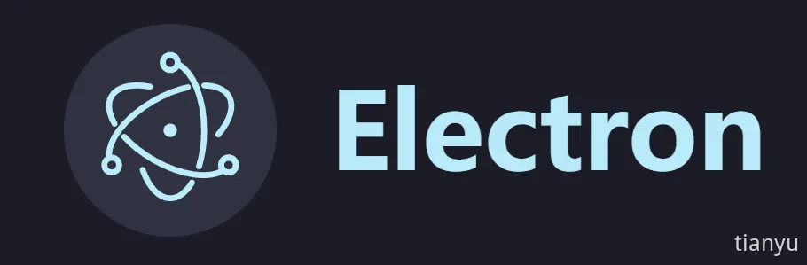
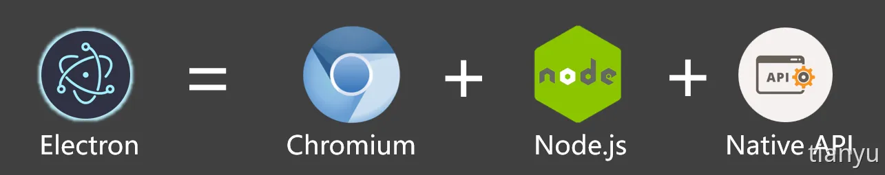
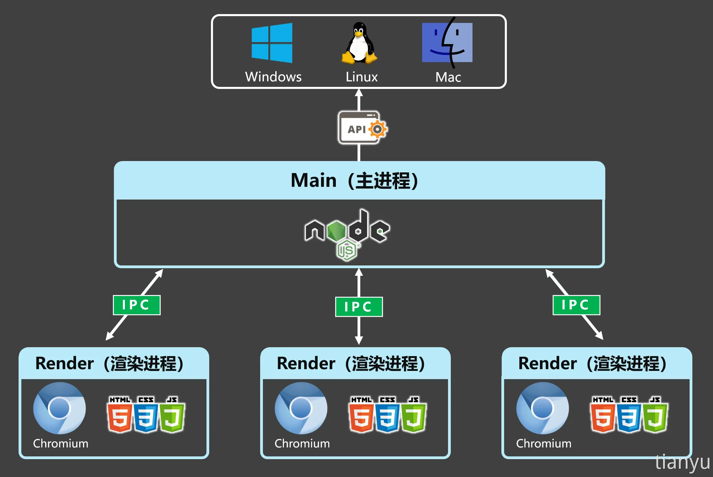
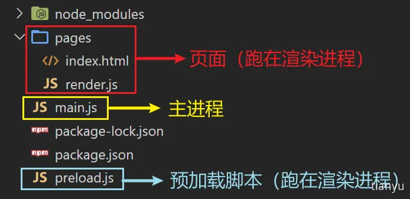
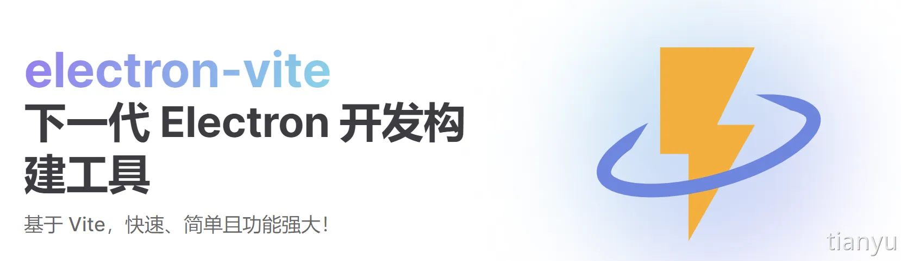

# 一小时快速上手 Electron

从 Electron 的概念与技术架构讲起，完整走一遍工程搭建、本地页面加载、窗口行为配置、自动重启、进程通信与打包发布的流程。

<!-- more -->

## 目录

- 1. 什么是 Electron？
- 2. Electron 的优势
- 3. Electron 技术架构
  - 3.1. 技术架构
  - 3.2. 进程模型
- 4. 搭建一个工程
- 5. 加载本地页面
- 6. 完善窗口行为
- 7. 配置自动重启
- 8. 主进程与渲染进程
  - 8.1. 主进程
  - 8.2. 渲染进程
- 9. Preload 脚本
- 10. 进程通信（IPC）
  - 10.1. 渲染进程 ➡ 主进程（单向）
  - 10.2. 渲染进程 ↔ 主进程（双向）
  - 10.3. 主进程到 ➡ 渲染进程
- 11. 打包应用
- 12. electron-vite

## 1. 什么是 Electron？

Electron 是一个跨平台桌面应用开发框架，开发者可以使用 HTML、CSS、JavaScript 等 Web 技术来构建桌面应用程序，它的本质是结合了 Chromium 和 Node.js，现在广泛用于桌面应用程序开发，例如这些桌面应用都用到了 Electron 技术：

-  VisualStudioCode
-  GitHubDesktop
-  1Password
-  新版 QQ



## 2. Electron 的优势

1. 可跨平台：同一套代码可以构建出能在 Windows、macOS、Linux 上运行的应用程序。
2. 上手容易：使用 Web 技术就可以轻松完成开发桌面应用程序。
3. 底层权限：允许应用程序访问文件系统、操作系统等底层功能，从而实现复杂的系统交互。
4. 社区支持：拥有一个庞大且活跃的社区，开发者可以轻松找到文档、教程和开源库。

## 3. Electron 技术架构

### 3.1. 技术架构



### 3.2. 进程模型

此处我们只是先了解一下进程模型，后面会详细讲解。



## 4. 搭建一个工程

- 初始化一个包，并填写好 `package.json` 中的必要信息及启动命令。

```json
{
  "name": "test",
  "version": "1.0.0",
  "main": "main.js",
  "scripts": {
    "start": "electron ." //start 命令用于启动整个应用
  },
  "author": "tianyu", // 为后续能顺利打包，此处要写明作者。
  "license": "ISC",
  "description": "this is a electron demo", // 为后续能顺利打包，此处要编写描述。
}
```

- 安装 electron 作为开发依赖。

```bash
npm i electron -D
```

- 在 `main.js` 中编写代码，创建一个基本窗口。

```js
/*
  main.js 运行在应用的主进程上，无法访问 Web 相关 API，主要负责：控制生命周期、显示界面、
控制渲染进程等其他操作。
*/
const { app, BrowserWindow } = require('electron')
// 用于创建窗口
function createWindow() {
  const win = new BrowserWindow({
    width: 800, // 窗口宽度
    height: 600, // 窗口高度
    autoHideMenuBar: true, // 自动隐藏菜单栏
    alwaysOnTop: true, // 置顶
    x: 0, // 窗口位置 x 坐标
    y: 0 // 窗口位置 y 坐标
  })
  // 加载一个远程页面
  win.loadURL('http://www.atguigu.com')
}
// 当 app 准备好后，执行 createWindow 创建窗口
app.on('ready',()=>{
  createWindow()
})
```

关于 BrowserWindow 的更多配置项，请参考：[BrowserWindow 实例属性](https://www.electronjs.org/docs/latest/api/browser-window)。

- 启动应用查看效果。

```bash
npm start
```

效果如下：


## 5. 加载本地页面

- 创建 `pages/index.html` 编写内容：

```html
<!DOCTYPE html>
<html>
  <head>
    <meta charset="UTF-8" />
    <title>index</title>
  </head>
  <body>
    <h1>你好啊！</h1>
  </body>
</html>
```

- 修改 `main.js` 加载本地页面：

```js
// 加载一个本地页面
win.loadFile('./pages/index.html')
```

此时开发者工具会报出一个安全警告，需要修改 `index.html`，配置 CSP（Content-Security-Policy）：

```html
<meta http-equiv="Content-Security-Policy" content="default-src 'self'; style-src 'self' 'unsafe-inline'; img-src 'self' data:;">
```

上述配置的说明：

1. `default-src 'self'`

   `default-src`：配置加载策略，适用于所有未在其它指令中明确指定的资源类型。

   `self`：仅允许从同源的资源加载，禁止从不受信任的外部来源加载，提高安全性。

2. `style-src 'self' 'unsafe-inline'`

   `style-src`：指定样式表（CSS）的加载策略。

   `self`：仅允许从同源的资源加载，禁止从不受信任的外部来源加载，提高安全性。

   `unsafe-inline`：允许在 HTML 文档内使用内联样式。

3. `img-src 'self' data:`

   `img-src`：指定图像资源的加载策略。

   `self`：表示仅允许从同源加载图像。

   `data:`：允许使用 `data:` URI 来嵌入图像。这种 URI 模式允许将图像数据直接嵌入到 HTML 或 CSS 中，而不是通过外部链接引用。

关于 CSP 的详细说明请参考：[MDN Content-Security-Policy](https://developer.mozilla.org/zh-CN/docs/Web/HTTP/Guides/CSP) 与 [Electron Security](https://www.electronjs.org/docs/latest/tutorial/security)。

## 6. 完善窗口行为

1. Windows 和 Linux 平台窗口特点是：关闭所有窗口时退出应用。

```js
// 当所有窗口都关闭时
app.on('window-all-closed', () => {
  // 如果所处平台不是 mac(darwin) ，则退出应用。
  if (process.platform !== 'darwin') app.quit()
})
```

2. mac 应用即使在没有打开任何窗口的情况下也继续运行，并且在没有窗口可用的情况下激活应用时会打开新的窗口。

```js
// 当 app 准备好后，执行 createWindow 创建窗口
app.on('ready',()=>{
  createWindow()
  // 当应用被激活时
  app.on('activate', () => {
    // 如果当前应用没有窗口，则创建一个新的窗口
    if (BrowserWindow.getAllWindows().length === 0) createWindow()
  })
})
```

## 7. 配置自动重启

1. 安装 Nodemon。

```bash
npm i nodemon -D
```

2. 修改 `package.json` 命令。

```json
"scripts": {
  "start": "nodemon --exec electron ."
},
```

3. 配置 `nodemon.json` 规则。

```json
{
  "ignore": [
    "node_modules",
    "dist"
  ],
  "restartable": "r",
  "watch": ["*.*"],
  "ext": "html,js,css"
}
```

配置好以后，当代码修改后，应用就会自动重启了。

## 8. 主进程与渲染进程

下图是 Chrome 浏览器的程序架构，图来自于 Chrome 漫画。


Electron 应用的结构与上图非常相似，在 Electron 中主要控制两类进程：主进程、渲染器进程。

### 8.1. 主进程

每个 Electron 应用都有一个单一的主进程，作为应用程序的入口点。主进程在 Node.js 环境中运行，它具有 `require` 模块和使用所有 Node.js API 的能力，主进程的核心就是：**使用 BrowserWindow 来创建和管理窗口**。

### 8.2. 渲染进程

每个 BrowserWindow 实例都对应一个单独的渲染器进程，运行在渲染器进程中的代码，必须遵守网页标准，这也就意味着：**渲染器进程无权直接访问 `require` 或使用任何 Node.js 的 API**。

> 问题产生：处于渲染器进程的用户界面，该怎样才与 Node.js 和 Electron 的原生桌面功能进行交互呢？

## 9. Preload 脚本

预加载（Preload）脚本是运行在渲染进程中的，但它是在**网页内容加载之前**执行的，这意味着它具有比普通渲染器代码更高的权限，可以访问 Node.js 的 API，同时又可以与网页内容进行安全的交互。

简单说：它是 Node.js 和 Web API 的桥梁，Preload 脚本可以安全地将部分 Node.js 功能暴露给网页，从而减少安全风险。

> **需求**：点击按钮后，在页面呈现当前的 Node 版本。

具体文件结构与编码如下：

1. 创建预加载脚本 `preload.js`，内容如下：

```js
const {contextBridge} = require('electron')
// 暴露数据给渲染进程
contextBridge.exposeInMainWorld('myAPI',{
  n:666,
  version:process.version
})
```

2. 在主线程中引入 `preload.js`：

```js
const win = new BrowserWindow({
  /*******/
  webPreferences:{
    preload:path.resolve(__dirname,'./preload.js')
  }
  /*******/
})
```

3. 在 html 页面中编写对应按钮，并创建专门编写网页脚本的 `render.js`，随后引入。

```html
<body>
  <h1>你好啊！</h1>
  <button id="btn">在用户的D盘创建一个hello.txt</button>
  <script type="text/javascript" src="./render.js"></script>
</body>
```

4. 在渲染进程中使用 `version`：

```js
btn.addEventListener('click',()=>{
  console.log(myAPI.version)
  document.body.innerHTML += `<h2>${myAPI.version}</h2>`
})
```

5. 整体文件结构如下：



## 10. 进程通信（IPC）

> 值得注意的是：
>
> 上文中的 `preload.js`，无法使用全部 Node 的 API，比如：不能使用 Node 中的 `fs` 模块，但主进程（`main.js`）是可以的，这时就需要**进程通信**了。简单说：要让 `preload.js` 通知 `main.js` 去调用 `fs` 模块去干活。

关于 Electron 进程通信，我们要知道：

- IPC 全称为：InterProcess Communication，即：进程通信。
- IPC 是 Electron 中最为核心的内容，它是从 UI 调用原生 API 的唯一方法！
- Electron 中，主要使用 `ipcMain` 和 `ipcRenderer` 来定义“通道”，进行进程通信。

### 10.1. 渲染进程 ➡ 主进程（单向）

概述：在渲染器进程中 `ipcRenderer.send` 发送消息，在主进程中使用 `ipcMain.on` 接收消息。

常用于：**在 Web 中调用主进程的 API**，例如下面的这个需求：

> **需求**：点击按钮后，在用户的 D 盘创建一个 `hello.txt` 文件，文件内容来自于用户输入。

1. 页面中添加相关元素，`render.js` 中添加对应脚本。

`index.html`：

```html
<input id="content" type="text"><br><br>
<button id="btn">在用户的D盘创建一个hello.txt</button>
```

`render.js`：

```js
const btn = document.getElementById('btn')
const content = document.getElementById('content')
btn.addEventListener('click',()=>{
  console.log(content.value)
  myAPI.saveFile(content.value)
})
```

2. `preload.js` 中使用 `ipcRenderer.send('信道',参数)` 发送消息，与主进程通信。

```js
const {contextBridge,ipcRenderer} = require('electron')
contextBridge.exposeInMainWorld('myAPI',{
  /*******/
  saveFile(str){
    // 渲染进程给主进程发送一个消息
    ipcRenderer.send('create-file',str)
  }
})
```

3. 主进程中，在加载页面之前，使用 `ipcMain.on('信道',回调)` 配置对应回调函数，接收消息。

```js
// 用于创建窗口
function createWindow() {
  /**********/
  // 主进程注册对应回调
  ipcMain.on('create-file',createFile)
  // 加载一个本地页面
  win.loadFile(path.resolve(__dirname,'./pages/index.html'))
}
// 创建文件
function createFile(event,data){
  fs.writeFileSync('D:/hello.txt',data)
}
```

### 10.2. 渲染进程 ↔ 主进程（双向）

概述：渲染进程通过 `ipcRenderer.invoke` 发送消息，主进程使用 `ipcMain.handle` 接收并处理消息。

备注：`ipcRenderer.invoke` 的返回值是 `Promise` 实例。

常用于：**从渲染器进程调用主进程方法并等待结果**，例如下面的这个需求：

> **需求**：点击按钮从 D 盘读取 `hello.txt` 中的内容，并将结果呈现在页面上。

1. 页面中添加相关元素，`render.js` 中添加对应脚本。

`index.html`：

```html
<button id="btn">读取用户D盘的hello.txt</button>
```

`render.js`：

```js
const btn = document.getElementById('btn')
btn.addEventListener('click',async()=>{
  let data =
  document.body.innerHTML += `<h2>${data}</h2>`
})
```

2. `preload.js` 中使用 `ipcRenderer.invoke('信道',参数)` 发送消息，与主进程通信。

```js
const {contextBridge,ipcRenderer} = require('electron')
contextBridge.exposeInMainWorld('myAPI',{
  /*******/
  readFile (path){
    return ipcRenderer.invoke('read-file')
  }
})
```

3. 主进程中，在加载页面之前，使用 `ipcMain.handle('信道',回调)` 接收消息，并配置回调函数。

```js
// 用于创建窗口
function createWindow() {
  /**********/
  // 主进程注册对应回调
  ipcMain.handle('read-file',readFile)
  // 加载一个本地页面
  win.loadFile(path.resolve(__dirname,'./pages/index.html'))
}
// 读取文件
function readFile(event,path){
  return fs.readFileSync(path).toString()
}
```

### 10.3. 主进程到 ➡ 渲染进程

概述：主进程使用 `win.webContents.send` 发送消息，渲染进程通过 `ipcRenderer.on` 处理消息。

常用于：**从主进程主动发送消息给渲染进程**，例如下面的这个需求：

> **需求**：应用加载 6 秒钟后，主动给渲染进程发送一个消息，内容是：你好啊！

1. 页面中添加相关元素，`render.js` 中添加对应脚本。

```js
window.onload = ()=>{
  myAPI.getMessage(logMessage)
}
function logMessage(event,str){
  console.log(event,str)
}
```

2. `preload.js` 中使用 `ipcRenderer.on('信道',回调)` 接收消息，并配置回调函数。

```js
const {contextBridge,ipcRenderer} = require('electron')
contextBridge.exposeInMainWorld('myAPI',{
  /*******/
  getMessage: (callback) => {
    return ipcRenderer.on('message', callback);
  }
})
```

3. 主进程中，在合适的时候，使用 `win.webContents.send('信道',数据)` 发送消息。

```js
// 用于创建窗口
function createWindow() {
  /**********/
  // 加载一个本地页面
  win.loadFile(path.resolve(__dirname,'./pages/index.html'))
  // 创建一个定时器
  setTimeout(() => {
    win.webContents.send('message','你好啊！')
  }, 6000);
}
```

## 11. 打包应用

使用 electron-builder 打包应用。

1. 安装 electron-builder：

```bash
npm install electron-builder -D
```

2. 在 `package.json` 中进行相关配置，具体配置如下：

备注：json 文件不支持注释，使用时请去掉所有注释。

```json
{
  "name": "video-tools", // 应用程序的名称
  "version": "1.0.0", // 应用程序的版本
  "main": "main.js", // 应用程序的入口文件
  "scripts": {
    "start": "electron .", // 使用 `electron .` 命令启动应用程序
    "build": "electron-builder" // 使用 `electron-builder` 打包应用程序，生成安装包
  },
  "build": {
    "appId": "com.atguigu.video", // 应用程序的唯一标识符
    // 打包 windows 平台安装包的具体配置
    "win": {
      "icon":"./logo.ico", // 应用图标
      "target": [
        {
          "target": "nsis", // 指定使用 NSIS 作为安装程序格式
          "arch": ["x64"] // 生成 64 位安装包
        }
      ]
    },
    "nsis": {
      "oneClick": false, // 设置为 `false` 使安装程序显示安装向导界面，而不是一键安装
      "perMachine": true, // 允许每台机器安装一次，而不是每个用户都安装
      "allowToChangeInstallationDirectory": true // 允许用户在安装过程中选择安装目录
    }
  },
  "devDependencies": {
    "electron": "^30.0.0", // 开发依赖中的 Electron 版本
    "electron-builder": "^24.13.3" // 开发依赖中的 `electron-builder` 版本
  },
  "author": "tianyu", // 作者信息
  "license": "ISC", // 许可证信息
  "description": "A video processing program based on Electron" // 应用程序的描述
}
```

3. 执行打包命令。

```bash
npm run build
```

## 12. electron-vite

electron-vite 是一个新型构建工具，旨在为 Electron 提供更快、更精简的体验。主要由五部分组成：

- 一套构建指令，它使用 Vite 打包你的代码，并且它能够处理 Electron 的独特环境，包括 Node.js 和浏览器环境。
- 集中配置主进程、渲染器和预加载脚本的 Vite 配置，并针对 Electron 的独特环境进行预配置。
- 为渲染器提供快速模块热替换（HMR）支持，为主进程和预加载脚本提供热重载支持，极大地提高了开发效率。
- 优化 Electron 主进程资源处理。
- 使用 V8 字节码保护源代码。

electron-vite 快速、简单且功能强大，旨在开箱即用。

官网地址：[https://cn-evite.netlify.app/](https://cn-evite.netlify.app/)


