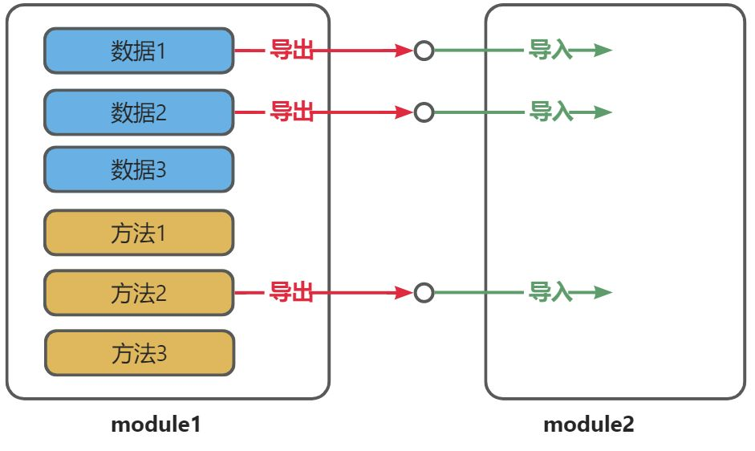
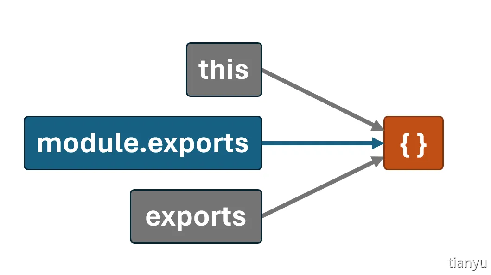

# CommonJS 规范

CommonJS 的初步体验、导出数据、导入数据、扩展理解与浏览器端运行。

<!-- more -->

<!-- PDF 第 3 页 -->

模块化的核心思想就是：模块之间是隔离的，通过导入和导出进行数据和功能的共享。  
- 导出（暴露）：模块公开其内部的一部分（如变量、函数等），使这些内容可以被其他模块使  
用。  
- 导入（引入）：模块引入和使用其他模块导出的内容，以重用代码和功能。  


## 4. CommonJS 规范

### 4.1. 初步体验

> 页码：3


<!-- PDF 第 4 页 -->

1.「创建 school.js」  
```javascript
const name = ''
const slogan = '让天下没有难学的技术！'
function getTel (){
  return '010-56253825'
}
function getCities(){
  return ['北京','上海','深圳','成都','武汉','西安']
}
// 通过给exports对象添加属性的方式，来导出数据（注意：此处没有导出getCities）
exports.name = name
exports.slogan = slogan
exports.getTel = getTel
```

2.「创建 student.js」  
```javascript
const name = '张三'
const motto = '相信明天会更好！'
function getTel (){
  return '13877889900'
}
function getHobby(){
  return ['抽烟','喝酒','烫头']
}
// 通过给exports对象添加属性的方式，来导出数据（注意：此处没有导出getHobby）
exports.name = name
exports.slogan = slogan
exports.getTel = getTel
```

3.「创建 index.js」  
```javascript
// 引入school模块暴露的所有内容
const school = require('./school')
// 引入student模块暴露的所有内容
const student = require('./student')
```

> 页码：4


<!-- PDF 第 5 页 -->

### 4.2. 导出数据

在 CommonJS 标准中，导出数据有两种方式：  
第一种方式：`module.exports = value`  
第二种方式：`exports.name = value`  
注意点如下：  
1. 每个模块内部的：`this`、`exports`、`modules.exports`在初始时，都指向同一  
个空对象，该空对象就是当前模块导出的数据，如下图：  


2. 无论如何修改导出对象，最终导出的都是`module.exports`的值。  
3.  
`exports`是对`module.exports`的初始引用，仅为了方便给导出象添加属性，所以  
不能使用   `exports = value`的形式导出数据，但是可以使用`module.exports`  
`= xxxx`导出数据。  
### 4.3. 导入数据

在`CJS`模块化标准中，使用内置的`require`函数进行导入数据  
```javascript
// 直接引入模块
const school = require('./school')
// 引入同时解构出要用的数据
const { name, slogan, getTel } = require('./school')
// 引入同时解构+重命名
const {name:stuName,motto,getTel:stuTel} = require('./student')
```

### 4.4. 扩展理解

> 页码：5

