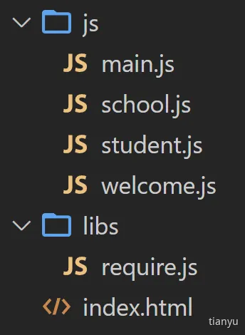
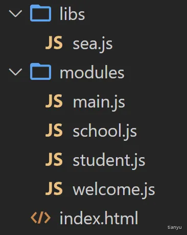

# AMD 与 CMD 模块化规范

AMD 与 CMD 的环境准备、数据导出导入及模块使用方式。

<!-- more -->

<!-- PDF 第 14 页 -->

## 6. AMD 模块化规范（了解）

### 6.1. 环境准备

第一步：准备文件结构：  


文件说明：  
1. js 文件夹中存放业务逻辑代码，`main.js`用于汇总各模块。  
2. libs 中存放的是第三方库，例如必须要用的`require.js`。  
require.js  
第二步：在`index.html`中配置`main.js`与`require.js`  
index.html  
HTML  
```html
<script data-main="./js/main.js" src="./libs/require.js"></script>
```

第三步：在`main.js`中编写模块配置对象，注册所有模块。  
> 页码：14


<!-- PDF 第 15 页 -->

main.js  
JavaScript  
```javascript
/*AMD_require.js模块化的入口文件，要编写配置对象，并且有固定的写法*/
requirejs.config({
  //基本路径
  baseUrl: "./js",
  //模块标识名与模块路径映射
  paths: {
    school: "school",
    student: "student",
    welcome: "welcome",
  }
})
```

### 6.2. 导出数据

AMD 规范使用`define`函数来定义模块和导出数据  
student.js  
JavaScript  
```javascript
define(function(){
  const name = '张三'
  const motto = '走自己的路，让别人五路可走！'
  function getTel (){
    return '13877889900'
  }
  function getHobby(){
    return ['抽烟','喝酒','烫头']
  }
  // 导出数据
  return {name,motto,getTel}
})
```

### 6.3. 导入数据

如需导入数据，则需要`define`传入两个参数，分别为：依赖项数组、回调函数  
> 页码：15


<!-- PDF 第 16 页 -->

school  
JavaScript  
```javascript
// ['welcome']表示当前模块要依赖的模块名字
// 回调接收到的welcome是模块导出的数据
define(['welcome'],function(welcome){
  let name = {str:'尚硅谷'}
  const slogan = '让天下没有难学的技术！'+ welcome
  function getTel (){
    return '010-56253825'
  }
  function getCities(){
    return ['北京','上海','深圳','成都','武汉','西安']
  }
  // 导出数据
  return {name,slogan,getTel}
})
```

### 6.4. 使用模块

main.js  
JavaScript  
```javascript
requirejs(['school','student'],function(school,student){
  console.log('main',school)
  console.log('main',student)
})
```

## 7. CMD 模块化规范（了解）

### 7.1. 环境准备

第一步：准备环境  
> 页码：16


<!-- PDF 第 17 页 -->



文件说明：  
1. js 文件夹中存放业务逻辑代码，`main.js`用于汇总各模块。  
2. libs 中存放的是第三方库，例如必须要用的`sea.js`。  
sea.js  
第二步：在`index.html`中配置`main.js`与`sea.js`  
index.html  
HTML  
```html
<script type="text/javascript" src="./libs/sea.js"></script>
<script type="text/javascript">
  seajs.use('./modules/main.js')
</script>
```

### 7.2. 导出数据

CMD 中同样使用`define`函数定义模块并导出数据  
> 页码：17


<!-- PDF 第 18 页 -->

school.js  
JavaScript  
```javascript
/*
  收到的三个参数分别为：require、exports、module
    1. require用于引入其他模块
    2. exports、module用于导出数据
*/
define(function(require,exports,module){
  const name = '尚硅谷'
  const slogan = '让天下没有难学的技术！'
  function getTel (){
    return '010-56253825'
  }
  function getCities(){
    return ['北京','上海','深圳','成都','武汉','西安']
  }
  // 导出数据
  module.exports = {name,slogan,getTel}
})
```

### 7.3. 导入数据

CMD 规范中使用收到的`require`参数进行模块导入  
> 页码：18


<!-- PDF 第 19 页 -->

student.js  
JavaScript  
```javascript
define(function(require,exports,module){
  const name = '张三'
  const motto = '相信明天会更好！'
  // 引入welcome模块
  const welcome = require('./welcome')
  console.log(welcome)
  function getTel (){
    return '13877889900'
  }
  function getHobby(){
    return ['抽烟','喝酒','烫头']
  }
  exports.name = name
  exports.motto = motto
  exports.getTel = getTel
})
```

### 7.4. 使用模块

main.js  
JavaScript  
```javascript
define(function(require){
  const school = require('./school')
  const student = require('./student')
  // 使用模块
  console.log(school)
  console.log(student)
})
```

> 页码：19

