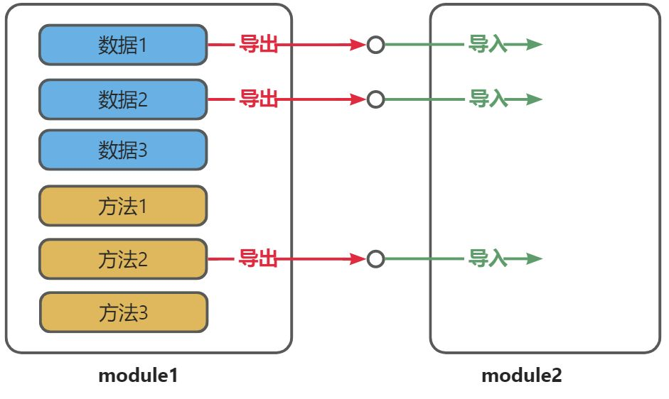
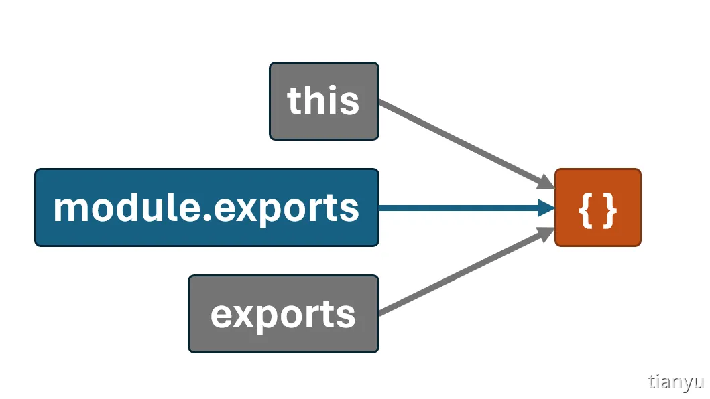
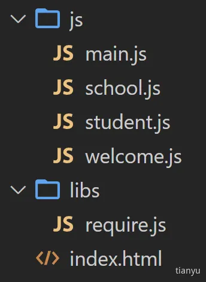
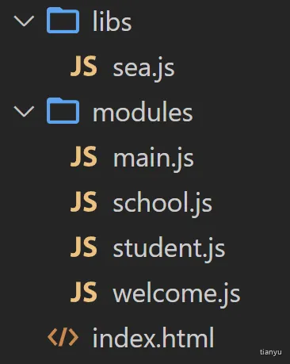

# JavaScript 模块化规范（完整版）

按 PDF 原页顺序编排，每页以 HTML 注释标记页码。章节分为：

- [模块化概述与导入导出概念](./01-overview-and-concepts.html)
- [CommonJS 规范](./02-commonjs.html)
- [ES6 模块化规范](./03-es6-module.html)
- [AMD 与 CMD 模块化规范](./04-amd-and-cmd.html)

<!-- PDF 第 1 页 -->

# JavaScript 模块化规范

1. 模块化概述  
1.1. 什么是模块化？  
1.2. 为什么需要模块化？  
2. 有哪些模块化规范？  
3. 导入与导出的概念  
4. CommonJS 规范  
4.1. 初步体验  
4.2. 导出数据  
4.3. 导入数据  
4.4. 扩展理解  
4.5. 浏览器端运行  
5. ES6 模块化规范  
5.1. 初步体验  
5.2. Node 中运行 ES6 模块  
5.3. 导出数据  
5.4. 导入数据  
5.5. 数据引用问题  
6. AMD 模块化规范（了解）  
6.1. 环境准备  
6.2. 导出数据  
6.3. 导入数据  
6.4. 使用模块  
7. CMD 模块化规范（了解）  
7.1. 环境准备  
7.2. 导出数据  
7.3. 导入数据  
7.4. 使用模块  
> 页码：1


<!-- PDF 第 2 页 -->

## 1. 模块化概述

### 1.1. 什么是模块化？

- 将程序文件依据一定规则拆分成多个文件，这种编码方式就是模块化的编码方式。  
- 拆分出来每个文件就是一个模块，模块中的数据都是私有的，模块之间互相隔离。  
- 同时也能通过一些手段，可以把模块内的指定数据“交出去”，供其他模块使用。  
### 1.2. 为什么需要模块化？

随着应用的复杂度越来越高，其代码量和文件数量都会急剧增加，会逐渐引发以下问题：  
1. 全局污染问题  
2. 依赖混乱问题  
3. 数据安全问题  
## 2. 有哪些模块化规范？

历史背景(了解即可)：2009 年，随着 Node.js 的出现，JavaScript 在服务器端的应用逐渐增  
多，为了让 Node.js 的代码更好维护，就必须要制定一种 Node.js 环境下的模块化规范，来自  
Mozilla 的工程师 Kevin Dangoor 提出了 CommonJS  
规范（CommonJS 初期的名字叫  
ServerJS），随后 Node.js 社区采纳了这一规范。  
随着时间的推移，针对 JavaScript 的不同运行环境，相继出现了多种模块化规范，按时间排序，  
分别为：  
1. CommonJS —— 服务端应用广泛  
2. AMD  
3. CMD  
4. ES6 模块化 —— 浏览器端应用广泛  
## 3. 导入与导出的概念

> 页码：2


<!-- PDF 第 3 页 -->

模块化的核心思想就是：模块之间是隔离的，通过导入和导出进行数据和功能的共享。  
- 导出（暴露）：模块公开其内部的一部分（如变量、函数等），使这些内容可以被其他模块使  
用。  
- 导入（引入）：模块引入和使用其他模块导出的内容，以重用代码和功能。  


## 4. CommonJS 规范

### 4.1. 初步体验

> 页码：3


<!-- PDF 第 4 页 -->

1.「创建 school.js」  
```javascript
const name = '尚硅谷'
const slogan = '让天下没有难学的技术！'
function getTel (){
  return '010-56253825'
}
function getCities(){
  return ['北京','上海','深圳','成都','武汉','西安']
}
// 通过给exports对象添加属性的方式，来导出数据（注意：此处没有导出getCities）
exports.name = name
exports.slogan = slogan
exports.getTel = getTel
```

2.「创建 student.js」  
```javascript
const name = '张三'
const motto = '相信明天会更好！'
function getTel (){
  return '13877889900'
}
function getHobby(){
  return ['抽烟','喝酒','烫头']
}
// 通过给exports对象添加属性的方式，来导出数据（注意：此处没有导出getHobby）
exports.name = name
exports.slogan = slogan
exports.getTel = getTel
```

3.「创建 index.js」  
```javascript
// 引入school模块暴露的所有内容
const school = require('./school')
// 引入student模块暴露的所有内容
const student = require('./student')
```

> 页码：4


<!-- PDF 第 5 页 -->

### 4.2. 导出数据

在 CommonJS 标准中，导出数据有两种方式：  
第一种方式：`module.exports = value`  
第二种方式：`exports.name = value`  
注意点如下：  
1. 每个模块内部的：`this`、`exports`、`modules.exports`在初始时，都指向同一  
个空对象，该空对象就是当前模块导出的数据，如下图：  


2. 无论如何修改导出对象，最终导出的都是`module.exports`的值。  
3.  
`exports`是对`module.exports`的初始引用，仅为了方便给导出象添加属性，所以  
不能使用   `exports = value`的形式导出数据，但是可以使用`module.exports`  
`= xxxx`导出数据。  
### 4.3. 导入数据

在`CJS`模块化标准中，使用内置的`require`函数进行导入数据  
```javascript
// 直接引入模块
const school = require('./school')
// 引入同时解构出要用的数据
const { name, slogan, getTel } = require('./school')
// 引入同时解构+重命名
const {name:stuName,motto,getTel:stuTel} = require('./student')
```

### 4.4. 扩展理解

> 页码：5


<!-- PDF 第 6 页 -->

一个 JS 模块在执行时，是被包裹在一个内置函数中执行的，所以每个模块都有自己的作用域，我  
们可以通过如下方式验证这一说法：  
```text
console.log(arguments)
console.log(arguments.callee.toString())
```

内置函数的大致形式如下：  
```javascript
function (exports, require, module, __filename, __dirname){
  /*********************/
}
```

### 4.5. 浏览器端运行

Node.js 默认是支持 CommonJS 规范的，但浏览器端不支持，所以需要经过编译，步骤如下：  
第一步：全局安装 browserify ：`npm i browserify -g`  
第二步：编译  
```text
browserify index.js -o build.js
```

备注：`index.js` 是源文件，`build.js` 是输出的目标文件  
第三步：页面中引入使用  
```html
<script type="text/javascript" src="./build.js"></script>
```

## 5. ES6 模块化规范

ES6 模块化规范是一个官方标准的规范，它是在语言标准的层面上实现了模块化功能，是目前最  
流行的模块化规范，且浏览器与服务端均支持该规范。  
### 5.1. 初步体验

> 页码：6


<!-- PDF 第 7 页 -->

1.「创建 school.js」  
```javascript
// 导出name
export let name = {str:'尚硅谷'}
// 导出slogan
export const slogan = '让天下没有难学的技术！'
// 导出name
export function getTel (){
  return '010-56253825'
}
function getCities(){
  return ['北京','上海','深圳','成都','武汉','西安']
}
```

2.「创建 student.js」  
```javascript
// 导出name
export const name = '张三'
// 导出motto
export const motto = '相信明天会更好！'
// 导出getTel
export function getTel (){
  return '13877889900'
}
function getHobby(){
  return ['抽烟','喝酒','烫头']
}
```

3.「创建 index.js」  
```javascript
// 引入school模块暴露的所有内容
import * as school from './school.js'
// 引入student模块暴露的所有内容
import * as student from './student.js'
```

4.「页面中引入 index.js」  
```html
<script type="module" src="./index.js"></script>
```

> 页码：7


<!-- PDF 第 8 页 -->

### 5.2. Node 中运行 ES6 模块

`Node.js`中运行`ES6`模块代码有两种方式：  
方式一：将`JavaScript`文件后缀从`.js` 改为`.mjs`，Node 则会自动识别 ES6 模块。  
方式二：在`package.json`中设置`type`属性值为`module`。  
### 5.3. 导出数据

ES6 模块化提供 3 种导出方式：①分别导出、②统一导出、③默认导出  
1.「分别导出」  
备注：在上方【初步体验中】环节，我们使用的导出方式就是【分别导出】  
```javascript
// 导出name
export let name = {str:'尚硅谷'}
// 导出slogan
export const slogan = '让天下没有难学的技术！'
// 导出getTel
export function getTel (){
  return '010-56253825'
}
```

2.「统一导出」  
```javascript
const name = {str:'尚硅谷'}
const slogan = '让天下没有难学的技术！'
function getTel (){
  return '010-56253825'
}
function getCities(){
  return ['北京','上海','深圳','成都','武汉','西安']
}
// 统一导出了：name,slogan,getTel
export {name,slogan,getTel}
```

> 页码：8


<!-- PDF 第 9 页 -->

3.「默认导出」  
```javascript
const name = '张三'
const motto = '走自己的路，让别人五路可走！'
function getTel (){
  return '13877889900'
}
function getHobby(){
  return ['抽烟','喝酒','烫头']
}
//默认导出：name,motto,getTel
export default {name,motto,getTel}
```

备注 :「上述多种导出方式，可以同时使用」  
```javascript
// 导出name ———— 分别导出
export const name = {str:'尚硅谷'}
const slogan = '让天下没有难学的技术！'
function getTel (){
  return '010-56253825'
}
function getCities(){
  return ['北京','上海','深圳','成都','武汉','西安']
}
// 导出slogan ———— 统一导出
export {slogan}
// 导出getTel ———— 默认导出
export default getTel
```

### 5.4. 导入数据

对于 ES6 模块化来说，使用何种导入方式，要根据导出方式决定。  
> 页码：9


<!-- PDF 第 10 页 -->

1.「导入全部」(通用)  
可以将模块中的所有导出内容整合到一个对象中。  
```javascript
import * as school from './school.js'
```

2.「命名导入」(对应导出方式：分别导出、统一导出)  
导出数据的模块  
```javascript
//分别导出
export const name = {str:'尚硅谷'}
//分别导出
export const slogan = '让天下没有难学的技术！'
function getTel (){
  return '010-56253825'
}
function getCities(){
  return ['北京','上海','深圳','成都','武汉','西安']
}
//统一导出
export { getTel }
```

命名导入：  
```javascript
import { name,slogan,getTel } from './school.js'
```

通过`as`重命名:  
```javascript
import { name as myName,slogan,getTel } from './school.js'
```

> 页码：10


<!-- PDF 第 11 页 -->

3.「默认导入」(对应导出方式：默认导出)  
导出数据的模块  
```javascript
const name = '张三'
const motto = '走自己的路，让别人五路可走！'
function getTel (){
  return '13877889900'
}
function getHobby(){
  return ['抽烟','喝酒','烫头']
}
//使用默认导出的方式，导出一个对象，对象中包含着数据
export default { name,motto,getTel }
```

默认导入：  
```javascript
import student from './student.js' //默认导出的名字可以修改，不是必须为student
```

4.「命名导入 与 默认导入可以混合使用」  
导出数据的模块  
```javascript
//分别导出
export const name = {str:'尚硅谷'}
//分别导出
export const slogan = '让天下没有难学的技术！'
function getTel (){
  return '010-56253825'
}
function getCities(){
  return ['北京','上海','深圳','成都','武汉','西安']
}
//统一导出
export default getTel
```

「命名导入」与「默认导入」混合使用，且默认导入的内容必须放在前方：  
```javascript
import getTel,{name,slogan} from './school.js'
```

> 页码：11


<!-- PDF 第 12 页 -->

5.「动态导入」(通用)  
允许在运行时按需加载模块，返回值是一个 Promise。  
```javascript
const school = await import('./school.js');
console.log(school)
```

6. import 可以不接收任何数据  
例如只是让 mock.js 参与运行  
```javascript
import './mock.js'
```

此时，我们感受到模块化确实解决了：①全局污染问题、②依赖混乱问题、③数据安全问题。  
### 5.5. 数据引用问题

思考1： 如下代码的输出结果是什么？（不要想太多，不涉及模块化相关知识）  
```javascript
function count (){
  let sum = 1
  function increment(){
    sum += 1
  }
  return {sum,increment}
}
const {sum,increment} = count()
console.log(sum)
increment()
increment()
console.log(sum)
```

> 页码：12


<!-- PDF 第 13 页 -->

思考2：使用 CommonJS 规范，编写如下代码，输出结果是什么？  
count.js  
JavaScript  
```javascript
let sum = 1
function increment (){
  sum += 1
}
module.exports = {sum,increment}
```

index.js  
JavaScript  
```javascript
const {sum,increment} = require('./count.js')
console.log(sum)
increment()
increment()
console.log(sum)
```

思考3：使用 ES6 模块化规范，编写如下代码，输出结果是什么？  
count.js  
JavaScript  
```javascript
let sum = 1
function increment(){
  sum += 1
}
export {sum,increment}
```

index.js  
JavaScript  
```javascript
import {sum,increment} from './count.js'
console.log(sum) //1
increment()
increment()
console.log(sum) //3
```

使用原则：导出的常量，务必用`const`定义  
> 页码：13


<!-- PDF 第 14 页 -->

## 6. AMD 模块化规范（了解）

### 6.1. 环境准备

第一步：准备文件结构：  


文件说明：  
1. js 文件夹中存放业务逻辑代码，`main.js`用于汇总各模块。  
2. libs 中存放的是第三方库，例如必须要用的`require.js`。  
require.js  
第二步：在`index.html`中配置`main.js`与`require.js`  
index.html  
HTML  
```html
<script data-main="./js/main.js" src="./libs/require.js"></script>
```

第三步：在`main.js`中编写模块配置对象，注册所有模块。  
> 页码：14


<!-- PDF 第 15 页 -->

main.js  
JavaScript  
```javascript
/*AMD_require.js模块化的入口文件，要编写配置对象，并且有固定的写法*/
requirejs.config({
  //基本路径
  baseUrl: "./js",
  //模块标识名与模块路径映射
  paths: {
    school: "school",
    student: "student",
    welcome: "welcome",
  }
})
```

### 6.2. 导出数据

AMD 规范使用`define`函数来定义模块和导出数据  
student.js  
JavaScript  
```javascript
define(function(){
  const name = '张三'
  const motto = '走自己的路，让别人五路可走！'
  function getTel (){
    return '13877889900'
  }
  function getHobby(){
    return ['抽烟','喝酒','烫头']
  }
  // 导出数据
  return {name,motto,getTel}
})
```

### 6.3. 导入数据

如需导入数据，则需要`define`传入两个参数，分别为：依赖项数组、回调函数  
> 页码：15


<!-- PDF 第 16 页 -->

school  
JavaScript  
```javascript
// ['welcome']表示当前模块要依赖的模块名字
// 回调接收到的welcome是模块导出的数据
define(['welcome'],function(welcome){
  let name = {str:'尚硅谷'}
  const slogan = '让天下没有难学的技术！'+ welcome
  function getTel (){
    return '010-56253825'
  }
  function getCities(){
    return ['北京','上海','深圳','成都','武汉','西安']
  }
  // 导出数据
  return {name,slogan,getTel}
})
```

### 6.4. 使用模块

main.js  
JavaScript  
```javascript
requirejs(['school','student'],function(school,student){
  console.log('main',school)
  console.log('main',student)
})
```

## 7. CMD 模块化规范（了解）

### 7.1. 环境准备

第一步：准备环境  
> 页码：16


<!-- PDF 第 17 页 -->



文件说明：  
1. js 文件夹中存放业务逻辑代码，`main.js`用于汇总各模块。  
2. libs 中存放的是第三方库，例如必须要用的`sea.js`。  
sea.js  
第二步：在`index.html`中配置`main.js`与`sea.js`  
index.html  
HTML  
```html
<script type="text/javascript" src="./libs/sea.js"></script>
<script type="text/javascript">
  seajs.use('./modules/main.js')
</script>
```

### 7.2. 导出数据

CMD 中同样使用`define`函数定义模块并导出数据  
> 页码：17


<!-- PDF 第 18 页 -->

school.js  
JavaScript  
```javascript
/*
  收到的三个参数分别为：require、exports、module
    1. require用于引入其他模块
    2. exports、module用于导出数据
*/
define(function(require,exports,module){
  const name = '尚硅谷'
  const slogan = '让天下没有难学的技术！'
  function getTel (){
    return '010-56253825'
  }
  function getCities(){
    return ['北京','上海','深圳','成都','武汉','西安']
  }
  // 导出数据
  module.exports = {name,slogan,getTel}
})
```

### 7.3. 导入数据

CMD 规范中使用收到的`require`参数进行模块导入  
> 页码：18


<!-- PDF 第 19 页 -->

student.js  
JavaScript  
```javascript
define(function(require,exports,module){
  const name = '张三'
  const motto = '相信明天会更好！'
  // 引入welcome模块
  const welcome = require('./welcome')
  console.log(welcome)
  function getTel (){
    return '13877889900'
  }
  function getHobby(){
    return ['抽烟','喝酒','烫头']
  }
  exports.name = name
  exports.motto = motto
  exports.getTel = getTel
})
```

### 7.4. 使用模块

main.js  
JavaScript  
```javascript
define(function(require){
  const school = require('./school')
  const student = require('./student')
  // 使用模块
  console.log(school)
  console.log(student)
})
```

> 页码：19

