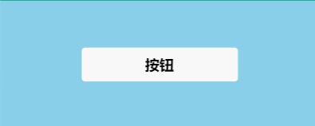

# 第 4 章 事件处理

事件绑定与事件对象、绑定并阻止事件冒泡，以及 data-* 与 mark 两种自定义数据传参方式。

<!-- more -->

<!-- PDF 第 62 页 -->

一个应用仅仅只有界面展示是不够的，还需要和用户做交互，例如：响应用户的点击、获取用户输入的 值等等，在小程序里边，我们就通过编写 JS 脚本文件来处理用户的操作

## 1. 事件绑定和事件对象

小程序中绑定事件与在网页开发中绑定事件几乎一致，只不过在小程序不能通过 on 的方式绑定事件， 也没有 click 等事件，小程序中绑定事件使用 bind 方法，click 事件也需要使用 tap 事件来进行 代替，绑定事件的方式有两种：

第一种方式：bind:事件名，bind 后面需要跟上冒号，冒号后面跟上事件名

```xml
<button bind:tap="handler">按钮</button>
```

第二种方式：bind事件名，bind 后面直接跟上事件名

```xml
<button bindtap="handler">按钮</button>
```

事件处理函数需要写到 .js 文件中，在 .js 文件中需要调用小程序提供的 Page 方法来注册小程序的 页面，我们可以直接在 Page 方法中创建事件处理函数。例如：

<!-- PDF 第 63 页 -->

```javascript
// pages/home/home.js
Page({
  // 页面的初始数据
  data: {},
  // 事件处理程序
  handler () {
    console.log('我被执行啦~~~')
  }
```

```
  // 其他 coding...
})
```

当组件触发事件时，绑定的事件的处理函数会收到一个事件对象，用来记录事件发生时的相关信息。在 触发事件时，事件处理程序会主动的给我们传入一个参数 —— event （事件对象）

```javascript
// pages/home/home.js
Page({
  // 页面的初始数据
  data: {},
  // 事件处理程序
  handler (event) {
    // console.log('我被触发了~~~')
    console.log(event)
  }
```

```
  // 其他 coding...
})
```

## 2. 绑定并阻止事件冒泡

事件分为冒泡事件和非冒泡事件：

1. 冒泡事件：当一个组件上的事件被触发后，该事件会向父节点传递。

2. 非冒泡事件：当一个组件上的事件被触发后，该事件不会向父节点传递。

使用 bind 绑定的事件，会触发事件冒泡，如果想阻止事件冒泡，可以使用 catch 来绑定事件。

<!-- PDF 第 64 页 -->

```xml
<view bindtap="parentHandler">
  <!-- 使用 bind 绑定的事件，会产生事件冒泡 -->
  <!-- <button bindtap="handler">按钮</button> -->
  <!-- 使用 catcht 绑定的事件，会阻止事件冒泡 -->
  <button catchtap="handler">按钮</button>
</view>
Page({
  // 页面的初始数据
  data: {},
  // 事件处理程序
  handler (event) {
    console.log('我是子绑定的事件 ~~~')
  },
```

```javascript
  parentHandler () {
    console.log('我是父绑定的事件 ~~~')
  }
```

```
  // 其他 coding...
})
```

WXML 中冒泡事件列表如下表： **类型触发条件** touchstart手指触摸动作开始 touchmove手指触摸后移动 touchcancel手指触摸动作被打断，如来电提醒，弹窗 touchend手指触摸动作结束 tap手指触摸后马上离开 手指触摸后，超过350ms再离开，如果指定了事件回调函数并触发了这个 longpress 事件，tap事件将不被触发 longtap手指触摸后，超过350ms再离开（推荐使用 longpress 事件代替） transitionend会在 WXSS transition 或 wx.createAnimation 动画结束后触发 animationstart会在一个 WXSS animation 动画开始时触发 animationiteration会在一个 WXSS animation 一次迭代结束时触发 animationend会在一个 WXSS animation 动画完成时触发 touchforcechange在支持 3D Touch 的 iPhone 设备，重按时会触发

<!-- PDF 第 65 页 -->

📌 **注意事项**： 除上表之外的其他组件自定义事件，如无特殊声明都是非冒泡事件 ​       例如 [form](https://developers.weixin.qq.com/miniprogram/dev/component/form.html) 的submit[事件，](https://developers.weixin.qq.com/miniprogram/dev/component/input.html)[input](https://developers.weixin.qq.com/miniprogram/dev/component/input.html) 的input 事件

## 3. 事件传参-data-*自定义数据

在小程序中，可以通过事件传参的方式，将数据传递给事件处理函数。常见的事件包括点击事件、输入 事件等。 在组件节点中可以通过 data- 的方式传递一些自定义数据，传递的数据可以通过事件对象的方式进行获 取

📌 **注意事项**： 使用 data- 方法传递参数的时候，多个单词由连字符 - 连接 连字符写法会转换成驼峰写法，而大写字符会自动转成小写字符 例如：

```
data-element-type ，最终会呈现为 event.currentTarget.dataset.elementType
data-elementType ，最终会呈现为 event.currentTarget.dataset.elementtype
```



在 wxml 文件中，使用 data-* 属性将数据传递给事件处理函数。例如：

```xml
<view bindtap="parentHandler" data-parent-id="1" data-parentName="tom">
  <!-- 如果需要进行事件传参，需要再组件上通过 data- 的方式传递数据 -->
  <!-- <button bindtap="btnHandler" data-id="1" data-name="tom">按钮</button> -->
  <button data-id="1" data-name="tom">按钮</button>
</view>
```

在 js 文件中，可以通过 event.currentTarget.dataset 获取传递的数据

<!-- PDF 第 66 页 -->

```javascript
// cate.js
Page({
  // 按钮触发的事件处理函数
  btnHandler (event) {
    // currentTarget 事件绑定者，也就是指：哪个组件绑定了当前事件处理函数
    // target 事件触发者，也就是指：哪个组件触发了当前事件处理函数
    // currentTarget 和 target 都是指按钮，因为是按钮绑定的事件处理函数，同时点击按钮触发事
件处理函数
    // 这时候通过谁来获取数据都可以
    console.log(event.currentTarget.dataset.id)
    console.log(event.target.dataset.name)
  },
  // view 绑定的事件处理函数
  parentHandler (event) {
    // 点击蓝色区域(不点击按钮)
    // currentTarget 事件绑定者：view
    // target 事件触发者：view
    // currentTarget 和 target 都是指 view，如果想获取 view 身上的数据，使用谁都可以
    // 点击按钮(不点击蓝色区域)
    // currentTarget 事件绑定者：view
    // target 事件触发者：按钮
    // 如果想获取 view 身上的数据，就必须使用 currentTarget 才可以
    // 如果想获取的是事件触发者本身的数据，就需要使用 target
    console.log(event)
    // 在传递参数的时候，如果自定义属性是多个单词，单词与单词直接使用中划线 - 进行连接
    // 在事件对象中会被转换为小托峰写法
    console.log(event.currentTarget.dataset.parentId)
    // 在传递参数的时候，如果自定义属性是多个单词，单词如果使用的是小托峰写法
    // 在事件对象中会被转为全部小写的
    console.log(event.currentTarget.dataset.parentname)
  }
})
```

## 4. 事件传参-mark 自定义数据

小程序进行事件传参的时候，除了使用 data-* 属性传递参数外，还可以使用 mark 标记传递参数 mark 是一种自定义属性，可以在组件上添加，用于来识别具体触发事件的 target 节点。同时 mark 还 可以用于承载一些自定义数据（类似于 dataset ）

<!-- PDF 第 67 页 -->

mark 和 dataset 很相似，主要区别在于： mark 会包含从触发事件的节点到根节点上所有的 mark: 属性值 (事件委托的) dataset 仅包含触发事件那一个节点的 data- 属性值。


在 wxml 文件中，使用 mark:自定义属性 的方式将数据传递给事件处理函数

```xml
<!-- pages/index/index.wxml -->
<view bindtap="parentHandler" mark:parentid="1" mark:parentname="tom">
  <!-- 如果需要使用 mark 进行事件传参，需要使用 mark:自定义属性的方式进行参数传递 -->
  <!-- <button bindtap="btnHandler" mark:id="1" mark:name="tom">按钮</button> -->
  <button mark:id="1" mark:name="tom">按钮</button>
</view>
```

```javascript
// cart.js
Page({
  // 按钮绑定的事件处理函数
  btnHandler (event) {
    console.log(event.mark.id)
    console.log(event.mark.name)
  },
  // view 绑定的事件处理函数
  parentHandler (event) {
    // 先点击蓝色区域 (不点击按钮)
    // 通过事件对象获取的是 view 身上绑定的数据
    // 先点击按钮 (不点击蓝色区域)
    // 通过事件对象获取到的是 触发事件的节点 已经 父节点身上所有的 mark 数据
    console.log(event)
  }
})
```

<!-- PDF 第 68 页 -->
