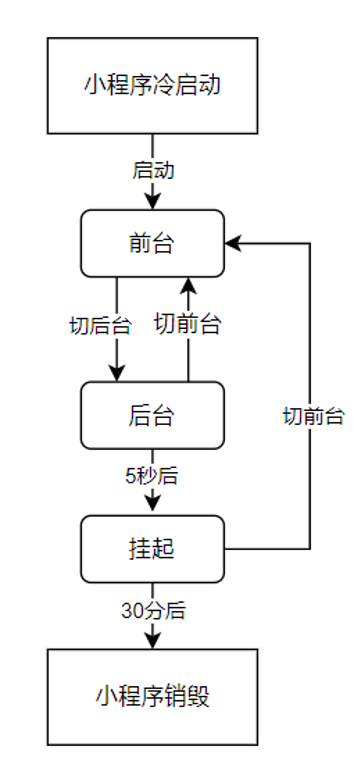
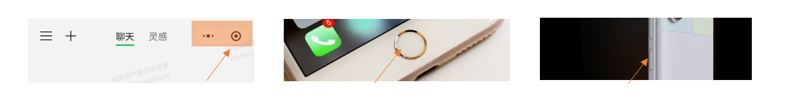
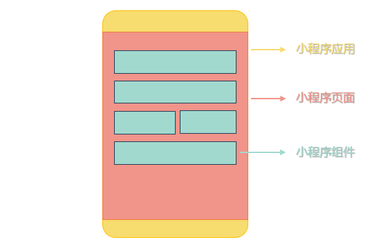
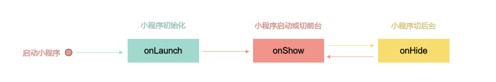
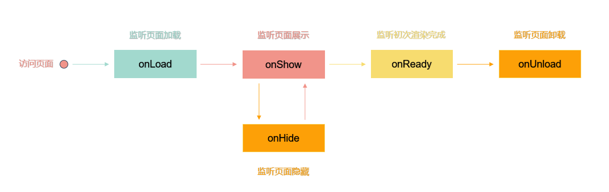
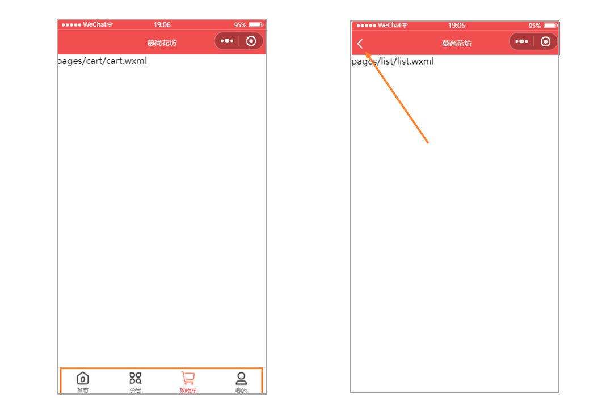

# 第 6 章 生命周期

小程序运行机制与更新机制、生命周期介绍、应用级别与页面级别生命周期，以及两个细节补充说明。

<!-- more -->

<!-- PDF 第 79 页 -->

## 1. 小程序运行机制



<!-- PDF 第 80 页 -->

**冷启动与热启动：**

小程序启动可以分为两种情况，一种是冷启动，一种是热启动 冷启动：如果用户首次打开，或小程序销毁后被用户再次打开，此时小程序需要重新加载启动 热启动：如果用户已经打开过某小程序，然后在一定时间内再次打开该小程序，此时小程序并未被销 毁，只是从后台状态进入前台状态

**前台** **以及** **后台状态：**

小程序启动后，界面被展示给用户，此时小程序处于「前台」状态。 当用户「关闭」小程序时，小程序并没有真正被关闭，而是进入了「后台」状态，当用户再次进入微信 并打开小程序，小程序又会重新进入「前台」状态

切后台的方式包括但不限于以下几种： 点击右上角胶囊按钮离开小程序 安卓点击返回键离开小程序 屏幕左侧右滑离开小程序



**挂起：** 小程序进入「后台」状态一段时间后（5 秒），微信停止小程序 JS 线程执行，小程序进入「挂起」状 态，当开发者使用了后台播放音乐、后台地理位置等能力时，小程序可以在后台持续运行，不会进入到 挂起状态

**销毁：** 如果用户很久没有使用小程序，或者系统资源紧张，小程序会被销毁，即完全终止运行。 当小程序进入后台并被「挂起」后，如果很长时间（目前是 30 分钟）都未再次进入前台，小程序会被销 毁 当小程序占用系统资源过高，可能会被系统销毁或被微信客户端主动回收。

<!-- PDF 第 81 页 -->

## 2. 小程序更新机制

在访问小程序时，微信会将小程序代码包缓存到本地。 开发者在发布了新的小程序版本以后，微信客户端会检查本地缓存的小程序有没有新版本，并进行小程 序代码包的更新。

小程序的更新机制有两种：**启动时同步更新** 和 **启动时异步更新**

**启动时异步更新** 启动时同步更新：微信运行时，会定期检查最近使用的小程序是否有更新。如果有更新，下次小程序启 动时会同步进行更新，更新到最新版本后再打开小程序。如果 用户长时间未使用小程序时，会强制同步 检查版本更新

**启动时异步更新** 启动时异步更新：在启动前没有发现更新，小程序每次 冷启动 时，都会异步检查是否有更新版本。如果 发现有新版本，将会异步下载新版本的代码包，**将新版本的小程序在下一次冷启动进行使用**，当前访问 使用的依然是本地的旧版本代码

在启动时异步更新的情况下，如果开发者希望立刻进行版本更新，可以使用 [wx.getUpdateManager](https://developers.weixin.qq.com/miniprogram/dev/api/base/update/wx.getUpdateManager.html) API 进行处理。在有新版本时提示用户重启小程序更新新版本。

```javascript
App({
  /**
   * 当小程序初始化完成时，会触发 onLaunch（全局只触发一次）
   */
```

```javascript
  onLaunch: function () {
    const updateManager = wx.getUpdateManager()
    updateManager.onCheckForUpdate(function (res) {
      // 请求完新版本信息的回调
      console.log(res.hasUpdate)
    })
    updateManager.onUpdateReady(function () {
      wx.showModal({
        title: '更新提示',
        content: '新版本已经准备好，是否重启应用？',
        success(res) {
          if (res.confirm) {
            // 新的版本已经下载好，调用 applyUpdate 应用新版本并重启
            updateManager.applyUpdate()
          }
```

<!-- PDF 第 82 页 -->

```javascript
        }
      })
    })
    updateManager.onUpdateFailed(function () {
      // 新版本下载失败
    })
  }
```

```
})
```

**落地代码：**

```javascript
// app.js
App({
```

```javascript
  // onLaunch 是小程序的钩子函数，这个钩子函数在冷启动时肯定会执行到
  // 当小程序冷启动时，会自动微信后台请求新版本的信息，如果有新版本，会立即进行下载
  onLaunch () {
    // 使用 wx.getUpdateManager 方法监听下载的状态
    const updateManager = wx.getUpdateManager()
    // 当下载完成新版本以后，会触发 onUpdateReady 回调函数
    updateManager.onUpdateReady(function () {
      // 在回调函数中给用户提示，
      wx.showModal({
        title: '更新提示',
        content: '新版本已经准备好，是否重启应用？',
        success(res) {
          if (res.confirm) {
            // 强制当前小程序使用新版本并且会重启当前小程序
            updateManager.applyUpdate()
          }
        }
      })
    })
  }
})
```

<!-- PDF 第 83 页 -->

## 3. 生命周期介绍

应用生命周期是指应用程序进程从创建到消亡的整个过程 小程序的生命周期指的是 小程序从启动到销毁的整个过程

在打开一个小程序应用的时候都需要经历一系列的初始化步骤，比如页面是否加载完成、页面是否初次 渲染完成等等。 在此过程中，小程序也会运行被称为生命周期钩子的函数，这些函数由小程序框架本身提供，被称为生 命周期函数，生命周期函数会按照顺序依次自动触发调用。帮助程序员在特定的时机执行特定的操作， 辅助程序员完成一些比较复杂的逻辑。让开发者有机会在特定阶段运行自己的代码。

小程序的生命周期分类三类：应用级别、页面级别和组件级别 3 种类型，我们先学习应用级别和页面级 别的生命周期



## 4. 应用级别生命周期

**知识点：**

应用生命周期通常是指一个小程序从 启动 → 运行 → 销毁的整个过程 应用生命周期伴随着一些函数，我们称为 应用生命周期函数，应用生命周期函数需要 在 app.js 文件的 App() 方法中定义

<!-- PDF 第 84 页 -->

当整个小程序应用运行到某个时机的时候，我们需要做一些事情。例如：当小程序启动成功之后，我们 要获取小程序的一些信息，就可以在小程序启动成功时的钩子函数中写代码获取我们想要的信息。

| 生命周期 | 必填 | 说明 |
| --- | --- | --- |
| onLaunch | 否 | 监听小程序初始化，全局只会执行 1 次 |
| onShow | 否 | 监听小程序启动或切前台 |
| onHide | 否 | 监听小程序切后台 |



📌 **注意事项：**

1. 从小程序生命周期的角度来看，我们一般讲的「启动」专指冷启动，热启动一般被称为后台 切前台。

2. **App()** **必须在** app.js **中调用，必须调用且只能调用一次。不然会出现无法预期的后果。**

小程序启动后，后台会首先完成小程序的初始化，该过程只会触发一次；之后会完成显示的工作，用户 可以操作小程序从前台进入后台以及从后台回复到前台显示；小程序在后台运行一段时间，当系统资源 不足时会被注销。

**落地代码：**

```javascript
➡️ app.js
App({
  /**
   * 当小程序初始化完成时，会触发 onLaunch（全局只触发一次）
   */
  onLaunch: function () {
    // 监听小程序初始化
    console.log('onLaunch: 当小程序初始化完成时，会触发 onLaunch')
  },
  /**
   * 当小程序启动，或从后台进入前台显示，会触发 onShow
   */
  onShow: function (options) {
    // 监听小程序的显示
```

<!-- PDF 第 85 页 -->

```javascript
    console.log('onShow: 当小程序启动，或从后台进入前台显示')
  },
  /**
   * 当小程序从前台进入后台，会触发 onHide
   */
  onHide: function () {
    // 监听小程序的隐藏
    console.log('onHide: 小程序从前台进入后台')
  }
})
```

## 5. 页面级别生命周期

**知识点：**

页面生命周期就是指小程序页面从 加载 → 运行 → 销毁的整个过程

当某个页面运行到某个时机的时候，我们需要做一些事情，例如: 当某个页面加载完毕之后，需要发请求 获取当前页面所需的数据，就可以在对应的页面加载完成后的钩子函数中执行发送请求的代码。

小程序中的一个页面都需要在对应页面的 .js 文件中调用 Page() 方法来注册。Page() 接受一个 Object 类型参数，其指定页面的初始数据、生命周期回调、事件处理函数等。

<!-- PDF 第 86 页 -->

| 生命周期 | 必填 | 说明 |
| --- | --- | --- |
| onLoad | 否 | 页面加载时触发 ( 一个页面只会调用一次 ) |
| onShow | 否 | 页面显示时触发，页面显示 / 切入前台时触发 |
| onReady | 否 | 页面初次渲染完成时触发 ( 一个页面只会调用一次 ) 代表页面已经准备妥当，可以和视图层进行交互 |
| onHide | 否 | 页面隐藏 / 切入后台时触发 |
| onUnload | 否 | 页面卸载时触发 |



**落地代码：**

```javascript
// pages/home/home.js
Page({
```

```
  // coding...
```

```javascript
  // 生命周期函数--监听页面加载
  onLoad: function (options) {
    console.log('页面加载完毕')
  },
  // 生命周期函数--监听页面显示
  onShow: function () {
    console.log('监听页面显示，此时页面处于显示状态')
  },
  // 生命周期函数--监听页面初次渲染完成
  onReady: function () {
    console.log('页面初次渲染已经完成')
  },
  // 生命周期函数--监听页面隐藏
  onHide: function () {
    console.log('当前页面处于隐藏状态')
  },
  // 生命周期函数--监听页面卸载
  onUnload: function () {
    console.log('页面卸载时触发')
  }
})
```

<!-- PDF 第 87 页 -->

## 6. 生命周期两个细节补充说明

1. tabBar 页面之间相互切换，页面不会被销毁

2. 点击左上角，返回上一个页面，会销毁当前页面(被打开页面)


