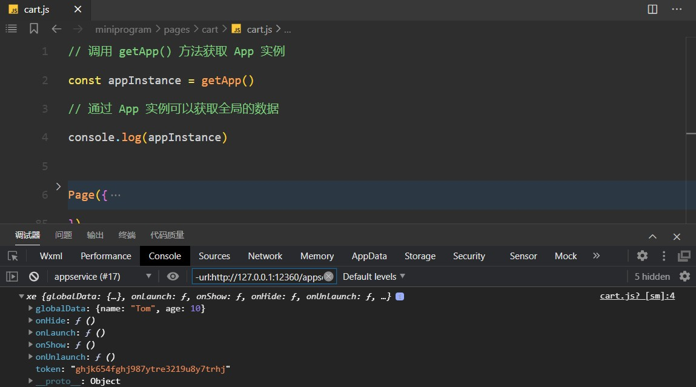
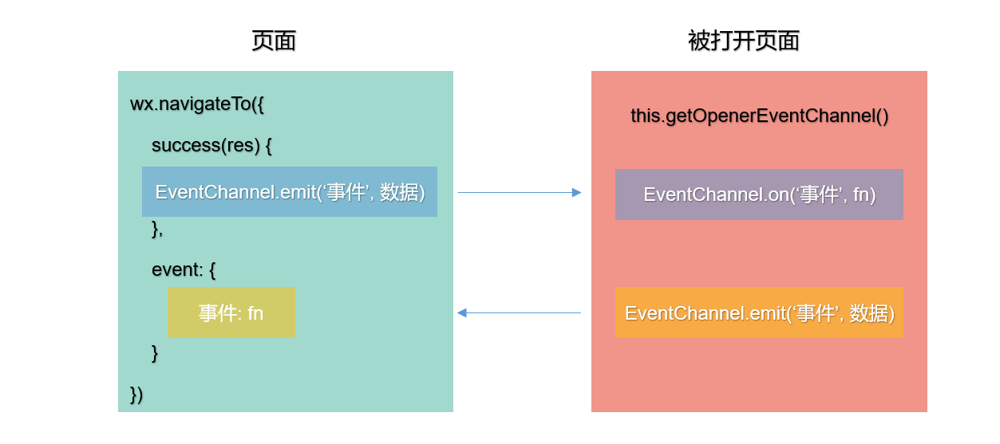
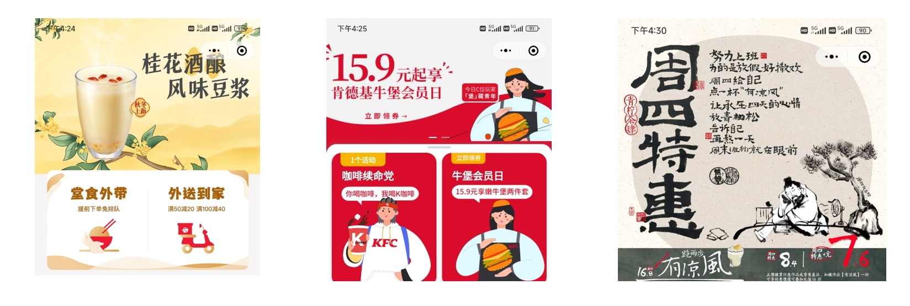

# 第 12 章 框架接口 getApp

getApp 全局对象、小程序页面间通信与自定义导航栏。

<!-- more -->

<!-- PDF 第 176 页 -->

getApp() 用于获取小程序全局唯一的 App 实例，通过小程序应用实例可实现数据或方法的共享

📌 **注意事项**：

1. 1.不要在 App() 方法中使用 getApp() ，使用 this 就可以拿到 app 实例

2. 通过 getApp() 获取实例之后，不要私自调用生命周期函数

**落地代码：**

```javascript
➡️ app.js
App({
  // 全局共享的数据
  globalData: {
    token: ''
  },
  // 全局共享的方法
  setToken (token) {
    // 如果想获取 token，可以使用 this 的方式进行获取
    this.globalData.token = token
    // 在 App() 方法中如果想获取 App() 实例，可以通过 this 的方式进行获取
    // 不能通过 getApp() 方法获取
  }
})
```

```javascript
➡️ pages/index/index.js
// getApp() 方法用来获取全局唯一的 App() 实例
const appInstance = getApp()
```

<!-- PDF 第 177 页 -->

```javascript
Page({
  login () {
    // 不要通过 app 实例调用钩子函数
    console.log(appInstance)
    appInstance.setToken('fghioiuytfghjkoiuytghjoiug')
  }
})
```



## 小程序页面间通信

如果一个页面通过 wx.navigateTo 打开一个新页面，这两个页面间将建立一条数据通道

1. 在 wx.navigateTo 的 success 回调中通过 EventChannel 对象发射事件

2. 被打开的页面可以通过 this.getOpenerEventChannel() 方法获得一个 EventChannel 对象， 进行监听、发射事件

3. wx.navigateTo 方法中可以定义 events 配置项接收被打开页面发射的事件

这两个 EventChannel 对象间可以使用 emit 和 on 方法相互发送、监听事件。

<!-- PDF 第 178 页 -->



**落地代码：**

页面 .js 文件

```javascript
Page({
  // 点击按钮触发的事件处理函数
  handler () {
    wx.navigateTo({
      url: '/pages/list/list',
      events: {
        // key：被打开页面通过 eventChannel 发射的事件
        // value：回调函数
        // 为事件添加一个监听器，获取到被打开页面传递给当前页面的数据
        currentevent: (res) => {
          console.log(res)
        }
      },
      success (res) {
        // console.log(res)
        // 通过 success 回调函数的形参，可以获取 eventChannel 对象
        // eventChannel 对象给提供了 emit 方法，可以发射事件，同时携带参数
        res.eventChannel.emit('myevent', { name: 'tom' })
      }
    })
  }
})
```

被页面 .js 文件

<!-- PDF 第 179 页 -->

```javascript
Page({
  onLoad () {
    // 通过 this.getOpenerEventChannel() 可以获取 EventChannel 对象
    const EventChannel = this.getOpenerEventChannel()
    // 通过 EventChannel 提供的 on 方法监听页面发射的自定义事件
    EventChannel.on('myevent', (res) => {
      console.log(res)
    })
    // 通过 EventChannel 提供的 emit 方法也可以向上一级页面传递数据
    // 需要使用 emit 定义自定义事件，携带需要传递的数据
    EventChannel.emit('currentevent', { age: 10 })
  }
})
```

## 自定义导航栏

小程序默认的导航栏与 APP 一样都位于顶部固定位置。但是默认导航栏可能会影响小程序整体风格，且 无法满足特定的设计需求，这时候，就需要进行自定义导航栏。



在 app.json 或者 page.json 中，**配置navigationStyle** **属性为custom**，即可 自定义导航栏 在设置以后，就会移除默认的导航栏，只保留右上角胶囊按钮

**落地代码：**

```json
{
  "usingComponents": {},
  "navigationStyle": "custom"
}
```

<!-- PDF 第 180 页 -->

```xml
<!--pages/cate/cate.wxml-->
<!-- <text>pages/cate/cate.wxml</text> -->
<swiper class="custom-swiper" indicator-dots autoplay interval="2000">
  <swiper-item>
    <image src="../../assets/banner/banner-1.png" mode=""/>
  </swiper-item>
  <swiper-item>
    <image src="../../assets/banner/banner-2.png" mode=""/>
  </swiper-item>
  <swiper-item>
    <image src="../../assets/banner/banner-3.png" mode=""/>
  </swiper-item>
</swiper>
```

```css
/* pages/cate/cate.wxss */
.custom-swiper {
  height: 440rpx;
}
.custom-swiper image {
  height: 100%;
  width: 100%;
}
```
