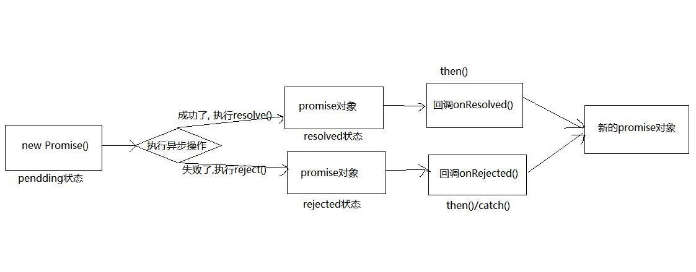

# 第 2 章 Promise 的理解和使用

Promise 的概念、状态、基本流程、API 与关键问题。

<!-- more -->

# 第2 章：promise 的理解和使用

## 2.1. Promise 是什么?

### 2.1.1. 理解

1. 抽象表达:  
Promise 是JS 中进行异步编程的新的解决方案(旧的是谁?)  

<!-- PDF 第 5 页 -->

2. 具体表达:  
(1) 从语法上来说: Promise 是一个构造函数  
(2) 从功能上来说: promise 对象用来封装一个异步操作并可以获取其结果  
### 2.1.2. promise 的状态改变

1. pending 变为resolved  
2. pending 变为rejected  
说明: 只有这2 种, 且一个promise 对象只能改变一次  
无论变为成功还是失败, 都会有一个结果数据  
成功的结果数据一般称为vlaue, 失败的结果数据一般称为reason  
### 2.1.3. promise 的基本流程



### 2.1.4. promise 的基本使用

```javascript
// 创建promise 对象
const p = new Promise((resolve, reject) => {
  // 执行异步操作
  setTimeout(() => {
    const time = Date.now() // 如果当前时间是奇数代表成功, 偶数代表失败
```


<!-- PDF 第 6 页 -->

```javascript
    // 如果成功了, 调用resolve(value)
    if (time%2===1) {
resolve('成功的数据'+time)
    } else {
    // 如果失败了, 调用reject(reason)
reject('失败数据'+time)
    }
  }, 1000)
})
// 通过promise 的then()指定成功和失败的回调函数
p.then(
  value => {
    console.log('成功的回调, value:', value)
  },
  reason => {
    console.log('失败的回调, reason:', reason)
  }
)
```

## 2.2. 为什么要用Promise?

### 2.2.1. 指定回调函数的方式更加灵活

1. 旧的: 必须在启动异步任务前指定  
2. promise: 启动异步任务=&gt; 返回promie 对象=&gt; 给promise 对象绑定回调函  
数(甚至可以在异步任务结束后指定/多个)  
### 2.2.2. 支持链式调用, 可以解决回调地狱问题

1. 什么是回调地狱?  

<!-- PDF 第 7 页 -->

回调函数嵌套调用, 外部回调函数异步执行的结果是嵌套的回调执行的条件  
2. 回调地狱的缺点?  
不便于阅读  
不便于异常处理  
3. 解决方案?  
promise 链式调用  
4. 终极解决方案?  
async/await  
```html
<script>
  /*
  1. 指定回调函数的方式更加灵活:
    旧的: 必须在启动异步任务前指定
    promise: 启动异步任务=> 返回promie 对象=> 给promise 对象绑定回调函数
(甚至可以在异步任务结束后指定)
  2. 支持链式调用, 可以解决回调地狱问题
    什么是回调地狱? 回调函数嵌套调用, 外部回调函数异步执行的结果是嵌套的回调函
```

数执行的条件  
```javascript
    回调地狱的缺点?
不便于阅读/ 不便于异常处理
    解决方案? promise 链式调用
    终极解决方案? async/await
  */
  // 成功的回调函数
  function successCallback(result) {
    console.log("声音文件创建成功: " + result);
  }
  // 失败的回调函数
  function failureCallback(error) {
    console.log("声音文件创建失败: " + error);
```


<!-- PDF 第 8 页 -->

```javascript
  }
  /* 1.1 使用纯回调函数*/
  createAudioFileAsync(audioSettings, successCallback, failureCallback)
  /* 1.2. 使用Promise */
  const promise = createAudioFileAsync(audioSettings); // 2
  setTimeout(() => {
    promise.then(successCallback, failureCallback);
  }, 3000);
  /*
  2.1. 回调地狱
  */
  doSomething(function(result) {
    doSomethingElse(result, function(newResult) {
doThirdThing(newResult, function(finalResult) {
console.log('Got the final result: ' + finalResult)
}, failureCallback)
    }, failureCallback)
  }, failureCallback)
  /*
  2.2. 使用promise 的链式调用解决回调地狱
  */
  doSomething().then(function(result) {
    return doSomethingElse(result)
  })
  .then(function(newResult) {
    return doThirdThing(newResult)
  })
  .then(function(finalResult) {
```


<!-- PDF 第 9 页 -->

```javascript
    console.log('Got the final result: ' + finalResult)
  })
  .catch(failureCallback)
  /*
  2.3. async/await: 回调地狱的终极解决方案
  */
  async function request() {
    try {
const result = await doSomething()
const newResult = await doSomethingElse(result)
const finalResult = await doThirdThing(newResult)
console.log('Got the final result: ' + finalResult)
    } catch (error) {
failureCallback(error)
    }
  }
</script>
```

## 2.3. 如何使用Promise?

### 2.3.1. API

1. Promise 构造函数: Promise (excutor) {}  
(1)  
excutor 函数:  
执行器  
(resolve, reject) =&gt; {}  
(2)  
resolve 函数: 内部定义成功时我们调用的函数value =&gt; {}  
(3)  
reject 函数: 内部定义失败时我们调用的函数reason =&gt; {}  
说明: excutor 会在Promise 内部立即同步回调,异步操作在执行器中执行  
2. Promise.prototype.then 方法: (onResolved, onRejected) =&gt; {}  

<!-- PDF 第 10 页 -->

(1)  
onResolved 函数: 成功的回调函数  
(value) =&gt; {}  
(2)  
onRejected 函数: 失败的回调函数(reason) =&gt; {}  
说明: 指定用于得到成功value 的成功回调和用于得到失败reason 的失败回调  
返回一个新的promise 对象  
3. Promise.prototype.catch 方法: (onRejected) =&gt; {}  
(1)  
onRejected 函数: 失败的回调函数(reason) =&gt; {}  
说明: then()的语法糖, 相当于: then(undefined, onRejected)  
4. Promise.resolve 方法: (value) =&gt; {}  
(1)  
value: 成功的数据或promise 对象  
说明: 返回一个成功/失败的promise 对象  
5. Promise.reject 方法: (reason) =&gt; {}  
(1)  
reason: 失败的原因  
说明: 返回一个失败的promise 对象  
6. Promise.all 方法: (promises) =&gt; {}  
(1)  
promises: 包含n 个promise 的数组  
说明: 返回一个新的promise, 只有所有的promise 都成功才成功, 只要有一个失败了就  
直接失败  
7. Promise.race 方法: (promises) =&gt; {}  
(1)  
promises: 包含n 个promise 的数组  
说明: 返回一个新的promise, 第一个完成的promise 的结果状态就是最终的结果状态  
```html
<script>
```


<!-- PDF 第 11 页 -->

```javascript
  /*
    1. Promise 构造函数: Promise (excutor) {}
excutor 函数: 同步执行
(resolve, reject) => {}
resolve 函数: 内部定义成功时我们调用的函数value => {}
reject 函数: 内部定义失败时我们调用的函数reason => {}
说明: excutor 会在Promise 内部立即同步回调,异步操作在执行器中执行
    2. Promise.prototype.then 方法: (onResolved, onRejected) => {}
onResolved 函数: 成功的回调函数
(value) => {}
onRejected 函数: 失败的回调函数(reason) => {}
说明: 指定用于得到成功value 的成功回调和用于得到失败reason 的失败回调
返回一个新的promise 对象
    3. Promise.prototype.catch 方法: (onRejected) => {}
onRejected 函数: 失败的回调函数(reason) => {}
说明: then()的语法糖, 相当于: then(undefined, onRejected)
    4. Promise.resolve 方法: (value) => {}
value: 成功的数据或promise 对象
说明: 返回一个成功/失败的promise 对象
    5. Promise.reject 方法: (reason) => {}
reason: 失败的原因
说明: 返回一个失败的promise 对象
    6. Promise.all 方法: (promises) => {}
promises: 包含n 个promise 的数组
说明: 返回一个新的promise, 只有所有的promise 都成功才成功, 只要有一
```

个失败了就直接失败  
```javascript
    7. Promise.race 方法: (promises) => {}
promises: 包含n 个promise 的数组
说明: 返回一个新的promise, 第一个完成的promise 的结果状态就是最终的
```

结果状态  
```javascript
  */
  /*
  new Promise((resolve, reject) => {
```


<!-- PDF 第 12 页 -->

```javascript
    if (Date.now()%2===0) {
resolve(1)
    } else {
reject(2)
    }
  }).then(value => {
    console.log('onResolved1()', value)
  }).catch(reason => {
    console.log('onRejected1()', reason)
  })
  */
  const p1 = Promise.resolve(1)
  const p2 = Promise.resolve(Promise.resolve(3))
  const p3 = Promise.resolve(Promise.reject(5))
  const p4 = Promise.reject(7)
  const p5 = new Promise((resolve, reject) => {
    setTimeout(() => {
if (Date.now()%2===0) {
resolve(1)
} else {
reject(2)
}
    }, 100);
  })
  const pAll = Promise.all([p1, p2, p5])
  pAll.then(
    values => {console.log('all 成功了', values)},
    reason => {console.log('all 失败了', reason)}
  )
```


<!-- PDF 第 13 页 -->

```javascript
  // const pRace = Promise.race([p5, p4, p1])
  const pRace = Promise.race([p5, p1, p4])
  pRace.then(
    value => {console.log('race 成功了', value)},
    reason => {console.log('race 失败了', reason)}
  )
</script>
```

### 2.3.2. promise 的几个关键问题

1. 如何改变promise 的状态?  
(1) resolve(value): 如果当前是pendding 就会变为resolved  
(2)  
reject(reason): 如果当前是pendding 就会变为rejected  
(3)  
抛出异常: 如果当前是pendding 就会变为rejected  
2. 一个promise 指定多个成功/失败回调函数, 都会调用吗?  
当promise 改变为对应状态时都会调用  
3. 改变promise 状态和指定回调函数谁先谁后?  
(1)  
都有可能, 正常情况下是先指定回调再改变状态, 但也可以先改状态再指定回调  
(2)  
如何先改状态再指定回调?  
在执行器中直接调用resolve()/reject()  
1  
2  
延迟更长时间才调用then()  
(3)  
什么时候才能得到数据?  
1  
如果先指定的回调, 那当状态发生改变时, 回调函数就会调用, 得到数据  
2  
如果先改变的状态, 那当指定回调时, 回调函数就会调用, 得到数据  
promise.then()返回的新promise 的结果状态由什么决定?  
4. (1)  
简单表达: 由then()指定的回调函数执行的结果决定  

<!-- PDF 第 14 页 -->

(2)  
详细表达:  
1  
如果抛出异常, 新promise 变为rejected, reason 为抛出的异常  
2  
如果返回的是非promise 的任意值, 新promise 变为resolved, value 为返回的值  
3  
如果返回的是另一个新promise, 此promise 的结果就会成为新promise 的结果  
5. promise 如何串连多个操作任务?  
(1)  
promise 的then()返回一个新的promise, 可以开成then()的链式调用  
(2)  
通过then 的链式调用串连多个同步/异步任务  
6. promise 异常传透?  
(1)  
当使用promise 的then 链式调用时, 可以在最后指定失败的回调,  
(2)  
前面任何操作出了异常, 都会传到最后失败的回调中处理  
7. 中断promise 链?  
(1)  
当使用promise 的then 链式调用时, 在中间中断, 不再调用后面的回调函数  
(2)  
办法: 在回调函数中返回一个pendding 状态的promise 对象  