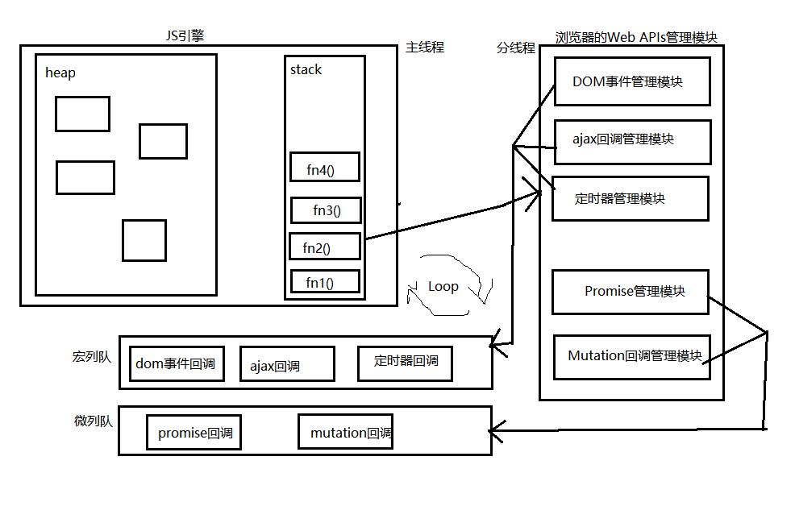

# 第 5 章 JS 异步之宏队列与微队列

JS 事件循环中的宏队列与微队列执行顺序。

<!-- more -->

# 第5 章：JS 异步之宏队列与微队列

## 5.1. 原理图

## 5.2. 说明

1. JS 中用来存储待执行回调函数的队列包含2 个不同特定的列队  
2. 宏列队: 用来保存待执行的宏任务(回调), 比如: 定时器回调/DOM 事件回调  
/ajax 回调  
3. 微列队: 用来保存待执行的微任务( 回调), 比如: promise 的回调  
/MutationObserver 的回调  
4. JS 执行时会区别这2 个队列  
(1) JS 引擎首先必须先执行所有的初始化同步任务代码  
(2) 每次准备取出第一个宏任务执行前, 都要将所有的微任务一个一个取出  
来执行  

<!-- PDF 第 28 页 -->
