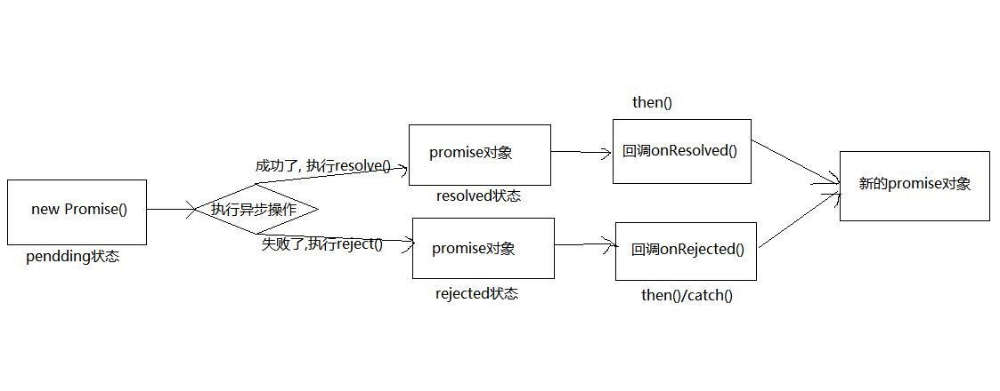
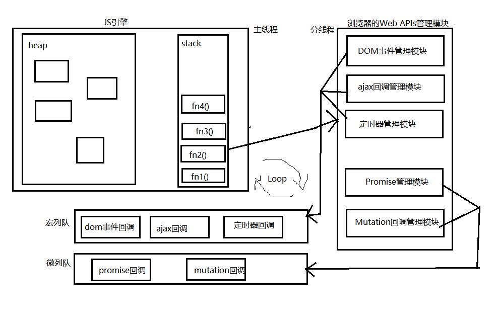

# Promise 从入门到自定义（完整版）

按 PDF 原页顺序编排，每页以 HTML 注释标记页码。章节分为：

- [第 1 章 准备](./01-preparation.html)
- [第 2 章 Promise 的理解和使用](./02-promise-understanding.html)
- [第 3 章 自定义 Promise](./03-custom-promise.html)
- [第 4 章 async 与 await](./04-async-await.html)
- [第 5 章 JS 异步之宏队列与微队列](./05-event-loop.html)
- [第 6 章 Promise 相关面试题](./06-interview-questions.html)

<!-- PDF 第 1 页 -->

# Promise 从入门到自定义

# 第1 章：准备

## 1.1. 区别实例对象与函数对象

1. 实例对象: new 函数产生的对象, 称为实例对象, 简称为对象  
2. 函数对象: 将函数作为对象使用时, 简称为函数对  
```javascript
function Fn() {
}
const fn = new Fn()
console.log(Fn.prototype)
Fn.bind({})
$('#test')
$.get('/test')
```

## 1.2. 二种类型的回调函数

### 1.2.1. 同步回调

1. 理解: 立即执行, 完全执行完了才结束, 不会放入回调队列中  
2. 例子: 数组遍历相关的回调函数/ Promise 的excutor 函数  
### 1.2.2. 异步回调

1. 理解: 不会立即执行, 会放入回调队列中将来执行  

<!-- PDF 第 2 页 -->

2. 例子: 定时器回调/ ajax 回调/ Promise 的成功|失败的回调  
```javascript
const arr = [1, 2, 3]
arr.forEach(item => console.log(item)) // 同步回调, 不会放入回调队列, 而是
```

立即执行  
```javascript
console.log('forEatch()之后')
setTimeout(() => { // 异步回调, 会放入回调队列, 所有同步执行完后才可能执行
  console.log('timout 回调')
}, 0)
console.log('setTimeout 之后')
```

## 1.3. JS 的error 处理

### 1.3.1. 错误的类型

1. Error: 所有错误的父类型  
2. ReferenceError: 引用的变量不存在  
3. TypeError: 数据类型不正确的错误  
4. RangeError: 数据值不在其所允许的范围内  
5. SyntaxError: 语法错误  
### 1.3.2. 错误处理

1. 捕获错误: try ... catch  
2. 抛出错误: throw error  
### 1.3.3. error 对象的结构

1. message 属性: 错误相关信息  

<!-- PDF 第 3 页 -->

2. stack 属性: 函数调用栈记录信息  
```html
<script>
  /*
  1. 常见的异常错误
  */
  // 1). ReferenceError: 引用的变量不存在
  // console.log(a) // ReferenceError: a is not defined
  // 2). TypeError: 数据类型不正确的错误
  // let b = null
  // console.log(b.xxx) // TypeError: Cannot read property 'xxx' of nul
l
  // 3). RangeError: 数据值不在其所允许的范围内
  // function fn() {
  //
fn()
  // }
  // fn() // RangeError: Maximum call stack size exceeded
  // SyntaxError: 语法错误
  // let c = """" // SyntaxError: Unexpected string
  /*
  2. 错误处理
  */
  // 1). 捕获错误: try ... catch
  /*
  try {
    let b = null
    b.xxx()
  } catch (error) {
```


<!-- PDF 第 4 页 -->

```javascript
    console.log('出错了: ', error.message)
    console.log('出错了: ', error.stack)
  }
  console.log('捕获错误后还可以继续向下执行') */
  // 2). 抛出错误: throw error
  /*
  function handle() {
    if (Date.now()%2===0) {
throw new Error('时间为偶数, 不能处理逻辑')
    } else {
console.log('时间为奇数, 可以处理逻辑')
    }
  }
  try {
    handle()
  } catch(error) { // 捕获错误, 做相应的提示
    alert('执行出错: ' + error.message)
  } */
</script>
```

# 第2 章：promise 的理解和使用

## 2.1. Promise 是什么?

### 2.1.1. 理解

1. 抽象表达:  
Promise 是JS 中进行异步编程的新的解决方案(旧的是谁?)  

<!-- PDF 第 5 页 -->

2. 具体表达:  
(1) 从语法上来说: Promise 是一个构造函数  
(2) 从功能上来说: promise 对象用来封装一个异步操作并可以获取其结果  
### 2.1.2. promise 的状态改变

1. pending 变为resolved  
2. pending 变为rejected  
说明: 只有这2 种, 且一个promise 对象只能改变一次  
无论变为成功还是失败, 都会有一个结果数据  
成功的结果数据一般称为vlaue, 失败的结果数据一般称为reason  
### 2.1.3. promise 的基本流程



### 2.1.4. promise 的基本使用

```javascript
// 创建promise 对象
const p = new Promise((resolve, reject) => {
  // 执行异步操作
  setTimeout(() => {
    const time = Date.now() // 如果当前时间是奇数代表成功, 偶数代表失败
```


<!-- PDF 第 6 页 -->

```javascript
    // 如果成功了, 调用resolve(value)
    if (time%2===1) {
resolve('成功的数据'+time)
    } else {
    // 如果失败了, 调用reject(reason)
reject('失败数据'+time)
    }
  }, 1000)
})
// 通过promise 的then()指定成功和失败的回调函数
p.then(
  value => {
    console.log('成功的回调, value:', value)
  },
  reason => {
    console.log('失败的回调, reason:', reason)
  }
)
```

## 2.2. 为什么要用Promise?

### 2.2.1. 指定回调函数的方式更加灵活

1. 旧的: 必须在启动异步任务前指定  
2. promise: 启动异步任务=&gt; 返回promie 对象=&gt; 给promise 对象绑定回调函  
数(甚至可以在异步任务结束后指定/多个)  
### 2.2.2. 支持链式调用, 可以解决回调地狱问题

1. 什么是回调地狱?  

<!-- PDF 第 7 页 -->

回调函数嵌套调用, 外部回调函数异步执行的结果是嵌套的回调执行的条件  
2. 回调地狱的缺点?  
不便于阅读  
不便于异常处理  
3. 解决方案?  
promise 链式调用  
4. 终极解决方案?  
async/await  
```html
<script>
  /*
  1. 指定回调函数的方式更加灵活:
    旧的: 必须在启动异步任务前指定
    promise: 启动异步任务=> 返回promie 对象=> 给promise 对象绑定回调函数
(甚至可以在异步任务结束后指定)
  2. 支持链式调用, 可以解决回调地狱问题
    什么是回调地狱? 回调函数嵌套调用, 外部回调函数异步执行的结果是嵌套的回调函
```

数执行的条件  
```javascript
    回调地狱的缺点?
不便于阅读/ 不便于异常处理
    解决方案? promise 链式调用
    终极解决方案? async/await
  */
  // 成功的回调函数
  function successCallback(result) {
    console.log("声音文件创建成功: " + result);
  }
  // 失败的回调函数
  function failureCallback(error) {
    console.log("声音文件创建失败: " + error);
```


<!-- PDF 第 8 页 -->

```javascript
  }
  /* 1.1 使用纯回调函数*/
  createAudioFileAsync(audioSettings, successCallback, failureCallback)
  /* 1.2. 使用Promise */
  const promise = createAudioFileAsync(audioSettings); // 2
  setTimeout(() => {
    promise.then(successCallback, failureCallback);
  }, 3000);
  /*
  2.1. 回调地狱
  */
  doSomething(function(result) {
    doSomethingElse(result, function(newResult) {
doThirdThing(newResult, function(finalResult) {
console.log('Got the final result: ' + finalResult)
}, failureCallback)
    }, failureCallback)
  }, failureCallback)
  /*
  2.2. 使用promise 的链式调用解决回调地狱
  */
  doSomething().then(function(result) {
    return doSomethingElse(result)
  })
  .then(function(newResult) {
    return doThirdThing(newResult)
  })
  .then(function(finalResult) {
```


<!-- PDF 第 9 页 -->

```javascript
    console.log('Got the final result: ' + finalResult)
  })
  .catch(failureCallback)
  /*
  2.3. async/await: 回调地狱的终极解决方案
  */
  async function request() {
    try {
const result = await doSomething()
const newResult = await doSomethingElse(result)
const finalResult = await doThirdThing(newResult)
console.log('Got the final result: ' + finalResult)
    } catch (error) {
failureCallback(error)
    }
  }
</script>
```

## 2.3. 如何使用Promise?

### 2.3.1. API

1. Promise 构造函数: Promise (excutor) {}  
(1)  
excutor 函数:  
执行器  
(resolve, reject) =&gt; {}  
(2)  
resolve 函数: 内部定义成功时我们调用的函数value =&gt; {}  
(3)  
reject 函数: 内部定义失败时我们调用的函数reason =&gt; {}  
说明: excutor 会在Promise 内部立即同步回调,异步操作在执行器中执行  
2. Promise.prototype.then 方法: (onResolved, onRejected) =&gt; {}  

<!-- PDF 第 10 页 -->

(1)  
onResolved 函数: 成功的回调函数  
(value) =&gt; {}  
(2)  
onRejected 函数: 失败的回调函数(reason) =&gt; {}  
说明: 指定用于得到成功value 的成功回调和用于得到失败reason 的失败回调  
返回一个新的promise 对象  
3. Promise.prototype.catch 方法: (onRejected) =&gt; {}  
(1)  
onRejected 函数: 失败的回调函数(reason) =&gt; {}  
说明: then()的语法糖, 相当于: then(undefined, onRejected)  
4. Promise.resolve 方法: (value) =&gt; {}  
(1)  
value: 成功的数据或promise 对象  
说明: 返回一个成功/失败的promise 对象  
5. Promise.reject 方法: (reason) =&gt; {}  
(1)  
reason: 失败的原因  
说明: 返回一个失败的promise 对象  
6. Promise.all 方法: (promises) =&gt; {}  
(1)  
promises: 包含n 个promise 的数组  
说明: 返回一个新的promise, 只有所有的promise 都成功才成功, 只要有一个失败了就  
直接失败  
7. Promise.race 方法: (promises) =&gt; {}  
(1)  
promises: 包含n 个promise 的数组  
说明: 返回一个新的promise, 第一个完成的promise 的结果状态就是最终的结果状态  
```html
<script>
```


<!-- PDF 第 11 页 -->

```javascript
  /*
    1. Promise 构造函数: Promise (excutor) {}
excutor 函数: 同步执行
(resolve, reject) => {}
resolve 函数: 内部定义成功时我们调用的函数value => {}
reject 函数: 内部定义失败时我们调用的函数reason => {}
说明: excutor 会在Promise 内部立即同步回调,异步操作在执行器中执行
    2. Promise.prototype.then 方法: (onResolved, onRejected) => {}
onResolved 函数: 成功的回调函数
(value) => {}
onRejected 函数: 失败的回调函数(reason) => {}
说明: 指定用于得到成功value 的成功回调和用于得到失败reason 的失败回调
返回一个新的promise 对象
    3. Promise.prototype.catch 方法: (onRejected) => {}
onRejected 函数: 失败的回调函数(reason) => {}
说明: then()的语法糖, 相当于: then(undefined, onRejected)
    4. Promise.resolve 方法: (value) => {}
value: 成功的数据或promise 对象
说明: 返回一个成功/失败的promise 对象
    5. Promise.reject 方法: (reason) => {}
reason: 失败的原因
说明: 返回一个失败的promise 对象
    6. Promise.all 方法: (promises) => {}
promises: 包含n 个promise 的数组
说明: 返回一个新的promise, 只有所有的promise 都成功才成功, 只要有一
```

个失败了就直接失败  
```javascript
    7. Promise.race 方法: (promises) => {}
promises: 包含n 个promise 的数组
说明: 返回一个新的promise, 第一个完成的promise 的结果状态就是最终的
```

结果状态  
```javascript
  */
  /*
  new Promise((resolve, reject) => {
```


<!-- PDF 第 12 页 -->

```javascript
    if (Date.now()%2===0) {
resolve(1)
    } else {
reject(2)
    }
  }).then(value => {
    console.log('onResolved1()', value)
  }).catch(reason => {
    console.log('onRejected1()', reason)
  })
  */
  const p1 = Promise.resolve(1)
  const p2 = Promise.resolve(Promise.resolve(3))
  const p3 = Promise.resolve(Promise.reject(5))
  const p4 = Promise.reject(7)
  const p5 = new Promise((resolve, reject) => {
    setTimeout(() => {
if (Date.now()%2===0) {
resolve(1)
} else {
reject(2)
}
    }, 100);
  })
  const pAll = Promise.all([p1, p2, p5])
  pAll.then(
    values => {console.log('all 成功了', values)},
    reason => {console.log('all 失败了', reason)}
  )
```


<!-- PDF 第 13 页 -->

```javascript
  // const pRace = Promise.race([p5, p4, p1])
  const pRace = Promise.race([p5, p1, p4])
  pRace.then(
    value => {console.log('race 成功了', value)},
    reason => {console.log('race 失败了', reason)}
  )
</script>
```

### 2.3.2. promise 的几个关键问题

1. 如何改变promise 的状态?  
(1) resolve(value): 如果当前是pendding 就会变为resolved  
(2)  
reject(reason): 如果当前是pendding 就会变为rejected  
(3)  
抛出异常: 如果当前是pendding 就会变为rejected  
2. 一个promise 指定多个成功/失败回调函数, 都会调用吗?  
当promise 改变为对应状态时都会调用  
3. 改变promise 状态和指定回调函数谁先谁后?  
(1)  
都有可能, 正常情况下是先指定回调再改变状态, 但也可以先改状态再指定回调  
(2)  
如何先改状态再指定回调?  
在执行器中直接调用resolve()/reject()  
1  
2  
延迟更长时间才调用then()  
(3)  
什么时候才能得到数据?  
1  
如果先指定的回调, 那当状态发生改变时, 回调函数就会调用, 得到数据  
2  
如果先改变的状态, 那当指定回调时, 回调函数就会调用, 得到数据  
promise.then()返回的新promise 的结果状态由什么决定?  
4. (1)  
简单表达: 由then()指定的回调函数执行的结果决定  

<!-- PDF 第 14 页 -->

(2)  
详细表达:  
1  
如果抛出异常, 新promise 变为rejected, reason 为抛出的异常  
2  
如果返回的是非promise 的任意值, 新promise 变为resolved, value 为返回的值  
3  
如果返回的是另一个新promise, 此promise 的结果就会成为新promise 的结果  
5. promise 如何串连多个操作任务?  
(1)  
promise 的then()返回一个新的promise, 可以开成then()的链式调用  
(2)  
通过then 的链式调用串连多个同步/异步任务  
6. promise 异常传透?  
(1)  
当使用promise 的then 链式调用时, 可以在最后指定失败的回调,  
(2)  
前面任何操作出了异常, 都会传到最后失败的回调中处理  
7. 中断promise 链?  
(1)  
当使用promise 的then 链式调用时, 在中间中断, 不再调用后面的回调函数  
(2)  
办法: 在回调函数中返回一个pendding 状态的promise 对象  
# 第3 章：自定义(手写)Promise

## 3.1. 定义整体结构

```javascript
/*
自定义Promise
*/
(function (window) {
  /*
  Promise 构造函数
  excutor: 内部同步执行的函数
(resolve, reject) => {}
   */
  function Promise(excutor) {
  }
```


<!-- PDF 第 15 页 -->

```javascript
  /*
  为promise 指定成功/失败的回调函数
  函数的返回值是一个新的promise 对象
   */
  Promise.prototype.then = function (onResolved, onRejected) {
  }
  /*
  为promise 指定失败的回调函数
  是then(null, onRejected)的语法糖
   */
  Promise.prototype.catch = function (onRejected) {
  }
  /*
  返回一个指定了成功value 的promise 对象
   */
  Promise.resolve = function (value) {
  }
  /*
  返回一个指定了失败reason 的promise 对象
   */
  Promise.reject = function (reason) {
  }
  /*
  返回一个promise, 只有promises 中所有promise 都成功时, 才最终成功, 只要有一个失败就直接
```

失败  
```javascript
   */
  Promise.all = function (promises) {
  }
```


<!-- PDF 第 16 页 -->

```javascript
  /*
  返回一个promise，一旦某个promise 解决或拒绝，返回的promise 就会解决或拒绝。
  */
  Promise.race = function (promises) {
  }
  // 暴露构造函数
  window.Promise = Promise
})(window)
```

## 3.2. Promise 构造函数的实现

```javascript
/*
Promise 构造函数
excutor: 内部同步执行的函数
(resolve, reject) => {}
  */
function Promise(excutor) {
  const self = this
  self.status = 'pending' // 状态值, 初始状态为pending, 成功了变为
resolved, 失败了变为rejected
  self.data = undefined // 用来保存成功value 或失败reason 的属性
  self.callbacks = [] // 用来保存所有待调用的包含onResolved 和onRejected 回
```

调函数的对象的数组  
```javascript
  /*
```

异步处理成功后应该调用的函数  
```javascript
  value: 将交给onResolve()的成功数据
    */
  function resolve(value) {
    if(self.status!=='pending') { // 如果当前不是pending, 直接结束
```


<!-- PDF 第 17 页 -->

```javascript
return
    }
    // 立即更新状态, 保存数据
    self.status = 'resolved'
    self.data = value
    // 异步调用所有待处理的onResolved 成功回调函数
    if (self.callbacks.length>0) {
setTimeout(() => {
self.callbacks.forEach(obj => {
obj.onResolved(value)
})
})
    }
  }
  /*
```

异步处理失败后应该调用的函数  
```javascript
  reason: 将交给onRejected()的失败数据
    */
  function reject(reason) {
    if(self.status!=='pending') { // 如果当前不是pending, 直接结束
return
}
    // 立即更新状态, 保存数据
    self.status = 'rejected'
    self.data = reason
    // 异步调用所有待处理的onRejected 回调函数
    setTimeout(() => {
self.callbacks.forEach(obj => {
obj.onRejected(reason)
```


<!-- PDF 第 18 页 -->

```javascript
})
    })
  }
  try {
    // 立即同步调用excutor()处理
    excutor(resolve, reject)
  } catch (error) { // 如果出了异常, 直接失败
    reject(error)
  }
}
```

## 3.3. promise.then()/catch()的实现

```javascript
/*
为promise 指定成功/失败的回调函数
函数的返回值是一个新的promise 对象
*/
Promise.prototype.then = function (onResolved, onRejected) {
  const self = this
  // 如果onResolved/onRejected 不是函数, 可它指定一个默认的函数
  onResolved = typeof onResolved==='function' ? onResolved : value => v
alue
// 指定返回的promise 为一个成功状态, 结果值为value
  onRejected = typeof onRejected === 'function' ? onRejected : reason =
> {throw reason} // 指定返回的promise 为一个失败状态, 结果值为reason
  // 返回一个新的promise 对象
  return new Promise((resolve, reject) => {
    /*
    专门抽取的用来处理promise 成功/失败结果的函数
    callback: 成功/失败的回调函数
    */
```


<!-- PDF 第 19 页 -->

```javascript
    function handle(callback) {
// 1. 抛出异常
===> 返回的promise 变为rejected
try {
const x = callback(self.data)
// 2. 返回一个新的promise ===> 得到新的promise 的结果值作为返回的
promise 的结果值
if (x instanceof Promise) {
x.then(resolve, reject) // 一旦x 成功了, resolve(value), 一旦x
失败了: reject(reason)
} else {
// 3. 返回一个一般值(undefined) ===> 将这个值作为返回的promise 的
```

成功值  
```javascript
resolve(x)
}
} catch (error) {
reject(error)
}
    }
    if (self.status === 'resolved') { // 当前promise 已经成功了
setTimeout(() => {
handle(onResolved)
})
    } else if (self.status === 'rejected') { // 当前promise 已经失败了
setTimeout(() => {
handle(onRejected)
})
    } else { // 当前promise 还未确定pending
// 将onResolved 和onRejected 保存起来
self.callbacks.push({
onResolved(value) {
handle(onResolved)
},
```


<!-- PDF 第 20 页 -->

```javascript
onRejected(reason) {
handle(onRejected)
}
})
    }
  })
}
/*
为promise 指定失败的回调函数
是then(null, onRejected)的语法糖
  */
Promise.prototype.catch = function (onRejected) {
  return this.then(null, onRejected)
}
```

## 3.4. Promise.resolve()/reject()的实现

```javascript
/*
返回一个指定了成功value 的promise 对象
value: 一般数据或promise
  */
Promise.resolve = function (value) {
  return new Promise((resolve, reject) => {
    if (value instanceof Promise) {
value.then(resolve, reject)
    } else {
resolve(value)
    }
  })
}
/*
```


<!-- PDF 第 21 页 -->

```javascript
返回一个指定了失败reason 的promise 对象
reason: 一般数据/error
  */
Promise.reject = function (reason) {
  return new Promise((resolve, reject) => {
    reject(reason)
  })
}
```

## 3.5. Promise.all/race()的实现

```javascript
/*
返回一个新的promise 对象, 只有promises 中所有promise 都产生成功value 时, 才最
终成功, 只要有一个失败就直接失败
*/
Promise.all = function (promises) {
  // 返回一个新的promise
  return new Promise((resolve, reject) => {
    // 已成功的数量
    let resolvedCount = 0
    // 待处理的promises 数组的长度
    const promisesLength = promises.length
    // 准备一个保存成功值的数组
    const values = new Array(promisesLength)
    // 遍历每个待处理的promise
    for (let i = 0; i < promisesLength; i++) {
// promises 中元素可能不是一个数组, 需要用resolve 包装一下
Promise.resolve(promises[i]).then(
value => {
// 成功当前promise 成功的值到对应的下标
values[i] = value
// 成功的数量加1
```


<!-- PDF 第 22 页 -->

```javascript
resolvedCount++
// 一旦全部成功
if(resolvedCount===promisesLength) {
// 将所有成功值的数组作为返回promise 对象的成功结果值
resolve(values)
}
},
reason => {
// 一旦有一个promise 产生了失败结果值, 将其作为返回promise 对象的失
```

败结果值  
```javascript
reject(reason)
}
)
    }
  })
}
/*
返回一个promise，一旦某个promise 解决或拒绝，返回的promise 就会解决或拒绝。
*/
Promise.race = function (promises) {
  // 返回新的promise 对象
  return new Promise((resolve, reject) => {
    // 遍历所有promise
    for (var i = 0; i < promises.length; i++) {
Promise.resolve(promises[i]).then(
(value) => { // 只要有一个成功了, 返回的promise 就成功了
resolve(value)
},
(reason) => { // 只要有一个失败了, 返回的结果就失败了
reject(reason)
}
```


<!-- PDF 第 23 页 -->

```javascript
)
    }
  })
}
```

## 3.6. Promise.resolveDelay()/rejectDelay()的实现

```javascript
/*
  返回一个延迟指定时间才确定结果的promise 对象
*/
Promise.resolveDelay = function (value, time) {
  return new Promise((resolve, reject) => {
    setTimeout(() => {
if (value instanceof Promise) { // 如果value 是一个promise, 取这个
promise 的结果值作为返回的promise 的结果值
value.then(resolve, reject) // 如果value 成功, 调用
resolve(val), 如果value 失败了, 调用reject(reason)
} else {
resolve(value)
}
    }, time);
  })
}
/*
返回一个延迟指定时间才失败的Promise 对象。
*/
Promise.rejectDelay = function (reason, time) {
  return new Promise((resolve, reject) => {
    setTimeout(() => {
reject(reason)
    }, time)
```


<!-- PDF 第 24 页 -->

```javascript
  })
}
```

## 3.7. ES5 function 完整版本

Promise.js  
## 3.8. ES6 class 完整版

Promise_class.js  
# 第4 章：async 与await

## 4.1. mdn 文档

https://developer.mozilla.org/zh-CN/docs/Web/JavaScript/Reference/Statements/async_function  
https://developer.mozilla.org/zh-CN/docs/Web/JavaScript/Reference/Operators/await  
## 4.2. async 函数

1. 函数的返回值为promise 对象  
2. promise 对象的结果由async 函数执行的返回值决定  
## 4.3. await 表达式

1. await 右侧的表达式一般为promise 对象, 但也可以是其它的值  
2. 如果表达式是promise 对象, await 返回的是promise 成功的值  

<!-- PDF 第 25 页 -->

3. 如果表达式是其它值, 直接将此值作为await 的返回值  
## 4.4. 注意

1. await 必须写在async 函数中, 但async 函数中可以没有await  
2. 如果await 的promise 失败了, 就会抛出异常, 需要通过try...catch 捕获处理  
```html
<script>
  function fn1() {
    return Promise.resolve(1)
  }
  function fn2() {
    return 2
  }
  function fn3() {
    return Promise.reject(3)
    // return fn3.test() // 程序运行会抛出异常
  }
  function fn4() {
    return fn3.test() // 程序运行会抛出异常
  }
  // 没有使用await 的async 函数
  async function fn5() {
    return 4
  }
  async function fn() {
    // await 右侧是一个成功的promise
```


<!-- PDF 第 26 页 -->

```javascript
    const result = await fn1()
    // await 右侧是一个非promise 的数据
    // const result = await fn2()
    // await 右侧是一个失败的promise
    // const result = await fn3()
    // await 右侧抛出异常
    // const result = await fn4()
    console.log('result: ', result)
    return result+10
  }
  async function test() {
    try {
const result2 = await fn()
console.log('result2', result2)
    } catch (error) {
console.log('error', error)
    }
    const result3 = await fn4()
    console.log('result4', result3)
  }
  // test()
</script>
```


<!-- PDF 第 27 页 -->

# 第5 章：JS 异步之宏队列与微队列

## 5.1. 原理图



## 5.2. 说明

1. JS 中用来存储待执行回调函数的队列包含2 个不同特定的列队  
2. 宏列队: 用来保存待执行的宏任务(回调), 比如: 定时器回调/DOM 事件回调  
/ajax 回调  
3. 微列队: 用来保存待执行的微任务( 回调), 比如: promise 的回调  
/MutationObserver 的回调  
4. JS 执行时会区别这2 个队列  
(1) JS 引擎首先必须先执行所有的初始化同步任务代码  
(2) 每次准备取出第一个宏任务执行前, 都要将所有的微任务一个一个取出  
来执行  

<!-- PDF 第 28 页 -->

# 第6 章：promise 相关面试题

## 6.1. 面试题1

```html
<script type="text/javascript">
  setTimeout(()=>{
    console.log(1)
  },0)
  Promise.resolve().then(()=>{
    console.log(2)
  })
  Promise.resolve().then(()=>{
    console.log(4)
  })
  console.log(3)
</script>
```

## 6.2. 面试题2

```html
<script type="text/javascript">
  setTimeout(() => {
    console.log(1)
  }, 0)
  new Promise((resolve) => {
    console.log(2)
    resolve()
  }).then(() => {
    console.log(3)
  }).then(() => {
    console.log(4)
  })
  console.log(5)
```


<!-- PDF 第 29 页 -->

```javascript
</script>
```

## 6.3. 面试题3

```html
<script type="text/javascript">
  const first = () => (new Promise((resolve, reject) => {
    console.log(3)
    let p = new Promise((resolve, reject) => {
console.log(7)
setTimeout(() => {
console.log(5)
resolve(6)
}, 0)
resolve(1)
    })
    resolve(2)
    p.then((arg) => {
console.log(arg)
    })
  }))
  first().then((arg) => {
    console.log(arg)
  })
  console.log(4)
</script>
```

## 6.4. 面试题4

```html
<script type="text/javascript">
```


<!-- PDF 第 30 页 -->

```javascript
  setTimeout(() => {
    console.log("0")
  }, 0)
  new Promise((resolve,reject)=>{
    console.log("1")
    resolve()
  }).then(()=>{
    console.log("2")
    new Promise((resolve,reject)=>{
console.log("3")
resolve()
    }).then(()=>{
console.log("4")
    }).then(()=>{
console.log("5")
    })
  }).then(()=>{
    console.log("6")
  })
  new Promise((resolve,reject)=>{
    console.log("7")
    resolve()
  }).then(()=>{
    console.log("8")
  })
</script>
```

## 6.5. 面试题5

手写/自定义promise  
