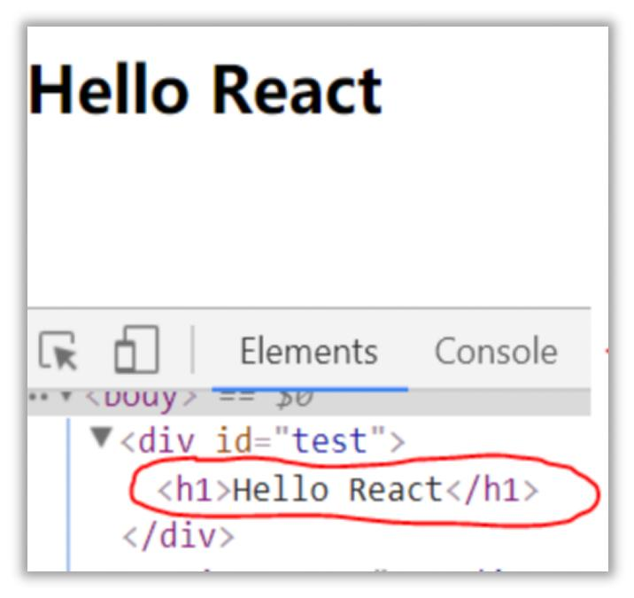
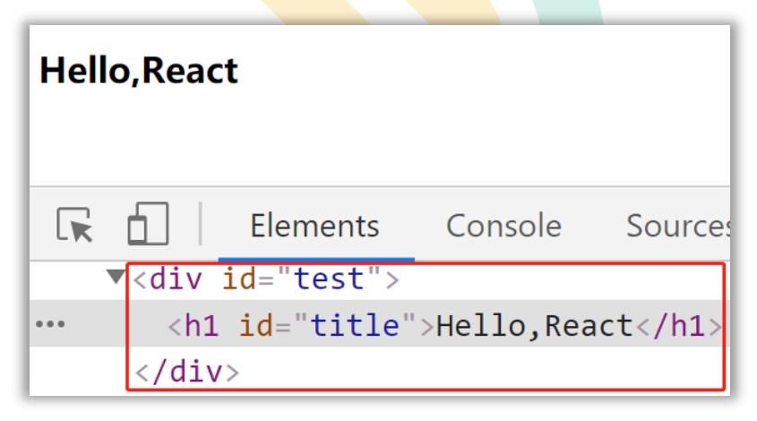
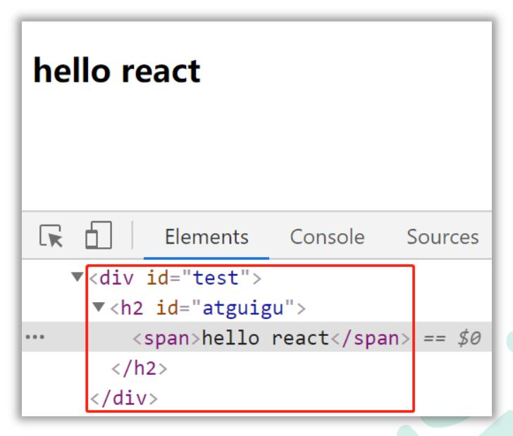
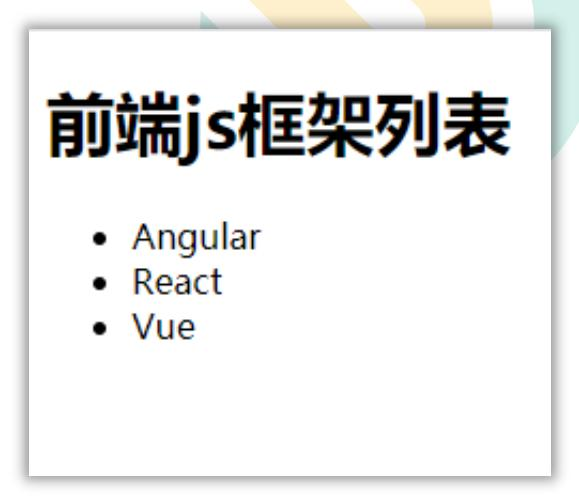
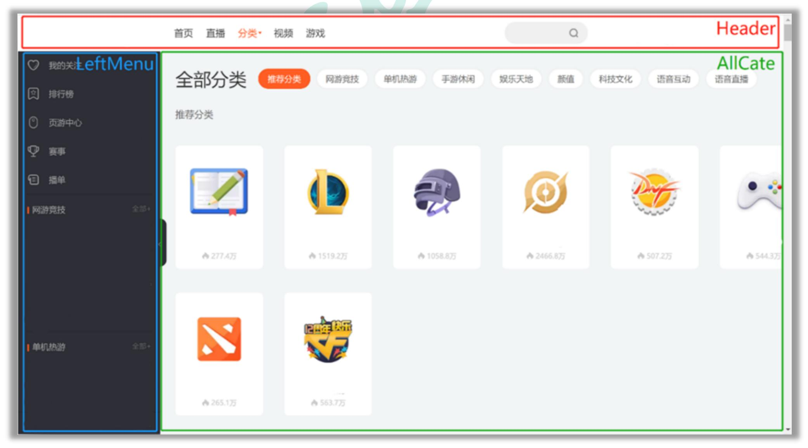

# 第 1 章 React 入门

React 简介、基本使用、JSX 语法，以及模块与组件、模块化与组件化的理解。

<!-- more -->

<!-- PDF 第 1 页 -->

# React 全家桶(技术栈)

前端研究院

# 第1 章：React 入门

## 1.1. React 简介

### 1.1.1. 官网

1. 英文官网: https://reactjs.org/
2. 中文官网: https://react.docschina.org/

### 1.1.2. 介绍描述

1. 用于动态构建用户界面的JavaScript 库(只关注于视图)
2. 由Facebook 开源

### 1.1.3. React 的特点

1. 声明式编码
2. 组件化编码
3. React Native 编写原生应用
4. 高效（优秀的Diffing 算法）

### 1.1.4. React 高效的原因

1. 使用虚拟(virtual)DOM, 不总是直接操作页面真实DOM。
2. DOM Diffing 算法, 最小化页面重绘。

<!-- PDF 第 2 页 -->

## 1.2. React 的基本使用

### 1.2.1. 效果



### 1.2.2. 相关js 库

1. react.js：React 核心库。
2. react-dom.js：提供操作DOM 的react 扩展库。
3. babel.min.js：解析JSX 语法代码转为JS 代码的库。

### 1.2.3. 创建虚拟DOM 的两种方式



1. 纯JS 方式(一般不用)
2. JSX 方式

### 1.2.4. 虚拟DOM 与真实DOM

1. React 提供了一些API 来创建一种“特别” 的一般js 对象

```javascript
const VDOM = React.createElement('xx',{id:'xx'},'xx')
```

<!-- PDF 第 3 页 -->

   上面创建的就是一个简单的虚拟DOM 对象

2. 虚拟DOM 对象最终都会被React 转换为真实的DOM
3. 我们编码时基本只需要操作react 的虚拟DOM 相关数据, react 会转换为真实DOM 变化而更新界。

## 1.3. React JSX

### 1.3.1. 效果



### 1.3.2. JSX

1. 全称: JavaScript XML
2. react 定义的一种类似于XML 的JS 扩展语法: JS + XML 本质是 `React.createElement(component, props, ...children)`方法的语法糖
3. 作用: 用来简化创建虚拟DOM
   1) 写法：`var ele = <h1>Hello JSX!</h1>`
   2) 注意1：它不是字符串, 也不是HTML/XML 标签
   3) 注意2：它最终产生的就是一个JS 对象
4. 标签名任意: HTML 标签或其它标签
5. 标签属性任意: HTML 标签属性或其它
6. 基本语法规则

<!-- PDF 第 4 页 -->

   1) 遇到<开头的代码, 以标签的语法解析: html 同名标签转换为html 同名元素, 其它标签需要特别解析
   2) 遇到以{ 开头的代码，以JS 语法解析: 标签中的js 表达式必须用{ }包含

7. babel.js 的作用
   1) 浏览器不能直接解析JSX 代码, 需要babel 转译为纯JS 的代码才能运行
   2) 只要用了JSX，都要加上type="text/babel", 声明需要babel 来处理

### 1.3.3. 渲染虚拟DOM(元素)

1. 语法: `ReactDOM.render(virtualDOM, containerDOM)`
2. 作用: 将虚拟DOM 元素渲染到页面中的真实容器DOM 中显示
3. 参数说明
   1) 参数一: 纯js 或jsx 创建的虚拟dom 对象
   2) 参数二: 用来包含虚拟DOM 元素的真实dom 元素对象(一般是一个div)

### 1.3.4. JSX 练习

需求: 动态展示如下列表



## 1.4. 模块与组件、模块化与组件化的理解

### 1.4.1. 模块

1. 理解：向外提供特定功能的js 程序, 一般就是一个js 文件
2. 为什么要拆成模块：随着业务逻辑增加，代码越来越多且复杂。

<!-- PDF 第 5 页 -->

3. 作用：复用js, 简化js 的编写, 提高js 运行效率

### 1.4.2. 组件

1. 理解：用来实现局部功能效果的代码和资源的集合(html/css/js/image 等等)
2. 为什么要用组件：一个界面的功能更复杂
3. 作用：复用编码, 简化项目编码, 提高运行效率

### 1.4.3. 模块化

当应用的js 都以模块来编写的, 这个应用就是一个模块化的应用

### 1.4.4. 组件化

当应用是以多组件的方式实现, 这个应用就是一个组件化的应用


