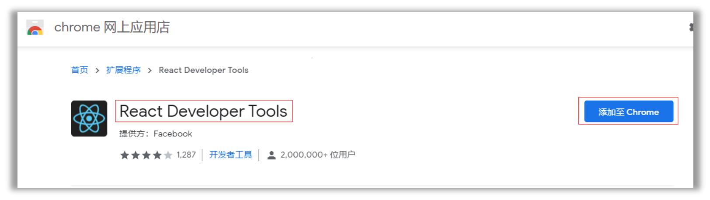
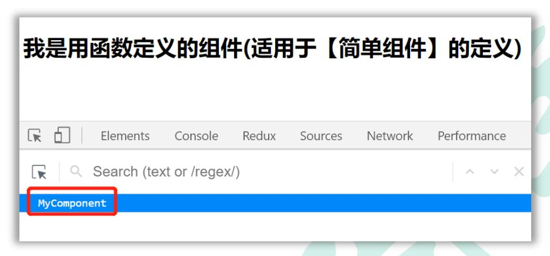
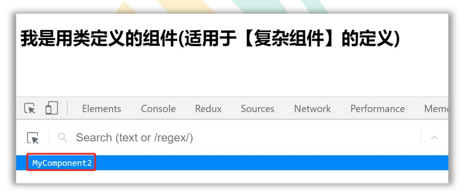
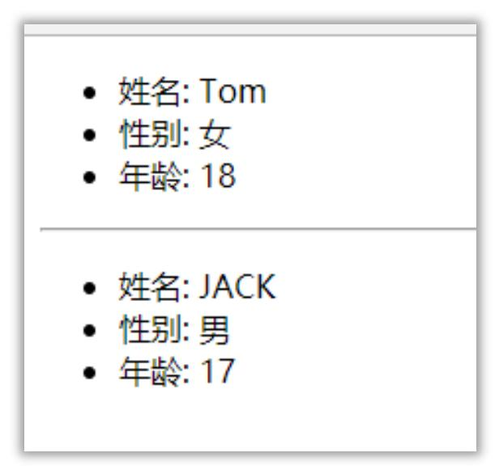
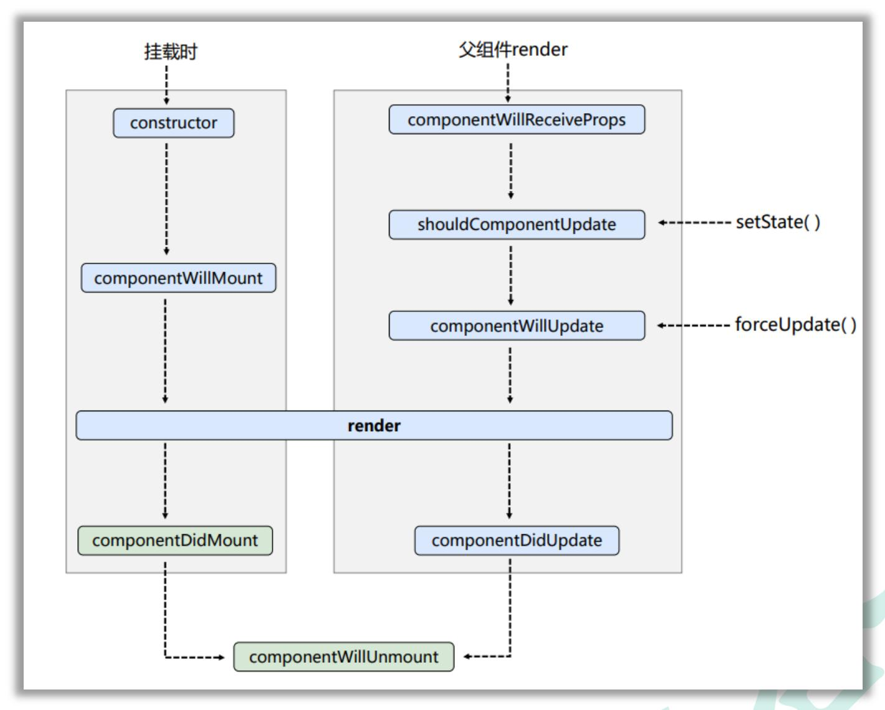
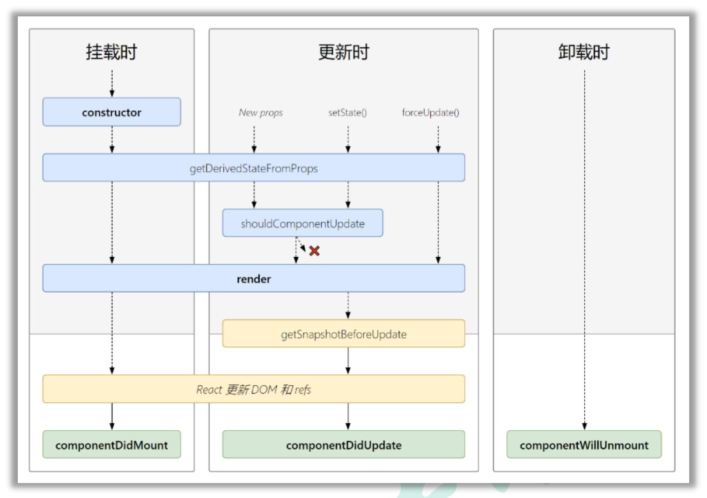

# 第 2 章 React 面向组件编程

组件的基本使用，state、props、refs 三大核心属性，生命周期，以及虚拟 DOM 与 Diffing 算法。

<!-- more -->

<!-- PDF 第 5 页 -->

# 第2 章：React 面向组件编程

## 2.1. 基本理解和使用

### 2.1.1. 使用React 开发者工具调试

<!-- PDF 第 6 页 -->



### 2.1.2. 效果

函数式组件：



类式组件：



### 2.1.3. 注意

1. 组件名必须首字母大写
2. 虚拟DOM 元素只能有一个根元素
3. 虚拟DOM 元素必须有结束标签

### 2.1.4. 渲染类组件标签的基本流程

<!-- PDF 第 7 页 -->

1. React 内部会创建组件实例对象
2. 调用render()得到虚拟DOM, 并解析为真实DOM
3. 插入到指定的页面元素内部

## 2.2. 组件三大核心属性1: state

### 2.2.1. 效果

需求:定义一个展示天气信息的组件

1. 默认展示天气炎热或凉爽
2. 点击文字切换天气

 Weather组件.gif

### 2.2.2. 理解

1. state 是组件对象最重要的属性, 值是对象(可以包含多个key-value 的组合)
2. 组件被称为"状态机", 通过更新组件的state 来更新对应的页面显示(重新渲染组件)

### 2.2.3. 强烈注意

1. 组件中render 方法中的this 为组件实例对象
2. 组件自定义的方法中this 为undefined，如何解决？
   a) 强制绑定this: 通过函数对象的bind()
   b) 箭头函数
3. 状态数据，不能直接修改或更新

## 2.3. 组件三大核心属性2: props

### 2.3.1. 效果

需求:自定义用来显示一个人员信息的组件

<!-- PDF 第 8 页 -->

1. 姓名必须指定，且为字符串类型；
2. 性别为字符串类型，如果性别没有指定，默认为男
3. 年龄为字符串类型，且为数字类型，默认值为18



### 2.3.2. 理解

1. 每个组件对象都会有props(properties 的简写)属性
2. 组件标签的所有属性都保存在props 中

### 2.3.3. 作用

1. 通过标签属性从组件外向组件内传递变化的数据
2. 注意: 组件内部不要修改props 数据

### 2.3.4. 编码操作

1. 内部读取某个属性值

```javascript
this.props.name
```

2. 对props 中的属性值进行类型限制和必要性限制

   第一种方式（React v15.5 开始已弃用）：

```javascript
Person.propTypes = {
  name: React.PropTypes.string.isRequired,
  age: React.PropTypes.number
}
```

   第二种方式（新）：使用prop-types 库进限制（需要引入prop-types 库）

<!-- PDF 第 9 页 -->

```javascript
Person.propTypes = {
  name: PropTypes.string.isRequired,
  age: PropTypes.number.
}
```

3. 扩展属性: 将对象的所有属性通过props 传递

```jsx
<Person {...person}/>
```

4. 默认属性值：

```javascript
Person.defaultProps = {
  age: 18,
  sex:'男'
}
```

5. 组件类的构造函数

```javascript
constructor(props){
  super(props)
  console.log(props)//打印所有属性
}
```

## 2.4. 组件三大核心属性3: refs 与事件处理

### 2.4.1. 效果

需求:自定义组件,功能说明如下:

1. 点击按钮,提示第一个输入框中的值
2. 当第2个输入框失去焦点时,提示这个输入框中的值

效果如下：


### 2.4.2. 理解

组件内的标签可以定义ref 属性来标识自己

### 2.4.3. 编码

<!-- PDF 第 10 页 -->

1. 字符串形式的ref

```jsx
<input ref="input1"/>
```

2. 回调形式的ref

```jsx
<input ref={(c)=>{this.input1 = c}}
```

3. createRef 创建ref 容器·

```javascript
myRef = React.createRef()
```

```jsx
<input ref={this.myRef}/>
```

### 2.4.4. 事件处理

1. 通过onXxx 属性指定事件处理函数(注意大小写)
   1) React 使用的是自定义(合成)事件, 而不是使用的原生DOM 事件
   2) React 中的事件是通过事件委托方式处理的(委托给组件最外层的元素)
2. 通过event.target 得到发生事件的DOM 元素对象

## 2.5. 收集表单数据

### 2.5.1. 效果

需求:定义一个包含表单的组件

输入用户名密码后,点击登录提示输入信息

 收集表单数据.gif

### 2.5.2. 理解

包含表单的组件分类

1. 受控组件
2. 非受控组件

<!-- PDF 第 11 页 -->

## 2.6. 组件的生命周期

### 2.6.1. 效果

需求:定义组件实现以下功能：

1. 让指定的文本做显示/ 隐藏的渐变动画
2. 从完全可见，到彻底消失，耗时2S
3. 点击“不活了”按钮从界面中卸载组件

 component 生命周期.gif

### 2.6.2. 理解

1. 组件从创建到死亡它会经历一些特定的阶段。
2. React 组件中包含一系列勾子函数(生命周期回调函数), 会在特定的时刻调用。
3. 我们在定义组件时，会在特定的生命周期回调函数中，做特定的工作。

### 2.6.3. 生命周期流程图(旧)

<!-- PDF 第 12 页 -->



生命周期的三个阶段（旧）

1. 初始化阶段: 由ReactDOM.render()触发---初次渲染
   1. constructor()
   2. componentWillMount()
   3. render()
   4. componentDidMount()
2. 更新阶段: 由组件内部this.setSate()或父组件重新render 触发
   1. shouldComponentUpdate()
   2. componentWillUpdate()
   3. render()
   4. componentDidUpdate()
3. 卸载组件: 由ReactDOM.unmountComponentAtNode()触发
   1. componentWillUnmount()

<!-- PDF 第 13 页 -->

### 2.6.4. 生命周期流程图(新)



生命周期的三个阶段（新）

1. 初始化阶段: 由ReactDOM.render()触发---初次渲染
   1. constructor()
   2. getDerivedStateFromProps
   3. render()
   4. componentDidMount()
2. 更新阶段: 由组件内部this.setSate()或父组件重新render 触发
   1. getDerivedStateFromProps
   2. shouldComponentUpdate()
   3. render()
   4. getSnapshotBeforeUpdate
   5. componentDidUpdate()
3. 卸载组件: 由ReactDOM.unmountComponentAtNode()触发

<!-- PDF 第 14 页 -->

   1. componentWillUnmount()

### 2.6.5. 重要的勾子

1. render：初始化渲染或更新渲染调用
2. componentDidMount：开启监听, 发送ajax 请求
3. componentWillUnmount：做一些收尾工作, 如: 清理定时器

### 2.6.6. 即将废弃的勾子

1. componentWillMount
2. componentWillReceiveProps
3. componentWillUpdate

现在使用会出现警告，下一个大版本需要加上UNSAFE_前缀才能使用，以后可能会被彻底废弃，不建议使用。

## 2.7. 虚拟DOM 与DOM Diffing 算法

### 2.7.1. 效果

需求：验证虚拟DOMDiffing算法的存在

 component 虚拟DOM.gif

### 2.7.2. 基本原理图
