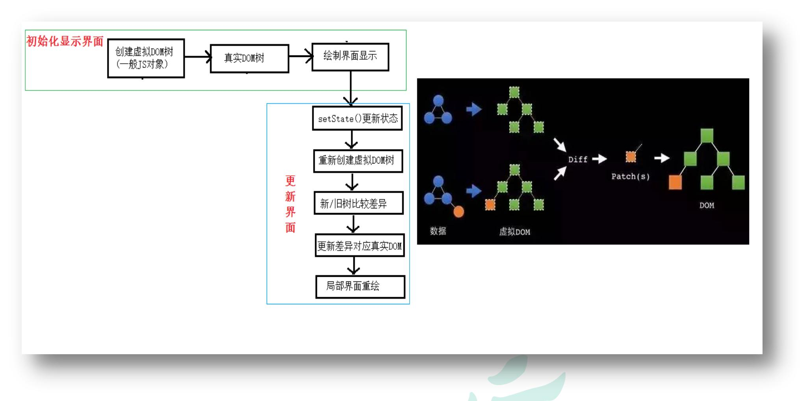

# 第 3 章 React 应用（基于 React 脚手架）

使用 create-react-app 创建 React 应用、脚手架项目结构，以及 TodoList 组件化编码流程。

<!-- more -->

<!-- PDF 第 15 页 -->

# 第3 章：React 应用(基于React 脚手架)



## 3.1. 使用create-react-app 创建react 应用

### 3.1.1. react 脚手架

1. xxx 脚手架: 用来帮助程序员快速创建一个基于xxx 库的模板项目
   1. 包含了所有需要的配置（语法检查、jsx 编译、devServer…）
   2. 下载好了所有相关的依赖
   3. 可以直接运行一个简单效果
2. react 提供了一个用于创建react 项目的脚手架库: create-react-app
3. 项目的整体技术架构为: react + webpack + es6 + eslint
4. 使用脚手架开发的项目的特点: 模块化, 组件化, 工程化

### 3.1.2. 创建项目并启动

第一步，全局安装：`npm i -g create-react-app`

第二步，切换到想创项目的目录，使用命令：`create-react-app hello-react`

<!-- PDF 第 16 页 -->

第三步，进入项目文件夹：`cd hello-react`

第四步，启动项目：`npm start`

### 3.1.3. react 脚手架项目结构

```text
public ---- 静态资源文件夹
    favicon.icon ------ 网站页签图标
    index.html -------- 主页面
    logo192.png ------- logo 图
    logo512.png ------- logo 图
    manifest.json ----- 应用加壳的配置文件
    robots.txt -------- 爬虫协议文件
src ---- 源码文件夹
    App.css -------- App 组件的样式
    App.js --------- App 组件
    App.test.js ---- 用于给App 做测试
    index.css ------ 样式
    index.js ------- 入口文件
    logo.svg ------- logo 图
    reportWebVitals.js --- 页面性能分析文件(需要web-vitals 库的支持)
    setupTests.js ---- 组件单元测试的文件(需要jest-dom 库的支持)
```

### 3.1.4. 功能界面的组件化编码流程（通用）

1. 拆分组件: 拆分界面,抽取组件

<!-- PDF 第 17 页 -->

2. 实现静态组件: 使用组件实现静态页面效果
3. 实现动态组件
   3.1 动态显示初始化数据
   3.1.1 数据类型
   3.1.2 数据名称
   3.1.2 保存在哪个组件?
   3.2 交互(从绑定事件监听开始)

## 3.2. 组件的组合使用-TodoList

功能:组件化实现此功能

1. 显示所有todo 列表
2. 输入文本, 点击按钮显示到列表的首位, 并清除输入的文本


