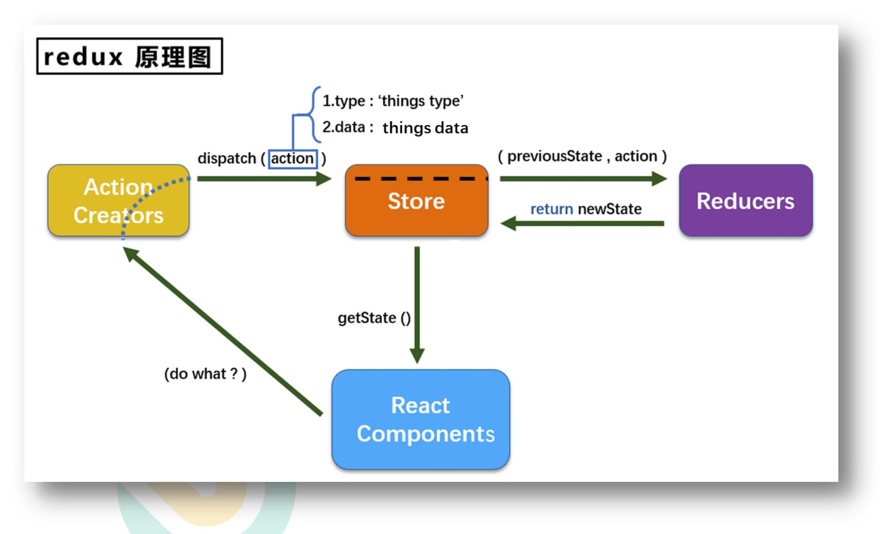
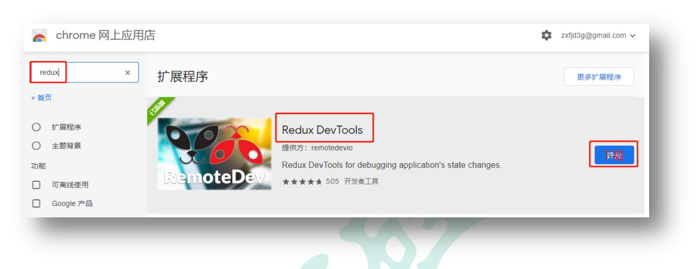

# 第 7 章 redux

redux 的理解、三个核心概念与核心 API，react-redux、异步中间件、调试工具，以及纯函数和高阶函数。

<!-- more -->

<!-- PDF 第 24 页 -->

# 第7 章：redux

## 7.1. redux 理解

### 7.1.1. 学习文档

1. 英文文档: https://redux.js.org/
2. 中文文档: http://www.redux.org.cn/
3. Github: https://github.com/reactjs/redux

### 7.1.2. redux 是什么

1. redux 是一个专门用于做状态管理的JS 库(不是react 插件库)。
2. 它可以用在react, angular, vue 等项目中, 但基本与react 配合使用。
3. 作用: 集中式管理react 应用中多个组件共享的状态。

<!-- PDF 第 25 页 -->

### 7.1.3. 什么情况下需要使用redux

1. 某个组件的状态，需要让其他组件可以随时拿到（共享）。
2. 一个组件需要改变另一个组件的状态（通信）。
3. 总体原则：能不用就不用, 如果不用比较吃力才考虑使用。

### 7.1.4. redux 工作流程



## 7.2. redux 的三个核心概念

### 7.2.1. action

1. 动作的对象
2. 包含2 个属性
   - type：标识属性, 值为字符串, 唯一, 必要属性
   - data：数据属性, 值类型任意, 可选属性
3. 例子：`{ type: 'ADD_STUDENT',data:{name: 'tom',age:18} }`

<!-- PDF 第 26 页 -->

### 7.2.2. reducer

1. 用于初始化状态、加工状态。
2. 加工时，根据旧的state 和action，产生新的state 的纯函数。

### 7.2.3. store

1. 将state、action、reducer 联系在一起的对象
2. 如何得到此对象?

```javascript
import {createStore} from 'redux'
import reducer from './reducers'
const store = createStore(reducer)
```

3. 此对象的功能?
   1) getState(): 得到state
   2) dispatch(action): 分发action, 触发reducer 调用, 产生新的state
   3) subscribe(listener): 注册监听, 当产生了新的state 时, 自动调用

## 7.3. redux 的核心API

### 7.3.1. createstore()

作用：创建包含指定reducer 的store 对象

### 7.3.2. store 对象

1. 作用: redux 库最核心的管理对象
2. 它内部维护着:
   1) state
   2) reducer
3. 核心方法:

<!-- PDF 第 27 页 -->

   1) getState()
   2) dispatch(action)
   3) subscribe(listener)

4. 具体编码:
   1) store.getState()
   2) store.dispatch({type:'INCREMENT', number})
   3) store.subscribe(render)

### 7.3.3. applyMiddleware()

作用：应用上基于redux 的中间件(插件库)

### 7.3.4. combineReducers()

作用：合并多个reducer 函数

## 7.4. 使用redux 编写应用

效果

 redux.gif

## 7.5. redux 异步编程

### 7.5.1 理解：

1. redux 默认是不能进行异步处理的,
2. 某些时候应用中需要在redux 中执行异步任务(ajax, 定时器)

### 7.5.2. 使用异步中间件

```bash
npm install --save redux-thunk
```

## 7.6. react-redux

### 7.6.1. 理解

<!-- PDF 第 28 页 -->

1. 一个react 插件库
2. 专门用来简化react 应用中使用redux

### 7.6.2. react-Redux 将所有组件分成两大类

1. UI 组件
   1) 只负责UI 的呈现，不带有任何业务逻辑
   2) 通过props 接收数据(一般数据和函数)
   3) 不使用任何Redux 的API
   4) 一般保存在components 文件夹下
2. 容器组件
   1) 负责管理数据和业务逻辑，不负责UI 的呈现
   2) 使用Redux 的API
   3) 一般保存在containers 文件夹下

### 7.6.3. 相关API

1. Provider：让所有组件都可以得到state 数据

```jsx
<Provider store={store}>
  <App />
</Provider>
```

2. connect：用于包装UI 组件生成容器组件

```javascript
import { connect } from 'react-redux'
  connect(
    mapStateToprops,
    mapDispatchToProps
  )(Counter)
```

3. mapStateToprops：将外部的数据（即state 对象）转换为UI 组件的标签属性

<!-- PDF 第 29 页 -->

```javascript
const mapStateToprops = function (state) {
  return {
    value: state
  }
}
```

4. mapDispatchToProps：将分发action 的函数转换为UI 组件的标签属性

## 7.7. 使用上redux 调试工具

### 7.7.1. 安装chrome 浏览器插件



### 7.7.2. 下载工具依赖包

```bash
npm install --save-dev redux-devtools-extension
```

## 7.8. 纯函数和高阶函数

### 7.8.1. 纯函数

1. 一类特别的函数: 只要是同样的输入(实参)，必定得到同样的输出(返回)
2. 必须遵守以下一些约束
   1) 不得改写参数数据
   2) 不会产生任何副作用，例如网络请求，输入和输出设备
   3) 不能调用Date.now()或者Math.random()等不纯的方法
3. redux 的reducer 函数必须是一个纯函数

<!-- PDF 第 30 页 -->

### 7.8.2. 高阶函数

1. 理解: 一类特别的函数
   1) 情况1: 参数是函数
   2) 情况2: 返回是函数
2. 常见的高阶函数:
   1) 定时器设置函数
   2) 数组的forEach()/map()/filter()/reduce()/find()/bind()
   3) promise
   4) react-redux 中的connect 函数
3. 作用: 能实现更加动态, 更加可扩展的功能
