# React 全家桶（完整版）

按 PDF 原页顺序编排，每页以 HTML 注释标记页码。章节分为：

- [第 1 章 React 入门](./01-react-introduction.html)
- [第 2 章 React 面向组件编程](./02-component-programming.html)
- [第 3 章 React 应用（基于 React 脚手架）](./03-react-scaffold.html)
- [第 4 章 React ajax](./04-react-ajax.html)
- [第 5 章 React 路由](./05-react-router.html)
- [第 6 章 React UI 组件库](./06-react-ui-libraries.html)
- [第 7 章 redux](./07-redux.html)

<!-- PDF 第 1 页 -->

# React 全家桶(技术栈)

前端研究院

# 第1 章：React 入门

## 1.1. React 简介

### 1.1.1. 官网

1. 英文官网: https://reactjs.org/
2. 中文官网: https://react.docschina.org/

### 1.1.2. 介绍描述

1. 用于动态构建用户界面的JavaScript 库(只关注于视图)
2. 由Facebook 开源

### 1.1.3. React 的特点

1. 声明式编码
2. 组件化编码
3. React Native 编写原生应用
4. 高效（优秀的Diffing 算法）

### 1.1.4. React 高效的原因

1. 使用虚拟(virtual)DOM, 不总是直接操作页面真实DOM。
2. DOM Diffing 算法, 最小化页面重绘。

<!-- PDF 第 2 页 -->

## 1.2. React 的基本使用

### 1.2.1. 效果

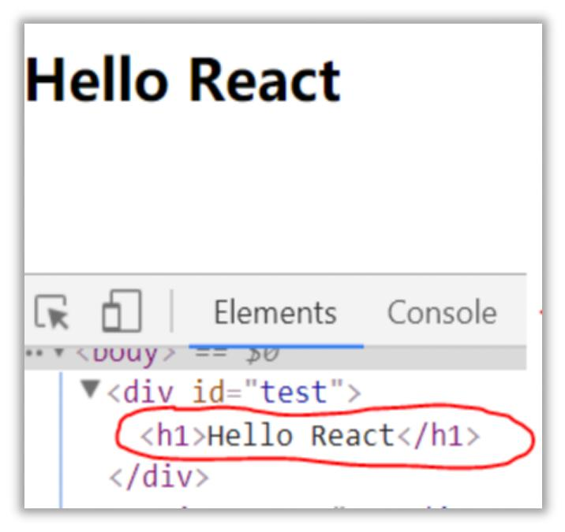

### 1.2.2. 相关js 库

1. react.js：React 核心库。
2. react-dom.js：提供操作DOM 的react 扩展库。
3. babel.min.js：解析JSX 语法代码转为JS 代码的库。

### 1.2.3. 创建虚拟DOM 的两种方式

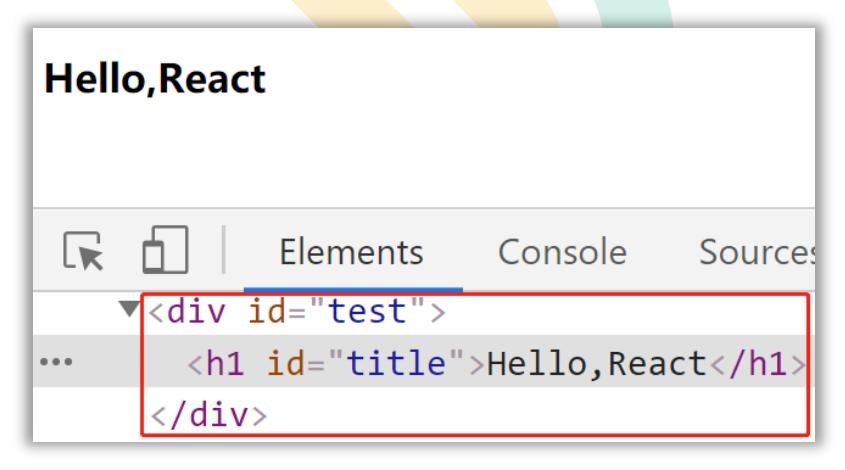

1. 纯JS 方式(一般不用)
2. JSX 方式

### 1.2.4. 虚拟DOM 与真实DOM

1. React 提供了一些API 来创建一种“特别” 的一般js 对象

```javascript
const VDOM = React.createElement('xx',{id:'xx'},'xx')
```

<!-- PDF 第 3 页 -->

   上面创建的就是一个简单的虚拟DOM 对象

2. 虚拟DOM 对象最终都会被React 转换为真实的DOM
3. 我们编码时基本只需要操作react 的虚拟DOM 相关数据, react 会转换为真实DOM 变化而更新界。

## 1.3. React JSX

### 1.3.1. 效果

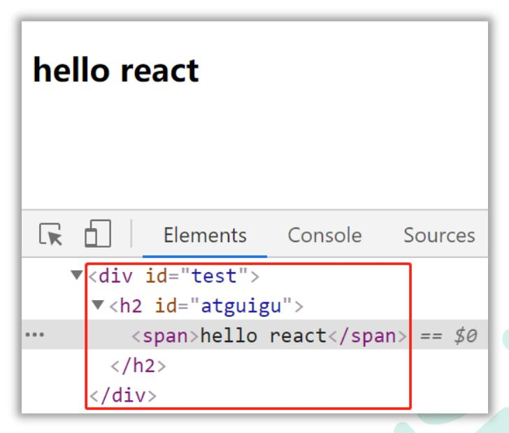

### 1.3.2. JSX

1. 全称: JavaScript XML
2. react 定义的一种类似于XML 的JS 扩展语法: JS + XML 本质是 `React.createElement(component, props, ...children)`方法的语法糖
3. 作用: 用来简化创建虚拟DOM
   1) 写法：`var ele = <h1>Hello JSX!</h1>`
   2) 注意1：它不是字符串, 也不是HTML/XML 标签
   3) 注意2：它最终产生的就是一个JS 对象
4. 标签名任意: HTML 标签或其它标签
5. 标签属性任意: HTML 标签属性或其它
6. 基本语法规则

<!-- PDF 第 4 页 -->

   1) 遇到<开头的代码, 以标签的语法解析: html 同名标签转换为html 同名元素, 其它标签需要特别解析
   2) 遇到以{ 开头的代码，以JS 语法解析: 标签中的js 表达式必须用{ }包含

7. babel.js 的作用
   1) 浏览器不能直接解析JSX 代码, 需要babel 转译为纯JS 的代码才能运行
   2) 只要用了JSX，都要加上type="text/babel", 声明需要babel 来处理

### 1.3.3. 渲染虚拟DOM(元素)

1. 语法: `ReactDOM.render(virtualDOM, containerDOM)`
2. 作用: 将虚拟DOM 元素渲染到页面中的真实容器DOM 中显示
3. 参数说明
   1) 参数一: 纯js 或jsx 创建的虚拟dom 对象
   2) 参数二: 用来包含虚拟DOM 元素的真实dom 元素对象(一般是一个div)

### 1.3.4. JSX 练习

需求: 动态展示如下列表

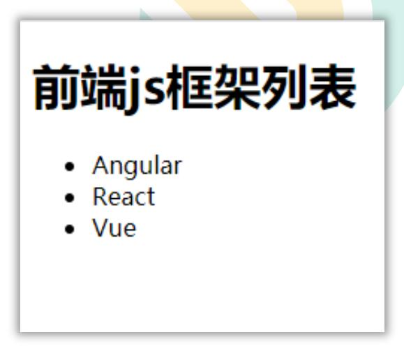

## 1.4. 模块与组件、模块化与组件化的理解

### 1.4.1. 模块

1. 理解：向外提供特定功能的js 程序, 一般就是一个js 文件
2. 为什么要拆成模块：随着业务逻辑增加，代码越来越多且复杂。

<!-- PDF 第 5 页 -->

3. 作用：复用js, 简化js 的编写, 提高js 运行效率

### 1.4.2. 组件

1. 理解：用来实现局部功能效果的代码和资源的集合(html/css/js/image 等等)
2. 为什么要用组件：一个界面的功能更复杂
3. 作用：复用编码, 简化项目编码, 提高运行效率

### 1.4.3. 模块化

当应用的js 都以模块来编写的, 这个应用就是一个模块化的应用

### 1.4.4. 组件化

当应用是以多组件的方式实现, 这个应用就是一个组件化的应用

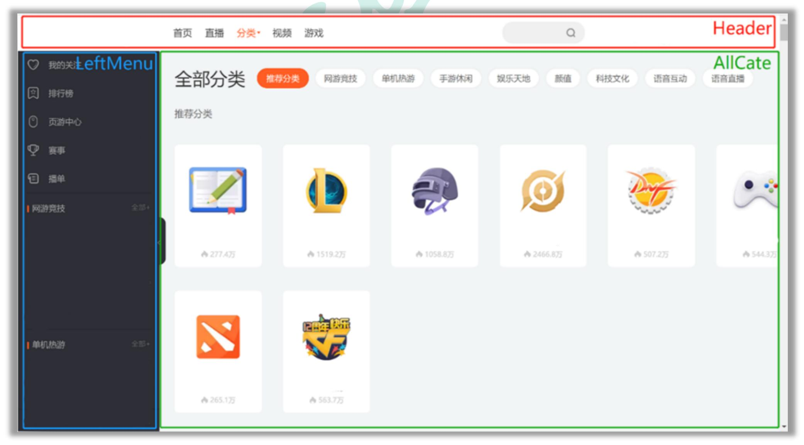


# 第2 章：React 面向组件编程

## 2.1. 基本理解和使用

### 2.1.1. 使用React 开发者工具调试

<!-- PDF 第 6 页 -->

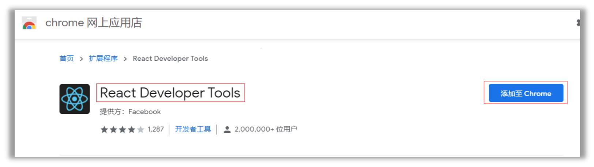

### 2.1.2. 效果

函数式组件：

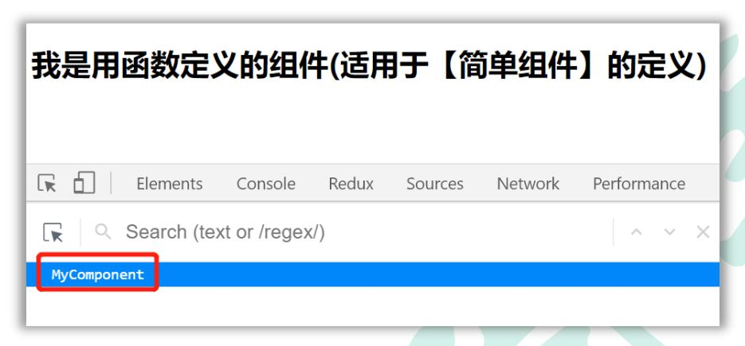

类式组件：

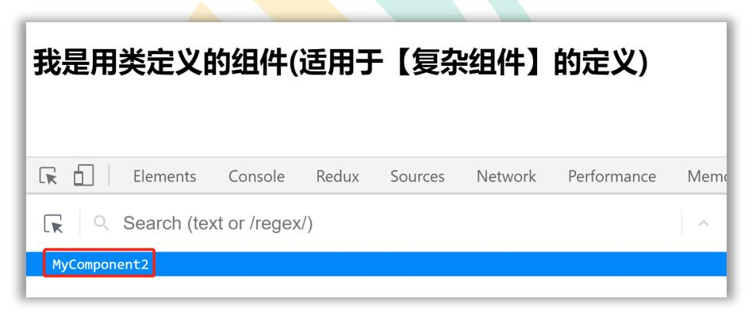

### 2.1.3. 注意

1. 组件名必须首字母大写
2. 虚拟DOM 元素只能有一个根元素
3. 虚拟DOM 元素必须有结束标签

### 2.1.4. 渲染类组件标签的基本流程

<!-- PDF 第 7 页 -->

1. React 内部会创建组件实例对象
2. 调用render()得到虚拟DOM, 并解析为真实DOM
3. 插入到指定的页面元素内部

## 2.2. 组件三大核心属性1: state

### 2.2.1. 效果

需求:定义一个展示天气信息的组件

1. 默认展示天气炎热或凉爽
2. 点击文字切换天气

 Weather组件.gif

### 2.2.2. 理解

1. state 是组件对象最重要的属性, 值是对象(可以包含多个key-value 的组合)
2. 组件被称为"状态机", 通过更新组件的state 来更新对应的页面显示(重新渲染组件)

### 2.2.3. 强烈注意

1. 组件中render 方法中的this 为组件实例对象
2. 组件自定义的方法中this 为undefined，如何解决？
   a) 强制绑定this: 通过函数对象的bind()
   b) 箭头函数
3. 状态数据，不能直接修改或更新

## 2.3. 组件三大核心属性2: props

### 2.3.1. 效果

需求:自定义用来显示一个人员信息的组件

<!-- PDF 第 8 页 -->

1. 姓名必须指定，且为字符串类型；
2. 性别为字符串类型，如果性别没有指定，默认为男
3. 年龄为字符串类型，且为数字类型，默认值为18

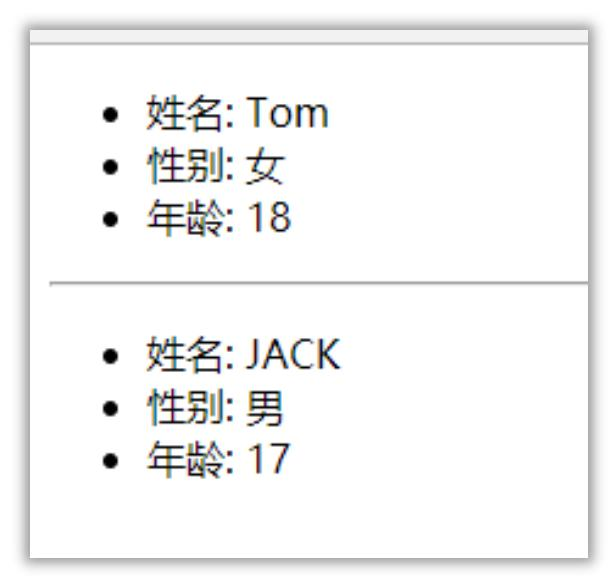

### 2.3.2. 理解

1. 每个组件对象都会有props(properties 的简写)属性
2. 组件标签的所有属性都保存在props 中

### 2.3.3. 作用

1. 通过标签属性从组件外向组件内传递变化的数据
2. 注意: 组件内部不要修改props 数据

### 2.3.4. 编码操作

1. 内部读取某个属性值

```javascript
this.props.name
```

2. 对props 中的属性值进行类型限制和必要性限制

   第一种方式（React v15.5 开始已弃用）：

```javascript
Person.propTypes = {
  name: React.PropTypes.string.isRequired,
  age: React.PropTypes.number
}
```

   第二种方式（新）：使用prop-types 库进限制（需要引入prop-types 库）

<!-- PDF 第 9 页 -->

```javascript
Person.propTypes = {
  name: PropTypes.string.isRequired,
  age: PropTypes.number.
}
```

3. 扩展属性: 将对象的所有属性通过props 传递

```jsx
<Person {...person}/>
```

4. 默认属性值：

```javascript
Person.defaultProps = {
  age: 18,
  sex:'男'
}
```

5. 组件类的构造函数

```javascript
constructor(props){
  super(props)
  console.log(props)//打印所有属性
}
```

## 2.4. 组件三大核心属性3: refs 与事件处理

### 2.4.1. 效果

需求:自定义组件,功能说明如下:

1. 点击按钮,提示第一个输入框中的值
2. 当第2个输入框失去焦点时,提示这个输入框中的值

效果如下：


### 2.4.2. 理解

组件内的标签可以定义ref 属性来标识自己

### 2.4.3. 编码

<!-- PDF 第 10 页 -->

1. 字符串形式的ref

```jsx
<input ref="input1"/>
```

2. 回调形式的ref

```jsx
<input ref={(c)=>{this.input1 = c}}
```

3. createRef 创建ref 容器·

```javascript
myRef = React.createRef()
```

```jsx
<input ref={this.myRef}/>
```

### 2.4.4. 事件处理

1. 通过onXxx 属性指定事件处理函数(注意大小写)
   1) React 使用的是自定义(合成)事件, 而不是使用的原生DOM 事件
   2) React 中的事件是通过事件委托方式处理的(委托给组件最外层的元素)
2. 通过event.target 得到发生事件的DOM 元素对象

## 2.5. 收集表单数据

### 2.5.1. 效果

需求:定义一个包含表单的组件

输入用户名密码后,点击登录提示输入信息

 收集表单数据.gif

### 2.5.2. 理解

包含表单的组件分类

1. 受控组件
2. 非受控组件

<!-- PDF 第 11 页 -->

## 2.6. 组件的生命周期

### 2.6.1. 效果

需求:定义组件实现以下功能：

1. 让指定的文本做显示/ 隐藏的渐变动画
2. 从完全可见，到彻底消失，耗时2S
3. 点击“不活了”按钮从界面中卸载组件

 component 生命周期.gif

### 2.6.2. 理解

1. 组件从创建到死亡它会经历一些特定的阶段。
2. React 组件中包含一系列勾子函数(生命周期回调函数), 会在特定的时刻调用。
3. 我们在定义组件时，会在特定的生命周期回调函数中，做特定的工作。

### 2.6.3. 生命周期流程图(旧)

<!-- PDF 第 12 页 -->

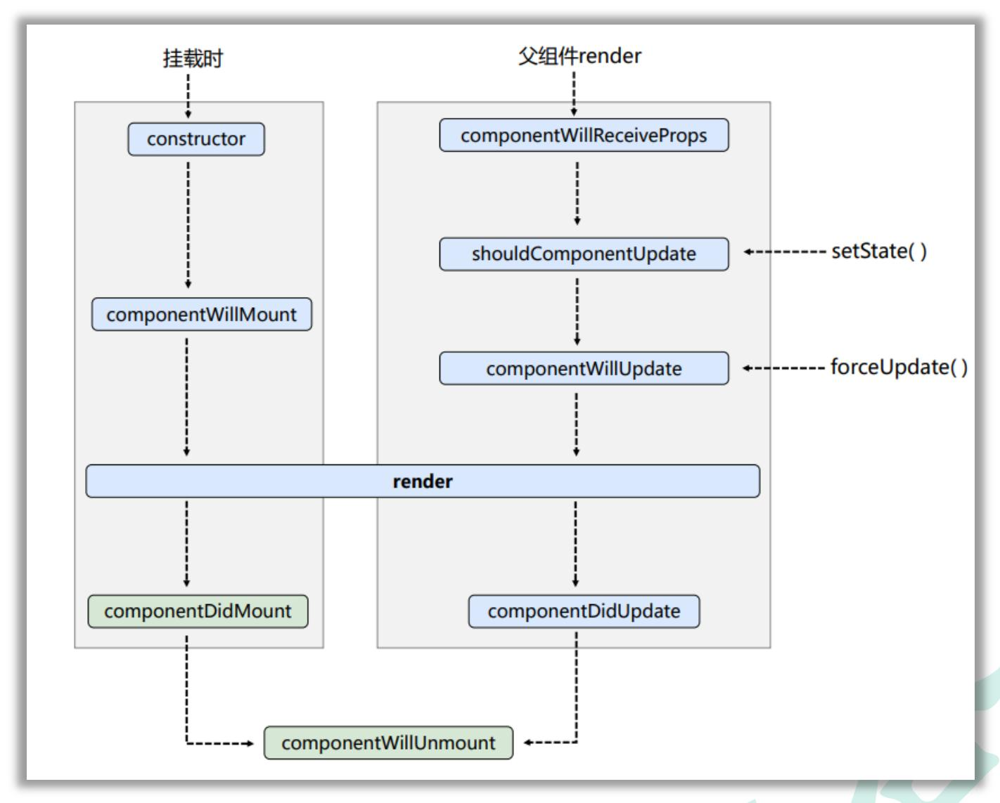

生命周期的三个阶段（旧）

1. 初始化阶段: 由ReactDOM.render()触发---初次渲染
   1. constructor()
   2. componentWillMount()
   3. render()
   4. componentDidMount()
2. 更新阶段: 由组件内部this.setSate()或父组件重新render 触发
   1. shouldComponentUpdate()
   2. componentWillUpdate()
   3. render()
   4. componentDidUpdate()
3. 卸载组件: 由ReactDOM.unmountComponentAtNode()触发
   1. componentWillUnmount()

<!-- PDF 第 13 页 -->

### 2.6.4. 生命周期流程图(新)

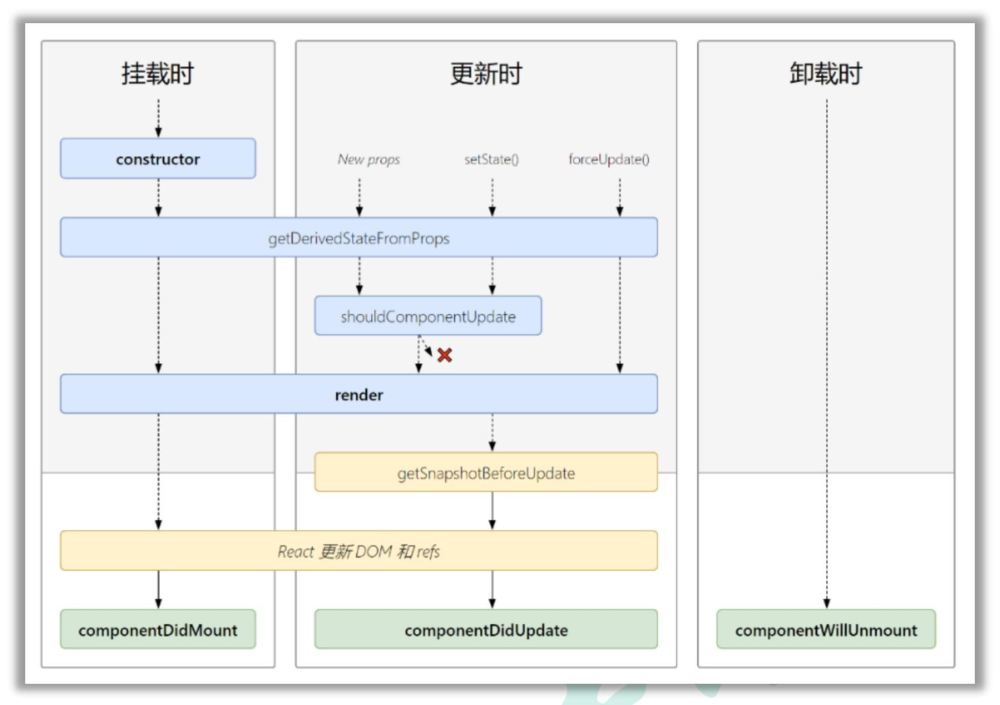

生命周期的三个阶段（新）

1. 初始化阶段: 由ReactDOM.render()触发---初次渲染
   1. constructor()
   2. getDerivedStateFromProps
   3. render()
   4. componentDidMount()
2. 更新阶段: 由组件内部this.setSate()或父组件重新render 触发
   1. getDerivedStateFromProps
   2. shouldComponentUpdate()
   3. render()
   4. getSnapshotBeforeUpdate
   5. componentDidUpdate()
3. 卸载组件: 由ReactDOM.unmountComponentAtNode()触发

<!-- PDF 第 14 页 -->

   1. componentWillUnmount()

### 2.6.5. 重要的勾子

1. render：初始化渲染或更新渲染调用
2. componentDidMount：开启监听, 发送ajax 请求
3. componentWillUnmount：做一些收尾工作, 如: 清理定时器

### 2.6.6. 即将废弃的勾子

1. componentWillMount
2. componentWillReceiveProps
3. componentWillUpdate

现在使用会出现警告，下一个大版本需要加上UNSAFE_前缀才能使用，以后可能会被彻底废弃，不建议使用。

## 2.7. 虚拟DOM 与DOM Diffing 算法

### 2.7.1. 效果

需求：验证虚拟DOMDiffing算法的存在

 component 虚拟DOM.gif

### 2.7.2. 基本原理图

<!-- PDF 第 15 页 -->

# 第3 章：React 应用(基于React 脚手架)

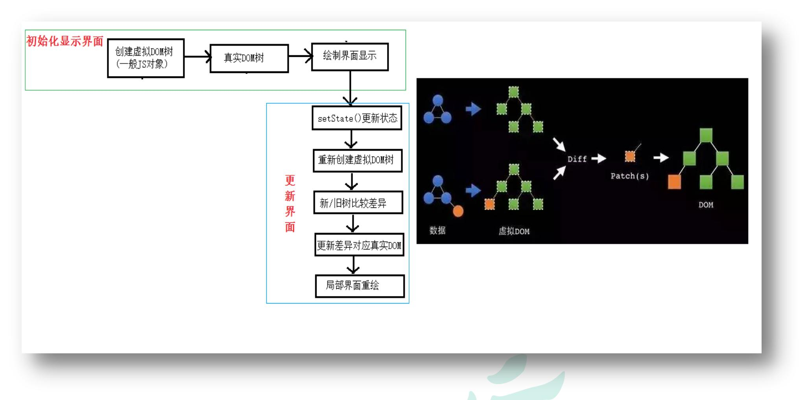

## 3.1. 使用create-react-app 创建react 应用

### 3.1.1. react 脚手架

1. xxx 脚手架: 用来帮助程序员快速创建一个基于xxx 库的模板项目
   1. 包含了所有需要的配置（语法检查、jsx 编译、devServer…）
   2. 下载好了所有相关的依赖
   3. 可以直接运行一个简单效果
2. react 提供了一个用于创建react 项目的脚手架库: create-react-app
3. 项目的整体技术架构为: react + webpack + es6 + eslint
4. 使用脚手架开发的项目的特点: 模块化, 组件化, 工程化

### 3.1.2. 创建项目并启动

第一步，全局安装：`npm i -g create-react-app`

第二步，切换到想创项目的目录，使用命令：`create-react-app hello-react`

<!-- PDF 第 16 页 -->

第三步，进入项目文件夹：`cd hello-react`

第四步，启动项目：`npm start`

### 3.1.3. react 脚手架项目结构

```text
public ---- 静态资源文件夹
    favicon.icon ------ 网站页签图标
    index.html -------- 主页面
    logo192.png ------- logo 图
    logo512.png ------- logo 图
    manifest.json ----- 应用加壳的配置文件
    robots.txt -------- 爬虫协议文件
src ---- 源码文件夹
    App.css -------- App 组件的样式
    App.js --------- App 组件
    App.test.js ---- 用于给App 做测试
    index.css ------ 样式
    index.js ------- 入口文件
    logo.svg ------- logo 图
    reportWebVitals.js --- 页面性能分析文件(需要web-vitals 库的支持)
    setupTests.js ---- 组件单元测试的文件(需要jest-dom 库的支持)
```

### 3.1.4. 功能界面的组件化编码流程（通用）

1. 拆分组件: 拆分界面,抽取组件

<!-- PDF 第 17 页 -->

2. 实现静态组件: 使用组件实现静态页面效果
3. 实现动态组件
   3.1 动态显示初始化数据
   3.1.1 数据类型
   3.1.2 数据名称
   3.1.2 保存在哪个组件?
   3.2 交互(从绑定事件监听开始)

## 3.2. 组件的组合使用-TodoList

功能:组件化实现此功能

1. 显示所有todo 列表
2. 输入文本, 点击按钮显示到列表的首位, 并清除输入的文本


# 第4 章：React ajax

## 4.1. 理解

### 4.1.1. 前置说明

1. React 本身只关注于界面, 并不包含发送ajax 请求的代码
2. 前端应用需要通过ajax 请求与后台进行交互(json 数据)
3. react 应用中需要集成第三方ajax 库(或自己封装)

### 4.1.2. 常用的ajax 请求库

1. jQuery: 比较重, 如果需要另外引入不建议使用

<!-- PDF 第 18 页 -->

2. axios: 轻量级, 建议使用
   1) 封装XmlHttpRequest 对象的ajax
   2) promise 风格
   3) 可以用在浏览器端和node 服务器端

## 4.2. axios

### 4.2.1. 文档

https://github.com/axios/axios

### 4.2.2. 相关API

1) GET 请求

```javascript
axios.get('/user?ID=12345')
 .then(function (response) {
  console.log(response.data);
  })
 .catch(function (error) {
   console.log(error);
  });
```

```javascript
axios.get('/user', {
  params: {
    ID: 12345
    }
  })
 .then(function (response) {
  console.log(response);
  })
 .catch(function (error) {
   console.log(error);
  });
```

<!-- PDF 第 19 页 -->

2) POST 请求

```javascript
axios.post('/user', {
  firstName: 'Fred',
  lastName: 'Flintstone'
})
.then(function (response) {
console.log(response);
})
.catch(function (error) {
console.log(error);
});
```

## 4.3. 案例—github 用户搜索

### 4.3.1. 效果

 demo_users.gif

请求地址: https://api.github.com/search/users?q=xxxxxx

## 4.4. 消息订阅-发布机制

1. 工具库: PubSubJS
2. 下载: `npm install pubsub-js --save`
3. 使用:
   1) `import PubSub from 'pubsub-js' //引入`
   2) `PubSub.subscribe('delete', function(data){ }); //订阅`
   3) `PubSub.publish('delete', data) //发布消息`

## 4.5. 扩展：Fetch

<!-- PDF 第 20 页 -->

### 4.5.1. 文档

1. https://github.github.io/fetch/
2. https://segmentfault.com/a/1190000003810652

### 4.5.2. 特点

1. fetch: 原生函数，不再使用XmlHttpRequest 对象提交ajax 请求
2. 老版本浏览器可能不支持

### 4.5.3. 相关API

1) GET 请求

```javascript
fetch(url).then(function(response) {
    return response.json()
  }).then(function(data) {
    console.log(data)
  }).catch(function(e) {
    console.log(e)
  });
```

2) POST 请求

```javascript
fetch(url, {
  method: "POST",
  body: JSON.stringify(data),
}).then(function(data) {
  console.log(data)
}).catch(function(e) {
  console.log(e)
})
```

<!-- PDF 第 21 页 -->

# 第5 章：React 路由

## 5.1. 相关理解

### 5.1.1. SPA 的理解

1. 单页Web 应用（single page web application，SPA）。
2. 整个应用只有一个完整的页面。
3. 点击页面中的链接不会刷新页面，只会做页面的局部更新。
4. 数据都需要通过ajax 请求获取, 并在前端异步展现。

### 5.1.2. 路由的理解

1. 什么是路由?
   1. 一个路由就是一个映射关系(key:value)
   2. key 为路径, value 可能是function 或component
2. 路由分类
   1. 后端路由：
      1) 理解：value 是function, 用来处理客户端提交的请求。
      2) 注册路由：`router.get(path, function(req, res))`
      3) 工作过程：当node 接收到一个请求时, 根据请求路径找到匹配的路由, 调用路由中的函数来处理请求, 返回响应数据
   2. 前端路由：
      1) 浏览器端路由，value 是component，用于展示页面内容。
      2) 注册路由: `<Route path="/test" component={Test}>`
      3) 工作过程：当浏览器的path 变为/test 时, 当前路由组件就会变为Test 组件

<!-- PDF 第 22 页 -->

### 5.1.3. react-router-dom 的理解

1. react 的一个插件库。
2. 专门用来实现一个SPA 应用。
3. 基于react 的项目基本都会用到此库。

## 5.2. react-router-dom 相关API

### 5.2.1. 内置组件

1. `<BrowserRouter>`
2. `<HashRouter>`
3. `<Route>`
4. `<Redirect>`
5. `<Link>`
6. `<NavLink>`
7. `<Switch>`

### 5.2.2. 其它

1. history 对象
2. match 对象
3. withRouter 函数

## 5.3. 基本路由使用

### 5.3.1. 效果

<!-- PDF 第 23 页 -->

 react-router demo1.gif

### 5.3.2. 准备

1. 下载react-router-dom: `npm install --save react-router-dom`
2. 引入bootstrap.css: `<link rel="stylesheet" href="/css/bootstrap.css">`

## 5.4. 嵌套路由使用

效果

 react-router demo2.gif

## 5.5. 向路由组件传递参数数据

效果

 react-router demo3.gif

## 5.6. 多种路由跳转方式

效果

 react-router demo4.gif

<!-- PDF 第 24 页 -->

# 第6 章：React UI 组件库

## 6.1. 流行的开源React UI 组件库

### 6.1.1. material-ui(国外)

1. 官网: http://www.material-ui.com/#/
2. github: https://github.com/callemall/material-ui

### 6.1.2. ant-design(国内蚂蚁金服)

1. 官网: https://ant.design/index-cn
2. Github: https://github.com/ant-design/ant-design/


# 第7 章：redux

## 7.1. redux 理解

### 7.1.1. 学习文档

1. 英文文档: https://redux.js.org/
2. 中文文档: http://www.redux.org.cn/
3. Github: https://github.com/reactjs/redux

### 7.1.2. redux 是什么

1. redux 是一个专门用于做状态管理的JS 库(不是react 插件库)。
2. 它可以用在react, angular, vue 等项目中, 但基本与react 配合使用。
3. 作用: 集中式管理react 应用中多个组件共享的状态。

<!-- PDF 第 25 页 -->

### 7.1.3. 什么情况下需要使用redux

1. 某个组件的状态，需要让其他组件可以随时拿到（共享）。
2. 一个组件需要改变另一个组件的状态（通信）。
3. 总体原则：能不用就不用, 如果不用比较吃力才考虑使用。

### 7.1.4. redux 工作流程

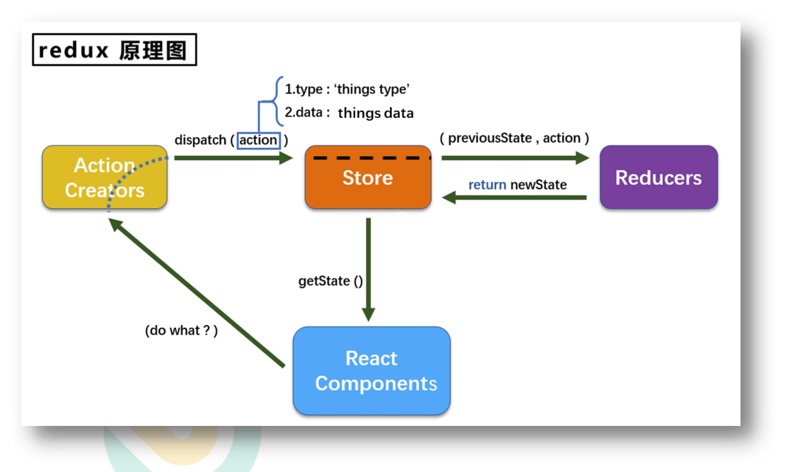

## 7.2. redux 的三个核心概念

### 7.2.1. action

1. 动作的对象
2. 包含2 个属性
   - type：标识属性, 值为字符串, 唯一, 必要属性
   - data：数据属性, 值类型任意, 可选属性
3. 例子：`{ type: 'ADD_STUDENT',data:{name: 'tom',age:18} }`

<!-- PDF 第 26 页 -->

### 7.2.2. reducer

1. 用于初始化状态、加工状态。
2. 加工时，根据旧的state 和action，产生新的state 的纯函数。

### 7.2.3. store

1. 将state、action、reducer 联系在一起的对象
2. 如何得到此对象?

```javascript
import {createStore} from 'redux'
import reducer from './reducers'
const store = createStore(reducer)
```

3. 此对象的功能?
   1) getState(): 得到state
   2) dispatch(action): 分发action, 触发reducer 调用, 产生新的state
   3) subscribe(listener): 注册监听, 当产生了新的state 时, 自动调用

## 7.3. redux 的核心API

### 7.3.1. createstore()

作用：创建包含指定reducer 的store 对象

### 7.3.2. store 对象

1. 作用: redux 库最核心的管理对象
2. 它内部维护着:
   1) state
   2) reducer
3. 核心方法:

<!-- PDF 第 27 页 -->

   1) getState()
   2) dispatch(action)
   3) subscribe(listener)

4. 具体编码:
   1) store.getState()
   2) store.dispatch({type:'INCREMENT', number})
   3) store.subscribe(render)

### 7.3.3. applyMiddleware()

作用：应用上基于redux 的中间件(插件库)

### 7.3.4. combineReducers()

作用：合并多个reducer 函数

## 7.4. 使用redux 编写应用

效果

 redux.gif

## 7.5. redux 异步编程

### 7.5.1 理解：

1. redux 默认是不能进行异步处理的,
2. 某些时候应用中需要在redux 中执行异步任务(ajax, 定时器)

### 7.5.2. 使用异步中间件

```bash
npm install --save redux-thunk
```

## 7.6. react-redux

### 7.6.1. 理解

<!-- PDF 第 28 页 -->

1. 一个react 插件库
2. 专门用来简化react 应用中使用redux

### 7.6.2. react-Redux 将所有组件分成两大类

1. UI 组件
   1) 只负责UI 的呈现，不带有任何业务逻辑
   2) 通过props 接收数据(一般数据和函数)
   3) 不使用任何Redux 的API
   4) 一般保存在components 文件夹下
2. 容器组件
   1) 负责管理数据和业务逻辑，不负责UI 的呈现
   2) 使用Redux 的API
   3) 一般保存在containers 文件夹下

### 7.6.3. 相关API

1. Provider：让所有组件都可以得到state 数据

```jsx
<Provider store={store}>
  <App />
</Provider>
```

2. connect：用于包装UI 组件生成容器组件

```javascript
import { connect } from 'react-redux'
  connect(
    mapStateToprops,
    mapDispatchToProps
  )(Counter)
```

3. mapStateToprops：将外部的数据（即state 对象）转换为UI 组件的标签属性

<!-- PDF 第 29 页 -->

```javascript
const mapStateToprops = function (state) {
  return {
    value: state
  }
}
```

4. mapDispatchToProps：将分发action 的函数转换为UI 组件的标签属性

## 7.7. 使用上redux 调试工具

### 7.7.1. 安装chrome 浏览器插件

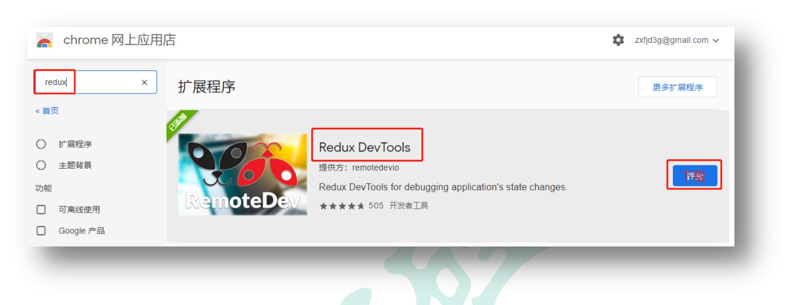

### 7.7.2. 下载工具依赖包

```bash
npm install --save-dev redux-devtools-extension
```

## 7.8. 纯函数和高阶函数

### 7.8.1. 纯函数

1. 一类特别的函数: 只要是同样的输入(实参)，必定得到同样的输出(返回)
2. 必须遵守以下一些约束
   1) 不得改写参数数据
   2) 不会产生任何副作用，例如网络请求，输入和输出设备
   3) 不能调用Date.now()或者Math.random()等不纯的方法
3. redux 的reducer 函数必须是一个纯函数

<!-- PDF 第 30 页 -->

### 7.8.2. 高阶函数

1. 理解: 一类特别的函数
   1) 情况1: 参数是函数
   2) 情况2: 返回是函数
2. 常见的高阶函数:
   1) 定时器设置函数
   2) 数组的forEach()/map()/filter()/reduce()/find()/bind()
   3) promise
   4) react-redux 中的connect 函数
3. 作用: 能实现更加动态, 更加可扩展的功能
