<!-- PDF 第 1 页 -->


# webpack 从入门到精通

尚硅谷前端研究院  
版本：V 2.1  
<a id="chapter-1"></a>

# 第1 章：webpack 简介

<a id="toc-2"></a>

## 1.1 webpack 是什么

webpack 是一种前端资源构建工具，一个静态模块打包器(module bundler)。  
在webpack 看来, 前端的所有资源文件(js/json/css/img/less/...)都会作为模块处理。  
它将根据模块的依赖关系进行静态分析，打包生成对应的静态资源(bundle)。  
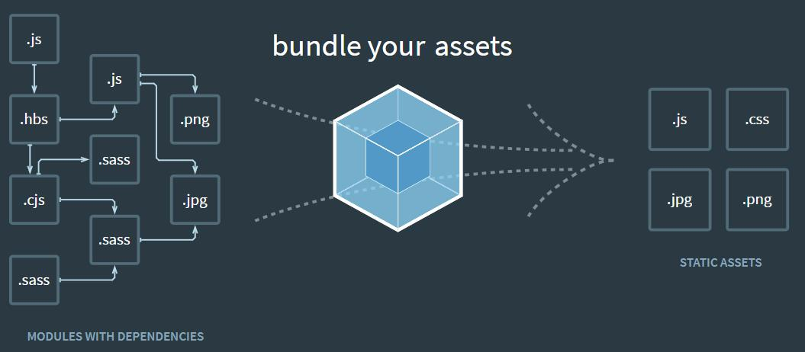

<a id="toc-3"></a>

## 1.2 webpack 五个核心概念

<a id="toc-4"></a>

### 1.2.1 Entry

入口(Entry)指示webpack 以哪个文件为入口起点开始打包，分析构建内部依赖图。  

<!-- PDF 第 2 页 -->

<a id="toc-5"></a>

### 1.2.2 Output

输出(Output)指示webpack 打包后的资源bundles 输出到哪里去，以及如何命名。  
<a id="toc-6"></a>

### 1.2.3 Loader

Loader 让webpack 能够去处理那些非JavaScript 文件(webpack 自身只理解  
JavaScript)  
<a id="toc-7"></a>

### 1.2.4 Plugins

插件(Plugins)可以用于执行范围更广的任务。插件的范围包括，从打包优化和压缩，  
一直到重新定义环境中的变量等。  
<a id="toc-8"></a>

### 1.2.5 Mode

模式(Mode)指示webpack 使用相应模式的配置。  
| 选项 | 描述 | 特点 |
| --- | --- | --- |
| development | 会将 DefinePlugin 中 process.env.NODE_ENV 的值设置<br>为 development。启用 NamedChunksPlugin 和<br>NamedModulesPlugin。 | 能让代码本地调试<br>运行的环境 |
| production | 会将 DefinePlugin 中 process.env.NODE_ENV 的值设置<br>为 production。启用 FlagDependencyUsagePlugin,<br>FlagIncludedChunksPlugin,ModuleConcatenationPlugin,<br>NoEmitOnErrorsPlugin,OccurrenceOrderPlugin,<br>SideEffectsFlagPlugin 和 TerserPlugin。 | 能让代码优化上线<br>运行的环境 |

<a id="chapter-2"></a>

# 第2 章：webpack 的初体验

<a id="toc-10"></a>

## 2.1 初始化配置

1. 初始化package.json
输入指令:  
npm init  

<!-- PDF 第 3 页 -->

2. 下载并安装webpack
输入指令:  
npm install webpack webpack-cli -g  
npm install webpack webpack-cli -D  
<a id="toc-11"></a>

## 2.2 编译打包应用

1. 创建文件
2. 运行指令
开发环境指令：webpack src/js/index.js -o build/js/built.js --mode=development  
功能：webpack 能够编译打包js 和json 文件，并且能将es6 的模块化语法转换成  
浏览器能识别的语法。  
生产环境指令：webpack src/js/index.js -o build/js/built.js --mode=production  
功能：在开发配置功能上多一个功能，压缩代码。  
3. 结论
webpack 能够编译打包js 和json 文件。  
能将es6 的模块化语法转换成浏览器能识别的语法。  
能压缩代码。  
4. 问题
不能编译打包css、img 等文件。  
不能将js 的es6 基本语法转化为es5 以下语法。  
<a id="chapter-3"></a>

# 第3 章：webpack 开发环境的基本配置

<a id="toc-13"></a>

## 3.1 创建配置文件

1. 创建文件webpack.config.js
2. 配置内容如下
```javascript
const { resolve } = require('path'); // node 内置核心模块，用来处理路径问题。
```


<!-- PDF 第 4 页 -->

```javascript
module.exports = {
  entry: './src/js/index.js',  // 入口文件
  output: {  // 输出配置
    filename: './built.js',  // 输出文件名
    path: resolve(__dirname, 'build/js')  // 输出文件路径配置
  },
  mode: 'development'  //开发环境
};
```

3. 运行指令: webpack
4. 结论: 此时功能与上节一致
<a id="toc-14"></a>

## 3.2 打包样式资源

1. 创建文件
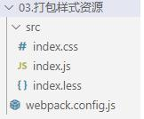

2. 下载安装loader 包
npm i css-loader style-loader less-loader less -D  
3. 修改配置文件
```javascript
// resolve 用来拼接绝对路径的方法
const { resolve } = require('path');

module.exports = {
  // webpack 配置
  // 入口起点
  entry: './src/index.js',
  // 输出
  output: {
    // 输出文件名
    filename: 'built.js',
    // 输出路径
    // __dirname nodejs 的变量，代表当前文件的目录绝对路径
    path: resolve(__dirname, 'build')
```


<!-- PDF 第 5 页 -->

```javascript
  },
  // loader 的配置
  module: {
    rules: [
      // 详细loader 配置
      // 不同文件必须配置不同loader 处理
      {
        // 匹配哪些文件
        test: /\.css$/,
        // 使用哪些loader 进行处理
        use: [
          // use 数组中loader 执行顺序：从右到左，从下到上依次执行
          // 创建style 标签，将js 中的样式资源插入进行，添加到head 中生效
          'style-loader',
          // 将css 文件变成commonjs 模块加载js 中，里面内容是样式字符串
          'css-loader'
        ]
      },
      {
        test: /\.less$/,
        use: [
          'style-loader',
          'css-loader',
          // 将less 文件编译成css 文件
          // 需要下载less-loader 和less
          'less-loader'
        ]
      }
    ]
  },
  // plugins 的配置
  plugins: [
    // 详细plugins 的配置
  ],
  // 模式
  mode: 'development', // 开发模式
  // mode: 'production'
}
```

4. 运行指令: webpack

<!-- PDF 第 6 页 -->

<a id="toc-15"></a>

## 3.3 打包HTML 资源

1. 创建文件
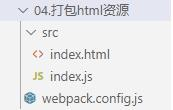

2. 下载安装plugin 包
npm install --save-dev html-webpack-plugin  
3. 修改配置文件
```javascript
const { resolve } = require('path');
const HtmlWebpackPlugin = require('html-webpack-plugin');

module.exports = {
  entry: './src/index.js',
  output: {
    filename: 'built.js',
    path: resolve(__dirname, 'build')
  },
  module: {
    rules: [
      // loader 的配置
    ]
  },
  plugins: [
    // plugins 的配置
    // html-webpack-plugin
    // 功能：默认会创建一个空的HTML，自动引入打包输出的所有资源（JS/CSS）
    // 需求：需要有结构的HTML 文件
    new HtmlWebpackPlugin({
      // 复制'./src/index.html' 文件，并自动引入打包输出的所有资源（JS/CSS）
      template: './src/index.html'
    })
  ],
  mode: 'development'
};
```

4.运行指令: webpack  

<!-- PDF 第 7 页 -->

<a id="toc-16"></a>

## 3.4 打包图片资源

1. 创建文件
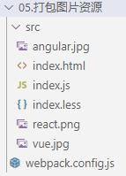

2. 下载安装loader 包
npm install --save-dev html-loader url-loader file-loader  
3. 修改配置文件
```javascript
const { resolve } = require('path');
const HtmlWebpackPlugin = require('html-webpack-plugin');

module.exports = {
  entry: './src/index.js',
  output: {
    filename: 'built.js',
    path: resolve(__dirname, 'build')
  },
  module: {
    rules: [
      {
        test: /\.less$/,
        // 要使用多个loader 处理用use
        use: ['style-loader', 'css-loader', 'less-loader']
      },
      {
        // 问题：默认处理不了html 中img 图片
        // 处理图片资源
        test: /\.(jpg|png|gif)$/,
        // 使用一个loader
        // 下载url-loader file-loader
        loader: 'url-loader',
        options: {
```


<!-- PDF 第 8 页 -->

```javascript
          // 图片大小小于8kb，就会被base64 处理
          // 优点: 减少请求数量（减轻服务器压力）
          // 缺点：图片体积会更大（文件请求速度更慢）
          limit: 8 * 1024,
          // 问题：因为url-loader 默认使用es6 模块化解析，而html-loader 引入图片是commonjs
          // 解析时会出问题：[object Module]
          // 解决：关闭url-loader 的es6 模块化，使用commonjs 解析
          esModule: false,
          // 给图片进行重命名
          // [hash:10]取图片的hash 的前10 位
          // [ext]取文件原来扩展名
          name: '[hash:10].[ext]'
        }
      },
      {
        test: /\.html$/,
        // 处理html 文件的img 图片（负责引入img，从而能被url-loader 进行处理）
        loader: 'html-loader'
      }
    ]
  },
  plugins: [
    new HtmlWebpackPlugin({
      template: './src/index.html'
    })
  ],
  mode: 'development'
};
```

4. 运行指令: webpack
<a id="toc-17"></a>

## 3.5 打包其他资源

1. 创建文件

<!-- PDF 第 9 页 -->

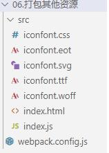

2. 修改配置文件
```javascript
const { resolve } = require('path');
const HtmlWebpackPlugin = require('html-webpack-plugin');

module.exports = {
  entry: './src/index.js',
  output: {
    filename: 'built.js',
    path: resolve(__dirname, 'build')
  },
  module: {
    rules: [
      {
        test: /\.css$/,
        use: ['style-loader', 'css-loader']
      },
      // 打包其他资源(除了html/js/css 资源以外的资源)
      {
        // 排除css/js/html 资源
        exclude: /\.(css|js|html|less)$/,
        loader: 'file-loader',
        options: {
          name: '[hash:10].[ext]'
        }
      }
    ]
  },
  plugins: [
    new HtmlWebpackPlugin({
      template: './src/index.html'
    })
```


<!-- PDF 第 10 页 -->

```javascript
  ],
  mode: 'development'
};
```

4. 运行指令: webpack
<a id="toc-18"></a>

## 3.6 devserver

1. 创建文件
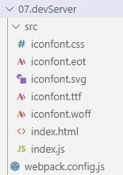

2. 修改配置文件
```javascript
const { resolve } = require('path');
const HtmlWebpackPlugin = require('html-webpack-plugin');

module.exports = {
  entry: './src/index.js',
  output: {
    filename: 'built.js',
    path: resolve(__dirname, 'build')
  },
  module: {
    rules: [
      {
        test: /\.css$/,
        use: ['style-loader', 'css-loader']
      },
      // 打包其他资源(除了html/js/css 资源以外的资源)
      {
        // 排除css/js/html 资源
        exclude: /\.(css|js|html|less)$/,
```


<!-- PDF 第 11 页 -->

```javascript
        loader: 'file-loader',
        options: {
          name: '[hash:10].[ext]'
        }
      }
    ]
  },
  plugins: [
    new HtmlWebpackPlugin({
      template: './src/index.html'
    })
  ],
  mode: 'development',
    devServer: {
    // 项目构建后路径
    contentBase: resolve(__dirname, 'build'),
    // 启动gzip 压缩
    compress: true,
    // 端口号
    port: 3000,
    // 自动打开浏览器
    open: true
  }
};
```

4. 运行指令: npx webpack-dev-server
<a id="toc-19"></a>

## 3.7 开发环境配置

1.创建文件  
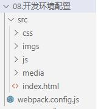

2. 修改配置文件
```javascript
const { resolve } = require('path');
const HtmlWebpackPlugin = require('html-webpack-plugin');
```


<!-- PDF 第 12 页 -->

```javascript
module.exports = {
  entry: './src/js/index.js',
  output: {
    filename: 'js/built.js',
    path: resolve(__dirname, 'build')
  },
  module: {
    rules: [
      // loader 的配置
      {
        // 处理less 资源
        test: /\.less$/,
        use: ['style-loader', 'css-loader', 'less-loader']
      },
      {
        // 处理css 资源
        test: /\.css$/,
        use: ['style-loader', 'css-loader']
      },
      {
        // 处理图片资源
        test: /\.(jpg|png|gif)$/,
        loader: 'url-loader',
        options: {
          limit: 8 * 1024,
          name: '[hash:10].[ext]',
          // 关闭es6 模块化
          esModule: false,
          outputPath: 'imgs'
        }
      },
      {
        // 处理html 中img 资源
        test: /\.html$/,
        loader: 'html-loader'
      },
      {
        // 处理其他资源
        exclude: /\.(html|js|css|less|jpg|png|gif)/,
        loader: 'file-loader',
        options: {
```


<!-- PDF 第 13 页 -->

```javascript
          name: '[hash:10].[ext]',
          outputPath: 'media'
        }
      }
    ]
  },
  plugins: [
    // plugins 的配置
    new HtmlWebpackPlugin({
      template: './src/index.html'
    })
  ],
  mode: 'development',
  devServer: {
    contentBase: resolve(__dirname, 'build'),
    compress: true,
    port: 3000,
    open: true
  }
};
```

3. 运行指令: npx webpack-dev-server
<a id="chapter-4"></a>

# 第4 章：webpack 生产环境的基本配置

<a id="toc-21"></a>

## 4.1 提取css 成单独文件

1. 下载安装包
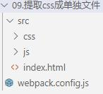

2.下载插件  
npm install --save-dev mini-css-extract-plugin  
3. 修改配置文件

<!-- PDF 第 14 页 -->

```javascript
const { resolve } = require('path');
const HtmlWebpackPlugin = require('html-webpack-plugin');
const MiniCssExtractPlugin = require('mini-css-extract-plugin');

module.exports = {
  entry: './src/js/index.js',
  output: {
    filename: 'js/built.js',
    path: resolve(__dirname, 'build')
  },
  module: {
    rules: [
      {
        test: /\.css$/,
        use: [
          // 创建style 标签，将样式放入
          // 'style-loader',
          // 这个loader 取代style-loader。作用：提取js 中的css 成单独文件
          MiniCssExtractPlugin.loader,
          // 将css 文件整合到js 文件中
          'css-loader'
        ]
      }
    ]
  },
  plugins: [
    new HtmlWebpackPlugin({
      template: './src/index.html'
    }),
    new MiniCssExtractPlugin({
      // 对输出的css 文件进行重命名
      filename: 'css/built.css'
    })
  ],
  mode: 'development'
};
```

4 .运行指令: webpack  
<a id="toc-22"></a>

## 4.2 css 兼容性处理

1.创建文件  

<!-- PDF 第 15 页 -->

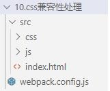

2.下载loader  
npm install --save-dev postcss-loader postcss-preset-env  
3.修改配置文件  
```javascript
const { resolve } = require('path');
const HtmlWebpackPlugin = require('html-webpack-plugin');
const MiniCssExtractPlugin = require('mini-css-extract-plugin');

// 设置nodejs 环境变量
// process.env.NODE_ENV = 'development';

module.exports = {
  entry: './src/js/index.js',
  output: {
    filename: 'js/built.js',
    path: resolve(__dirname, 'build')
  },
  module: {
    rules: [
      {
        test: /\.css$/,
        use: [
          MiniCssExtractPlugin.loader,
          'css-loader',
          {
            loader: 'postcss-loader',
            options: {
              ident: 'postcss',
              plugins: () => [
                // postcss 的插件
                require('postcss-preset-env')()
              ]
            }
          }
        ]
```


<!-- PDF 第 16 页 -->

```javascript
      }
    ]
  },
  plugins: [
    new HtmlWebpackPlugin({
      template: './src/index.html'
    }),
    new MiniCssExtractPlugin({
      filename: 'css/built.css'
    })
  ],
  mode: 'development'
};
```

4. 修改package.json
```json
"browserslist": {
    "development": [
      "last 1 chrome version",
      "last 1 firefox version",
      "last 1 safari version"
    ],
    "production": [
      ">0.2%",
      "not dead",
      "not op_mini all"
    ]
}
```

5. 运行指令: webpack
<a id="toc-23"></a>

## 4.3 压缩css

1.创建文件  

<!-- PDF 第 17 页 -->

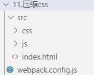

2. 下载安装包
npm install --save-dev optimize-css-assets-webpack-plugin  
3. 修改配置文件
```javascript
const { resolve } = require('path');
const HtmlWebpackPlugin = require('html-webpack-plugin');
const MiniCssExtractPlugin = require('mini-css-extract-plugin');
const OptimizeCssAssetsWebpackPlugin = require('optimize-css-assets-webpack-plugin'
)

// 设置nodejs 环境变量
// process.env.NODE_ENV = 'development';

module.exports = {
  entry: './src/js/index.js',
  output: {
    filename: 'js/built.js',
    path: resolve(__dirname, 'build')
  },
  module: {
    rules: [
      {
        test: /\.css$/,
        use: [
          MiniCssExtractPlugin.loader,
          'css-loader',
          {
            loader: 'postcss-loader',
            options: {
              ident: 'postcss',
              plugins: () => [
                // postcss 的插件
                require('postcss-preset-env')()
              ]
            }
```


<!-- PDF 第 18 页 -->

```javascript
          }
        ]
      }
    ]
  },
  plugins: [
    new HtmlWebpackPlugin({
      template: './src/index.html'
    }),
    new MiniCssExtractPlugin({
      filename: 'css/built.css'
    }),
    // 压缩css
    new OptimizeCssAssetsWebpackPlugin()
  ],
  mode: 'development'
};
```

2. 运行指令: webpack
<a id="toc-24"></a>

## 4.4 js 语法检查

1.创建文件  
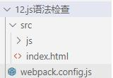

2. 下载安装包
npm install --save-dev eslint-loader eslint eslint-config-airbnb-base eslint-plugin-import  
3. 修改配置文件
```javascript
const { resolve } = require('path');
const HtmlWebpackPlugin = require('html-webpack-plugin');
const MiniCssExtractPlugin = require('mini-css-extract-plugin');
const OptimizeCssAssetsWebpackPlugin = require('optimize-css-assets-webpack-plugin'
)
```


<!-- PDF 第 19 页 -->

```json
// 设置nodejs 环境变量
// process.env.NODE_ENV = 'development';

module.exports = {
  entry: './src/js/index.js',
  output: {
    filename: 'js/built.js',
    path: resolve(__dirname, 'build')
  },
  module: {
    rules: [
      /*
        语法检查：eslint-loader  eslint
          注意：只检查自己写的源代码，第三方的库是不用检查的
          设置检查规则：
            package.json 中eslintConfig 中设置~
              "eslintConfig": {
                "extends": "airbnb-base"
              }
            airbnb --> eslint-config-airbnb-base  eslint-plugin-import eslint
      */
      {
        test: /\.js$/,
        exclude: /node_modules/,
        loader: 'eslint-loader',
        options: {
          // 自动修复eslint 的错误
          fix: true
        }
      }
    ]
  },
  plugins: [
    new HtmlWebpackPlugin({
      template: './src/index.html'
    }),
    new MiniCssExtractPlugin({
      filename: 'css/built.css'
    }),
```


<!-- PDF 第 20 页 -->

```javascript
    // 压缩css
    new OptimizeCssAssetsWebpackPlugin()
  ],
  mode: 'development'
};
```

4. 配置package.json
```json
"eslintConfig": {
    "extends": "airbnb-base",
    "env": {
      "browser": true
    }
}
```

5. 运行指令: webpack
<a id="toc-25"></a>

## 4.5 js 兼容性处理

1.创建文件  
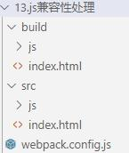

2. 下载安装包
npm install --save-dev babel-loader @babel/core @babel/preset-env @babel/polyfill core-js  
3. 修改配置文件
```javascript
const { resolve } = require('path');
const HtmlWebpackPlugin = require('html-webpack-plugin');

module.exports = {
  entry: './src/js/index.js',
  output: {
    filename: 'js/built.js',
```


<!-- PDF 第 21 页 -->

```javascript
  path: resolve(__dirname, 'build')
},
module: {
  rules: [
    
    {
      test: /\.js$/,
      exclude: /node_modules/,
      loader: 'babel-loader',
      options: {
        // 预设：指示babel 做怎么样的兼容性处理
        presets: [
          [
            '@babel/preset-env',
            {
              // 按需加载
              useBuiltIns: 'usage',
              // 指定core-js 版本
              corejs: {
                version: 3
              },
              // 指定兼容性做到哪个版本浏览器
              targets: {
                chrome: '60',
                firefox: '60',
                ie: '9',
                safari: '10',
                edge: '17'
              }
            }
          ]
        ]
      }
    }
  ]
},
plugins: [
  new HtmlWebpackPlugin({
    template: './src/index.html'
  })
],
mode: 'development'
```


<!-- PDF 第 22 页 -->

```javascript
};
```

4. 运行指令: webpack
<a id="toc-26"></a>

## 4.6 js 压缩

1.创建文件  


2. 修改配置文件
```javascript
const { resolve } = require('path');
const HtmlWebpackPlugin = require('html-webpack-plugin');

module.exports = {
  entry: './src/js/index.js',
  output: {
    filename: 'js/built.js',
    path: resolve(__dirname, 'build')
  },
  plugins: [
    new HtmlWebpackPlugin({
      template: './src/index.html'
    })
  ],
  // 生产环境下会自动压缩js 代码
  mode: 'production'
};
```

3. 运行指令: webpack
<a id="toc-27"></a>

## 4.7 HTML 压缩

1.创建文件  

<!-- PDF 第 23 页 -->

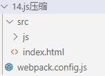

2. 修改配置文件
```javascript
const { resolve } = require('path');
const HtmlWebpackPlugin = require('html-webpack-plugin');

module.exports = {
  entry: './src/js/index.js',
  output: {
    filename: 'js/built.js',
    path: resolve(__dirname, 'build')
  },
  plugins: [
    new HtmlWebpackPlugin({
      template: './src/index.html',
      // 压缩html 代码
      minify: {
        // 移除空格
        collapseWhitespace: true,
        // 移除注释
        removeComments: true
      }
    })
  ],
  mode: 'production'
};
```

2. 运行指令:webpack
<a id="toc-28"></a>

## 4.8 生产环境配置

1.创建文件  


2. 修改配置文件

<!-- PDF 第 24 页 -->

```javascript
const { resolve } = require('path');
const MiniCssExtractPlugin = require('mini-css-extract-plugin');
const OptimizeCssAssetsWebpackPlugin = require('optimize-css-assets-webpack-plugin'
);
const HtmlWebpackPlugin = require('html-webpack-plugin');

// 定义nodejs 环境变量：决定使用browserslist 的哪个环境
process.env.NODE_ENV = 'production';

// 复用loader
const commonCssLoader = [
  MiniCssExtractPlugin.loader,
  'css-loader',
  {
    // 还需要在package.json 中定义browserslist
    loader: 'postcss-loader',
    options: {
      ident: 'postcss',
      plugins: () => [require('postcss-preset-env')()]
    }
  }
];

module.exports = {
  entry: './src/js/index.js',
  output: {
    filename: 'js/built.js',
    path: resolve(__dirname, 'build')
  },
  module: {
    rules: [
      {
        test: /\.css$/,
        use: [...commonCssLoader]
      },
      {
        test: /\.less$/,
        use: [...commonCssLoader, 'less-loader']
      },
      /*
        正常来讲，一个文件只能被一个loader 处理。
        当一个文件要被多个loader 处理，那么一定要指定loader 执行的先后顺序：
```


<!-- PDF 第 25 页 -->

```javascript
    先执行eslint 在执行babel
*/
{
  // 在package.json 中eslintConfig --> airbnb
  test: /\.js$/,
  exclude: /node_modules/,
  // 优先执行
  enforce: 'pre',
  loader: 'eslint-loader',
  options: {
    fix: true
  }
},
{
  test: /\.js$/,
  exclude: /node_modules/,
  loader: 'babel-loader',
  options: {
    presets: [
      [
        '@babel/preset-env',
        {
          useBuiltIns: 'usage',
          corejs: {version: 3},
          targets: {
            chrome: '60',
            firefox: '50'
          }
        }
      ]
    ]
  }
},
{
  test: /\.(jpg|png|gif)/,
  loader: 'url-loader',
  options: {
    limit: 8 * 1024,
    name: '[hash:10].[ext]',
    outputPath: 'imgs',
    esModule: false
  }
```


<!-- PDF 第 26 页 -->

```javascript
      },
      {
        test: /\.html$/,
        loader: 'html-loader'
      },
      {
        exclude: /\.(js|css|less|html|jpg|png|gif)/,
        loader: 'file-loader',
        options: {
          outputPath: 'media'
        }
      }
    ]
  },
  plugins: [
    new MiniCssExtractPlugin({
      filename: 'css/built.css'
    
    }),
    new OptimizeCssAssetsWebpackPlugin(),
    new HtmlWebpackPlugin({
      template: './src/index.html',
      minify: {
        collapseWhitespace: true,
        removeComments: true
      }
    })
  ],
  mode: 'production'
};
```

3. 运行指令: webpack
<a id="chapter-5"></a>

# 第5 章：webpack 优化配置

<a id="toc-30"></a>

## 5.1 HMR

1.创建文件  

<!-- PDF 第 27 页 -->

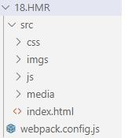

2. 修改配置文件
```javascript
const { resolve } = require('path');
const HtmlWebpackPlugin = require('html-webpack-plugin');

module.exports = {
  entry: ['./src/js/index.js', './src/index.html'],
  output: {
    filename: 'js/built.js',
    path: resolve(__dirname, 'build')
  },
  module: {
    rules: [
      // loader 的配置
      {
        // 处理less 资源
        test: /\.less$/,
        use: ['style-loader', 'css-loader', 'less-loader']
      },
      {
        // 处理css 资源
        test: /\.css$/,
        use: ['style-loader', 'css-loader']
      },
      {
        // 处理图片资源
        test: /\.(jpg|png|gif)$/,
        loader: 'url-loader',
        options: {
          limit: 8 * 1024,
          name: '[hash:10].[ext]',
          // 关闭es6 模块化
          esModule: false,
          outputPath: 'imgs'
```


<!-- PDF 第 28 页 -->

```javascript
        }
      },
      {
        // 处理html 中img 资源
        test: /\.html$/,
        loader: 'html-loader'
      },
      {
        // 处理其他资源
        exclude: /\.(html|js|css|less|jpg|png|gif)/,
        loader: 'file-loader',
        options: {
          name: '[hash:10].[ext]',
          outputPath: 'media'
        }
      }
    ]
  },
  plugins: [
    // plugins 的配置
    new HtmlWebpackPlugin({
      template: './src/index.html'
    })
  ],
  mode: 'development',
  devServer: {
    contentBase: resolve(__dirname, 'build'),
    compress: true,
    port: 3000,
    open: true,
    // 开启HMR 功能
    // 当修改了webpack 配置，新配置要想生效，必须重新webpack 服务
    hot: true
  }
};
```

3. 运行指令: webpack
<a id="toc-31"></a>

## 5.2 source-map

1.创建文件  

<!-- PDF 第 29 页 -->

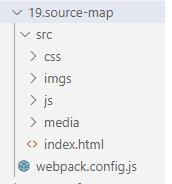

2. 修改配置文件
```javascript
const { resolve } = require('path');
const HtmlWebpackPlugin = require('html-webpack-plugin');

module.exports = {
  entry: ['./src/js/index.js', './src/index.html'],
  output: {
    filename: 'js/built.js',
    path: resolve(__dirname, 'build')
  },
  module: {
    rules: [
      // loader 的配置
      {
        // 处理less 资源
        test: /\.less$/,
        use: ['style-loader', 'css-loader', 'less-loader']
      },
      {
        // 处理css 资源
        test: /\.css$/,
        use: ['style-loader', 'css-loader']
      },
      {
        // 处理图片资源
        test: /\.(jpg|png|gif)$/,
        loader: 'url-loader',
        options: {
          limit: 8 * 1024,
          name: '[hash:10].[ext]',
          // 关闭es6 模块化
          esModule: false,
          outputPath: 'imgs'
```


<!-- PDF 第 30 页 -->

```javascript
        }
      },
      {
        // 处理html 中img 资源
        test: /\.html$/,
        loader: 'html-loader'
      },
      {
        // 处理其他资源
        exclude: /\.(html|js|css|less|jpg|png|gif)/,
        loader: 'file-loader',
        options: {
          name: '[hash:10].[ext]',
          outputPath: 'media'
        }
      }
    ]
  },
  plugins: [
    // plugins 的配置
    new HtmlWebpackPlugin({
      template: './src/index.html'
    })
  ],
  mode: 'development',
  devServer: {
    contentBase: resolve(__dirname, 'build'),
    compress: true,
    port: 3000,
    open: true,
    hot: true
  },
  devtool: 'eval-source-map'
};
```

3. 运行指令: webpack
<a id="toc-32"></a>

## 5.3 oneOf

1.创建文件  

<!-- PDF 第 31 页 -->

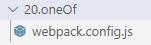

2. 修改配置文件
```javascript
const { resolve } = require('path');
const MiniCssExtractPlugin = require('mini-css-extract-plugin');
const OptimizeCssAssetsWebpackPlugin = require('optimize-css-assets-webpack-plugin'
);
const HtmlWebpackPlugin = require('html-webpack-plugin');

// 定义nodejs 环境变量：决定使用browserslist 的哪个环境
process.env.NODE_ENV = 'production';

// 复用loader
const commonCssLoader = [
  MiniCssExtractPlugin.loader,
  'css-loader',
  {
    // 还需要在package.json 中定义browserslist
    loader: 'postcss-loader',
    options: {
      ident: 'postcss',
      plugins: () => [require('postcss-preset-env')()]
    }
  }
];

module.exports = {
  entry: './src/js/index.js',
  output: {
    filename: 'js/built.js',
    path: resolve(__dirname, 'build')
  },
  module: {
    rules: [
      {
        // 在package.json 中eslintConfig --> airbnb
        test: /\.js$/,
        exclude: /node_modules/,
        // 优先执行
        enforce: 'pre',
        loader: 'eslint-loader',
```


<!-- PDF 第 32 页 -->

```javascript
  options: {
    fix: true
  }
},
{
  // 以下loader 只会匹配一个
  // 注意：不能有两个配置处理同一种类型文件
  oneOf: [
    {
      test: /\.css$/,
      use: [...commonCssLoader]
    },
    {
      test: /\.less$/,
      use: [...commonCssLoader, 'less-loader']
    },
    /*
      正常来讲，一个文件只能被一个loader 处理。
      当一个文件要被多个loader 处理，那么一定要指定loader 执行的先后顺序：
        先执行eslint 在执行babel
    */
    {
      test: /\.js$/,
      exclude: /node_modules/,
      loader: 'babel-loader',
      options: {
        presets: [
          [
            '@babel/preset-env',
            {
              useBuiltIns: 'usage',
              corejs: {version: 3},
              targets: {
                chrome: '60',
                firefox: '50'
              }
            }
          ]
        ]
      }
    },
    {
```


<!-- PDF 第 33 页 -->

```javascript
            test: /\.(jpg|png|gif)/,
            loader: 'url-loader',
            options: {
              limit: 8 * 1024,
              name: '[hash:10].[ext]',
              outputPath: 'imgs',
              esModule: false
            }
          },
          {
            test: /\.html$/,
            loader: 'html-loader'
          },
          {
            exclude: /\.(js|css|less|html|jpg|png|gif)/,
            loader: 'file-loader',
            options: {
              outputPath: 'media'
            }
          }
        ]
      }
    ]
  },
  plugins: [
    new MiniCssExtractPlugin({
      filename: 'css/built.css'
    }),
    new OptimizeCssAssetsWebpackPlugin(),
    new HtmlWebpackPlugin({
      template: './src/index.html',
      minify: {
        collapseWhitespace: true,
        removeComments: true
      }
    })
  ],
  mode: 'production'
};
```

3. 运行指令:webpack

<!-- PDF 第 34 页 -->

<a id="toc-33"></a>

## 5.4 缓存

1 创建文件  
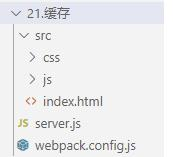

.  
2. 修改配置文件
```javascript
const { resolve } = require('path');
const MiniCssExtractPlugin = require('mini-css-extract-plugin');
const OptimizeCssAssetsWebpackPlugin = require('optimize-css-assets-webpack-plugin'
);
const HtmlWebpackPlugin = require('html-webpack-plugin');

// 定义nodejs 环境变量：决定使用browserslist 的哪个环境
process.env.NODE_ENV = 'production';

// 复用loader
const commonCssLoader = [
  MiniCssExtractPlugin.loader,
  'css-loader',
  {
    // 还需要在package.json 中定义browserslist
    loader: 'postcss-loader',
    options: {
      ident: 'postcss',
      plugins: () => [require('postcss-preset-env')()]
    }
  }
];

module.exports = {
  entry: './src/js/index.js',
  output: {
    filename: 'js/built.[contenthash:10].js',
    path: resolve(__dirname, 'build')
```


<!-- PDF 第 35 页 -->

```javascript
},
module: {
  rules: [
    {
      // 在package.json 中eslintConfig --> airbnb
      test: /\.js$/,
      exclude: /node_modules/,
      // 优先执行
      enforce: 'pre',
      loader: 'eslint-loader',
      options: {
        fix: true
      }
    },
    {
      // 以下loader 只会匹配一个
      // 注意：不能有两个配置处理同一种类型文件
      oneOf: [
        {
          test: /\.css$/,
          use: [...commonCssLoader]
        },
        {
          test: /\.less$/,
          use: [...commonCssLoader, 'less-loader']
        },
        /*
          正常来讲，一个文件只能被一个loader 处理。
          当一个文件要被多个loader 处理，那么一定要指定loader 执行的先后顺序：
            先执行eslint 在执行babel
        */
        {
          test: /\.js$/,
          exclude: /node_modules/,
          loader: 'babel-loader',
          options: {
            presets: [
              [
                '@babel/preset-env',
                {
                useBuiltIns: 'usage',
                corejs: { version: 3 },
```


<!-- PDF 第 36 页 -->

```javascript
                targets: {
                chrome: '60',
                firefox: '50'
                }
                }
              ]
            ],
            // 开启babel 缓存
            // 第二次构建时，会读取之前的缓存
            cacheDirectory: true
          }
        },
        {
          test: /\.(jpg|png|gif)/,
          loader: 'url-loader',
          options: {
            limit: 8 * 1024,
            name: '[hash:10].[ext]',
            outputPath: 'imgs',
            esModule: false
          }
        },
        {
          test: /\.html$/,
          loader: 'html-loader'
        },
        {
          exclude: /\.(js|css|less|html|jpg|png|gif)/,
          loader: 'file-loader',
          options: {
            outputPath: 'media'
          }
        }
      ]
    }
  ]
},
plugins: [
  new MiniCssExtractPlugin({
    filename: 'css/built.[contenthash:10].css'
  }),
  new OptimizeCssAssetsWebpackPlugin(),
```


<!-- PDF 第 37 页 -->

```javascript
    new HtmlWebpackPlugin({
      template: './src/index.html',
      minify: {
        collapseWhitespace: true,
        removeComments: true
      }
    })
  ],
  mode: 'production',
  devtool: 'source-map'
};
```

3. 运行指令: webpack
<a id="toc-34"></a>

## 5.5 tree shaking

1. 创建文件
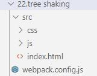

2. 修改配置文件
```javascript
const { resolve } = require('path');
const MiniCssExtractPlugin = require('mini-css-extract-plugin');
const OptimizeCssAssetsWebpackPlugin = require('optimize-css-assets-webpack-plugin'
);
const HtmlWebpackPlugin = require('html-webpack-plugin');

// 定义nodejs 环境变量：决定使用browserslist 的哪个环境
process.env.NODE_ENV = 'production';

// 复用loader
const commonCssLoader = [
  MiniCssExtractPlugin.loader,
  'css-loader',
  {
```


<!-- PDF 第 38 页 -->

```javascript
    // 还需要在package.json 中定义browserslist
    loader: 'postcss-loader',
    options: {
      ident: 'postcss',
      plugins: () => [require('postcss-preset-env')()]
    }
  }
];

module.exports = {
  entry: './src/js/index.js',
  output: {
    filename: 'js/built.[contenthash:10].js',
    path: resolve(__dirname, 'build')
  },
  module: {
    rules: [
      {
        // 在package.json 中eslintConfig --> airbnb
        test: /\.js$/,
        exclude: /node_modules/,
        // 优先执行
        enforce: 'pre',
        loader: 'eslint-loader',
        options: {
          fix: true
        }
      },
      {
        // 以下loader 只会匹配一个
        // 注意：不能有两个配置处理同一种类型文件
        oneOf: [
          {
            test: /\.css$/,
            use: [...commonCssLoader]
          },
          {
            test: /\.less$/,
            use: [...commonCssLoader, 'less-loader']
          },
          /*
            正常来讲，一个文件只能被一个loader 处理。
```


<!-- PDF 第 39 页 -->

```javascript
  当一个文件要被多个loader 处理，那么一定要指定loader 执行的先后顺序：
    先执行eslint 在执行babel
*/
{
  test: /\.js$/,
  exclude: /node_modules/,
  loader: 'babel-loader',
  options: {
    presets: [
      [
        '@babel/preset-env',
        {
          useBuiltIns: 'usage',
          corejs: { version: 3 },
          targets: {
            chrome: '60',
            firefox: '50'
          }
        }
      ]
    ],
    // 开启babel 缓存
    // 第二次构建时，会读取之前的缓存
    cacheDirectory: true
  }
},
{
  test: /\.(jpg|png|gif)/,
  loader: 'url-loader',
  options: {
    limit: 8 * 1024,
    name: '[hash:10].[ext]',
    outputPath: 'imgs',
    esModule: false
  }
},
{
  test: /\.html$/,
  loader: 'html-loader'
},
{
  exclude: /\.(js|css|less|html|jpg|png|gif)/,
```


<!-- PDF 第 40 页 -->

```javascript
            loader: 'file-loader',
            options: {
              outputPath: 'media'
            }
          }
        ]
      }
    ]
  },
  plugins: [
    new MiniCssExtractPlugin({
      filename: 'css/built.[contenthash:10].css'
    }),
    new OptimizeCssAssetsWebpackPlugin(),
    new HtmlWebpackPlugin({
      template: './src/index.html',
      minify: {
        collapseWhitespace: true,
        removeComments: true
      }
    })
  ],
  mode: 'production',
  devtool: 'source-map'
};
```

3. 运行指令: webpack
<a id="toc-35"></a>

## 5.6 code split

1.创建文件  

<!-- PDF 第 41 页 -->

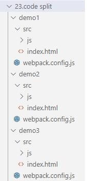

2.1 修改demo1 配置文件  
```javascript
const { resolve } = require('path');
const HtmlWebpackPlugin = require('html-webpack-plugin');

module.exports = {
  // 单入口
  // entry: './src/js/index.js',
  entry: {
    // 多入口：有一个入口，最终输出就有一个bundle
    index: './src/js/index.js',
    test: './src/js/test.js'
  },
  output: {
    // [name]：取文件名
    filename: 'js/[name].[contenthash:10].js',
    path: resolve(__dirname, 'build')
  },
  plugins: [
    new HtmlWebpackPlugin({
      template: './src/index.html',
      minify: {
        collapseWhitespace: true,
        removeComments: true
      }
    })
```


<!-- PDF 第 42 页 -->

```javascript
  ],
  mode: 'production'
};
```

2.2 修改demo2 配置文件  
```javascript
const { resolve } = require('path');
const HtmlWebpackPlugin = require('html-webpack-plugin');

module.exports = {
  // 单入口
  // entry: './src/js/index.js',
  entry: {
    index: './src/js/index.js',
    test: './src/js/test.js'
  },
  output: {
    // [name]：取文件名
    filename: 'js/[name].[contenthash:10].js',
    path: resolve(__dirname, 'build')
  },
  plugins: [
    new HtmlWebpackPlugin({
      template: './src/index.html',
      minify: {
        collapseWhitespace: true,
        removeComments: true
      }
    })
  ],
  /*
    1. 可以将node_modules 中代码单独打包一个chunk 最终输出
    2. 自动分析多入口chunk 中，有没有公共的文件。如果有会打包成单独一个chunk
  */
  optimization: {
    splitChunks: {
      chunks: 'all'
    }
  },
  mode: 'production'
```


<!-- PDF 第 43 页 -->

```javascript
};
```

2.3 修改demo3 配置文件  
```javascript
const { resolve } = require('path');
const HtmlWebpackPlugin = require('html-webpack-plugin');

module.exports = {
  // 单入口
  entry: './src/js/index.js',
  output: {
    // [name]：取文件名
    filename: 'js/[name].[contenthash:10].js',
    path: resolve(__dirname, 'build')
  },
  plugins: [
    new HtmlWebpackPlugin({
      template: './src/index.html',
      minify: {
        collapseWhitespace: true,
        removeComments: true
      }
    })
  ],
  /*
    1. 可以将node_modules 中代码单独打包一个chunk 最终输出
    2. 自动分析多入口chunk 中，有没有公共的文件。如果有会打包成单独一个chunk
  */
  optimization: {
    splitChunks: {
      chunks: 'all'
    }
  },
  mode: 'production'
};
```

3. 运行指令: webpack

<!-- PDF 第 44 页 -->

<a id="toc-36"></a>

## 5.7 lazy loading

1. 创建文件
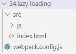

2. 修改配置文件
```javascript
const { resolve } = require('path');
const HtmlWebpackPlugin = require('html-webpack-plugin');

module.exports = {
  // 单入口
  entry: './src/js/index.js',
  output: {
    filename: 'js/[name].[contenthash:10].js',
    path: resolve(__dirname, 'build')
  },
  plugins: [
    new HtmlWebpackPlugin({
      template: './src/index.html',
      minify: {
        collapseWhitespace: true,
        removeComments: true
      }
    })
  ],
  optimization: {
    splitChunks: {
      chunks: 'all'
    }
  },
  mode: 'production'
};
```

3. 运行指令: webpack

<!-- PDF 第 45 页 -->

<a id="toc-37"></a>

## 5.8 pwa

1. 创建文件
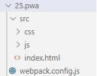

2. 下载安装包
npm install --save-dev workbox-webpack-plugin  
3. 修改配置文件
```javascript
const { resolve } = require('path');
const MiniCssExtractPlugin = require('mini-css-extract-plugin');
const OptimizeCssAssetsWebpackPlugin = require('optimize-css-assets-webpack-plugin'
);
const HtmlWebpackPlugin = require('html-webpack-plugin');
const WorkboxWebpackPlugin = require('workbox-webpack-plugin');

/*
  PWA: 渐进式网络开发应用程序(离线可访问)
    workbox --> workbox-webpack-plugin
*/

// 定义nodejs 环境变量：决定使用browserslist 的哪个环境
process.env.NODE_ENV = 'production';

// 复用loader
const commonCssLoader = [
  MiniCssExtractPlugin.loader,
  'css-loader',
  {
    // 还需要在package.json 中定义browserslist
    loader: 'postcss-loader',
    options: {
      ident: 'postcss',
      plugins: () => [require('postcss-preset-env')()]
```


<!-- PDF 第 46 页 -->

```javascript
    }
  }
];

module.exports = {
  entry: './src/js/index.js',
  output: {
    filename: 'js/built.[contenthash:10].js',
    path: resolve(__dirname, 'build')
  },
  module: {
    rules: [
      {
        // 在package.json 中eslintConfig --> airbnb
        test: /\.js$/,
        exclude: /node_modules/,
        // 优先执行
        enforce: 'pre',
        loader: 'eslint-loader',
        options: {
          fix: true
        }
      },
      {
        // 以下loader 只会匹配一个
        // 注意：不能有两个配置处理同一种类型文件
        oneOf: [
          {
            test: /\.css$/,
            use: [...commonCssLoader]
          },
          {
            test: /\.less$/,
            use: [...commonCssLoader, 'less-loader']
          },
          /*
            正常来讲，一个文件只能被一个loader 处理。
            当一个文件要被多个loader 处理，那么一定要指定loader 执行的先后顺序：
              先执行eslint 在执行babel
          */
          {
            test: /\.js$/,
```


<!-- PDF 第 47 页 -->

```javascript
  exclude: /node_modules/,
  loader: 'babel-loader',
  options: {
    presets: [
      [
        '@babel/preset-env',
        {
          useBuiltIns: 'usage',
          corejs: { version: 3 },
          targets: {
            chrome: '60',
            firefox: '50'
          }
        }
      ]
    ],
    // 开启babel 缓存
    // 第二次构建时，会读取之前的缓存
    cacheDirectory: true
  }
},
{
  test: /\.(jpg|png|gif)/,
  loader: 'url-loader',
  options: {
    limit: 8 * 1024,
    name: '[hash:10].[ext]',
    outputPath: 'imgs',
    esModule: false
  }
},
{
  test: /\.html$/,
  loader: 'html-loader'
},
{
  exclude: /\.(js|css|less|html|jpg|png|gif)/,
  loader: 'file-loader',
  options: {
    outputPath: 'media'
  }
}
```


<!-- PDF 第 48 页 -->

```javascript
        ]
      }
    ]
  },
  plugins: [
    new MiniCssExtractPlugin({
      filename: 'css/built.[contenthash:10].css'
    }),
    new OptimizeCssAssetsWebpackPlugin(),
    new HtmlWebpackPlugin({
      template: './src/index.html',
      minify: {
        collapseWhitespace: true,
        removeComments: true
      }
    }),
    new WorkboxWebpackPlugin.GenerateSW({
      /*
        1. 帮助serviceworker 快速启动
        2. 删除旧的serviceworker
        
        生成一个serviceworker 配置文件~
      */
      clientsClaim: true,
      skipWaiting: true
    })
  ],
  mode: 'production',
  devtool: 'source-map'
};
```

4. 运行指令:webpack
<a id="toc-38"></a>

## 5.9 多进程打包

1.创建文件  
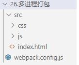


<!-- PDF 第 49 页 -->

2. 下载安装包
npm install --save-dev thread-loader  
3. 修改配置文件
```javascript
const { resolve } = require('path');
const MiniCssExtractPlugin = require('mini-css-extract-plugin');
const OptimizeCssAssetsWebpackPlugin = require('optimize-css-assets-webpack-plugin'
);
const HtmlWebpackPlugin = require('html-webpack-plugin');
const WorkboxWebpackPlugin = require('workbox-webpack-plugin');

/*
  PWA: 渐进式网络开发应用程序(离线可访问)
    workbox --> workbox-webpack-plugin
*/

// 定义nodejs 环境变量：决定使用browserslist 的哪个环境
process.env.NODE_ENV = 'production';

// 复用loader
const commonCssLoader = [
  MiniCssExtractPlugin.loader,
  'css-loader',
  {
    // 还需要在package.json 中定义browserslist
    loader: 'postcss-loader',
    options: {
      ident: 'postcss',
      plugins: () => [require('postcss-preset-env')()]
    }
  }
];

module.exports = {
  entry: './src/js/index.js',
  output: {
    filename: 'js/built.[contenthash:10].js',
    path: resolve(__dirname, 'build')
  },
  module: {
    rules: [
```


<!-- PDF 第 50 页 -->

```javascript
{
  // 在package.json 中eslintConfig --> airbnb
  test: /\.js$/,
  exclude: /node_modules/,
  // 优先执行
  enforce: 'pre',
  loader: 'eslint-loader',
  options: {
    fix: true
  }
},
{
  // 以下loader 只会匹配一个
  // 注意：不能有两个配置处理同一种类型文件
  oneOf: [
    {
      test: /\.css$/,
      use: [...commonCssLoader]
    },
    {
      test: /\.less$/,
      use: [...commonCssLoader, 'less-loader']
    },
    /*
      正常来讲，一个文件只能被一个loader 处理。
      当一个文件要被多个loader 处理，那么一定要指定loader 执行的先后顺序：
        先执行eslint 在执行babel
    */
    {
      test: /\.js$/,
      exclude: /node_modules/,
      use: [
        /*
          开启多进程打包。
          进程启动大概为600ms，进程通信也有开销。
          只有工作消耗时间比较长，才需要多进程打包
        */
        {
          loader: 'thread-loader',
          options: {
            workers: 2 // 进程2 个
          }
```


<!-- PDF 第 51 页 -->

```javascript
    },
    {
      loader: 'babel-loader',
      options: {
        presets: [
          [
            '@babel/preset-env',
            {
              useBuiltIns: 'usage',
              corejs: { version: 3 },
              targets: {
                chrome: '60',
                firefox: '50'
              }
            }
          ]
        ],
        // 开启babel 缓存
        // 第二次构建时，会读取之前的缓存
        cacheDirectory: true
      }
    }
  ]
},
{
  test: /\.(jpg|png|gif)/,
  loader: 'url-loader',
  options: {
    limit: 8 * 1024,
    name: '[hash:10].[ext]',
    outputPath: 'imgs',
    esModule: false
  }
},
{
  test: /\.html$/,
  loader: 'html-loader'
},
{
  exclude: /\.(js|css|less|html|jpg|png|gif)/,
  loader: 'file-loader',
  options: {
```


<!-- PDF 第 52 页 -->

```javascript
              outputPath: 'media'
            }
          }
        ]
      }
    ]
  },
  plugins: [
    new MiniCssExtractPlugin({
      filename: 'css/built.[contenthash:10].css'
    }),
    new OptimizeCssAssetsWebpackPlugin(),
    new HtmlWebpackPlugin({
      template: './src/index.html',
      minify: {
        collapseWhitespace: true,
        removeComments: true
      }
    }),
    new WorkboxWebpackPlugin.GenerateSW({
      /*
        1. 帮助serviceworker 快速启动
        2. 删除旧的serviceworker
        
        生成一个serviceworker 配置文件~
      */
      clientsClaim: true,
      skipWaiting: true
    })
  ],
  mode: 'production',
  devtool: 'source-map'
};
```

4. 运行指令:webpack
<a id="toc-39"></a>

## 5.10 externals

1.创建文件  

<!-- PDF 第 53 页 -->

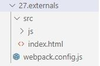

2. 修改配置文件
```javascript
const { resolve } = require('path');
const HtmlWebpackPlugin = require('html-webpack-plugin');

module.exports = {
  entry: './src/js/index.js',
  output: {
    filename: 'js/built.js',
    path: resolve(__dirname, 'build')
  },
  plugins: [
    new HtmlWebpackPlugin({
      template: './src/index.html'
    })
  ],
  mode: 'production',
  externals: {
    // 拒绝jQuery 被打包进来
    jquery: 'jQuery'
  }
};
```

3. 运行指令:webpack
<a id="toc-40"></a>

## 5.10 dll

1.创建文件  
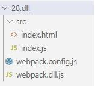


<!-- PDF 第 54 页 -->

2.修改配置文件  
```javascript
const { resolve } = require('path');
const HtmlWebpackPlugin = require('html-webpack-plugin');
const webpack = require('webpack');
const AddAssetHtmlWebpackPlugin = require('add-asset-html-webpack-plugin');

module.exports = {
  entry: './src/index.js',
  output: {
    filename: 'built.js',
    path: resolve(__dirname, 'build')
  },
  plugins: [
    new HtmlWebpackPlugin({
      template: './src/index.html'
    }),
    // 告诉webpack 哪些库不参与打包，同时使用时的名称也得变~
    new webpack.DllReferencePlugin({
      manifest: resolve(__dirname, 'dll/manifest.json')
    }),
    // 将某个文件打包输出去，并在html 中自动引入该资源
    new AddAssetHtmlWebpackPlugin({
      filepath: resolve(__dirname, 'dll/jquery.js')
    })
  ],
  mode: 'production'
};
```

3. 运行指令:webpack
<a id="chapter-6"></a>

# 第6 章：webpack 配置详情

<a id="toc-42"></a>

## 6.1 entry

1.创建文件  

<!-- PDF 第 55 页 -->

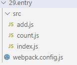

2.修改配置文件  
```javascript
const { resolve } = require('path');
const HtmlWebpackPlugin = require('html-webpack-plugin');

module.exports = {
  entry: {
    index: ['./src/index.js', './src/count.js'],
    add: './src/add.js'
  },
  output: {
    filename: '[name].js',
    path: resolve(__dirname, 'build')
  },
  plugins: [new HtmlWebpackPlugin()],
  mode: 'development'
};
```

3. 运行指令:webpack
<a id="toc-43"></a>

## 6.2 output

1.创建文件  
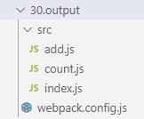

2.修改配置文件  

<!-- PDF 第 56 页 -->

```javascript
const { resolve } = require('path');
const HtmlWebpackPlugin = require('html-webpack-plugin');

module.exports = {
  entry: './src/index.js',
  output: {
    // 文件名称（指定名称+目录）
    filename: 'js/[name].js',
    // 输出文件目录（将来所有资源输出的公共目录）
    path: resolve(__dirname, 'build'),
    // 所有资源引入公共路径前缀--> 'imgs/a.jpg' --> '/imgs/a.jpg'
    publicPath: '/',
    chunkFilename: 'js/[name]_chunk.js', // 非入口chunk 的名称
    // library: '[name]', // 整个库向外暴露的变量名
    // libraryTarget: 'window' // 变量名添加到哪个上browser
    // libraryTarget: 'global' // 变量名添加到哪个上node
    // libraryTarget: 'commonjs'
  },
  plugins: [new HtmlWebpackPlugin()],
  mode: 'development'
};
```

3. 运行指令:webpack
<a id="toc-44"></a>

## 6.3 module

1.创建文件  
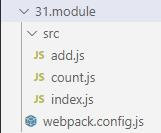

2.修改配置文件  
```javascript
const { resolve } = require('path');
const HtmlWebpackPlugin = require('html-webpack-plugin');
```


<!-- PDF 第 57 页 -->

```javascript
module.exports = {
  entry: './src/index.js',
  output: {
    filename: 'js/[name].js',
    path: resolve(__dirname, 'build')
  },
  module: {
    rules: [
      // loader 的配置
      {
        test: /\.css$/,
        // 多个loader 用use
        use: ['style-loader', 'css-loader']
      },
      {
        test: /\.js$/,
        // 排除node_modules 下的js 文件
        exclude: /node_modules/,
        // 只检查src 下的js 文件
        include: resolve(__dirname, 'src'),
        // 优先执行
        enforce: 'pre',
        // 延后执行
        // enforce: 'post',
        // 单个loader 用loader
        loader: 'eslint-loader',
        options: {}
      },
      {
        // 以下配置只会生效一个
        oneOf: []
      }
    ]
  },
  plugins: [new HtmlWebpackPlugin()],
  mode: 'development'
};
```

3. 运行指令:webpack

<!-- PDF 第 58 页 -->

<a id="toc-45"></a>

## 6.4 resolve

1.创建文件  
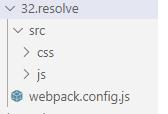

2.修改配置文件  
```javascript
const { resolve } = require('path');
const HtmlWebpackPlugin = require('html-webpack-plugin');

module.exports = {
  entry: './src/js/index.js',
  output: {
    filename: 'js/[name].js',
    path: resolve(__dirname, 'build')
  },
  module: {
    rules: [
      {
        test: /\.css$/,
        use: ['style-loader', 'css-loader']
      }
    ]
  },
  plugins: [new HtmlWebpackPlugin()],
  mode: 'development',
  // 解析模块的规则
  resolve: {
    // 配置解析模块路径别名: 优点简写路径缺点路径没有提示
    alias: {
      $css: resolve(__dirname, 'src/css')
    },
    // 配置省略文件路径的后缀名
    extensions: ['.js', '.json', '.jsx', '.css'],
    // 告诉webpack 解析模块是去找哪个目录
    modules: [resolve(__dirname, '../../node_modules'), 'node_modules']
  }
```


<!-- PDF 第 59 页 -->

```javascript
};
```

3. 运行指令:webpack
<a id="toc-46"></a>

## 6.5 dev server

1.创建文件  
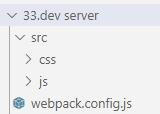

2.修改配置文件  
```javascript
const { resolve } = require('path');
const HtmlWebpackPlugin = require('html-webpack-plugin');

module.exports = {
  entry: './src/js/index.js',
  output: {
    filename: 'js/[name].js',
    path: resolve(__dirname, 'build')
  },
  module: {
    rules: [
      {
        test: /\.css$/,
        use: ['style-loader', 'css-loader']
      }
    ]
  },
  plugins: [new HtmlWebpackPlugin()],
  mode: 'development',
  resolve: {
    alias: {
      $css: resolve(__dirname, 'src/css')
    },
    extensions: ['.js', '.json', '.jsx', '.css'],
    modules: [resolve(__dirname, '../../node_modules'), 'node_modules']
  },
```


<!-- PDF 第 60 页 -->

```javascript
  devServer: {
    // 运行代码的目录
    contentBase: resolve(__dirname, 'build'),
    // 监视contentBase 目录下的所有文件，一旦文件变化就会reload
    watchContentBase: true,
    watchOptions: {
      // 忽略文件
      ignored: /node_modules/
    },
    // 启动gzip 压缩
    compress: true,
    // 端口号
    port: 5000,
    // 域名
    host: 'localhost',
    // 自动打开浏览器
    open: true,
    // 开启HMR 功能
    hot: true,
    // 不要显示启动服务器日志信息
    clientLogLevel: 'none',
    // 除了一些基本启动信息以外，其他内容都不要显示
    quiet: true,
    // 如果出错了，不要全屏提示~
    overlay: false,
    // 服务器代理--> 解决开发环境跨域问题
    proxy: {
      // 一旦devServer(5000)服务器接受到/api/xxx 的请求，就会把请求转发到另外一个服务器
(3000)
      '/api': {
        target: 'http://localhost:3000',
        // 发送请求时，请求路径重写：将/api/xxx --> /xxx （去掉/api）
        pathRewrite: {
          '^/api': ''
        }
      }
    }
  }
};
```

3. 运行指令:webpack

<!-- PDF 第 61 页 -->

<a id="toc-47"></a>

## 6.6 optimization

1.创建文件  
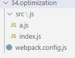

2.修改配置文件  
```javascript
const { resolve } = require('path');
const HtmlWebpackPlugin = require('html-webpack-plugin');
const TerserWebpackPlugin = require('terser-webpack-plugin')

module.exports = {
  entry: './src/js/index.js',
  output: {
    filename: 'js/[name].[contenthash:10].js',
    path: resolve(__dirname, 'build'),
    chunkFilename: 'js/[name].[contenthash:10]_chunk.js'
  },
  module: {
    rules: [
      {
        test: /\.css$/,
        use: ['style-loader', 'css-loader']
      }
    ]
  },
  plugins: [new HtmlWebpackPlugin()],
  mode: 'production',
  resolve: {
    alias: {
      $css: resolve(__dirname, 'src/css')
    },
    extensions: ['.js', '.json', '.jsx', '.css'],
    modules: [resolve(__dirname, '../../node_modules'), 'node_modules']
  },
```


<!-- PDF 第 62 页 -->

```javascript
  optimization: {
    splitChunks: {
      chunks: 'all'
      // 默认值，可以不写~
    },
    // 将当前模块的记录其他模块的hash 单独打包为一个文件runtime
    // 解决：修改a 文件导致b 文件的contenthash 变化
    runtimeChunk: {
      name: entrypoint => `runtime-${entrypoint.name}`
    },
    minimizer: [
      // 配置生产环境的压缩方案：js 和css
      new TerserWebpackPlugin({
        // 开启缓存
        cache: true,
        // 开启多进程打包
        parallel: true,
        // 启动source-map
        sourceMap: true
      })
    ]
  }
};
```

3. 运行指令:webpack
<a id="chapter-7"></a>

# 第7 章：webpack5 介绍和使用


webpack5介绍.  
MD
