# 流程控制语句

掌握单分支、双分支、多分支及嵌套分支的写法，以及 while、for 循环与 continue、break 的控制逻辑。

<!-- more -->


```text
age = int(input('请输入你的年龄：'))
```

程序并不是简单的“从上到下”执行，很多时候，我们希望程序能根据不同的情况，做出不同的
选择，比如：根据情况跳过某些代码，或者重复执行某些代码，那这时就需要用到『流程控制
语句』，程序的执行流程大体上可分为三类：顺序、分之、循环。
备注：其中顺序执行是最简单的，就是按照程序的编写顺序依次执行，所以我们不再探讨
顺序执行。

## 1. 分之

分支有很多其他的称呼，比如：条件控制语句、分支语句、选择语句。

分之是通过条件判断，来决定执行哪些代码。

### 1.1. 单分支

1 语法格式：

```python
if 判断条件:
 条件【成立】时执行的代码1
 条件【成立】时执行的代码2
 ......
```

2 语法图解：

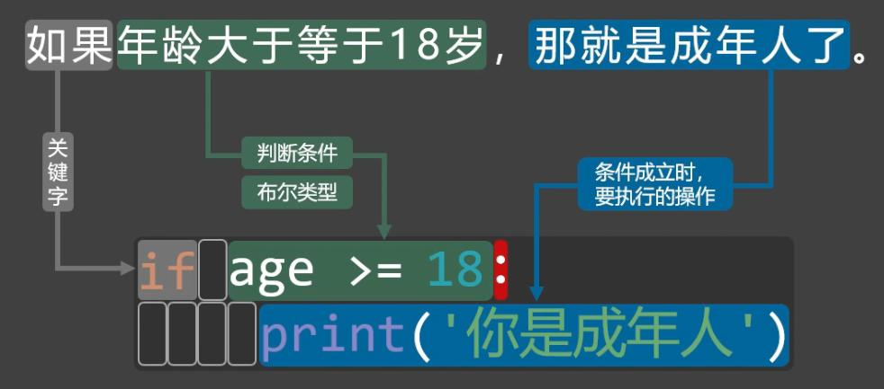

⚠注意：Python 靠代码缩进来识别代码范围，所以条件成立时要执行的代码前，必须加空
格。
3 示例代码：

```python
print('欢迎你来学习Python！')
```


### 1.2. 双分支

1 语法格式：

```python
if 判断条件:
 条件【成立】时执行的代码1
 条件【成立】时执行的代码2
else:
 条件成【不成立】时执行的代码1
 条件成【不成立】时执行的代码2
```

2 语法图解：

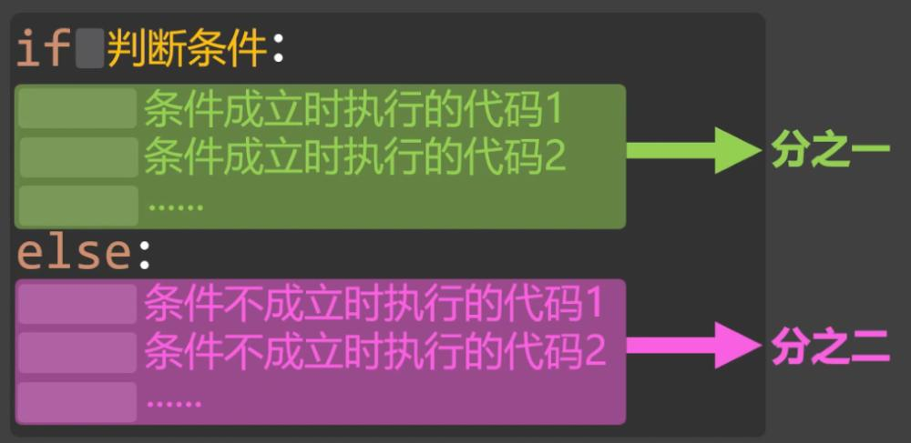

3 示例代码：

### 1.3. 多分支

1 语法格式：

```python
if 判断条件1:
 条件1【成立】时执行的代码
elif 判断条件2:
 条件2【成立】时执行的代码
elif 判断条件3:
 条件3【成立】时执行的代码
else: # else如不需要可以省略
 上述所有条件都不成立时执行的代码
```

2 语法图解：

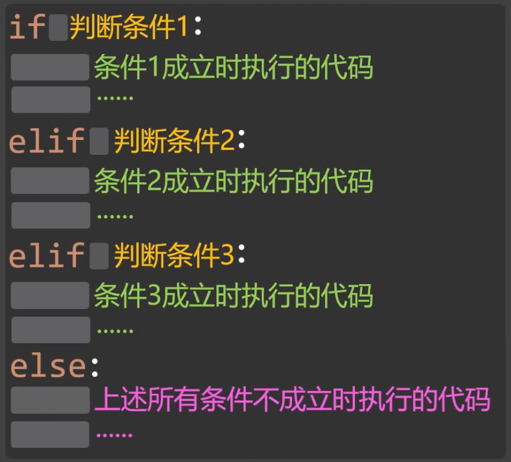

3 示例代码：

```python
 print('你是中年')
elif age <= 60:
 print('你是中老年')
else:
 print('你是老年')
```

使用多分支语句时，需要注意下面几点：
一个 if 语句只能匹配 1 个 else 语句，但可以匹配多个 elif 语句，并且 else 语句要在所
1.
有的 elif 语句之后。
一旦某个分支语句检测为 true，其他的 elif 以及 else 语句都将不再执行。
2.

### 1.4. 嵌套分之

1 语法格式：

```python
 if 判断条件4:
  # 条件4 成立时执行的代码
  # ......
 else:
  # 条件4 不成立时执行的代码
  # ......
```

2 语法图解：

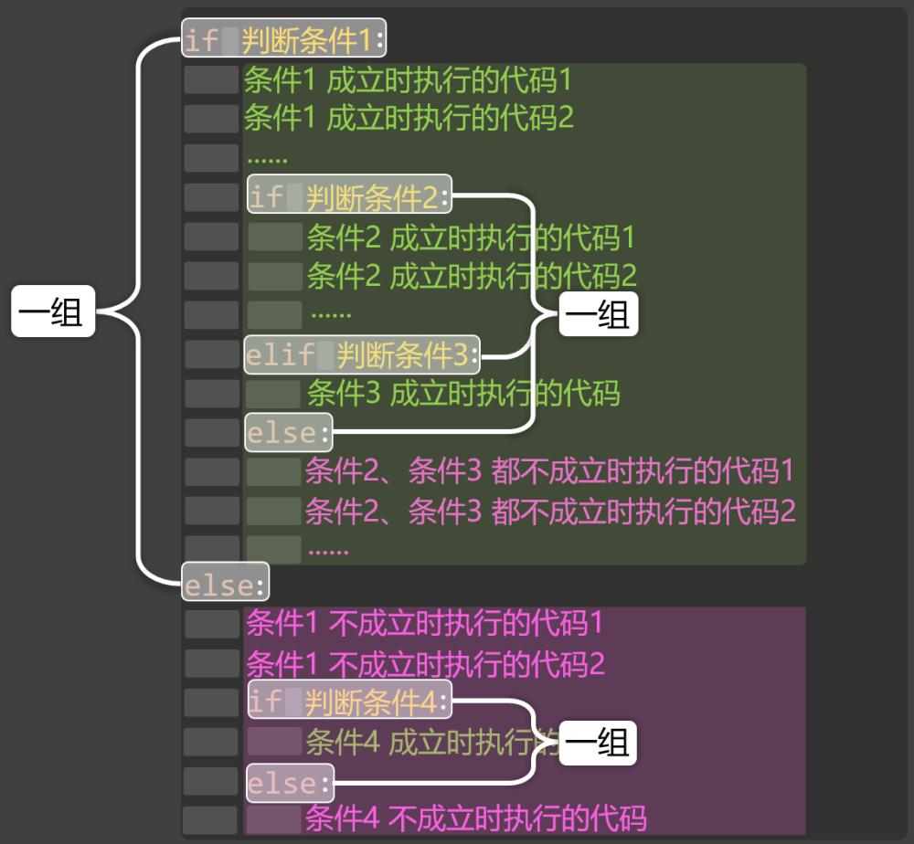

3 案例：

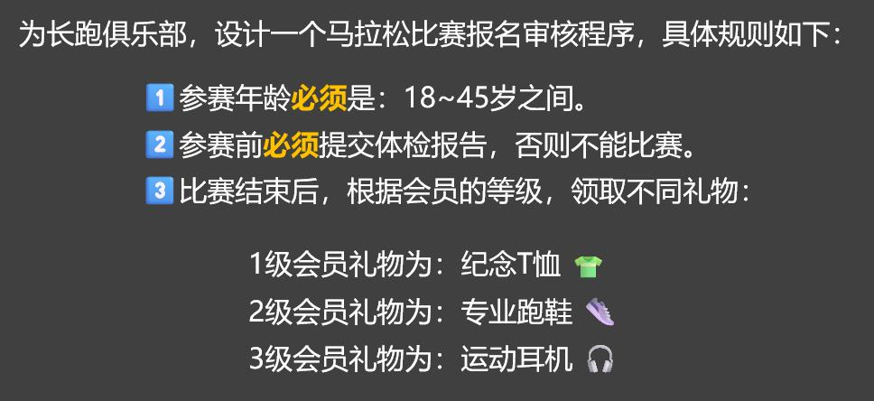


```python
level = int(input('请输入你的会员等级（1/2/3）'))
print('****** 程序的识别结果如下：******')
   ⬇⬇
if 18 <= age <= 45:
 print(' 您的年龄符合比赛要求！')
   ✅
 if has_report == '是':
  print(' 您已提交体检报告！')
    ✅
  print(' 您可以参加比赛！')
    ✅
  if level == 1:
   print(f' 尊敬的{level}会员，比赛结束后，您可以领取纪念T恤一件！')
  elif level == 2:
   print(f'尊敬的{level}会员，比赛结束后，您可以领取专业跑鞋一双！')
  elif level == 3:
   print(f'尊敬的{level}会员，比赛结束后，您可以领取运动耳机一副！')
  else:
   print(' 您输入的会员等级不正确！')
     ❌
 elif has_report == '否':
  print(' 您未提交体检报告，不能参加比赛！')
    ❌
 else:
  print(' 您输入的体检报告有误！')
    ❌
else:
 print(' 抱歉，参赛年龄需要在18~45之间！')
   ❌
```


## 2. 循环

循环是一种让代码重复执行的机制，当某个条件成立时，程序会反复执行一些语句，直到条
“”
件不再满足时，再停止运行。

### 2.1. while 循环

1 语法格式：

```text
 条件成立时执行的操作2
```

2 循环逻辑：
先判断循环条件是否成立（是否为 True）
1.
如果成立执行循环中的代码
2. →
3. 执行完循环体→再次判断循环条件
若仍成立继续执行循环中的代码
4. →
若不成立循环结束
5. →
3 代码示例：

```python
n = 1
while n <= 10:
 print(f'第{n}次你好啊')
 n += 1
print(f'我是 while循环以外的代码，执行到这里时，循环已经结束了，此时的n是：{n}')
```

注意：如果条件一直成立，就是无限循环（死循环）。例如上述代码中，如果忘记编写 n
+= 1 就会产生死循环。
4 案例：

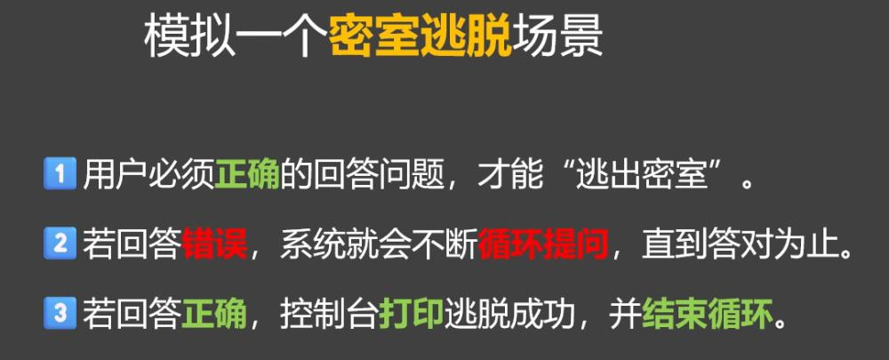


```python
guess = ''
while guess != answer:
 print(f'问题：{riddle}')
 guess = input('请输入答案：')
 if guess == answer:
  print(' 答案正确，逃脱成功！')
    ✅
 else:
  print(' 回答错误，请再想想！')
    ❌
```


### 2.2. for 循环

1 语法格式：

```python
for 临时变量 in 可迭代对象：
 要执行的操作1
 要执行的操作2
```

什么叫『可迭代对象』？
比如我们有一个盒子，里面装着：苹果、香蕉、橙子。我们可以一个接一个地把水果取出来，
那这个盒子，就相当于 Python 中的可迭代对象。每次 for 循环执行时，其实就是在“取出一
个水果，目前我们还没学到类和对象，先记住一句话：能一个个取出来的，就是可迭代
”“”“”
的。
2 循环逻辑：
1. 从可迭代对象中取出第一个元素→赋值给临时变量
执行循环中的代码
2.
取出下一个元素重复执行
3. →
4. 当所有元素取完后→循环结束
3 代码示例：

```python
# 使用 for循环遍历range()所指定的数字范围
n = 0
for n in range(1, 11):
 print(f'第{n}次你好啊')
print(f'我是 for循环以外的代码，执行到这里时，循环已经结束了，此时的n是：{n}')
# 使用 for循环遍历字符串
for m in 'abcdef':
 print(m)
# 演示由于误操作造成的死循环（下面代码中，用到了列表，我们后面会讲解）
# 备注：for循环还能遍历很多我们没有讲到的东西，比如：元组、列表、对象......
nums = [1,2,3]
for i in nums:
 # nums.append(4) # 此行代码会造成死循环
 print(i)
```

以上代码中的：range(1, 11)、'abcdef'、[1,2,3]这些都是可迭代对象，我们后面还会遇到
很多可迭代对象。
4 案例：实现一个字符串加密程序，大致思路如下图：

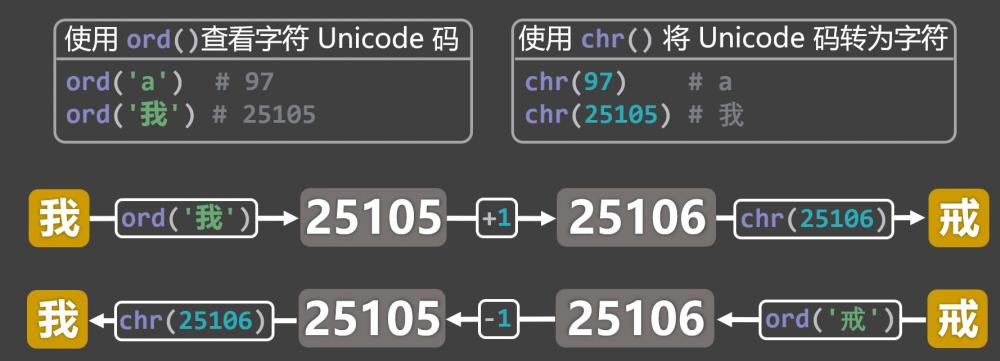


```python
# 解密代码
secret = input(' 请输入要解密的文字：')
text = ''
for s in secret:
 text += chr(ord(s) - 1)
print(f'经过解密后的内容为：{text}')
```


### 2.3. 对比 while 与 for


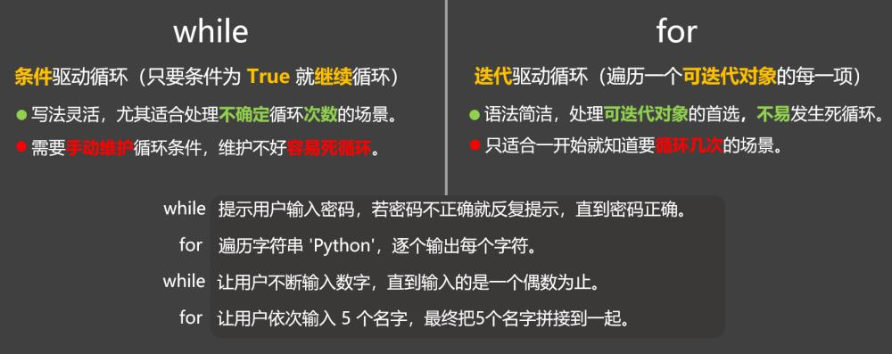


### 2.4. 嵌套循环

1 概念：在一个循环的内部，再写一个或多个循环，就是嵌套循环。
2 案例：实现一个为期 30 天的健身计划，效果如图：

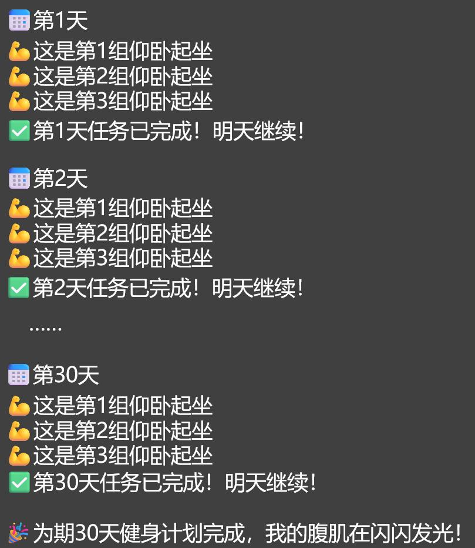


### 2.5. 九九乘法表案例

案例效果如图：

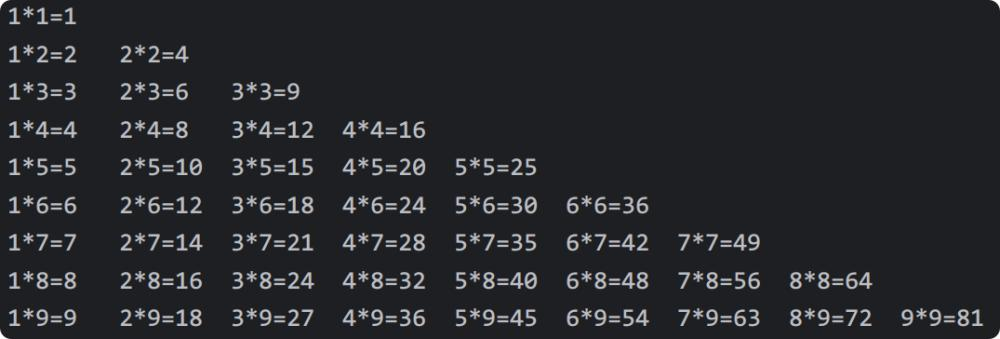

print('你好', end='') 中的 end 用来控制打印后结尾输出的内容。

```python
# 前序知识
print('你好', end='')
print('尚硅谷', end='')
# for循环实现九九乘法表
for row in range(1, 10):
 for item in range(1, row + 1):
  print(f'{item}*{row}={item * row}', end='\t')
 print()
```


### 2.6. continue 与 break

continue 和 break 都可用于循环语句中（while 循环、for 循环都可以）它们的作用分别是：
 continue：跳过本次循环剩余语句，直接进入下一次循环判断。
 break：立即终止循环，不再执行后续循环。
1 测试 continue
建议参考视频教程中对下方代码的分析与讲解：

```python
   continue
  print(f'牛奶{item}')
 print('睡觉')
```

2 测试 break
建议参考视频教程中对下方代码的分析与讲解：

```python
  print(f'牛奶{item}')
 print('睡觉')
```


### 2.7. 综合案例


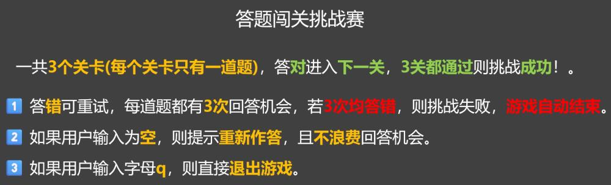
