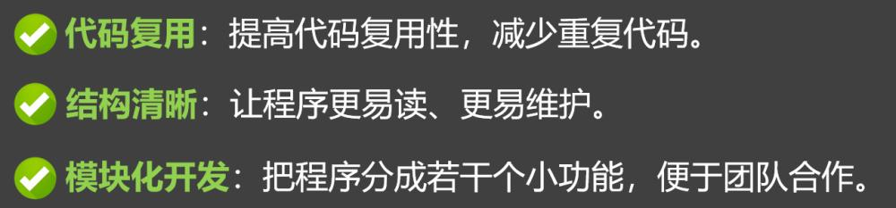
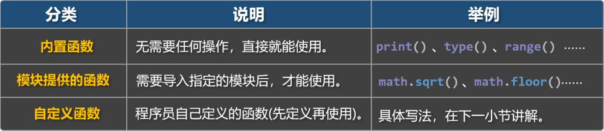
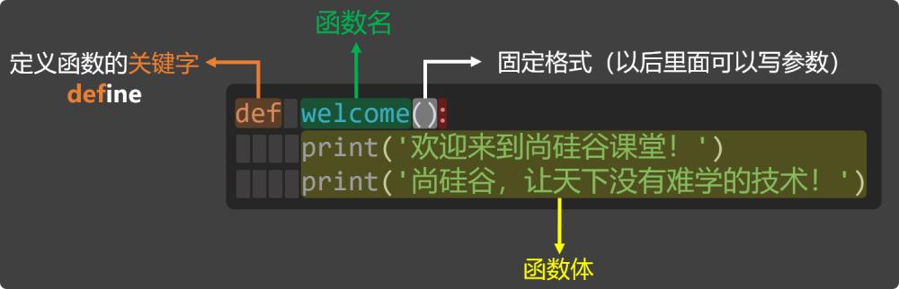
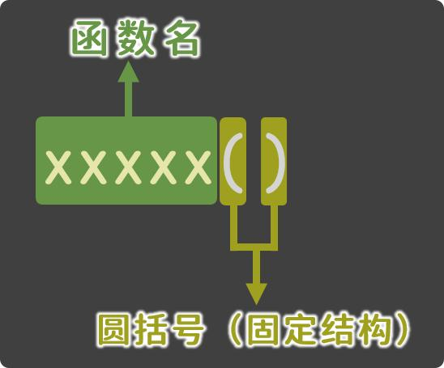
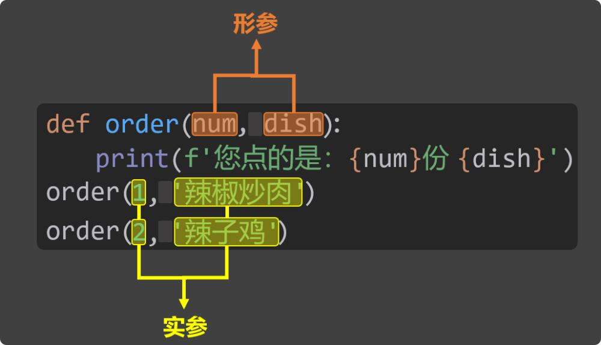
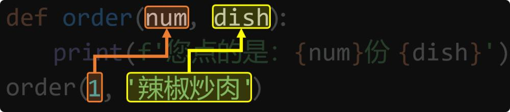
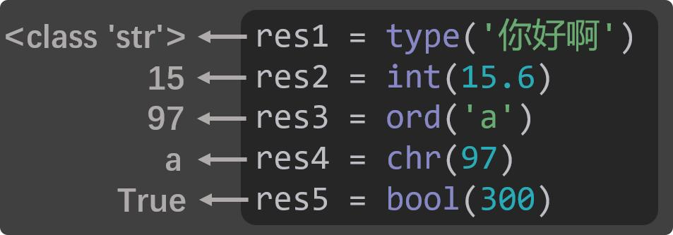
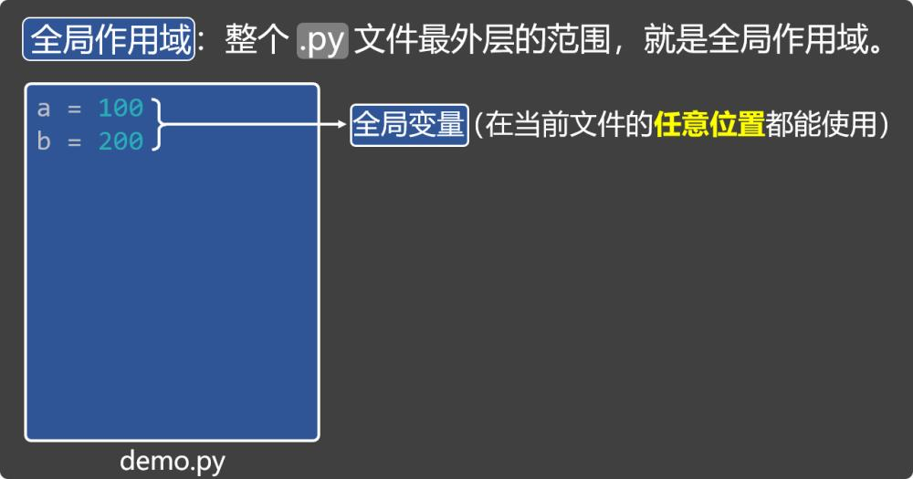
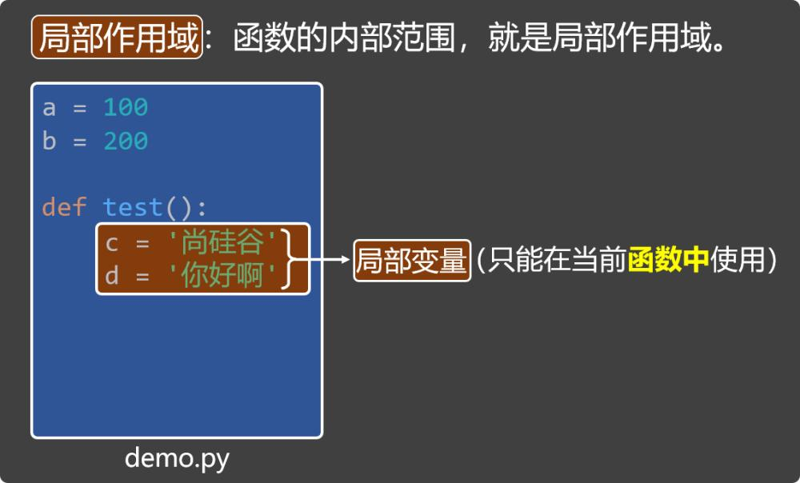
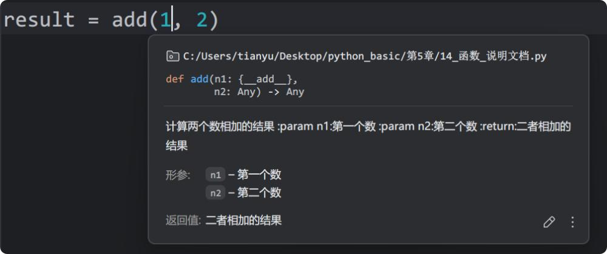

# 函数入门

从函数的概念与分类出发，学习定义与调用、参数传递、返回值、作用域、嵌套与递归调用，并完成综合案例。

<!-- more -->


```python
 print('恭喜您！全部通关！')
```


## 1. 概念及分类


### 1.1. 函数的概念

函数（function）是：组织好的、可重复使用的、用于执行特定任务的代码块。
举个生活中的例子：
函数就像是智能家居中的一个场景，我们提前配置好场景中要执行的操作，等需要时，直
接呼唤场景的名字，场景中的操作就会开始执行。
 Python 中的函数是一段有名字的代码块，我们提前编写好函数中要执行的代码，等需要
时，调用函数，函数中的代码就会执行。


智能家居场景 VS 函数
使用函数的主要优势：




### 1.2. Python 中函数的分类

Python 中函数分为三类：①内置函数、②模块提供的函数、③自定义函数。



相关官方文档：
内置函数：https://docs.python.org/zh-cn/3.13/library/functions.html
模块提供的函数：https://docs.python.org/zh-cn/3.13/py-modindex.html
备注：
内置函数与模块提供的函数， Python 都已经提前定义完毕，我们只管调用即可。
1.
2. 本章主要讲解自定义函数，对于内置函数和模块提供的函数，后面用到哪个讲哪个。

## 2. 基本使用


### 2.1. 定义函数

1 语法格式：
如下语法格式是函数的基本定义，不涉及：接收参数和返回值。

```python
def 函数名():
 函数体
 函数体
```

2 语法图解：



3 说明：
定义函数的关键字是 def，需要将 def 与函数名用空格隔开，随后紧跟():。
函数的命名遵循我们之前讲过的『标识符命名规范』。
函数定义完毕后，只是告诉 Python 我们定义了一个函数，可以完成某些功能，但此时函

数体还没有执行，需要调用函数后，函数体才会执行！
4 示例代码：定义一个名为 welcome 的函数，函数体中打印两句欢迎语。

```python
# 定义函数
def welcome():
 print('欢迎来到课堂！')
 print('，让天下没有难学的技术！')
```


### 2.2. 调用函数

1 语法格式：
如下语法格式是基本调用形式，不涉及：传递参数。

```text
函数名()
```

2 语法图解：



3 示例代码：编写代码，调用我们刚才定义的 welcome 函数。

```python
# 定义函数
def welcome():
 print('欢迎来到课堂！')
 print('，让天下没有难学的技术！')
# 调用函数（让函数中的代码运行起来）
welcome()
welcome()
welcome()
```

⚠注意：函数必须先定义再调用。

## 3. 参数


### 3.1. 参数的作用

参数可以让函数接收外部传入的数据，能让函数更具通用性和灵活性，比如下面的这个需求：
需求：定义一个名为 order 的函数，在函数体中打印用户的点餐信息。
用如下代码实现，就会面临两个问题：①每次的点餐数量只能是一份。②每次点的菜品只能
是辣椒炒肉。

```text
# 调用函数
order()
```

但如果在上述代码的基础上，使用参数，就可以灵活修改点餐数量和菜品，写法如下：

```python
# 定义函数（定义的同时：声明需要两个参数，分别是：菜品数量 num，和菜品名称 dish）
def order(num, dish):
 print(f'您点的是：{num}份 {dish}')
 print(f'{dish}可是很好吃的！')
 print(f'你只点了{num}份，够吃吗？\n')
# 调用函数（调用的同时：传递了两个值）
order(1, '辣椒炒肉')
order(2, '辣子鸡')
```


### 3.2. 实参与形参

在使用函数时，要注意区分『形参』与『实参』。
形参（形式参数）：在定义函数时，用来接收数据的变量叫形参，形参是函数定义者设置
的。
实参（实际参数）：在调用函数时，给函数传递的具体值叫实参，实参是函数调用者提供
的。



备注：形参存储的到底是什么数据，要看调用者传递的实参具体是什么。
注意：形参的使用范围仅限函数体内。

### 3.3. 位置参数

位置参数：调用函数时，根据参数在函数定义时出现的顺序，把实参的值，依次传递给对应的
形参。
例如在上一小节所写的 order 函数，就是在使用位置参数，其中形参与实参的对应关系如下
图：



注意：在使用『位置参数』时，实参的个数与顺序，必须和形参保持一致！

```python
def order(num, dish):
 print(f'您点的是：{num}份 {dish}')
 print(f'{dish}可是很好吃的！')
 print(f'你只点了{num}份，够吃吗？\n')
# 以下是错误示范
order(3) # 参数少了
order(4, '宫保鸡丁', 7) # 参数多了
order('宫保鸡丁', 4) # 实参顺序没有和形参保持一致，不会报错，但会造成数据错乱。
```


### 3.4. 关键字参数

关键字参数：函数调用时通过形参名 = 值的形式传递的参数，就是关键字参数。
关键字参数的优势是：不受顺序限制。

```text
# 调用函数（使用关键字参数）
greet(name='张三', gender='男', age=18, height=172)
greet(height=172, age = 18, gender='男', name='张三')
```

注意：『位置参数』和『关键字参数』可以混用，但『位置参数』必须写在『关键字参
数』之前！

```text
# 正确使用方式
greet('张三', '男', height=172, age=18)
# 错误示例
greet(height=172, age=18, '张三', '男')
greet(name='张三', '男', 18, 172)
greet(name='张三', '男', age=18, 172)
greet(height=172, age=18, gender='男', name='张三', age=19)
greet(height=172, age=18, gender='男', name='张三', school='')
```


### 3.5. 限制传参方式

具体限制方式：/前面只能用『位置参数』，*后面只能用『关键字参数』。

### 3.6. 参数默认值

在定义函数时，可以通过形参名 = 值的形式，为形参设置一个默认值，这样就可以实现：
若调用函数时没有传入该参数的值，就使用默认值。
若调用函数时传入了该参数的值，就使用传入的值。


```python
# 定义函数（设置参数默认值）
def greet(name, gender, age, height, msg='你好'):
 print(f'我叫{name}，性别{gender}，年龄是{age}，身高是{height}cm')
 print(f'我想说：{msg}')
# 调用函数
greet('张三', '男', 18, 172)
greet('张三', '男', 18, 172, 'hello')
greet('张三', '男', 18, 172, msg='hello')
```

注意：定义函数时，『默认参数』必须放在『必选参数』的后面，或者换一种说法就是：
某个形参，一旦设置了默认值，那它后面的所有形参，也必须要写默认值！
例如：下面的代码中，msg='你好'这个默认参数，居然写在了位置参数 height 前面，所以就
会报错。

```python
# 定义函数（设置参数默认值的错误示例）
def greet(name, gender, age, msg='你好', height):
 print(f'我叫{name}，性别{gender}，年龄是{age}，身高是{height}cm')
 print(f'我想说：{msg}')
```


### 3.7. 可变参数

在定义函数时，如果不确定会传入多少个参数，那就可以使用可变参数，具体写法有两种：
使用*形参名来接收任意数量的『位置参数』，多个位置参数最终会被打包成一个『元

组』。
使用**形参名来接收任意数量的『关键字参数』，多个关键字参数最终会被打包成一个

『字典』。
备注：元组和字典都是新的数据类型，后面才会讲，但没关系，这不耽误大家理解本小节
的内容。

```python
# 定义函数（使用*args去接收：可变位置参数，args只是大家习惯这么写，当然也可以换成其他变
量）
def test1(*args):
 # 此处args的值，是一种新的数据类型，叫：元组，我们下一章就去讲元组
 print(args)
# 调用函数
test1('张三', '男', 18, 172)
# 定义函数（使用**kwargs去接收：可变关键字参数，kwargs只是大家习惯这么写，当然也可以换成
其他变量）
def test2(**kwargs):
 # 此处kwargs的值，是一种新的数据类型，叫：字典，我们下一章就去讲字典
 print(kwargs)
# 调用函数
test2(name='张三', gender='男', age=18, height=172)
```

『可变位置参数』和『可变关键字参数』，可以同时使用，但必须要先写『可变位置参
数』。

```text
test3('张三', '男', '抽烟', '喝酒', age=18, height=172)
```


### 3.8. 特殊的字面量 None

None 是一个特殊的字面量，用来表示：空值、无值、无意义。
例如：msg = None 的含义是我先定义一个变量 msg，但目前还不知道它会存储什么类
——
型的值，那能不能写成 msg = 0 呢？这要看具体情况：
如果确定 msg 之后会存放数值类型的数据，那这样写是可以的。
但如果还不确定 msg 将来会存放什么类型的数据，最好不要写成 msg = 0，否则可能会

误导别人以为它一定是数值类型。
所以使用 None 更加中立、开放，因为它不暗示变量的类型。
None 的官方文档：https://docs.python.org/zh-cn/3.13/library/constants.html#None
几个关键点：
1. None 的类型是 NoneType。
None 出现在布尔判断中(if 判断条件、while 循环条件)，会被当作 False 来处理。
2.
None 不能参与任何数学运算，也不能与字符串拼接。
3.
不给函数设置返回值，那函数默认就会返回 None
4.
None 出现最多的两个场景：
1 函数中没有写 return，或写了 return 但没有返回任何内容。
2 变量定义时，暂时还不知道要存放什么，可以先赋值为 None。

```python
print(type(msg))
# None 转为布尔值是 False。
print(bool(msg))
if not msg:
 print('你好')
# 不能参与数学运算，也不能与字符串拼接。
# result1 = msg + 1
# result1 = msg + 'hello'
```


## 4. 返回值


### 4.1. 什么是返回值

函数返回值：函数执行完毕后，会把执行结果交给调用者，这个执行结果就是函数的返回值。
我们之前用过的这些内置函数，都有返回值：



对于自定义的函数，即便我们不去设置返回值，函数也会默认返回 None，由于 None 表示空，
所以如果一个函数的返回值是 None 的话，就也可以说：这个函数“没有”返回值。

```python
print(result) # None
```


### 4.2. 如何设置返回值

使用 return 关键字可以设置函数的返回值，return 的作用有两个，分别是：
结束函数的运行。
1.
把 return 后面的值，作为函数的返回值。
2.

```python
# 定义函数
def add(n1, n2):
 print(f'我收到了：{n1}、{n2}，二者相加是：{n1 + n2}')
 print('add函数执行完毕了')
 return n1 + n2
# 调用函数
result = add(100, 200)
print(result)
# print函数是没有返回值的
res = print('hello')
print(res)
```


## 5. 全局作用域 VS 局部作用域


### 5.1. 什么是作用域？

作用域就是变量能起作用的范围（变量在哪里能用，在哪里不能用），Python 中有多种作用
域，我们先来学习：全局作用域、局部作用域。

### 5.2. 全局作用域 _ 全局变量

1. 全局作用域：整个.py 文件最外层的范围，就是全局作用域。
全局变量：写在全局作用域中的变量，就叫：全局变量，全局变量在整个程序中都可以访
2.
问。




### 5.3. 局部作用域 _ 局部变量

局部作用域：函数的内部范围，就是局部作用域。
1.
2. 局部变量：写在局部作用域中（函数内部）的变量，叫：局部变量，它只能在当前函数中
使用。




### 5.4. global 关键字

在函数内部使用 global 关键字，可以声明变量为全局变量。

```python
 a = 300
 print('函数中的打印（a）', a)
test()
print('全局的打印（a）', a)
```


### 5.5. 小测试

请说出如下代码的输出结果（具体分析请参考视频教程）

```python
test2()
test2()
test2()
# 全局作用域与全局变量，会在程序开始时创建，在程序结束后销毁
n = 100
def test3():
 global n
 n += 1
 print(f'我是test3函数中打印的n：{n}')
test3()
test3()
test3()
print(n)
```


## 6. 嵌套调用

嵌套调用：在一个函数执行的过程中，调用了另外一个函数，例如下面的代码：
如下代码的具体分析过程，请参考视频教程。

```python
# 函数嵌套调用测试 2
def test1():
 print('进入 test1 函数')
 test2()
 print('退出 test1 函数')
def test2():
 print('进入 test2 函数')
 test3()
 print('退出 test2 函数')
def test3():
 print('进入 test3 函数')
 print('***正在执行 test3 函数')
 print('退出 test3 函数')
test1()
```


## 7. 递归调用

1 递归调用：函数自己调用自己的一种操作。

```python
def welcome():
 print("你好啊！")
 welcome() # welcome 函数内部在调用自己
welcome()
```

警告：上述代码确实是递归调用，但会出现死循环！
2 递归必须要具备终止条件（不能无限的一直调用，总得有停下来的时候。）
如下代码使用递归调用的方式，输出了 10 次你好啊！
“”

```python
# 使用递归打印n次你好啊（从大到小）
    “”
def welcome(n):
 print(f'你好啊{n}')
 if n > 1:
  welcome(n - 1)
# 调用函数
welcome(5)
# 使用递归打印n次你好啊（从小到大）
    “”
def welcome(n):
 if n > 1:
  welcome(n - 1)
 print(f'你好啊{n}')
# 调用函数
welcome(5)
```

3 递归的应用：使用递归完成一个数的阶乘
如下代码的具体分析过程，请参考视频教程。

```python
# 使用递归求阶乘
def factorial(num):
 if num == 0:
  return 1
 else:
  return num * factorial(num - 1)
# 调用函数，求5的阶乘
result = factorial(6)
print(result)
```


## 8. 函数说明文档

函数说明文档：写在函数里的文字说明，用来描述：函数的功能、需要哪些参数、返回什么结
果，它的语法和普通字符串一样，用三引号包裹：

```python
def add(n1, n2):
 """
 计算两个数相加的结果
 :param n1:第一个数
 :param n2:第二个数
 :return:二者相加的结果
 """
 return n1 + n2
result = add(1, 2)
```

有了函数说明文档之后，可以通过鼠标悬浮的方式，查看函数的具体信息，如下图：




## 9. 函数综合案例

完成一个健身挑战赛程序，功能演示见下图：


具体实现代码如下：
如下代码的具体分析过程，请参考视频教程。
