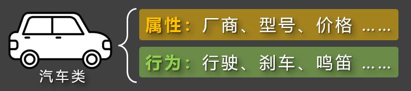
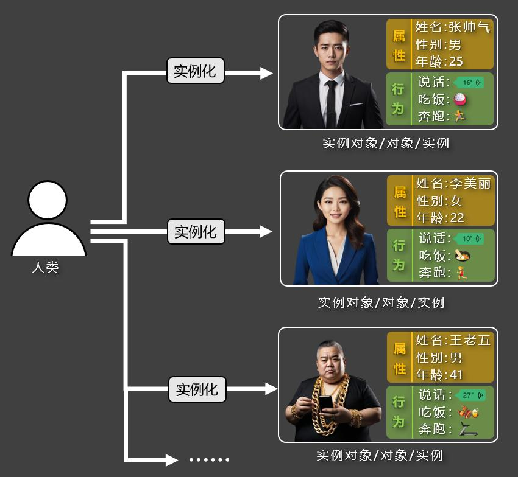
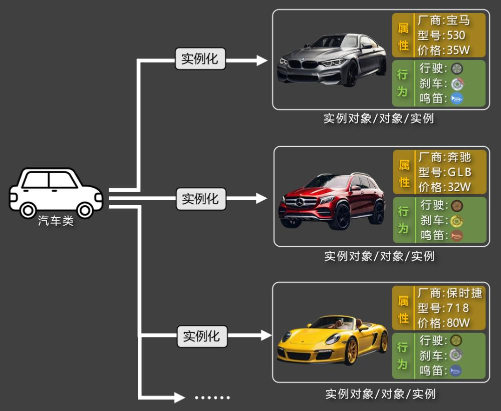
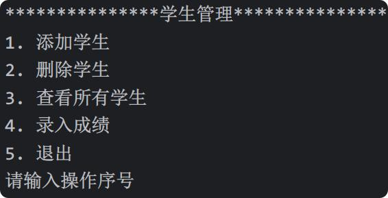
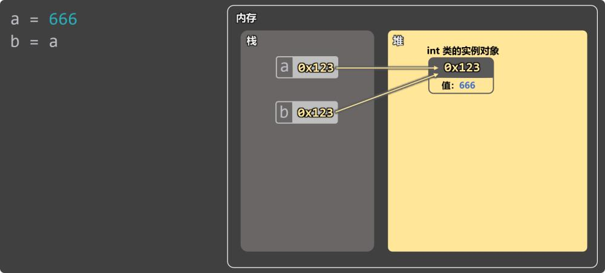
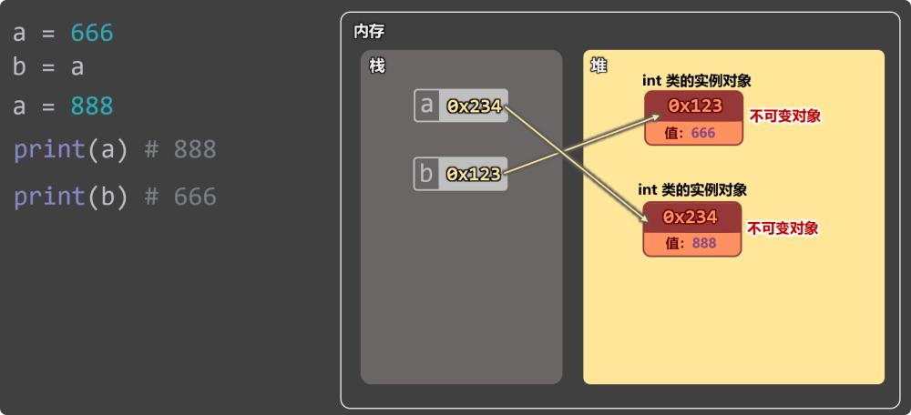
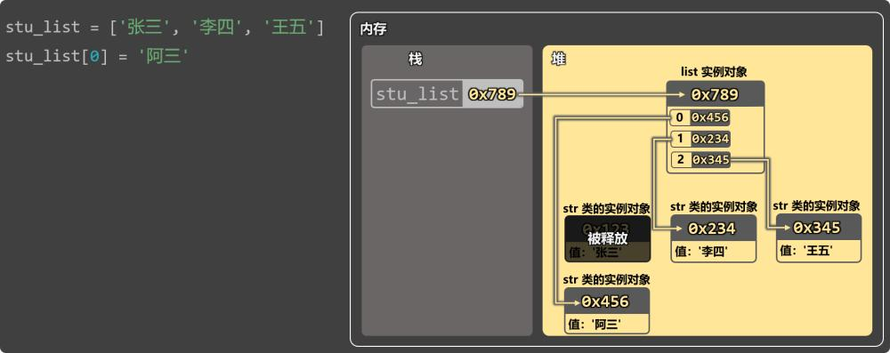
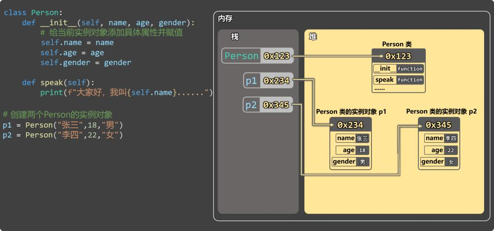

# 面向对象

理解类与对象、属性与方法、继承与多态，深入权限控制、魔法方法、抽象类和对象内存分析。

<!-- more -->


## 1. 概述


### 1.1. 对象

『对象』是一个拥有『属性』和『行为』的个体，它是构成现实世界和程序世界的基本单位。
编程领域有这么一句话，叫万物皆对象！之所以这么说，是因为任何一个具体存在的人或
“”
物，都可以看成是一个对象，例如：一个人、一辆车、一部手机，都是对象，他们的『属
性』和『行为』分别是：
人的属性有：姓名、性别、年龄...... ，人的行为有：吃饭、睡觉、跑步......
1.
2. 车的属性有：品牌、颜色、价格...... ，车的行为有：启动、加速、刹车......
手机的属性有：品牌、颜色、电量...... ，手机的行为有：打电话、播放音乐、拍
3.
照......

### 1.2. 面向对象

『面向对象』是一种以对象为中心，去思考和组织代码的方式，它更关注：谁来做这件事。
“”
以做饭这件事为例：
“”
传统思想：关注“做饭的步骤”，会依次进行：洗菜→切菜→炒菜→装盘。
面向对象思想：关注谁来做这件事，会找『切菜员』来洗菜和切菜，找『厨师』来炒菜
“”
和装盘。
在上述描述中：『切菜员』和『厨师』就是对象，至于这些对象是我们自己编写的，还是来自
外部模块，这并不重要。
面向对象思想的好处是：可扩展性强，『切菜员』能给我做菜，也能给别人做菜；能做简单的
菜，也能做复杂的菜。在程序中也是这个道理：我们定义的对象，可以被复用，多个对象之
“”
间还可以协作，一起组成更大的系统。

### 1.3. 类

『类（class）』是用来描述一类事物的"模板"，它规定了一类事物所具有的『属性』和『行
为』。


人类



汽车类

### 1.4. 实例 VS 实例化

1 实例：根据『类』创建出来的一个具体的『对象』又称『实例』，也可称为『实例对
象』。
对象、实例、实例对象，这三个词在日常使用中是同一个意思。
2 实例化：所谓『实例化』就是根据类“制造出”一个对象的过程。
类是抽象的模板，『实例 / 实例对象 / 对象』是具体的个体。
“”



类进行实例化，得到实例对象



类进行实例化，得到实例对象

## 2. 基本使用


### 2.1. 类的定义

1 语法格式：

```python
# 定义一个类（类名通常用大驼峰写法）
class 类名:
 # 当一个函数被定义在类中时，它就被称为方法。
          “”
 # __init__方法又叫：初始化方法，它主要用来给当前实例对象添加属性。
 # __init__方法收到的参数是：当前正在创建的实例对象、其他自定义参数。
 # 当我们后期编写代码，对类进行实例化的时候，Python就会自动调用__init__方法，去完成对
实例的初始化。
 def __init__(self, 参数 1, 参数2, 参数 3):
  # 通过self给当前实例添加属性，语法格式为：self.属性名 = 属性值
  self.属性名 = 参数1
  self.属性名 = 参数2
  self.属性名 = 参数3
```

2 相关说明：
1. 类名通常采用大驼峰命名法（如:Person、UserInfo）。
类中所定义的函数，通常又称为方法。
2.
__init__方法叫初始化方法，当我们对类进行实例化时，Python 会自动调用__init__方
3.
法。
4. __init__方法的名字不能更改，否则 Python 无法自动调用。
__init__收到的第一个参数是当前正在创建的实例对象，形参通常用 self。
5.
__init__方法收到的除 self 以外的参数，通常用来设置实例的属性值，通过点语法实
6. “”
现：self.属性名 = 属性值
3 代码示例：

```python
# 定义一个Person类（类名通常使用：大驼峰写法）
class Person:
 # 说明：当一个函数被定义在了类中时，那这个函数就被称为：方法。
 # __init__方法：初始化方法，主要作用：给当前正在创建的实例对象添加属性
 # __init__方法收到的参数：当前正在创建的实例对象（self）、其它的自定义参数
 # 当我们以后编写代码去创建Person类实例的时候，Python会自动调用__init__方法
 def __init__(self, name, age, gender):
  # 给实例添加属性（语法为：self.属性名 = 值）
  self.name = name
  self.age = age
  self.gender = gender
```


### 2.2. 创建实例

1 语法格式：

```text
实例名 = 类名(参数 1, 参数2, ...)
```

2 代码示例：

```python
  self.name = name
  self.age = age
  self.gender = gender
# 创建 Person的实例对象
p1 = Person('张三', 18, '男')
p2 = Person('李四', 22, '女')
```

3 通过实例的点语法，可以『访问』或『修改』实例的属性。
“”

```python
# 如果直接打印一个实例的话，我们是看不到实例身上的属性的
print(p1)
print(p2)
# 通过点语法可以访问或修改实例身上的属性
print(p1.name)
print(p1.age)
print(p1.gender)
print('-' * 20)
print(p2.name)
print(p2.age)
print(p2.gender)
p1.name = '阿三'
print(p1.name)
```

4 通过实例.__dict__ 的方式，可以查看实例身上的所有属性。

```python
# 通过实例.__dict__ 可以查看实例身上的所有属性
print(p1.__dict__)
print(p2.__dict__)
```

5 在实例创建完毕后，也可以通过实例.属性名 = 值的形式，给实例追加属性。

```python
# 实例创建完毕后，依然可以通过实例.属性名 = 值去给实例追加属性
p1.address = '北京昌平宏福科技园'
print(p1.__dict__)
```

6 通过 type() 函数，可以查看某个实例对象，是由哪个类创建出来的。

```python
# 通过 type函数，可以查看某个实例对象，是由哪个类创建出来的
print(type(p1))
print(type(p2))
```


### 2.3. 自定义方法（行为）

我们之前提到过：类是用来规定一类事物所具有的『属性』和『行为』，在上一小节中，我们
已经通过 self.属性名 = 值的形式，为实例对象添加了『属性』；接下来，要想让对象具备
相应的『行为』，就需要通过『自定义方法』来实现。
『自定义方法』的第一个参数也是 self，是调用该方法的实例对象。

```python
# print(Person.__dict__)
# 创建 Person类的实例对象
p1 = Person('张三', 18, '男')
p2 = Person('李四', 22, '女')
# 验证一下：Person的实例对象身上是没有speak方法的
# print(p1.__dict__)
# print(p2.__dict__)
# 所有 Person类的实例对象，都可以调用到speak方法
# 当执行p1.speak()的时候，查找speak方法的过程：1.实例对象自身(p1) => 2.实例的缔造者
                    “”
的身上(Person)
# p1.speak('好好学习')
# p2.speak('天天向上')
# 验证一下上述的查找过程
def speak():
 print('巴拉巴拉巴拉巴拉巴拉')
p1.speak = speak
print(Person.__dict__)
print(p1.__dict__)
print(p2.__dict__)
p1.speak()
```


## 3. 实例属性、类属性


### 3.1. 实例属性

1 定义：通过实例.属性名 = 值定义在实例身上的属性，称为：实例属性。
2 特点：
每个实例都有自己『独立的一份』实例属性，各个实例之间是互不影响的。
1.
实例属性只能通过实例.xxxx 访问和修改，不能通过『类名』访问或修改。
2.

```python
# 定义一个Person类
class Person:
 # 初始化方法
 def __init__(self, name, age, gender):
  # 通过【实例.属性名 = 值】给实例添加的属性，就叫实例属性
  # 实例属性只能通过实例访问，不能通过类访问
  # 每个实例都有自己【独一份的】实例属性，各个实例之间是互不干扰的
  self.name = name
  self.age = age
  self.gender = gender
# 创建 Person类的实例对象
p1 = Person('张三', 18, '男')
p2 = Person('李四', 22, '女')
# 实例属性只能通过实例访问，不能通过类访问
print(p1.name)
print(Person.name)
```


### 3.2. 类属性

1 定义：在类中直接写赋值语句（例如：a = 100），就会在类身上添加一个 a 属性，值为
100，此时的 a 就是『类属性』，它属于类本身，由类所拥有，并且该类创建出来的所有实例
对象，都能去访问 a 属性。
2 特点：
所有实例访问的，都是同一个类属性，所以类属性通常用于：存放公共数据。
1.
类属性即可以通过『类』访问，也可以『实例』访问。
2.

```python
# print(p3.__dict__)
```

3 特别注意：
进行实例.属性名 = xxx 操作时，只会对实例自身的属性起作用（有则修改，无则添加）！

```python
# 注意点：进行【实例.属性名 = 值】操作时，只会对实例自身的属性起作用，不会影响类属性
p1.planet = '火星'
print(Person.__dict__)
print(p1.__dict__)
print(p2.__dict__)
print(p1.planet)
print(p2.planet)
```


## 4. 实例方法、类方法、静态方法


### 4.1. 实例方法

定义：类中所定义的方法，最终会保存在类身上，并且主要是通过实例调用，所以叫：实例方
法。
特点：
实例方法虽然最终会保存在类身上，但它主要是供实例使用的，所以才叫实例方法。
1.
2. 因为收到了 self 参数，所以其内部可以：访问实例属性，调用实例方法。
实例方法的主要作用：定义实例对象的具体行为。
3.

```python
  self.name = name
  self.age = age
  self.gender = gender
 # 下面的speak方法、run方法，都保存在类身上，但他们主要是供实例调用，所以他们都叫：实
例方法
 # 自定义方法（给实例添加行为）
 def speak(self, msg):
  print(f'我叫{self.name}，年龄是{self.age}，性别是{self.gender}，我想说：{msg}')
 # 自定义方法（给实例添加行为）
 def run(self, distance):
  print(f'{self.name}疯狂的奔跑了{distance}米')
# 创建 Person类的实例对象
p1 = Person('张三', 18, '男')
p2 = Person('李四', 22, '女')
print(Person.__dict__)
print(p1.__dict__)
print(p2.__dict__)
# 通过实例调用实例方法
p1.speak('你好')
p1.run(300)
# 通过类去调用实例方法(能调用，但不推荐)
Person.run(p2, 100)
```


### 4.2. 类方法

定义：使用@classmethod 装饰器修饰，第一个参数是类本身，通常用形参 cls 接收。
特点：
可通过『类名』或『实例名』调用，但强烈推荐通过类名调用以体现语义。
1.
2. 因为收到了 cls 参数，所以内部可以访问类属性。
一般用于：实现与类相关的逻辑，如：操作类级别的信息、工厂方法等。
3.

```python
print(p4.__dict__)
```


### 4.3. 静态方法

定义：使用@staticmethod 装饰器修饰，方法没有 self 或 cls 参数，只是单纯的定义在类
中。
特点：
1. 可通过『类名』或『实例名』调用，但强烈推荐通过类名调用以体现语义。
由于没有 self 或 cls 参数，所以静态方法中通常：不访问类属性，也不访问实例属性。
2.
一般用于：定义与类相关，但可以独立使用的工具方法。
3.

```python
  # 返回结果（成年True，未成年 False）
  return age >= 18
 @staticmethod
 def mask_idcard(idcard):
  return idcard[:6] + '********' + idcard[-4:]
# 验证一下：静态方法也是保存在类身上的
# print(Person.__dict__)
# 静态方法需要通过类去调用
# result = Person.is_adult(2015)
# print(result)
# result2 = Person.mask_idcard('212101198802030028')
# print(result2)
# 注意点：通过实例也能调用到静态方法，但非常不推荐
p1 = Person('张三', 18, '男')
res = p1.mask_idcard('212101198802030028')
print(res)
```


## 5. 继承


### 5.1. 基本语法

概念：是指一个类，可以继承另一个类的属性和方法。
作用：可以实现代码的复用与扩展，避免重复编写相同的代码，让程序结构更简洁、更高效。
举例：就像生活中，孩子可以继承父母的：长相、性格、财产等，程序中的继承与之类似。
代码实例：
如下代码中 Person 为父类（又称：基类）Student 为子类（又称：派生类）

```python
# s1.speak('你好')
# print(s1.__dict__)
# 查找 study方法的过程：1.实例自身(s1) => 2.Student类 => 3.Person类
# s1.study()
```

几个说明：
定义类时，在类名后写圆括号()，并填入另一个类名，表示该类继承自另一个类。
1.
在子类中，可以直接使用父类中定义的：属性、方法，也可以定义自己独有的内容。
2.
super().__init__()的作用：调用父类的初始化方法。
3.

### 5.2. 方法重写

如果子类中定义了与父类同名的方法，则会子类会“覆盖”父类中的方法，又称：“重写”。

```python
 def __init__(self, name, age, gender, stu_id, grade):
  super().__init__(name, age, gender)
  self.stu_id = stu_id
  self.grade = grade
 # 方法重写：当子类中定义了一个与父类中相同的方法，那么子类中的方法就会覆盖父类的方
                  “”
法
 def speak(self, msg):
  super().speak(msg)
  print(f'我是学生，我的学号是{self.stu_id}，我正在读{self.grade}，我想说：{msg}')
s1 = Student('李华', 12, '男', '2025001', '初二')
s1.speak('好好学习')
```


### 5.3. isinstance() 和 issubclass()

两个常用方法：
函数作用
isinstance(obj, Class) 判断对象是否为指定类或其子类的实例
issubclass(Sub, Super) 判断一个类是否是另一个类的子类

```python
# 定义一个Student类，继承自Person类
class Student(Person):
 def __init__(self, name, age, gender, stu_id, grade):
  super().__init__(name, age, gender)
  self.stu_id = stu_id
  self.grade = grade
p1 = Person('张三', 18, '男')
s1 = Student('李华', 12, '男', '2025001', '初二')
# 方法 1：isinstance(instance, Class)，作用：判断某个对象是否为指定类或其子类的实例
print(isinstance(s1, Student))
print(isinstance(p1, Person))
print(isinstance(s1, Person))
print(isinstance(p1, Student))
# 方法 2：issubclass(Class1, Class2)，作用：判断某个类是否是另一个类的子类
print(issubclass(Student, Person))
print(issubclass(Person, Student))
```


### 5.4. 多重继承

概念：多重继承指一个类同时继承多个父类，从而拥有多个父类的属性和方法。
举例：就像孩子不仅继承爸爸的长相，还可能继承妈妈的性格。

```python
class 子类名(父类A, 父类 B, ...):
 # 子类可以继承多个父类的属性和方法
 ...
```

代码示例：如下代码中 Student 类同时继承 Person 类和 Worker 类。

```python
去查找
print(Student.__mro__)
```


## 6. 权限控制


### 6.1. 三种访问权限

在 Python 中，我们可以给属性赋予三种权限，分别是：公有属性、受保护属性、私有属性。
下面是详细梳理
权限类型定义方式在当前类内部访问在子类内部访问在类外部访问
公有属性属性名能能能
✅✅✅
受保护属性 _属性名能能能（但不推荐）
⚠
✅✅
私有属性 __属性名能不能不能
✅❌❌
测试『类外部』访问：

```python
  # 子类的内部可以访问：公有属性、受保护属性
  print(f"我是学生，我叫：{self.name}，年龄：{self._age}")
p1 = Person('张三', 18, '110101199001011234')
print(p1.name)
# 类的外部，仅能访问公有属性
# 注意：如果在类的外部，强制访问【受保护的属性】，也能访问，但最好别这么做
print(p1._age)
# 强制访问【私有属性】会报错
# print(p1.__idcard)
# 扩展：Python保护【私有属性】的方式，是重命名，例如：__idcard属性，会被重命名为：
_Person__idcard
print(p1.__dict__)
print(p1._Person__idcard)
```


### 6.2. getter 与 setter

在面向对象编程中，我们会把一些内部数据保护起来，但同时还想提供一个安全的通道让外
“”
部访问。这时候我们就用到：
 getter：读取属性的方法
setter：修改属性的方法

在 Python 中：通过@property 和@xxx.setter 语法，把普通方法变成像属性一样使用的方
法。

```text
p1.idcard = 'asd'
```


## 7. 魔法方法

概念：以 __xxx__ 命名的特殊方法（双下划线开头和结尾）。

特点：不需要手动调，在特定场景由 Python 自动调用。
几个常用的魔法方法：
方法调用时机
1 __str__ 当调用 print(对象)或 str(对象) 时
2 __len__ 当调用 len(对象)时
3 __lt__ 当执行对象 1 < 对象 2 时
4 __gt__ 当执行对象 1 > 对象 2 时
5 __eq__ 当执行对象 1 == 对象 2 时
6 __getattr__ 当访问不存在的属性时

## 8. object 类

 object 是所有类的最终祖先，所有的类，无论写与不写，都继承自 object。
object 提供了所有对象都会有的一组最基本方法，例如：

方法名作用简述
__init__(self) 在对实例对象初始化时调用
__str__(self) print(obj)或 int(obj)时调用
__class__ 返回对象所属的类
......
备注：上述这些方法，如果我们不去重写，Python 会自动继承并使用默认版本。

```python
# 因为 object 是所有类的父类，所以 Python 中的所有对象，都间接是 object 类的实例。
p1 = Person('张三', 18, '男')
print(isinstance(p1, object))
print(isinstance(100, object))
print(isinstance('hello', object))
print(isinstance(True, object))
print(isinstance(None, object))
print(isinstance([10, 20, 30], object))
print(isinstance({'吃饭','睡觉'}, object))
# 所有对象都继承了 object 类所提供的：各种属性和方法，从而保证每个对象都具备统一的基本能
力。
for key in object.__dict__:
 print(key)
p1 = Person('张三', 18, '男')
print(p1.__dict__) # 打印对象自己身上的东西
print(dir(p1)) # 打印对象能访问到的东西
print(p1.__str__())
print(p1)
```


## 9. 多态


### 9.1. 何为多态

多态就是多种形态，即：不同的对象调使用同一个方法名调用方法时，会表现出不同的行
“”
为。

### 9.2. 标准多态

基于继承实现多态，又叫：『传统多态』或『标准多态』。

常见于 Java、C++ 这样的强类型语言中，Python 支持『标准多态』。

```text
# 多态的体现：同一函数，不同对象不同行为
        →
make_sound(a1) # 动物正在发出声音
make_sound(d1) # 汪汪汪！
make_sound(c1) # 喵喵喵！
# 按标准多态规则：Pig 没有继承 Animal，类型不匹配（会出现类型警告）
p1 = Pig()
make_sound(p1) # 在其它语言中会报错，虽然 Python 中能运行，但这不属于标准多态
```


### 9.3. 鸭子多态

鸭子类型：如果一个东西看起来像鸭子，叫起来也像鸭子，那它就是鸭子，鸭子类型指一种编
程风格，它并不依靠查找对象类型，来确定其是否具有正确的实现，而是直接调用或使用其方
法或属性。
官方文档地址：https://docs.python.org/zh-cn/3.13/glossary.html#term-duck-typing
特点：不需要继承，只要传进来的对象，有对应实现就可以。
Python 中支持鸭子多态。
“”

```python
  print('哼哼哼！')
class Fish:
 def speak(self):
  print('咕噜噜！')
# 不再对animal的类型做限制，animal可以是任何类型，只要能调用speak方法就可以
def make_sound(animal):
 animal.speak()
# 创建实例对象
d1 = Dog()
c1 = Cat()
p1 = Pig()
f1 = Fish()
make_sound(d1)
make_sound(c1)
make_sound(p1)
make_sound(f1)
```


## 10. 抽象类

概念：抽象类（Abstract Class）是一种不能被直接实例化的类，通常作为规范，
“”
让子类去继承并实现其中定义的抽象方法，本身只定义规范，不需要提供完整实现。
例如：动物会叫、飞行器会飞、支付方式会支付。

```python
 # run方法一旦被@abstractmethod装饰后，就变成了【抽象方法】
 @abstractmethod
 def run(self):
  pass
class Person(MustRun):
 def __init__(self, name, age, gender):
  self.name = name
  self.age = age
  self.gender = gender
 def run(self):
  print(f'我叫{self.name}，我在努力的奔跑！')
p1 = Person('张三', 18, '男')
p1.run()
```


## 11. 小练习

完成一个学生成绩管理小案例



具体代码如下：

```python
   print('3. 查看所有学生')
   print('4. 录入成绩')
   print('5. 退出')
   chocie = input('请输入操作编号：')
   if chocie == '1':
    self.add_student()
   elif chocie == '2':
    self.del_student()
   elif chocie == '3':
    self.show_all_student()
   elif chocie == '4':
    self.set_score()
   elif chocie == '5':
    print('再见！')
    break
   else:
    print('输入有误！')
m1 = Manager()
m1.run()
```


## 12. 内存分析

内存分为两个部分：栈内存、堆内存；变量在栈内存中，对象在堆内存中。
备注：强烈建议各位参考视频教程学习本小节
1 Python 中变量里保存的不是存数据，而是指向堆中对象的引用（内存地址）。



2 不可变对象：重新赋值会创建新对象
int 类的实例对象，是不可变对象，所以修改变量 a 时，会创建新对象，不会影响其他引用
（b）
Python 中常见的不可变对象有：int 、float 、bool 、str 、tuple 、frozenset 、None。
Python 中常见的可变对象有：list 、dict 、set 、自定义类的实例对象。



3 可变对象：修改内容不改变地址



4 自定义类对象的内存表示


