# 模块与包

学习模块与包的导入和使用，并掌握通过全局环境与虚拟环境管理项目依赖。

<!-- more -->


```python
 print(f'程序异常：{e}')
```


## 1. 模块


### 1.1. 概述

在 Python 中，一个.py 文件就是一个模块（Module）。

模块中可以包含：变量、函数、类、等很多内容。
通常把能够实现某一特定功能的代码，集中放在一个模块中（模块就类似于一个工具
箱）。
模块可以提高代码的可维护性与可复用性，还可以避免命名冲突。

### 1.2. 模块的分类

Python 中的模块分为三类，分别是：标准库模块、自定义模块、第三方模块。

### 1.3. 创建模块

模块命名注意点：
1. 要符合标识符命名规则
模块名（.py 文件名）区分大小写
2.
不要与标准库模块同名（一旦同名，Python 会优先引入标准库模块）
3.
创建如下文件：

```text
 order.py # 订单模块
├──
 pay.py # 支付模块
└──
```

order 模块中包含：创建订单、关闭订单，相关的功能函。

```python
# 订单最大金额
max_order_amount = 1000000
# 创建订单
def create_order():
 print('订单创建成功！')
# 关闭订单
def cancel_order():
 print('订单关闭成功！')
# 提示函数
def show_info():
 print('我是来自【订单】模块的提示！')
```

pay 模块中包含：微信支付、支付宝支付，等相关功能。

```python
 print('我是支付宝支付！')
# 提示函数
def show_info():
 print('我是来自【支付】模块的提示！')
```


### 1.4. 导入模块


#### 1 import 模块名

如下写法，会导入 order 模块，和 pay 模块的全部内容，又叫全部导入，是最简单的导入方
式。

```python
import order
import pay
print(order.max_order_amount)
order.create_order()
order.cancel_order()
order.show_info()
print('*' * 10)
print(pay.timeout)
pay.wechat_pay()
pay.ali_pay()
pay.show_info()
```

注意：
Python 中导入模块的时，会执行对应模块中的代码。
1.
模块只加载一次，后续再次导入，直接复用缓存。
2.

#### 2 import 模块名 as 别名


```python
import order as dd
import pay as zf
print(dd.max_order_amount)
dd.create_order()
dd.cancel_order()
dd.show_info()
print('*' * 10)
print(zf.timeout)
zf.wechat_pay()
zf.ali_pay()
zf.show_info()
```


#### 3 from 模块名 import 具体内容 1, 具体内容 2, ......


```python
from order import max_order_amount, show_info
from pay import wechat_pay, ali_pay
print(max_order_amount)
show_info()
wechat_pay()
ali_pay()
```


#### 4 from 模块名 import 具体内容 as 别名


```text
show1()
show2()
```


#### 5 from 模块名 import *


```python
from order import *
from pay import *
max_order_amount = 10
print(max_order_amount)
create_order()
cancel_order()
show_info()
print(timeout)
wechat_pay()
ali_pay()
show_info()
```


### 1.5. __all__ 与 __name__

关于__all__：
在 Python 模块中，可通过 __all__ 来控制 from 模块 import *能导入哪些内容。

 __all__ 的值可以是：列表、元组。
关于__name__:
__name__是每个 Python 模块（.py 文件）都拥有的一个内置变量。

它的具体值取决于模块的运行方式：
(1). 作为主程序直接运行，__name__ 的值是 __main__
(2). 作为模块被导入到其他程序中运行，__name__的模块的文件名（不带.py）。

### 1.6. 标准库模块

Python 中的模块分为三类，分别是：标准库模块、自定义模块、第三方模块。
1.
标准库模块：随着 Python 一起安装在我们电脑上的那些模块。
2.
3. 有一些标准库模块是用 C 语言实现的，这些用 C 语言实现的模块，又称：【内置模块】。
标准库模块保存在 Python 安装目录中的 Lib 文件夹中，但内置模块无法在 Lib 中看到。

```python
# 休眠
time.sleep(2)
print('ok')
# 获取当前时间
print(time.strftime('%H:%M:%S'))
print(time.strftime('%p %I:%M:%S'))
# 开平方
print(math.sqrt(4))
# 取绝对值
print(math.fabs(-11.2))
# 获取 Python解释器的版本
print(sys.version)
```


## 2. 包


### 2.1. 概述

包是一种组织模块的方式，包中可以包含：各种模块、子包、其他资源等。
在 Python 中，【包含__init__.py 的文件夹】就是一个包（Package）。
我们通常会把【某个特定功能相关的所有模块】放入一个包中。

使用包可以进一步提升代码的：可维护性、可复用性，便于管理大型项目。

### 2.2. 包与模块的关系

一个模块就是一个.py 文件，包是用来管理模块的目录(文件夹)。
“”
一个包中可以有多个模块，也可以有多个子包。

### 2.3. 包的分类

Python 中的包分为三类，分别是：标准库包、自定义包、第三方包。

### 2.4. 创建包

包命名注意点：
要符合标识符命名规范。
1.
2. 包名区分大小写（建议全部使用小写字母）
不要与标准库包同名。
3.
创建如下文件结构，由于 trade 文件中包含了__init__.py 文件，所以 trade 就可以称之为
『包』。

```text
 trade/
└──
  __init__.py
 ├──
  order.py
 ├──
  pay.py
 └──
```

各文件内容如下：

```python
 print('订单关闭成功！')
# 提示函数
def show_info():
 print('我是来自【订单】模块的提示！')
# 支付超时时间
timeout = 1800
# 微信支付
def wechat_pay():
 print('我是微信支付！')
# 支付宝支付
def ali_pay():
 print('我是支付宝支付！')
# 提示函数
def show_info():
 print('我是来自【支付】模块的提示！')
```


### 2.5. 导入包


#### 1 import 包名.模块名


#### 2 import 包名.模块名 as 别名


```python
import trade.order as dd
import trade.pay as zf
dd.create_order()
zf.wechat_pay()
```


#### 3 from 包名.模块名 import 具体内容 1


```python
from trade.order import max_order_amount, create_order
from trade.pay import timeout, wechat_pay
print(max_order_amount)
print(timeout)
create_order()
wechat_pay()
```


#### 4 from 包名.模块名 import 具体内容 as 别名


```python
from trade.order import max_order_amount as max_amt, create_order
from trade.pay import timeout, wechat_pay as w_pay
print(max_amt)
print(timeout)
create_order()
w_pay()
```


#### 5 from 包名.模块名 import *


```python
# print(max_order_amount)
create_order()
cancel_order()
show_info()
print(timeout)
wechat_pay()
ali_pay()
show_info()
```


#### 6 from 包名 import 模块名


```python
from trade import order, pay
order.create_order()
pay.wechat_pay()
```


#### 7 from 包名 import 模块名 as 别名


```python
from trade import order as dd, pay as p
dd.create_order()
p.wechat_pay()
```


#### 关于 __init__.py 文件


#### ⭐

1. __init__.py 是包的初始化文件，在包被导入时，__init__.py 会被自动调用
__init__.py 中可以编写一些包的初始化逻辑
2.
__init__.py 中所定义的内容，会被 from 包名 import * 形式全部引入
3.
__init__.py 中也可以使用 __all__ 来控制包中的哪些模块可以被 from 包名 import *
4.
引入

#### 8 from 包名 import *


```python
from trade import *
# print(a)
# print(b)
print(order.max_order_amount)
order.create_order()
print(pay.timeout)
pay.wechat_pay()
```


#### 9 import 包名

注意：想通过 import 包名形式进行引入，就必须在__init__.py 中定义好具体的内容

```python
import trade
print(trade.a)
print(trade.b)
trade.order.create_order()
trade.pay.wechat_pay()
```


### 2.6. 引入子包

以上引入方式，都可以用于引入子包，只需要在包名的后面跟上子包名即可，
在 trade 包中创建一个子包 hello，其中包含 h1 模块：

```text
  pay.py
 └──
  demo.py
 └──
```

h1 模块内容如下：

```python
def say_hello():
 print('你好')
```

例如：

```python
from trade.hello.h1 import say_hello
say_hello()
```


### 2.7. 第三方包


#### 1 概述

 PyPI 是是 Python 官方推荐、官方维护的包发布与分发平台（https://pypi.org）
 pip 是 Python 包管理工具，该工具提供了对 Python 包的查找、下载、安装、卸载的功
能。
 pip 默认的源是 PyPI，其地址为，如果下载比较慢，还可以指定其它的源。
备注：以下网址不推荐在浏览器中访问，正确用法是结合命令去使用（后面有讲解）
清华大学： https://pypi.tuna.tsinghua.edu.cn/simple
1.
阿里云： https://mirrors.aliyun.com/pypi/simple
2.
中国科技大学： https://pypi.mirrors.ustc.edu.cn/simple
3.

#### 2 pip 常用命令

命令说明
pip install 包名安装指定的包。
pip install -i 镜像地址包名临时使用镜像地址安装指定包。
pip config set global.index-url 地址设置 pip 所使用的镜像地址。
pip config list 查看当前环境的 pip 配置。
pip config unset global.index-url 让 pip 恢复使用官方默认的地址。
pip list 列出当前环境中，已安装的所有第三方包。
pip uninstall 包名从当前环境中卸载指定的第三方包。

#### 3 安装一个第三方包

以安装 numpy 包为例（注意：请务必使用管理员身份运行 cmd）

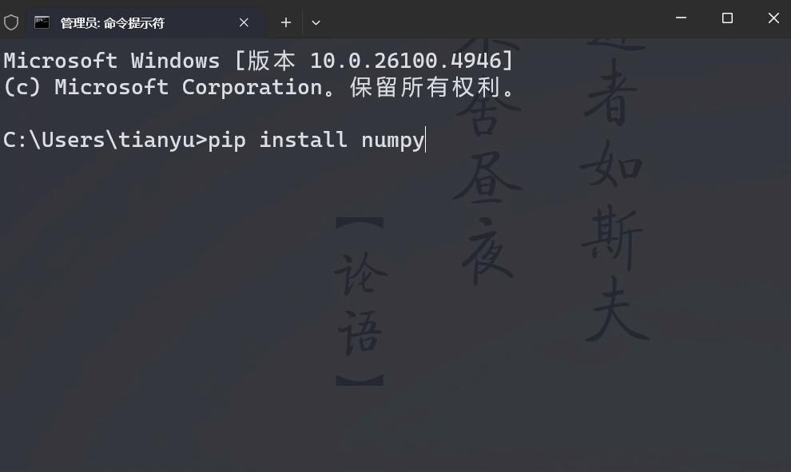

思考：numpy 安装到哪里去了呢？————全局环境

#### 4 全局环境 vs 虚拟环境

什么是环境？——所谓环境就是指：python 解释器 + 依赖包。
 Python 环境分类两种，分别是全局环境（系统环境）、虚拟环境。
所有项目共用全局环境容易互相影响和干扰，虚拟环境可以解决这个问题，二者结构如下图：
1. 图中的 Python 安装目录中的文件，构成了全局环境（系统环境）。
图中的.venv 中的文件构成了虚拟环境。
2.
虚拟环境有自己独立的一套：Python 解释器、pip 命令、第三方依赖包，不和其它项目
3.
产生干扰。
虚拟环境和全局环境共用的东西，只有标准库。
4.

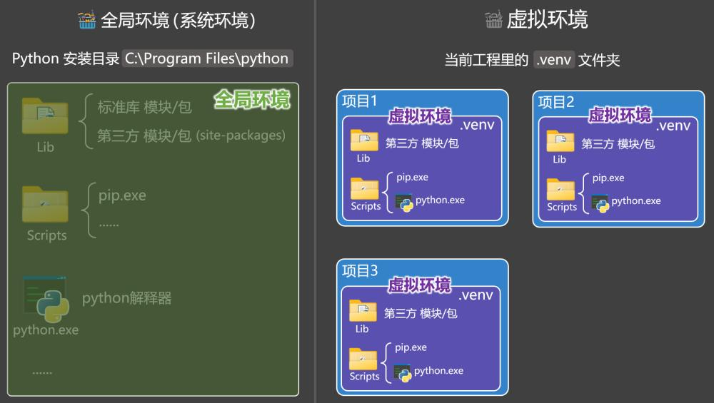

在 cmd 中不做任何处理，直接通过 pip 安装的包，都是安装在了全局环境中，如果想在虚拟环
境中安装包，需要切到虚拟环境目录后，通过 activate 命令切换到虚拟环境。
备注：使用 deactivate 可以退出虚拟环境。

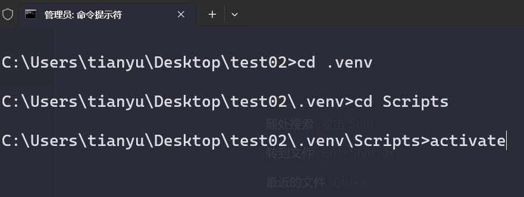


## 3. 创建全局环境项目

通过 Pycharm 创建项目时，进行如下配置，即可创建全局环境：

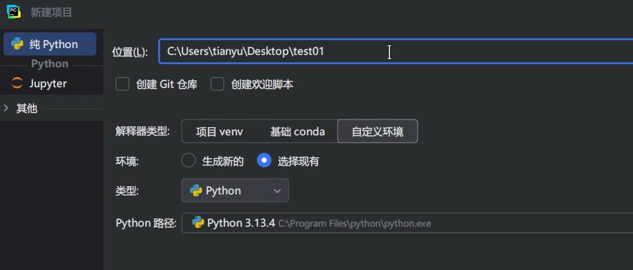

在全局环境中安装好这两个包：numpy、pyfiglet，随后进行测试：

```python
# 使用全局的标准库
from collections import Counter
list1 = [10, 20, 30, 40, 20, 30, 20, 30, 10, 10, 10]
res = Counter(list1)
print(res)
```

结论：基于全局环境的项目，可以使用：全局环境中的第三方包，也可以使用全局的标准库。

## 4. 创建虚拟环境项目

通过 Pycharm 创建项目时，进行如下配置，即可创建虚拟环境：

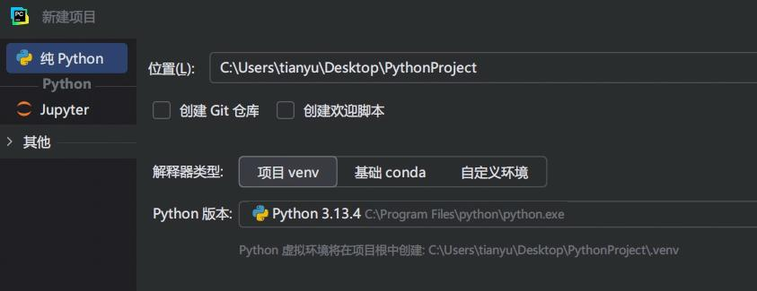

给虚拟环境安装第三方包的方式有三种：
1 通过 cmd 安装
先切换到虚拟环境

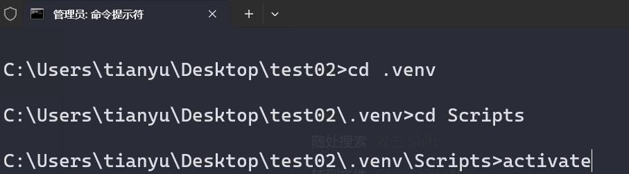

随后会切换到虚拟环境

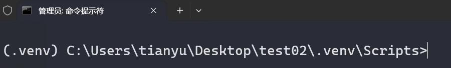

随后安装自己想要的包（例如：faker）

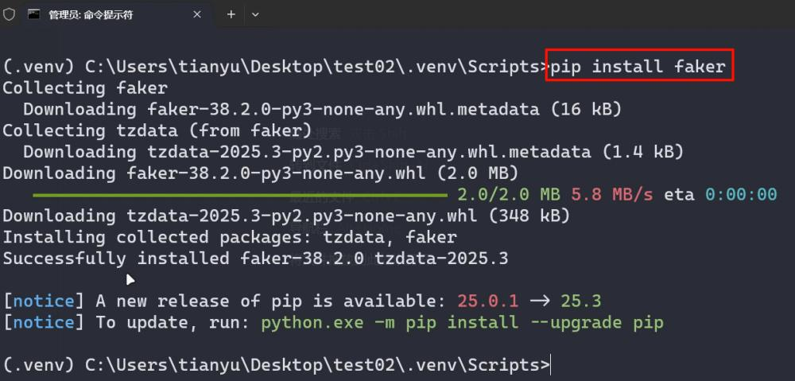

2 通过 Pycharm 中的命令行窗口安装
在 Pycharm 中打开命令行，会自动激活当前目录的虚拟环境

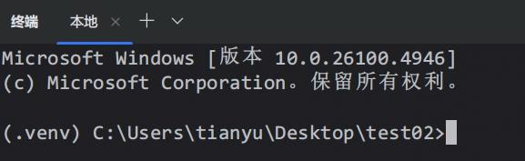

随后安装自己想要的包（例如：jieba）

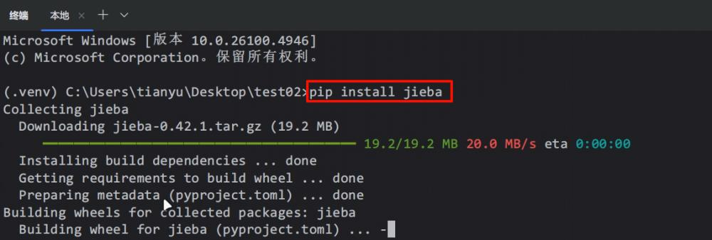

3 通过 Pycharm 提供的可视化工具安装
点击 Pycharm 右下角，随后选择解析器设置

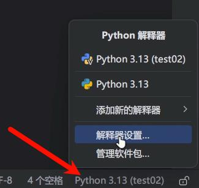

随后点击加号

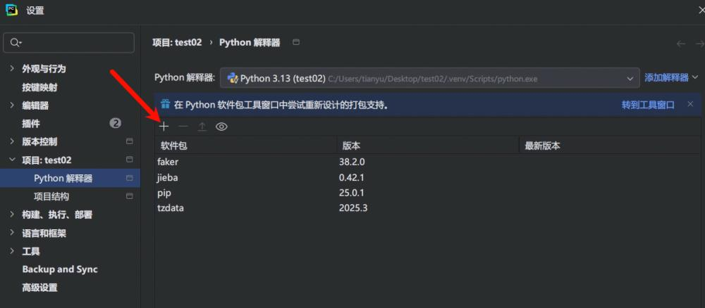

在搜索框里输入自己想安装的包（例如：cn2an），随后点击安装即可

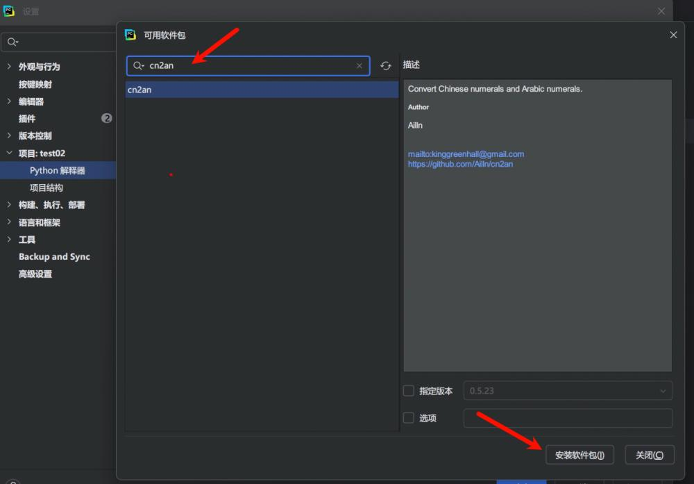

测试使用虚拟环境的第三方包

```python
# 使用全局的标准库
from collections import Counter
list1 = [10, 20, 30, 40, 20, 30, 20, 30, 10, 10, 10]
res = Counter(list1)
print(res)
```

结论：基于虚拟环境的项目，可以使用：虚拟环境中的第三方包，也可以使用全局的标准库。
