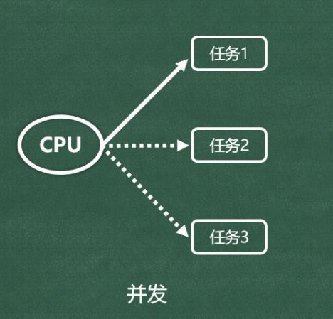
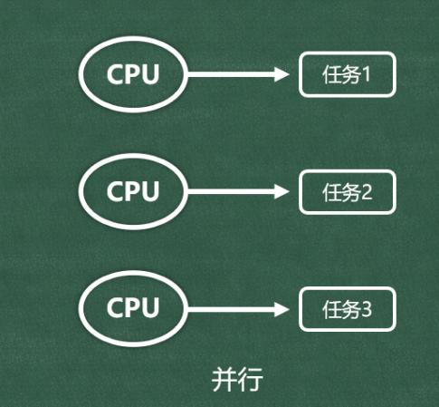
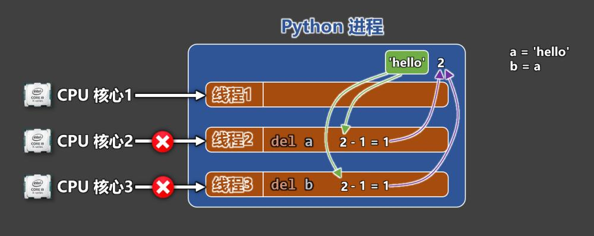
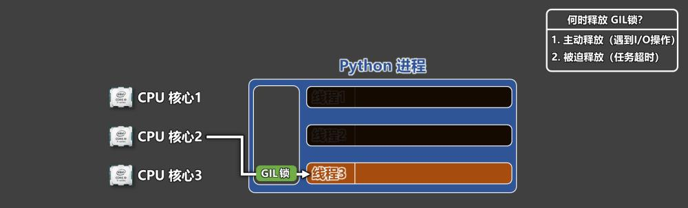
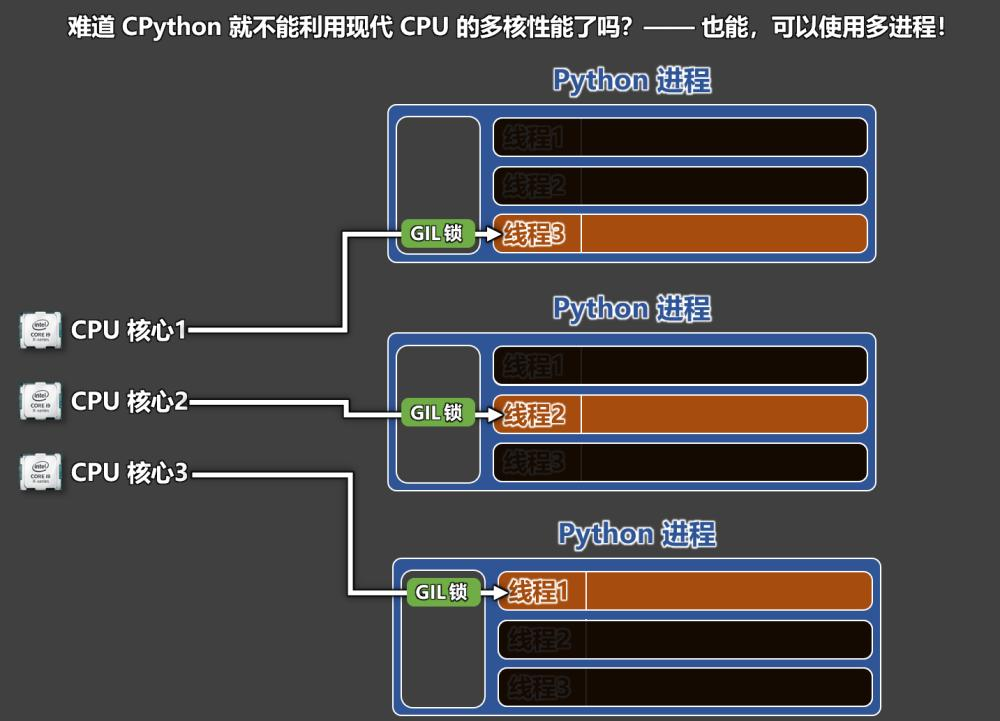
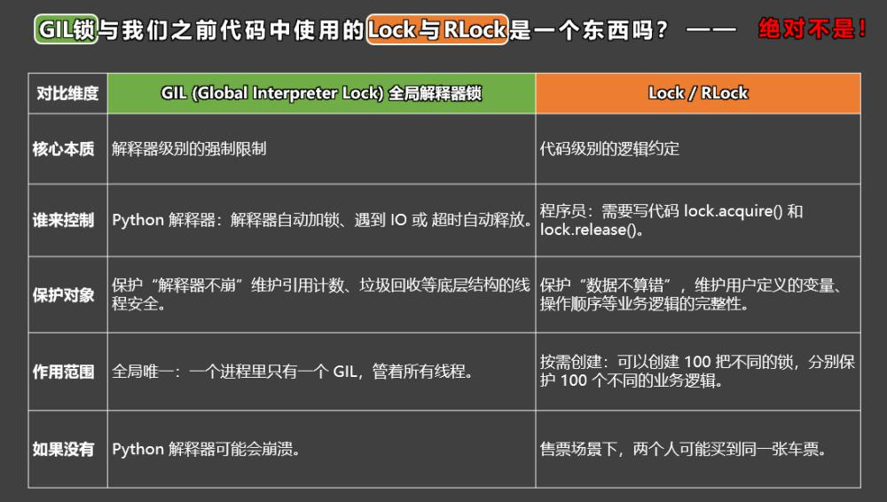

# 进程与线程

辨析进程、线程与并发概念，实践多进程、多线程、进程池与线程池，理解 GIL 与进程间通信。

<!-- more -->


## 1. 一些核心概念


### 1 并发 vs 并行

并发：
1.
概念：在一段时间内，当 CPU 面对多个任务时，会将每个任务交替着执行一段时间。
特点：
(1). 对于某个瞬间，CPU 实际上只在执行一个任务。
(2). CPU 通过高频切换不同的任务，让每个任务都能得到推进，仿佛多个任务在同时执
“
行。
”
并行：
2.
概念：并行依赖于多个 CPU，或多核心的 CPU，在同一时刻，每个核心都在执行不同的任务
特点：
(1). 对于某个瞬间，每个 CPU（或每个核心）都在执行不同的任务。
(2). 通过多个 CPU（或多个核心）同时工作的方式，让多个任务真的在同时执行。






注意：现代操作系统中，并发与并行通常同时存在。

### 2 同步 vs 异步

同步(sync)：
1.
概念：发起一个任务之后，需要等该任务完成后，才能继续执行后续任务。
表现：当前执行流会被『阻塞』。
2. 异步(async)：
概念：发起一个任务之后，不必等该任务完成，就可以继续执行其他任务。
备注：虽然不必等待任务完成，但任务完成后，仍然可以通过特定方式获取结果。
表现：当前执行流不会被『阻塞』。
概念对比：
并发 / 并行：描述的是任务如何被执行，即：多个任务在执行时，CPU 要如何处理。
同步 / 异步：描述的是任务如何被组织和等待，即：是否等当前任务执行完，再进行下
一个任务。
注意点：
⚠
CPU 的核心数和执行速度，不会改变任务之间的逻辑依赖关系！例如：一旦任务 1、任务 2、
任务 3 之间被设计为同步关系，那么：即便 CPU 切换任务的速度再快，核心数量再多，也不
会在【任务 1】没完成的情况下去启动【任务 2】

### 3 进程 vs 线程

进程：
1.
一个正在运行的程序或软件，背后就对应着一个或多个进程。
进程是操作系统进行资源分配的基本单位。
每个进程都有自己独立的一块内存空间。
线程：
2.
线程是进程内部的执行单元（一个进程中可以有多个线程）。
线程是操作系统进行 CPU 调度的基本单位。
同一进程内的线程共享进程资源。

## 2. 主进程 _ 子进程

在操作系统中，每个进程都会对应一个进程编号（PID），并且主进程与子进程是一个相对的
概念，比如 A 进程中创建了 B 进程，B 进程中创建了 C 进程，那此时的 B 进程既是 A 进
程的子进程，又是 C 进程的（主）父进程
Python 中查看进程 PID：
os.getpid(): 获取当前进程 ID。

 os.getppid(): 获取父进程 ID。
Windows 命令查看：进程名、父进程 PID、进程 PID：
wmic process get Name,ParentProcessId,ProcessId 。


## 3. 使用 Process 创建进程

使用 multiprocessing.Process 类创建进程对象。

```python
  print(f'我在说话{index}, 进程pid是:{os.getpid()}, 我的父进程是:{os.getppid()}')
  time.sleep(1)
# 定义一个 study 函数，功能是：每隔一秒学习一次（一共学习 15次）
def study():
 for index in range(15):
  print(f'我在学习{index}, 进程pid是:{os.getpid()}, 我的父进程是:{os.getppid()}')
  time.sleep(1)
# 注意：一定要写 if __name__ == '__main__' 这个判断，原因如下：
# 1.当创建子进程时，Python 并不会把父进程内存里的 speak 函数直接交给子进程。
# 2.Python会启动一个全新的 Python 解释器进程，重新执行当前的 .py 文件（作为模块）。
# 3.在执行过程中，重新定义出一个 speak 函数，交给子进程。
if __name__ == '__main__':
 print('我是主进程中的【第一行】打印')
 # 创建两个 Process 类的实例对象（进程对象），分别是 p1 和 p2。
 # 注意点1：p1 和 p2 就对应着以后的两个子进程，在创建它们的时候，就要指定好他们要执行
的任务。
 # 注意点2：此时的 p1 和 p2 只是代码层面的两个进程对象，操作系统还没有创建 p1 和 p2 两
个进程。
 p1 = Process(target=speak)
 p2 = Process(target=study)
 # 调用进程对象的 start 方法，会立刻向操作系统申请一个进程，并且会将该进程交由操作系统
进行调度。
 p1.start()
 p2.start()
 print('我是主进程中的【最后一行】打印')
```

⚠注意点：
在 Windows 中使用 multiprocessing 必须加上 if __name__ == '__main__':，原因是：创
建子进程时，Python 不会直接拷贝内存里的函数给子进程。Python 会启动一个全新的解释
器，重新执行当前的.py 文件作为模块。如果不加判断，会无限递归创建子进程。

## 4. 关于 Process 的参数

在实例化 Process 时，可以传递以下参数：
group：默认值为 None（应当始终为 None）。
target：子进程要执行的可调用对象，默认值为 None。
name：进程名称，默认为 None ，如果设置为 None，Python 会自动分配名字。
args：给 target 传的位置参数（元组）
kwargs：给 target 传的关键字参数（字典）。
daemon：标记进程是否为守护进程，取值为布尔值（默认为 None，表示从创建方继
承）。
备注：可以使用 current_process().name 获取当前进程的名字。

```python
 p2 = Process(target=study)
 # print(p1.name)
 # print(p2.name)
 p1.start()
 p2.start()
 print('我是主进程中的【最后一行】打印')
```


## 5. 进程控制


### 1 Lock（进程锁）

为了防止多个进程同时打印或操作同一资源导致数据错乱，可以使用 Lock。
传统用法：

```text
lock.acquire() # 上锁
# ... 临界区代码 ...
lock.release() # 释放锁
```

上下文管理器用法 (推荐)：

```text
with lock:
 # 自动上锁，退出块时自动释放
 # 好处：即便发生异常也能保证释放锁，避免死锁
```

示例代码：

```python
待
  lock.acquire()
  print('好好', end='')
  print('学习', end='')
  print('天天', end='')
  print('向上')
  # 释放锁：acquire 和 release 必须成对出现，否则会永远卡住（死等）
  lock.release()
  time.sleep(1)
def study(lock):
 for index in range(15):
  # with lock: 会自动完成两件事：
  # (1).进入前：自动执行 lock.acquire() 上锁
  # (2).离开后：自动执行 lock.release() 释放锁
  # 好处：即便代码块里发生异常，也能保证释放锁，避免卡死
               “”
  with lock:
   print('A', end='')
   print('B', end='')
   print('C', end='')
   print('D')
  time.sleep(1)
if __name__ == '__main__':
 print('我是主进程中的【第一行】打印')
 lock = Lock()
 p1 = Process(target=speak, args=(lock,))
 p2 = Process(target=study, args=(lock,))
 p1.start()
 p2.start()
 print('我是主进程中的【最后一行】打印')
```

传统 Lock 在面对多次上锁时，会产生死锁状态，解决办法是使用 RLock，示例代码：

### 2 join 方法

作用：阻塞当前进程（通常是主进程），直到调用 join 的那个进程执行完毕。

参数：join(timeout)，timeout 为超时时间（秒）。如果时间到了进程还没结束，主进
程就不等了，会继续执行。
注意：join 必须在 start() 之后调用。

```python
 # 让主进程等 p1 5秒钟
 p1.join(5)
 p2.start()
 # p1.join() # 让主进程等 p1 进程执行完毕后，主进程再继续执行。
 # p2.join() # 让主进程等 p2 进程执行完毕后，主进程再继续执行。
 print('我是主进程中的【最后一行】打印')
```


### 3 terminate 方法

作用：向操作系统申请强制终止进程。

注意：使用 terminate 终止进程，不会执行 finally 代码块。
辅助方法：is_alive() 可用于查看进程是否还活着。
“”

```python
if __name__ == '__main__':
 print('我是主进程中的【第一行】打印')
 p1 = Process(target=speak)
 p2 = Process(target=study)
 p1.start()
 p2.start()
 time.sleep(3)
 print('我是主进程，我准备强制终止p1进程........')
 # 向操作系统申请强制终止p1进程
 p1.terminate()
 # 等操作系统彻底终止掉了p1进程
 p1.join()
 # 看一下p1进程是否活着
      “”
 print(p1.is_alive())
 print('我是主进程中的【最后一行】打印')
```


### 4 守护进程 (Daemon)

什么是守护进程？
一种“依附于主进程存在的子进程”，一旦主进程结束，它就会被自动终止。简言之：主进程
一死，守护进程必跟着死。
守护进程的使用场景：
后台监控类任务
1.
日志 / 统计 / 采样类任务
2.
3. 辅助型“陪跑任务”
注意点：
守护进程必须是子进程。
1.
主进程结束，守护进程也会随之结束。
2.
守护进程中，不允许再创建新的子进程。
3.
必须在 start 之前，start()之后，不能再设置 daemon。
4.

```python
  for index in range(10):
   file.write(f'尚硅谷{index}\n')
   file.flush()
   time.sleep(1)
 print(f'我是主进程({os.getpid()})中的【最后一行】代码')
```


## 6. 进程之间不共享变量

进程之间不共享内存，因此也就不共享任何变量。验证代码如下：
验证代码 1：

```python
 p1.start()
 p2.start()
 p1.join()
 p2.join()
 print('主进程中的【最后一行】代码', num, names)
```

验证代码 2：

```python
 print('主进程中的【最后一行】代码', num, names)
```

注意：
我们正常编写的变量，在多个进程之间是不共享的，但有些对象是天然被多个进程共享的，比
如：我们之前讲过的 Lock 和 RLock，我们后面还会学习到很多天然被多个进程锁共享的对
象，例如：multiprocessing.Queue

## 7. Queue（队列）

我们之前学过 list、tuple、dict，它们的特点是：数据想怎么拿数据，就怎么拿。
队列(Queue)是：一种先进先出的数据结构（先放进去的数据，一定会先取出来）。
“”
队列的常见操作如下：

```python
q2.put(400, timeout=3)
print('放入完毕')
# (3).put_nowait 方法，会直接向队列中添加元素，不会进入等待模式，若队列已满，会抛出异常。
# 备注：put_nowait 等价于 put(元素, block=False)，block的默认值为 True
q2.put_nowait(400)
q2.put(400, block=False)
# get读多了，也会进入等待模式
q2.get()
q2.get()
q2.get()
# (1).当队列已空，继续 get，就会进入等待模式。x
q2.get()
# (2).当队列已空，执行 get(timeout=秒数)，就会等待指定秒数。
q2.get(timeout=3)
# (3).get_nowait 方法，会直接读取队列中的元素，不会进入等待模式，若队列已空，会抛出异常
# 备注：get_nowait 等价于 get(block=False)
q2.get_nowait()
q2.get(block=False)
```

通过多进程演示：当队列满了以后，再次 put 会等待，当有人从队列中取出元素后，put 会继
续。

```python
if __name__ == '__main__':
 # 创建一个队列，让其最多能保存2个元素
 q = Queue(2)
 # put两次，把队列填满
 q.put('尚硅谷')
 q.put('atguigu')
 print(f'队列是否已满：{q.full()}')
 # 创建子进程p1
 p1 = Process(target=test, args=(q, ))
 # 开启子进程p1，让其3秒钟后，从队列中取出一个元素
 p1.start()
 print('即将向已满的队列中添加一个元素........')
 q.put('hello')
 print('目前队列中有的元素是：')
 print(q.get())
 print(q.get())
```


## 8. 使用 Queue 实现进程通信

进程之间是不共享数据的，那如果进程之间如何进行数据沟通（进程通信）呢？手段多种多
样，我们本小节给大家说通过 Queue 实现进程通信。
核心思想：一个进程负责生产数据，另一个进程负责消费数据，中间通过 Queue 进行传话
“”

```python
  time.sleep(0.5)
# 子进程2：从队列里取数据
def test2(q):
 for index in range(5):
  data = q.get()
  print(f'【test2】取出数据：{data}')
  time.sleep(1)
if __name__ == '__main__':
 q = Queue()
 p1 = Process(target=test1, args=(q,))
 p2 = Process(target=test2, args=(q,))
 p1.start()
 p2.start()
 p1.join()
 p2.join()
```

备注：q 是在主进程中创建的，但可以被子进程使用，因为 multiprocessing.Queue 是跨进
程的。
为什么数据不会乱掉？因为队列是先进先出的。
——

## 9. 使用 Pipe 实现进程通信

Pipe 就像一根水管，一头负责发送，另一头负责接收。
“”
1 创建管道

```text
# 单向 Pipe 的规则：con1只能发送，con2只能接收。
```

2 发送与接收
 send 方法：向管道中发送数据。
recv 方法：从管道中接收数据。

3 测试代码：

## 10. 继承 Process 类创建进程

当子进程逻辑比较复杂，或者想把「进程 + 行为」封装成一个整体时，可以使用继承
Process 类的方式去创建进程，这种方式属于“面向对象风格”
1 核心要点：
必须继承 Process 类

把子进程要干的事，写进 run() 方法里
依然使用 start 方法启动进程，不要手动调用 run()！
若子进程不需要参数，可以不写__init__，若需要参数，则需编写__init__

传给的子进程的参数，作为实例属性保存。
2 示例代码：

```python
   print(f'我在学习{index}, 进程pid是:{os.getpid()}, 我的父进程
是:{os.getppid()}')
   time.sleep(1)
if __name__ == '__main__':
 print('我是主进程中的【第一行】打印')
 p1 = SpeakProcess(100, 200)
 p2 = StudyProcess()
 p1.start()
 p2.start()
 p1.join()
 p2.join()
 print('我是主进程中的【最后一行】打印')
```


## 11. 进程池（ProcessPoolExecutor）

截至目前，我们已经学会了创建多个进程一起工作，但是我们仍然面临一个问题：如果每来一
个任务就创建一个进程，会很浪费系统资源，因为进程创建 / 销毁成本很高，当有大量任务
时，系统资源浪费严重。
使用进程池的优势：如何使用进程池统一管理多个子进程，避免频繁创建 / 销毁进程带来的
开销，因为进程池会提前创建固定数量的进程，反复使用它们来执行任务。
1 创建『进程池执行器』、使用 submit 方法提交任务、使用 shutdown 方法等待任务完
成。

```python
 # 创建一个进程池执行器
 executor = ProcessPoolExecutor(3)
 # 使用 submit 方法提交任务（submit 只负责提交任务，不会阻塞主进程）
           “”
 executor.submit(work, 1)
 executor.submit(work, 2)
 executor.submit(work, 3)
 executor.submit(work, 4)
 executor.submit(work, 5)
 executor.submit(work, 6)
 executor.submit(work, 7)
 # shutdown 的作用：不再接收新的任务。
 # wait=True 的作用：阻塞主进程，等待进程池中所有任务执行完毕。
 executor.shutdown(wait=True)
 print('---------end-------------')
```

2 获取子进程执行后的返回结果（Future 类的实例对象 + result 方法）

```python
 # 阻塞主进程，等待进程池中所有任务执行完毕。
 executor.shutdown(wait=True)
 # print(f1.result())
 # print(f2.result())
 # print(f3.result())
 # print(f4.result())
 # print(f5.result())
 # print(f6.result())
 # print(f7.result())
 for f in futures:
  print(f.result())
 print('---------end-------------')
```

3 使用 as_completed：按完成顺序获取结果
“”

```python
  result_list.append(f.result())
 # 阻塞主进程，等待进程池中所有任务执行完毕。
 executor.shutdown(wait=True)
 # 打印最终的结
 print(result_list)
 print('---------end-------------')
```

4 使用 add_done_callback 方法，为任务添加完成时的回调函数。

```python
 print(result_list)
 print('---------end-------------')
```

5 使用 map 方法批量提交任务（注意：map 方法本身不阻塞，但读取其返回的生成器对象是
阻塞的，并且得到结果的顺序，与任务分配的顺序是一致的）
map 方法会把这一批任务提交到进程池里执行，它会立刻返回一个生成器，真正的阻塞发生
在：生成器取结果时，如 list(result)

```python
def work(n):
 print(f'work正在执行任务{n}.........{os.getpid()}')
 if n == 1:
  time.sleep(15)
 elif n == 2:
  time.sleep(10)
 else:
  time.sleep(1)
 return f'我是任务{n}的结果'
if __name__ == '__main__':
 print('---------start-------------')
 # 创建一个进程池执行器
 executor = ProcessPoolExecutor(3)
 # 通过 map 方法批量提交任务（结果按照提交的顺序来）
 results = executor.map(work, [1, 2, 3, 4, 5, 6, 7])
 # 获取 results 生成器中的内容
 print(list(results))
 # 等所有任务都完成
 executor.shutdown(wait=True)
 print('---------end-------------')
```

6 使用 with：进程池的自动回收写法，离开 with 代码块时自动执行
“”
shutdown(wait=True)

```python
def work(n):
 print(f'work正在执行任务{n}.........{os.getpid()}')
 if n == 1:
  time.sleep(15)
 elif n == 2:
  time.sleep(10)
 else:
  time.sleep(1)
 return f'我是任务{n}的结果'
if __name__ == '__main__':
 print('---------start-------------')
 # 创建一个进程池执行器
 with ProcessPoolExecutor(3) as executor:
  # 通过 map 方法批量提交任务（结果按照提交的顺序来）
  results = executor.map(work, [1, 2, 3, 4, 5, 6, 7])
  # 获取 results 生成器中的内容
  print(list(results))
 print('---------end-------------')
```


## 12. 使用 Thread 创建线程

首先我们要明确一个概念：任何一个正在运行的 Python 程序，至少都有一个线程！
1 回顾一下我们之前的代码：

```python
if __name__ == '__main__':
 print('主进程中的代码')
```

对于上述代码来说：print('主进程中的代码') 确实属于主进程，但更准确地说，是运行在主
进程里的主线程中。
2 线程是进程中的执行单位：
一个进程里，至少有一个线程（主线程）
一个进程里，也可以有多个线程

多个线程之间会：共享进程的内存空间、但执行顺序由操作系统调度。
3 示例代码：

```python
 t1.start()
 t2.start()
 # 让主线程等 t1和 t2 线程执行完毕后，主线程再继续执行。
 t1.join()
 t2.join()
 print('-------end-------')
```


## 13. 继承 Thread 创建线程

和继承 Process 创建进程一样，我们也可以继承 Thread 创建线程。

```python
    print(f'我在学习{index}, 进程 pid是:{os.getpid()}, 线程编
号:{get_native_id()}')
   time.sleep(1)
if __name__ == '__main__':
 print(f'-------start------- 进程 pid是:{os.getpid()}, 线程编号:{get_native_id()}')
 lock = RLock()
 # 继承 Thread 类创建线程对象
 t1 = SpeakThread(lock)
 t2 = StudyThread(lock)
 # 调用线程对象的 start 方法，会立刻将该线程交由操作系统进行调度。
 t1.start()
 t2.start()
 # 让主线程等 t1和 t2 线程执行完毕后，主线程再继续执行。
 t1.join()
 t2.join()
 print('-------end-------')
```


## 14. 线程池

线程池的具体语法，以及各个方法的作用，都和进程池一样
1 创建『线程池执行器』、使用 submit 方法提交任务、使用 shutdown 方法等待任务完
成。

```python
 lock = RLock()
 # 使用 submit 方法提交任务（submit 只负责提交任务，不会阻塞主线程）
           “”
 executor.submit(work, 1, lock)
 executor.submit(work, 2, lock)
 executor.submit(work, 3, lock)
 executor.submit(work, 4, lock)
 executor.submit(work, 5, lock)
 executor.submit(work, 6, lock)
 executor.submit(work, 7, lock)
 # shutdown 的作用：不再接收新的任务。
 # wait=True 的作用：阻塞主线程，等待线程池中所有任务执行完毕。
 executor.shutdown(wait=True)
 print('---------end-------------')
```

2 获取子线程执行后的返回结果（Future 类的实例对象 + result 方法）

```python
 print('---------end-------------')
```

3 使用 as_completed：按“完成顺序”获取结果
4 使用 add_done_callback 方法，为任务添加完成时的回调函数
5 使用 map 方法批量提交任务（注意：map 方法本身不阻塞，但读取其返回的生成器对象是
阻塞的，并且得到结果的顺序，与任务分配的顺序是一致的）
map 方法会把这一批任务提交到线程池里执行，它会立刻返回一个生成器，真正的阻塞发生
在：生成器取结果时，如 list(result)

```python
def work(n, lock):
 with lock:
  print(f'work正在执行任务{n}.........{get_native_id()}')
 if n == 1:
  time.sleep(15)
 elif n == 2:
  time.sleep(10)
 else:
  time.sleep(1)
 return f'任务{n}的结果'
if __name__ == '__main__':
 print('---------start-------------')
 # 创建一个线程池执行器
 executor = ThreadPoolExecutor(3)
 # 创建线程锁
 lock = RLock()
 # 使用map方法批量提交任务
 result = executor.map(work, [1, 2, 3, 4, 5, 6, 7], [lock]*7)
 # 打印最终的结果
 print(list(result))
 # 阻塞主线程，等待线程池中所有任务执行完毕。
 executor.shutdown(wait=True)
 print('---------end-------------')
```

6 使用 with：线程池的自动回收写法，离开 with 代码块时自动执行
“”
shutdown(wait=True)

```python
def work(n, lock):
 with lock:
  print(f'work正在执行任务{n}.........{get_native_id()}')
 if n == 1:
  time.sleep(15)
 elif n == 2:
  time.sleep(10)
 else:
  time.sleep(1)
 return f'任务{n}的结果'
if __name__ == '__main__':
 print('---------start-------------')
 with ThreadPoolExecutor(3) as executor:
  # 创建线程锁
  lock = RLock()
  # 使用map方法批量提交任务
  result = executor.map(work, [1, 2, 3, 4, 5, 6, 7], [lock]*7)
  # 打印最终的结果
  print(list(result))
 print('---------end-------------')
```


## 15. GIL 全局解释器锁

概念： GIL 锁是 CPython 解释器中的一把互斥锁。
作用：无论 CPU 有多少个核心，在某一时刻，只允许同一个进程中的一个线程去执行 Python
代码。
结论：CPython 解释器中的多线程模型，本质上是并发，而不是并行！（是快速切换，而不是
同时进行）
为何要这样设计？————为了确保解释器级别的数据安全。
如果没有 GIL 锁，那么 Python 底层就可能会出现引用计数错误，导致内存爆炸。
“”



GIl 锁何时会被释放？主动释放（遇到 I/O 操作）、被迫释放（任务超时）
——



可以使用多进程来发挥多核 CPU 的性能



GIL 对比 lock/Rlock：



结论：GIL 为了确保 Cpython 解释器级别的数据安全，作为日常编码来说，我们对 GIL 是无
感的，但对于 Lock/Rlock 是实际编码中使用较多的，Lock/Rlock 是为了确保业务路基的完
整，例如：

```python
 while True:
  with lock:
   if current <= 20:
    print(f'{current_thread().name}出售了第{current}张票！')
    current += 1
   else:
    print('票已售空')
    break
  time.sleep(0.3)
if __name__ == '__main__':
 lock = RLock()
 t1 = Thread(target=sale, name='窗口 1', args=(lock,))
 t2 = Thread(target=sale, name='窗口 2', args=(lock,))
 t3 = Thread(target=sale, name='窗口 3', args=(lock,))
 t1.start()
 t2.start()
 t3.start()
```


## 16. 多进程 vs 多线程，该如何选择？


CPU 密集型任务，更适合用多进程。

```python
 total = 0
 for i in range(10000000):
  total += i * i
 return total
if __name__ == '_main_':
 print('===== 多进程完成【CPU密集型任务】=====')
 start = time.time()
 #开启四个进程进行计算
 with ProcessPoolExecutor(4) as executor:
  list(executor.map(cpu_task, [1, 2, 3, 4]))
 end = time.time() - start
 print(f'多进程总耗时：{end}秒')
 # print('===== 多线程完成【CPU密集型任务】=====')
 # start = time.time()
 # # 开启四个线程进行计算
 # with ThreadPoolExecutor(max_workers=4) as executor:
 # results = list(executor.map(cpu_task, [1, 2, 3, 4]))
 # end = time.time() - start
 # print(f'多线程总耗时：{end}秒')
```

IO 密集型任务，更适合用多线程。
