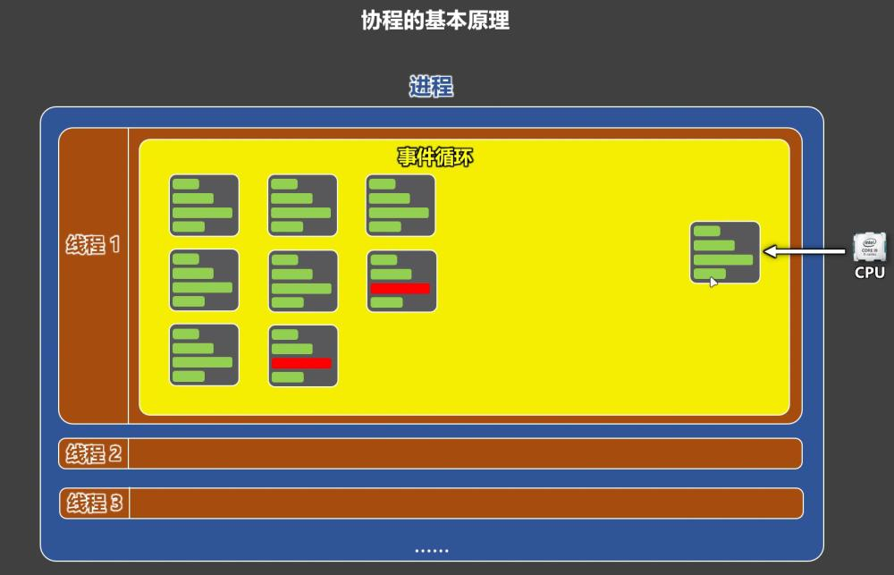

# 协程

认识协程与 async/await 语法，学习多个任务的同步与异步执行、asyncio.gather 及图片下载案例。

<!-- more -->


```python
   dst.write(data)
if __name__ == '__main__':
 # print('===== 使用多进程完成【IO密集型任务】 =====')
 # start = time.time()
 # with ProcessPoolExecutor(4) as executor:
 # for i in range(4):
 # executor.submit(copy_file, i)
 # end = time.time() - start
 # print(f'多进程耗时：{end} 秒')
 print('===== 使用多线程完成【IO密集型任务】 =====')
 start = time.time()
 with ThreadPoolExecutor(4) as executor:
  for i in range(4):
   executor.submit(copy_file, i)
 end = time.time() - start
 print(f'多线程耗时：{end} 秒')
```


## 1. 什么是协程

概念：协程（Coroutine），是一种线程内部的任务调度机制，它通过事件循环，在用户态中
实现任务的挂起与恢复执行，从而在遇到 IO 操作时，不让 CPU 等待，而是继续执行其它需
要 CPU 的任务。
协程的本质就是：在一个线程里，趁着某些任务在等 IO，把 CPU 交给其它任务去用。



关键点 1 ：协程不是线程，也不是进程
协程不是操作系统提供的，并且 CPU 看不见协程。
操作系统不知道协程的存在。
协程是程序员在用户态，用代码设计出来的任务切换机制。
“”
关键点 2 ：协程发生在一个线程内部
协程不是线程之间的切换。
而是线程内部多个任务之间的切换。

本质是一个线程里，写了很多任务，由事件循环统一调度。
关键点 3 ：协程的核心能力：挂起与恢复
当任务遇到 IO 操作时：任务会被挂起。

当 IO 操作完成后：任务会被恢复执行。
关键点 4 ：协程依赖一个关键角色：事件循环
事件循环负责：调度任务、判断是否该挂起、决定何时恢复执行，事件循环是协程系统的

大脑
“”
关键点 5 ：协程的目标是尽量减少线程切换
在单线程场景下，最大化 CPU 利用率，特别适合 IO 密集型任务

## 2. 协程函数 vs 协程对象

协程函数(coroutine Function)：使用『async 关键字』修饰的函数，就是协程函数。
协程对象(coroutine Object)：调用『协程函数』，就会得到『协程对象』。
注意：调用『协程函数』，并不会执行『协程函数』中的代码。

```python
# 定义一个协程函数
async def work():
 print('work开始')
 print('work执行中......')
 print('work结束')
 return '工作结果'
# 调用协程函数，会得到协程对象
coroutine_object = work()
```

将协程对象交给 asyncio.run()，asyncio.run()会将协程对象包装成一个任务交给事件循
环。

## 3. await 关键字

await 关键有三个作用：
挂起：await 会暂停当前协程的执行。
1.
等待：遇到 await 关键字，事件循环会立即安排 await 后面的对象去执行，并等待该对
2.
象执行完成，并且可以拿到执行结果。
关键点：在执行 await 后面的对象时，会出现两种情况:
情况一：如果在执行该对象中的代码时，遇到了【await I/O 操作】（需要等待外部资源
返回结果的操作）例如：网络请求、文件读写等，那 CPU 的控制权就会交给事件循环。
事件循环会去调度循环中的其他任务（如果有的话）。
情况二：如果该对象中的代码，不包含任何【await I/O 操作】。例如：print 打印、数

学计算、逻辑计算等。此时事件循环拿不到 CPU 控制权，无法调度循环中的其他任务，
不会发生任务切换。
3. 恢复：当 await 后的对象执行完毕，事件循环会恢复之前被挂起的协程，该协程会从当
时挂起的位置继续执行，并拿到返回值。
注意：await 后面只能写『可等待对象』，常见可等待对象有：协程对象、Future 对象、
Task 对象。

```python
async def main():
 print('main开始')
 # await去等待一个协程对象（靠自己去编写协程函数，随后调用该函数来得到协程对象）
 res = await work()
 print(res)
 print('main结束')
 return 'main的返回值'
result = asyncio.run(main())
print(result)
```


## 4. 多个任务同步执行

使用 await 实现多个任务同步执行

```python
 coroutine3 = work(3, 2)
 # 此处会等待coroutine1执行完成
 res1 = await coroutine1
 print(res1)
 # 等待上面的coroutine1完成后，再等待coroutine2完成
 res2 = await coroutine2
 print(res2)
 # 等待上面的coroutine2完成后，再等待coroutine3完成
 res3 = await coroutine3
 print(res3)
 print('main结束', time.time() - start)
 return '我是main的返回值'
# 将协程对象交给事件循环
result = asyncio.run(main())
print(result)
```


## 5. 多个任务异步执行

使用 asyncio.create_task()方法向事件循环中添加任务，从而实现多个任务异步执行。

## 6. asyncio.gather

asyncio.gather 方法可以把多个协程对象丢给事件循环，并在全部执行完后，一次性拿到所
有结果。

## 7. 下载图片案例

1 使用传统方式下载图片：
如下代码的特点：图片是一张一张下载的，当前图片没有下载完成，后一张图片的下载就不能
开始，这属于典型的同步下载。

```python
import requests
def download_picture(url):
 print(f'开始下载：{url}')
 # 发送网络请求，获取这张图片
 response = requests.get(url)
 print('下载完毕')
 # 保存图片到本地
 with open(url[-10:], 'wb') as file:
  file.write(response.content)
def main():
 url_list = [
  'https://n.sinaimg.cn/spider20260129/217/w600h417/20260129/3e26-
917ee55a8a42b8626807c332c24981de.png',
  'https://n.sinaimg.cn/finance/transform/97/w630h267/20260129/97c4-
b211cc51784830f09ee19e450475c93b.png',
  'https://n.sinaimg.cn/spider20260129/539/w1439h700/20260129/e09a-
cc2ca319e00f701ccfca3ebc62aa8772.png'
 ]
 for url in url_list:
  download_picture(url)
main()
```

2 使用协程方式下载图：
如下代码的特点：多张图片会几乎同时发起下载请求，当某一张图片在等待网络数据返回时，
其它图片的下载任务并不会被阻塞，而是可以继续执行，这属于典型的协程并发下载。
